# B2.1 — Product Domain & Data Requirements Discovery Report
## Gapji Digital Marketing Platform

---

## 1. Executive Summary

This report delivers a comprehensive, evidence-based domain discovery and data requirements analysis for the **Gapji Digital Marketing Platform**, strictly grounded in the official product specification document (`marketing-platform-phase1-frontend-pages-1.pdf`) and previously ratified architectural decisions (`docs/PROJECT-DECISIONS.md`).

### Key Discovery Metrics
- **Functional Workspaces Analyzed:** 3 main business workspaces + 1 Global/Administration space.
- **Candidate Domains Identified:** 22 core domains spanning the complete MVP customer journey.
- **Identified Domain Entities:** 32 primary and supporting entities across the platform.
- **Documented Requirements Analyzed:** Over 120 explicit page-level specifications.
- **Multi-Tenancy Model:** Strict, mandatory Organization-level data isolation for all business entities.
- **Primary Schema Gap:** The current Prisma schema (`apps/api/prisma/schema.prisma`) contains only a preliminary standalone `Campaign` model, lacking multi-tenancy (`OrganizationId`), user memberships, leads, costs, tasks, and settings.

---

## 2. Product Document References & Governance Hierarchy

The primary source of truth is the 29-page official product document: `marketing-platform-phase1-frontend-pages-1.pdf`.

### Document Taxonomy
Every finding, attribute, and rule in this report is classified using the following strict taxonomy:
- `DOCUMENTED REQUIREMENT`: An explicit requirement stated in the product document with page citation.
- `APPROVED PROJECT DECISION`: An explicitly ratified binding project decision (e.g. from `docs/PROJECT-DECISIONS.md`).
- `IMPLEMENTATION INFERENCE`: A necessary technical data model or relationship inferred to implement a documented workflow.
- `PRODUCT DECISION REQUIRED`: A business or functional ambiguity not resolved by the document, requiring Product Owner determination.
- `TECHNICAL RECOMMENDATION`: An engineering design suggestion that preserves documented behavior without altering requirements.

### Page-by-Page Product Document Map
- **Page 1:** Document Scope, Persian/RTL specifications, Jalali calendar. Explicit Phase 1 Exclusions: رشدیار (Growth Assistant), هوش مصنوعی (AI), اپلیکیشن موبایل (Mobile App), Push Notifications.
- **Page 2:** Complete Table of Contents (29 distinct product pages across 3 workspaces + settings).
- **Page 3–5:** Layout, Shared Components (DataTable, FilterBar, KpiCard, Chart, MoneyInput, PersianDatePicker), Data Display Rules (Amounts, Percentages, Dates), Status Badges.
- **Page 6–7:** General Pages (Login & Org Select, Role-specific Home Dashboard, Notification Center).
- **Page 8–14 (Workspace 1: Performance / عملکرد):** Executive Dashboard, Campaign List, Campaign Wizard (6 Steps), Campaign Details (8 Tabs), Platforms, Costs & Multi-row Entry, Data Import Wizard (4 Steps), KPIs & Alert Rules, Audience Segments, Landing Pages & UTM Builder.
- **Page 14–18 (Workspace 2: Sales & Leads / فروش و لید):** Lead Inbox, Lead Kanban Board (6 Stages), Lead Details & Customer Journey Timeline, Call Logging, SMS Tracking, Webinars & Attendees.
- **Page 18–23 (Workspace 3: Execution & Knowledge / اجرا و دانش):** Task List & Kanban Board, Calendar & Multi-day Events, Equipment Tracking, Meeting Minutes (صورتجلسات) & Action Items, SOPs & Versioning, Learning Library, Creative Ideas & Voting, Team Activity Reports.
- **Page 23–24 (Settings & Integration / تنظیمات):** Users & Access Matrix, Organization Settings & Taxonomies, WordPress Webhook & Field Mapping.
- **Page 25:** Implementation Priorities (MVP Priority 1, 2, and 3).
- **Page 26–29:** Frontend Technical Stack & Shared Contract Mappings.

---

## 3. Approved Project Decisions as Domain Constraints

The following binding decisions recorded in [`docs/PROJECT-DECISIONS.md`](file:///F:/marketing-platform-backend/docs/PROJECT-DECISIONS.md) govern the data architecture:

1. **Approved Stack:** TypeScript, NestJS, PostgreSQL, Prisma ORM.
2. **Approved Technical Roles:** Exactly 6 roles:
   - `admin` (مدیر ارشد سیستم / سازمان)
   - `marketing_manager` (مدیر مارکتینگ)
   - `campaign_manager` (کمپین‌چی)
   - `sales_agent` (کارشناس فروش)
   - `content_creator` (تولید محتوا / وبینار)
   - `client` (کارفرما - فقط‌خواندنی)
3. **Multi-Tenancy Isolation:**
   - Multi-tenant data isolation must be enforced at the database and service levels.
   - Users belong to Organizations via memberships. A user selecting an organization ID must be verified against membership.
4. **Financial Precision:**
   - Monetary inputs are integer non-negative values in Toman or Rial.
   - Database storage maintains `Decimal(12, 2)` for compatibility.
   - API JSON representations for valid monetary records are integer numbers.
   - No silent rounding or arbitrary truncation.
5. **Organization-Scoped Currency:**
   - Each organization independently configures its currency unit: Toman or Rial.
   - No platform-wide global override.
   - No automatic 10x conversion between Toman and Rial.

---

## 4. Executive Domain & Entity Inventory

The discovery process synthesized 32 domain entities grouped into 10 cohesive business domains:

| Domain | Entity Name | Type / Role | Document Citation | Classification | MVP Priority |
| :--- | :--- | :--- | :--- | :--- | :---: |
| **IAM & Tenancy** | `User` | Core Identity | p. 6, 23 | `DOCUMENTED REQUIREMENT` | **Priority 1** |
| | `Organization` | Tenant Root | p. 6, 23, 24 | `DOCUMENTED REQUIREMENT` | **Priority 1** |
| | `OrganizationMembership` | Tenancy Link & Role | p. 6, 23 | `DOCUMENTED REQUIREMENT` | **Priority 1** |
| | `Session` | Auth & Active Org Token | p. 6, 26, 27 | `IMPLEMENTATION INFERENCE` | **Priority 1** |
| **Settings** | `OrganizationTaxonomy` | Configurable Lists | p. 23, 24 | `DOCUMENTED REQUIREMENT` | **Priority 1** |
| **Campaigns** | `Campaign` | Core Marketing Asset | p. 8, 9, 10 | `DOCUMENTED REQUIREMENT` | **Priority 1** |
| | `Platform` | Channel / Tool | p. 8, 11 | `DOCUMENTED REQUIREMENT` | **Priority 2** |
| | `CampaignPlatformAllocation` | Platform Budget Row | p. 9, 10 | `DOCUMENTED REQUIREMENT` | **Priority 1** |
| | `TargetAudience` | Audience Segment | p. 9, 13, 14 | `DOCUMENTED REQUIREMENT` | **Priority 3** |
| | `LandingPage` | Destination Page | p. 9, 14 | `DOCUMENTED REQUIREMENT` | **Priority 2** |
| | `UtmLink` | Campaign Tracking Link | p. 9, 14 | `DOCUMENTED REQUIREMENT` | **Priority 2** |
| **Financials** | `Cost` | Expense Transaction | p. 8, 11, 12 | `DOCUMENTED REQUIREMENT` | **Priority 1** |
| | `CostCategory` | Expense Taxonomy | p. 23, 24 | `DOCUMENTED REQUIREMENT` | **Priority 1** |
| **Leads & CRM** | `Lead` | Sales Opportunity | p. 8, 14, 15, 16 | `DOCUMENTED REQUIREMENT` | **Priority 1** |
| | `LeadActivity` | Customer Journey Event | p. 16 | `DOCUMENTED REQUIREMENT` | **Priority 1** |
| | `LeadCall` | Phone Call Log | p. 16 | `DOCUMENTED REQUIREMENT` | **Priority 1** |
| **Messaging & Events**| `SmsCampaign` | SMS Batch Delivery | p. 10, 16, 17 | `DOCUMENTED REQUIREMENT` | **Priority 3** |
| | `Webinar` | Online Event | p. 17, 18 | `DOCUMENTED REQUIREMENT` | **Priority 3** |
| | `WebinarAttendee` | Registrant & Participant | p. 17, 18 | `DOCUMENTED REQUIREMENT` | **Priority 3** |
| **Tasks & Planning** | `Task` | Work Item & Todo | p. 8, 18, 19 | `DOCUMENTED REQUIREMENT` | **Priority 1** |
| | `TaskSubtask` | Checklist Item | p. 18 | `DOCUMENTED REQUIREMENT` | **Priority 1** |
| | `TaskComment` | Discussion Comment | p. 18 | `DOCUMENTED REQUIREMENT` | **Priority 1** |
| | `CalendarEvent` | Scheduled Event | p. 19 | `DOCUMENTED REQUIREMENT` | **Priority 2** |
| | `Equipment` | Physical/Digital Asset | p. 19, 20 | `DOCUMENTED REQUIREMENT` | **Priority 3** |
| **Knowledge & Collaboration** | `Meeting` | صورتجلسه / Minutes | p. 20 | `DOCUMENTED REQUIREMENT` | **Priority 2** |
| | `MeetingActionItem` | Converted Action Item | p. 20 | `DOCUMENTED REQUIREMENT` | **Priority 2** |
| | `Sop` | Standard Operating Proc | p. 20, 21 | `DOCUMENTED REQUIREMENT` | **Priority 2** |
| | `SopVersion` | Version History | p. 20, 21 | `DOCUMENTED REQUIREMENT` | **Priority 2** |
| | `LearningResource` | Course / Article / Video | p. 21 | `DOCUMENTED REQUIREMENT` | **Priority 3** |
| | `UserLearningProgress` | Completion Progress | p. 21 | `DOCUMENTED REQUIREMENT` | **Priority 3** |
| | `Idea` | Creative Proposal | p. 21, 22 | `DOCUMENTED REQUIREMENT` | **Priority 3** |
| | `IdeaVote` | User Vote | p. 22 | `DOCUMENTED REQUIREMENT` | **Priority 3** |
| **Metrics & Imports** | `KpiMetric` | Performance Indicator | p. 8, 13 | `DOCUMENTED REQUIREMENT` | **Priority 2** |
| | `KpiAlertRule` | Alert Threshold Rule | p. 8, 13 | `DOCUMENTED REQUIREMENT` | **Priority 2** |
| | `ImportJob` | File Import History | p. 12, 13 | `DOCUMENTED REQUIREMENT` | **Priority 1** |
| **System Operations** | `Notification` | In-App Alert | p. 7 | `DOCUMENTED REQUIREMENT` | **Priority 2** |
| | `UserActivityLog` | Audit Trail | p. 22, 23 | `DOCUMENTED REQUIREMENT` | **Priority 3** |
| | `WordpressIntegration`| Webhook / API Config | p. 24 | `DOCUMENTED REQUIREMENT` | **Priority 2** |

---

## 5. Entity-by-Entity Attribute Analysis

### 5.1 Identity & Access Management (IAM)

#### Entity: `User`
- **Purpose:** Central authentication identity and personal profile across organizations.
- **Source:** Page 6 (§1), Page 23 (§27).
- **Classification:** `DOCUMENTED REQUIREMENT`.

| Attribute | Type Proposal | Required? | Description | Classification & Source |
| :--- | :--- | :---: | :--- | :--- |
| `id` | UUID | Yes | Primary Key | `IMPLEMENTATION INFERENCE` |
| `email` | String(255) | Optional* | User login email (*Email or Mobile required) | `DOCUMENTED REQUIREMENT` (p. 6, 23) |
| `mobile` | String(20) | Optional* | Normalized Iranian mobile number (`0912...`) | `DOCUMENTED REQUIREMENT` (p. 5, 6, 27) |
| `passwordHash` | String(255) | Yes | Salted hashed password | `IMPLEMENTATION INFERENCE` (p. 6) |
| `fullName` | String(255) | Yes | User display name | `DOCUMENTED REQUIREMENT` (p. 6, 23) |
| `avatarUrl` | String(500) | No | Profile image URL or initials fallback | `DOCUMENTED REQUIREMENT` (p. 4, 23) |
| `isActive` | Boolean | Yes | Account active status (default: true) | `DOCUMENTED REQUIREMENT` (p. 23) |
| `lastLoginAt` | DateTime | No | Timestamp of most recent successful login | `DOCUMENTED REQUIREMENT` (p. 23) |
| `createdAt` | DateTime | Yes | Record creation timestamp | `IMPLEMENTATION INFERENCE` |
| `updatedAt` | DateTime | Yes | Last update timestamp | `IMPLEMENTATION INFERENCE` |

#### Entity: `Organization`
- **Purpose:** Tenant isolation root. Represents a legal organization or business entity.
- **Source:** Page 6 (§1), Page 24 (§28).
- **Classification:** `DOCUMENTED REQUIREMENT`.

| Attribute | Type Proposal | Required? | Description | Classification & Source |
| :--- | :--- | :---: | :--- | :--- |
| `id` | UUID | Yes | Primary Key | `IMPLEMENTATION INFERENCE` |
| `name` | String(255) | Yes | Organization legal/brand name | `DOCUMENTED REQUIREMENT` (p. 6, 24) |
| `logoUrl` | String(500) | No | Organization logo URL | `DOCUMENTED REQUIREMENT` (p. 3, 24) |
| `currency` | Enum (`TOMAN`, `RIAL`) | Yes | Selected monetary unit (default: `TOMAN`) | `DOCUMENTED REQUIREMENT` (p. 24) & `APPROVED DECISION` |
| `timezone` | String(50) | Yes | Operating timezone (default: `Asia/Tehran`) | `DOCUMENTED REQUIREMENT` (p. 24) |
| `createdAt` | DateTime | Yes | Creation timestamp | `IMPLEMENTATION INFERENCE` |
| `updatedAt` | DateTime | Yes | Last update timestamp | `IMPLEMENTATION INFERENCE` |

#### Entity: `OrganizationMembership`
- **Purpose:** Associative join establishing user membership and authorized role within an organization.
- **Source:** Page 6 (§1), Page 23 (§27).
- **Classification:** `DOCUMENTED REQUIREMENT`.

| Attribute | Type Proposal | Required? | Description | Classification & Source |
| :--- | :--- | :---: | :--- | :--- |
| `id` | UUID | Yes | Primary Key | `IMPLEMENTATION INFERENCE` |
| `organizationId` | UUID | Yes | FK to `Organization` | `DOCUMENTED REQUIREMENT` (p. 6) |
| `userId` | UUID | Yes | FK to `User` | `DOCUMENTED REQUIREMENT` (p. 6, 23) |
| `role` | Enum (`admin`, `marketing_manager`, `campaign_manager`, `sales_agent`, `content_creator`, `client`) | Yes | Granted organization role | `DOCUMENTED REQUIREMENT` (p. 23) & `APPROVED DECISION` |
| `status` | Enum (`active`, `invited`, `inactive`) | Yes | Membership status (فعال / دعوت‌شده / غیرفعال) | `DOCUMENTED REQUIREMENT` (p. 23) |
| `invitedAt` | DateTime | No | Timestamp of invitation dispatch | `DOCUMENTED REQUIREMENT` (p. 23) |
| `joinedAt` | DateTime | No | Timestamp of invitation acceptance | `IMPLEMENTATION INFERENCE` |
| `createdAt` | DateTime | Yes | Record creation timestamp | `IMPLEMENTATION INFERENCE` |
| `updatedAt` | DateTime | Yes | Last update timestamp | `IMPLEMENTATION INFERENCE` |

---

### 5.2 Performance & Campaign Domain (Workspace 1)

#### Entity: `Campaign`
- **Purpose:** Core marketing campaign tracking budget, performance, targets, and dates.
- **Source:** Pages 8, 9, 10.
- **Classification:** `DOCUMENTED REQUIREMENT`.

| Attribute | Type Proposal | Required? | Description | Classification & Source |
| :--- | :--- | :---: | :--- | :--- |
| `id` | UUID | Yes | Primary Key | `IMPLEMENTATION INFERENCE` |
| `organizationId` | UUID | Yes | Tenant ownership boundary (FK) | `APPROVED PROJECT DECISION` |
| `name` | String(255) | Yes | Campaign name | `DOCUMENTED REQUIREMENT` (p. 9) |
| `type` | String(100) | Yes | Campaign type taxonomy (e.g. دیجیتال، محیطی، وبینار) | `DOCUMENTED REQUIREMENT` (p. 9, 23) |
| `objective` | String(100) | Yes | Strategic goal (فروش / لید / آگاهی / نصب) | `DOCUMENTED REQUIREMENT` (p. 9) |
| `channel` | String(100) | Yes | Primary communication channel | `DOCUMENTED REQUIREMENT` (p. 9) |
| `status` | Enum (`draft`, `planned`, `active`, `paused`, `completed`, `archived`) | Yes | Lifecycle status (پیش‌نویس، فعال، متوقف...) | `DOCUMENTED REQUIREMENT` (p. 5, 9) |
| `health` | Enum (`healthy`, `needs_attention`, `critical`) | Yes | Health indicator (سالم، نیازمند توجه، ضعیف) | `DOCUMENTED REQUIREMENT` (p. 5, 8) |
| `budget` | Decimal(12, 2) | Yes | Total allocated budget (Integer Toman/Rial) | `DOCUMENTED REQUIREMENT` (p. 9) & `APPROVED DECISION` |
| `spend` | Decimal(12, 2) | Yes | Actual spend to date (Calculated/Aggregated) | `DOCUMENTED REQUIREMENT` (p. 9) & `APPROVED DECISION` |
| `startDate` | Date | Yes | Scheduled start date (Jalali ISO) | `DOCUMENTED REQUIREMENT` (p. 9) |
| `endDate` | Date | Yes | Scheduled end date (Jalali ISO) | `DOCUMENTED REQUIREMENT` (p. 9) |
| `ownerId` | UUID | Yes | Assigned manager (FK to `User`) | `DOCUMENTED REQUIREMENT` (p. 9) |
| `description` | Text | No | Detailed campaign brief and notes | `DOCUMENTED REQUIREMENT` (p. 9) |
| `impressions` | Int | Yes | Total ad views (default: 0) | `IMPLEMENTATION INFERENCE` (Existing schema) |
| `clicks` | Int | Yes | Total ad clicks (default: 0) | `IMPLEMENTATION INFERENCE` (Existing schema) |
| `conversions` | Int | Yes | Total conversions (default: 0) | `IMPLEMENTATION INFERENCE` (Existing schema) |
| `createdAt` | DateTime | Yes | Creation timestamp | `IMPLEMENTATION INFERENCE` |
| `updatedAt` | DateTime | Yes | Last update timestamp | `IMPLEMENTATION INFERENCE` |

#### Entity: `CampaignPlatformAllocation`
- **Purpose:** Sub-allocation of campaign budget and volume targets to specific advertising platforms.
- **Source:** Page 9 (§6 - مرحله ۳), Page 10 (§7 - تب پلتفرم‌ها).
- **Classification:** `DOCUMENTED REQUIREMENT`.

| Attribute | Type Proposal | Required? | Description | Classification & Source |
| :--- | :--- | :---: | :--- | :--- |
| `id` | UUID | Yes | Primary Key | `IMPLEMENTATION INFERENCE` |
| `organizationId` | UUID | Yes | Tenant ownership boundary (FK) | `APPROVED PROJECT DECISION` |
| `campaignId` | UUID | Yes | FK to `Campaign` | `DOCUMENTED REQUIREMENT` (p. 9) |
| `platformId` | UUID | Yes | FK to `Platform` | `DOCUMENTED REQUIREMENT` (p. 9) |
| `allocatedBudget`| Decimal(12, 2) | Yes | Platform budget portion (Integer Toman/Rial)| `DOCUMENTED REQUIREMENT` (p. 9) |
| `targetCount` | Int | No | Target quantity (تعداد پیامک / کلیک / نمایش) | `DOCUMENTED REQUIREMENT` (p. 9) |
| `notes` | Text | No | Platform-specific instructions | `DOCUMENTED REQUIREMENT` (p. 9) |

#### Entity: `Cost` (هزینه‌ها)
- **Purpose:** Granular expenditure records attributed to campaigns, platforms, and date periods.
- **Source:** Page 8 (§4), Page 11 (§9), Page 12 (§9).
- **Classification:** `DOCUMENTED REQUIREMENT`.

| Attribute | Type Proposal | Required? | Description | Classification & Source |
| :--- | :--- | :---: | :--- | :--- |
| `id` | UUID | Yes | Primary Key | `IMPLEMENTATION INFERENCE` |
| `organizationId` | UUID | Yes | Tenant boundary (FK) | `APPROVED PROJECT DECISION` |
| `campaignId` | UUID | Yes | FK to `Campaign` | `DOCUMENTED REQUIREMENT` (p. 11, 12) |
| `platformId` | UUID | Yes | FK to `Platform` | `DOCUMENTED REQUIREMENT` (p. 11, 12) |
| `date` | Date | Yes | Expense transaction date | `DOCUMENTED REQUIREMENT` (p. 11, 12) |
| `amount` | Decimal(12, 2) | Yes | Monetary cost (Integer Toman/Rial) | `DOCUMENTED REQUIREMENT` (p. 11, 12) |
| `count` | Int | No | Volume delivered (e.g. عدد پیامک، کلیک) | `DOCUMENTED REQUIREMENT` (p. 11, 12) |
| `source` | Enum (`manual`, `import`) | Yes | Entry source (دستی / Import) | `DOCUMENTED REQUIREMENT` (p. 11, 12) |
| `createdById` | UUID | Yes | User who logged the cost (FK to `User`) | `DOCUMENTED REQUIREMENT` (p. 11) |
| `notes` | Text | No | Explanatory note | `DOCUMENTED REQUIREMENT` (p. 11, 12) |
| `createdAt` | DateTime | Yes | Record creation timestamp | `IMPLEMENTATION INFERENCE` |

---

### 5.3 Leads & Sales Domain (Workspace 2)

#### Entity: `Lead`
- **Purpose:** Prospective customer opportunity tracked through the marketing and sales pipeline.
- **Source:** Pages 8, 14, 15, 16.
- **Classification:** `DOCUMENTED REQUIREMENT`.

| Attribute | Type Proposal | Required? | Description | Classification & Source |
| :--- | :--- | :---: | :--- | :--- |
| `id` | UUID | Yes | Primary Key | `IMPLEMENTATION INFERENCE` |
| `organizationId` | UUID | Yes | Tenant boundary (FK) | `APPROVED PROJECT DECISION` |
| `fullName` | String(255) | Yes | Contact full name | `DOCUMENTED REQUIREMENT` (p. 15, 16) |
| `mobile` | String(20) | Yes | Contact phone (masked for restricted roles) | `DOCUMENTED REQUIREMENT` (p. 5, 15, 16) |
| `email` | String(255) | No | Contact email | `DOCUMENTED REQUIREMENT` (p. 16) |
| `city` | String(100) | No | Geographic location | `DOCUMENTED REQUIREMENT` (p. 16) |
| `source` | String(100) | Yes | Acquisition source (منبع لید) | `DOCUMENTED REQUIREMENT` (p. 15, 16) |
| `campaignId` | UUID | No | Associated Campaign (FK to `Campaign`) | `DOCUMENTED REQUIREMENT` (p. 15, 16) |
| `utmSource` | String(100) | No | Tracking source tag | `DOCUMENTED REQUIREMENT` (p. 15, 16) |
| `utmMedium` | String(100) | No | Tracking medium tag | `DOCUMENTED REQUIREMENT` (p. 16) |
| `utmCampaign` | String(100) | No | Tracking campaign tag | `DOCUMENTED REQUIREMENT` (p. 16) |
| `status` | Enum (`new`, `contacted`, `qualified`, `proposal`, `customer`, `lost`) | Yes | Pipeline stage (جدید، تماس‌گرفته، واجدشرایط...) | `DOCUMENTED REQUIREMENT` (p. 5, 15, 16) |
| `assignedToId` | UUID | No | Sales rep responsible (FK to `User`) | `DOCUMENTED REQUIREMENT` (p. 15, 16) |
| `salesValue` | Decimal(12, 2) | No | Monetary deal value upon closing (مبلغ فروش) | `DOCUMENTED REQUIREMENT` (p. 15, 16) |
| `lostReason` | String(255) | No | Reason if marked lost (دلیل ردشدن) | `DOCUMENTED REQUIREMENT` (p. 15, 16) |
| `nextFollowUpAt`| DateTime | No | Scheduled date/time for next contact | `DOCUMENTED REQUIREMENT` (p. 15, 16) |
| `nextFollowUpNote`| String(500) | No | Note for next follow-up call | `DOCUMENTED REQUIREMENT` (p. 16) |
| `createdAt` | DateTime | Yes | Timestamp of entry into platform | `DOCUMENTED REQUIREMENT` (p. 15) |
| `updatedAt` | DateTime | Yes | Last status change timestamp | `IMPLEMENTATION INFERENCE` |

#### Entity: `LeadActivity` (Timeline / مسیر لید)
- **Purpose:** Immutable audit event logging customer journey touchpoints and sales interactions.
- **Source:** Page 16 (§16).
- **Classification:** `DOCUMENTED REQUIREMENT`.

| Attribute | Type Proposal | Required? | Description | Classification & Source |
| :--- | :--- | :---: | :--- | :--- |
| `id` | UUID | Yes | Primary Key | `IMPLEMENTATION INFERENCE` |
| `organizationId` | UUID | Yes | Tenant boundary (FK) | `APPROVED PROJECT DECISION` |
| `leadId` | UUID | Yes | FK to `Lead` | `DOCUMENTED REQUIREMENT` (p. 16) |
| `type` | Enum (`ad_click`, `landing_visit`, `form_submit`, `call`, `note`, `status_change`, `assignment`, `purchase`, `rejection`) | Yes | Activity event type | `DOCUMENTED REQUIREMENT` (p. 16) |
| `title` | String(255) | Yes | Activity title or summary | `DOCUMENTED REQUIREMENT` (p. 16) |
| `details` | Text | No | Detailed note, payload, or change diff | `DOCUMENTED REQUIREMENT` (p. 16) |
| `actorUserId` | UUID | No | User who initiated action (Null if system) | `DOCUMENTED REQUIREMENT` (p. 16) |
| `createdAt` | DateTime | Yes | Event occurrence timestamp | `DOCUMENTED REQUIREMENT` (p. 16) |

---

### 5.4 Tasks & Execution Domain (Workspace 3)

#### Entity: `Task`
- **Purpose:** Operational task, action item, or SOP execution assigned to team members.
- **Source:** Page 18 (§19), Page 19 (§19).
- **Classification:** `DOCUMENTED REQUIREMENT`.

| Attribute | Type Proposal | Required? | Description | Classification & Source |
| :--- | :--- | :---: | :--- | :--- |
| `id` | UUID | Yes | Primary Key | `IMPLEMENTATION INFERENCE` |
| `organizationId` | UUID | Yes | Tenant boundary (FK) | `APPROVED PROJECT DECISION` |
| `title` | String(255) | Yes | Task description title | `DOCUMENTED REQUIREMENT` (p. 18) |
| `description` | Text | No | Extended details and instructions | `DOCUMENTED REQUIREMENT` (p. 18) |
| `status` | Enum (`todo`, `in_progress`, `waiting`, `done`, `overdue`) | Yes | Task state (انجام نشده، در جریان...) | `DOCUMENTED REQUIREMENT` (p. 5, 18) |
| `priority` | Enum (`low`, `medium`, `high`, `urgent`) | Yes | Urgency level (اولویت) | `DOCUMENTED REQUIREMENT` (p. 18) |
| `dueDate` | Date | No | Completion deadline (مهلت) | `DOCUMENTED REQUIREMENT` (p. 18) |
| `assigneeId` | UUID | No | Responsible user (FK to `User`) | `DOCUMENTED REQUIREMENT` (p. 18) |
| `createdById` | UUID | Yes | Creator user (FK to `User`) | `IMPLEMENTATION INFERENCE` |
| `relatedType` | Enum (`campaign`, `webinar`, `lead`, `sop`, `equipment`, `meeting`) | No | Polymorphic / associative target | `DOCUMENTED REQUIREMENT` (p. 18, 20) |
| `relatedId` | UUID | No | ID of associated entity | `DOCUMENTED REQUIREMENT` (p. 18, 20) |
| `createdAt` | DateTime | Yes | Creation timestamp | `IMPLEMENTATION INFERENCE` |
| `updatedAt` | DateTime | Yes | Last update timestamp | `IMPLEMENTATION INFERENCE` |

---

## 6. Multi-Tenancy & Data Isolation Architecture

Data isolation is a non-negotiable architectural invariant:

```
+--------------------------------------------------------------------------------+
|                         TENANT CONTEXT ENFORCEMENT                             |
|                                                                                |
|   Incoming HTTP Request                                                        |
|   ├── Bearer JWT (userId, activeOrganizationId)                               |
|   └── Tenancy Guard verifies Membership(userId, activeOrganizationId)          |
|                                                                                |
|   Database Execution Scope:                                                    |
|   Every business query MUST include: WHERE organization_id = :activeOrgId      |
+--------------------------------------------------------------------------------+
```

### 6.1 Scoping Inventory
1. **Global Entities (System-Wide, Tenant-Agnostic):**
   - `User`: Global credentials and identity across multiple organizations.
2. **Tenant-Scoped Entities (Must contain `organizationId`):**
   - `OrganizationMembership`
   - `OrganizationTaxonomy`
   - `Campaign`, `CampaignPlatformAllocation`, `TargetAudience`
   - `Platform` (Organization-configured instances)
   - `Cost`, `CostCategory`
   - `Lead`, `LeadActivity`, `LeadCall`
   - `LandingPage`, `UtmLink`
   - `SmsCampaign`
   - `Webinar`, `WebinarAttendee`
   - `Task`, `TaskSubtask`, `TaskComment`
   - `Equipment`, `Meeting`, `MeetingActionItem`
   - `Sop`, `SopVersion`
   - `Idea`, `IdeaVote`
   - `KpiMetric`, `KpiAlertRule`
   - `ImportJob`
   - `UserActivityLog`
   - `WordpressIntegration`

### 6.2 Relational Integrity Rules Across Tenants
- **Assignee Constraint:** An assigned user (`ownerId`, `assigneeId`, `assignedToId`) MUST hold an active `OrganizationMembership` within the same `organizationId`.
- **Foreign Key Cross-Tenant Prevention:** When linking `Lead` to `Campaign`, or `Task` to `Campaign`, both child and parent entities MUST share identical `organizationId`. Cross-tenant relational queries must be blocked at both database constraint and service validation levels.

---

## 7. Existing Prisma Schema Gap Analysis

Comparing [`apps/api/prisma/schema.prisma`](file:///F:/marketing-platform-backend/apps/api/prisma/schema.prisma) with the discovered requirements:

```prisma
// EXISTING SCHEMA (Snapshot)
model Campaign {
  id          String         @id @default(uuid()) @db.Uuid
  name        String         @db.VarChar(255)
  description String?        @db.Text
  channel     String         @db.VarChar(100)
  status      CampaignStatus @default(draft)
  budget      Decimal        @default(0) @db.Decimal(12, 2)
  spend       Decimal        @default(0) @db.Decimal(12, 2)
  impressions Int            @default(0)
  clicks      Int            @default(0)
  conversions Int            @default(0)
  createdAt   DateTime       @default(now())
  updatedAt   DateTime       @updatedAt

  @@map("campaigns")
}
```

### Detailed Gap Table

| Missing Element | Area | Description & Consequence | Severity | Blocks B2.2? | Source Citation |
| :--- | :--- | :--- | :---: | :---: | :--- |
| **`organizationId` in Campaign** | Multi-Tenancy | Existing `Campaign` has no tenant scoping; all campaigns are global | **CRITICAL** | Yes | p. 6, 24 |
| **`Organization` Model** | Multi-Tenancy | No representation of tenant, currency, or organization settings | **CRITICAL** | Yes | p. 6, 24 |
| **`User` & `Membership` Models**| IAM / Security | No identity, authentication, or role enforcement tables | **CRITICAL** | Yes | p. 6, 23 |
| **`Lead` & `LeadActivity`** | Core Business | No support for Workspace 2 (Leads pipeline and customer journey) | **CRITICAL** | Yes | p. 14–16 |
| **`Cost` Entity** | Financials | Costs cannot be tracked; `Campaign.spend` cannot be dynamically audited | **HIGH** | Yes | p. 11–12 |
| **`Task` Entity** | Execution | No task assignment or tracking for Workspace 3 | **HIGH** | Yes | p. 18–19 |
| **Missing Campaign Fields** | Domain Model | `type`, `objective`, `startDate`, `endDate`, `health`, `ownerId` absent | **HIGH** | Yes | p. 9–10 |
| **Taxonomies & Settings** | Configuration | Hardcoded campaign types/statuses instead of dynamic org taxonomies | **MEDIUM** | No | p. 23–24 |

---

## 8. Financial & Currency Domain Analysis

### 8.1 Money Storage and Representation
- **Document Baseline (Page 4, §2-1):** All amounts are whole numbers with thousand separators (e.g. `۱۲٬۵۰۰٬۰۰۰ تومان`).
- **Database Schema:** `Decimal(12, 2)` is maintained for backward compatibility and aggregation safety without precision loss.
- **API Contracts:** Outgoing JSON fields (`budget`, `spend`, `amount`, `salesValue`) are formatted as integer JSON Numbers.

### 8.2 Currency Scope & Risks
- **Scope:** Independent per organization (`Organization.currency = TOMAN | RIAL`).
- **Absence of Exchange Engine:** The system does NOT perform automatic dynamic currency conversion. Switching currency changes the display label but does not mutate underlying numerical amounts.
- **Historical Data Risk:** The business rule regarding whether an organization is permitted to change its currency after financial records exist is marked as `PRODUCT DECISION REQUIRED`.

---

## 9. Domain Dependency Analysis

### 9.1 Dependency Flow Diagram

```mermaid
flowchart TD
    subgraph Core ["1. Core Platform & Multi-Tenancy"]
        User["User (Identity)"]
        Org["Organization (Tenant Root)"]
        Member["OrganizationMembership (Role & Access)"]
        Org --> Member
        User --> Member
        OrgSettings["Organization Taxonomies & Settings"]
        Org --> OrgSettings
    end

    subgraph Perf ["2. Performance & Marketing (Workspace 1)"]
        Platform["Platform"]
        Campaign["Campaign"]
        Alloc["CampaignPlatformAllocation"]
        Landing["LandingPage & UtmLink"]
        Cost["Cost (Expenses)"]
        KPI["KpiMetric & Rules"]
        
        Org --> Platform
        Org --> Campaign
        User --> Campaign
        Campaign --> Alloc
        Platform --> Alloc
        Campaign --> Landing
        Campaign --> Cost
        Platform --> Cost
        Org --> KPI
    end

    subgraph Sales ["3. Leads & Sales (Workspace 2)"]
        Lead["Lead (Opportunity)"]
        Activity["LeadActivity (Journey)"]
        Call["LeadCall (Interaction)"]
        Webinar["Webinar & Attendees"]
        Sms["SmsCampaign"]

        Org --> Lead
        Campaign -.-> Lead
        User -.-> Lead
        Lead --> Activity
        Lead --> Call
        Campaign --> Webinar
        Campaign --> Sms
    end

    subgraph Exec ["4. Execution & Knowledge (Workspace 3)"]
        Task["Task (Action Item)"]
        Meeting["Meeting & Action Items"]
        SOP["SOP & Versions"]
        Idea["Idea & Votes"]
        Equip["Equipment"]

        Org --> Task
        User --> Task
        Campaign -.-> Task
        Lead -.-> Task
        Org --> Meeting
        Org --> SOP
        Org --> Idea
        Org --> Equip
    end

    subgraph Ops ["5. System Operations"]
        Import["ImportJob"]
        Notify["Notification"]
        Audit["UserActivityLog"]

        Org --> Import
        User --> Notify
        Org --> Audit
    end
```



### 9.2 Phased Implementation Order (Aligned with Page 25 Priorities)
1. **Foundation Phase (MVP Phase 1A):** `User`, `Organization`, `OrganizationMembership`, `OrganizationTaxonomy`.
2. **Campaign & Financial Phase (MVP Phase 1B):** `Campaign`, `Platform`, `CampaignPlatformAllocation`, `Cost`.
3. **Leads & CRM Phase (MVP Phase 1C):** `Lead`, `LeadActivity`, `LeadCall`, `ImportJob`.
4. **Execution Phase (MVP Phase 1D):** `Task`, `TaskSubtask`, `TaskComment`.
5. **Secondary Capabilities (Phase 2):** `LandingPage`, `UtmLink`, `KpiMetric`, `Meeting`, `Sop`, `Notification`, `WordpressIntegration`.
6. **Collaboration & Media (Phase 3):** `Webinar`, `Equipment`, `SmsCampaign`, `TargetAudience`, `Idea`, `LearningResource`, `UserActivityLog`.

---

## 10. Open Product Decisions & Technical Risks

### 10.1 Unresolved Product Decisions (`PRODUCT DECISION REQUIRED`)
1. **Currency Switch Behavior:** When an organization with existing campaigns/costs switches currency from Toman to Rial, does the platform:
   - A) Disallow the change?
   - B) Display a warning that historical numeric values remain unchanged?
   - C) Trigger an explicit historical conversion wizard?
2. **Cross-Organization User Assignment:** Can a user be invited to multiple organizations with different roles? (Current architecture supports this via `OrganizationMembership`, but UI invitation flow across tenants needs PO sign-off).
3. **Lead Duplication Policy:** When importing leads via Excel/WordPress with identical mobile numbers, should the record be skipped, updated, or created as a duplicate event? (Page 12 mentions «تکراری» in import wizard).

### 10.2 Technical Risks
1. **Tenant Leakage via Deep Relations:** Complex queries joining `Campaign -> Lead -> Task` risk data leakage if `organizationId` is not enforced on every level of nested Prisma queries.
2. **Floating-point Calculation Drift:** Metric aggregations (CPL, ROAS, CAC) must use exact Decimal operations before final rounding.

---

## 11. Recommendations for Phase B2.2 (Domain Data Model & ERD Design)

1. **Normalize Tenant Boundaries:** Add `organizationId` to all 32 candidate entities (except `User`).
2. **Upgrade Campaign Model:** Extend the current rudimentary `Campaign` model with `type`, `objective`, `startDate`, `endDate`, `health`, and relational allocations.
3. **Formalize Enums:** Define explicit PostgreSQL enums for statuses across Campaigns, Leads, Tasks, and Roles.
4. **Draft Formal ERD:** In B2.2, translate the entities discovered in this report into a comprehensive Mermaid entity-relationship diagram with exact field data types, index definitions, and foreign key constraints.

---

## 12. Explicit Exclusions (Out of Scope for Phase 1)
As explicitly documented on **Page 1** of the product specification:
- رشدیار (Growth Assistant)
- هوش مصنوعی (AI-driven generation/prediction)
- اپلیکیشن موبایل (Dedicated Mobile Apps)
- Push Notifications
- Foreign Currency Exchange Engine (USD/EUR)
