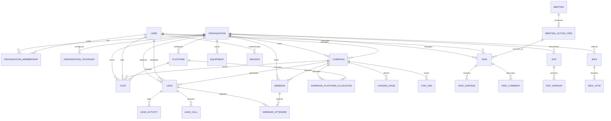
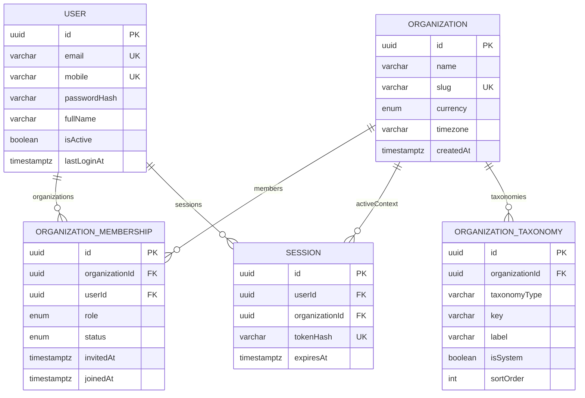
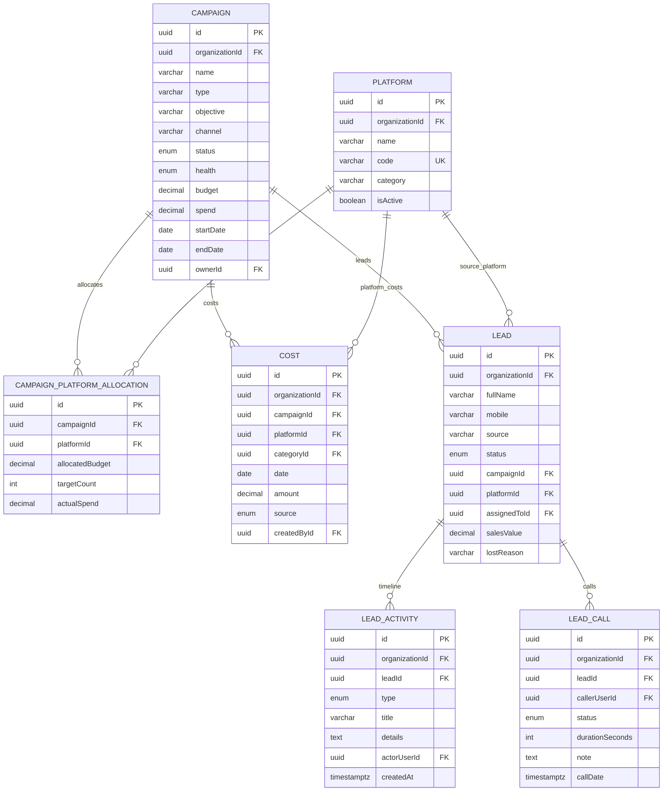
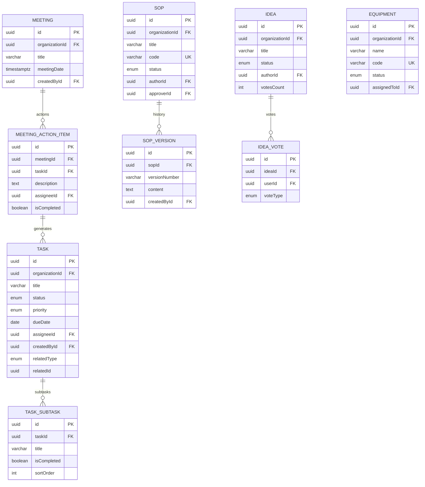

# B2.2 — Comprehensive Domain Data Model & ERD Design Report
## Gapji Digital Marketing Platform

---

## 1. Executive Summary

This report establishes the comprehensive, implementation-oriented relational database design and Entity-Relationship Architecture for the **Gapji Digital Marketing Platform**. Grounded strictly in the official product specification (`marketing-platform-phase1-frontend-pages-1.pdf`), the foundational domain discovery (`docs/B2.1-DOMAIN-DISCOVERY-REPORT.md`), and ratified architectural decisions (`docs/PROJECT-DECISIONS.md`), this design formalizes all domain entities, relational integrity constraints, multi-tenant isolation barriers, and PostgreSQL data types.

### Key Design Metrics
- **Entities Covered:** 38 relational models (100% of the 32 entities discovered in B2.1 + 6 system operations and integration models).
- **Domain Coverage:** 10 cohesive business domains spanning Workspaces 1, 2, and 3, plus Administration and IAM.
- **PostgreSQL Enums:** 21 discrete enumeration types capturing lifecycle states and technical constants.
- **Multi-Tenancy Isolation:** First-class tenant boundary enforced via `organizationId UUID` across all business models with composite uniqueness constraints (`@@unique([id, organizationId])`) to prevent cross-tenant referencing.
- **Approved Roles:** Exactly 6 technical roles (`admin`, `marketing_manager`, `campaign_manager`, `sales_agent`, `content_creator`, `client`).
- **Financial Integrity:** Complete alignment with the approved policy: database storage maintained as `Decimal(12, 2)` in Toman/Rial, non-negative integer input validation, and integer JSON number API serialization.
- **Design Artifacts Produced:**
  1. `docs/B2.2-DOMAIN-DATA-MODEL-REPORT.md` (This document).
  2. `docs/B2.2-PROPOSED-SCHEMA.prisma` (Syntactically verified Prisma schema proposal with 38 models).
- **Execution Mode:** Strictly **DESIGN ONLY**. Zero database migrations executed; existing source code, packages, and `apps/api/prisma/schema.prisma` remain 100% untouched.

---

## 2. Mandatory Source Review & Governance Hierarchy

### 2.1 Governance Precedence Rules
Every architectural decision, data type, relationship, and constraint is evaluated through the binding governance hierarchy:
1. **Approved Project Decisions (`APPROVED PROJECT DECISION`):** Binding architectural and financial decisions recorded in `docs/PROJECT-DECISIONS.md` take highest precedence.
2. **Documented Requirements (`DOCUMENTED REQUIREMENT`):** Explicit UI elements, workflows, and specifications from `marketing-platform-phase1-frontend-pages-1.pdf`.
3. **Implementation Decisions (`IMPLEMENTATION DECISION`):** Necessary technical designs (e.g. UUID primary keys, composite foreign keys) required to realize documented workflows without altering behavior.
4. **Product Decisions Required (`PRODUCT DECISION REQUIRED`):** Business ambiguities or edge cases not resolved in product documentation, preserved as open items for stakeholder sign-off.
5. **Technical Recommendations (`TECHNICAL RECOMMENDATION`):** Engineering best practices proposed for future maintenance.

### 2.2 Product Document Citations Map
| Page Range | Scope & Section | Relevant Domain Entities & Rules |
| :--- | :--- | :--- |
| **Page 1** | Scope & Persian/RTL baseline | Exclusions: Growth Assistant (رشدیار), AI, Mobile App, Push Notifications, Foreign Currencies. |
| **Page 2** | Table of Contents | 29 distinct pages across 3 Workspaces + Settings. |
| **Pages 3–5** | Shared Components & Display Rules | Status badges, Jalali dates, non-negative integer amounts, percentages (1 decimal place). |
| **Pages 6–7** | Login, Org Select & Home Dashboards | `User`, `Organization`, `OrganizationMembership`, `Session`, role-based routing. |
| **Pages 8–14** | Workspace 1: Performance (عملکرد) | `Campaign`, `Platform`, `CampaignPlatformAllocation`, `Cost`, `LandingPage`, `UtmLink`, `TargetAudience`, `KpiMetric`, `ImportJob`. |
| **Pages 14–18**| Workspace 2: Sales & Leads (فروش و لید) | `Lead`, `LeadActivity`, `LeadCall`, `SmsCampaign`, `Webinar`, `WebinarAttendee`. |
| **Pages 18–23**| Workspace 3: Execution & Knowledge (اجرا و دانش)| `Task`, `TaskSubtask`, `TaskComment`, `CalendarEvent`, `Equipment`, `Meeting`, `MeetingActionItem`, `Sop`, `SopVersion`, `LearningResource`, `UserLearningProgress`, `Idea`, `IdeaVote`. |
| **Pages 23–24**| Settings & Integrations (تنظیمات) | `OrganizationTaxonomy`, `WordpressIntegration`, `CostCategory`, Organization-scoped currency (`TOMAN` / `RIAL`). |
| **Page 25** | Implementation Priorities | Phased MVP delivery roadmap (Priority 1, 2, and 3). |
| **Pages 26–29**| Frontend Stack & Contracts | TypeScript interfaces, API schemas, Persian date formatting. |

---

## 3. B2.1 Entity Inventory Traceability Matrix

All 32 candidate entities identified in the B2.1 Discovery Report, along with 6 necessary system operations models, are fully accounted for in this design without silent omission or renaming:

| # | B2.1 Discovery Entity | Proposed B2.2 Prisma Model | PostgreSQL Table | Domain Module | Representation Status | Classification & Source |
| :---: | :--- | :--- | :--- | :--- | :---: | :--- |
| 1 | `User` | `User` | `users` | IAM | Direct Model | `DOCUMENTED REQUIREMENT` (p. 6, 23) |
| 2 | `Organization` | `Organization` | `organizations` | Tenancy Root | Direct Model | `DOCUMENTED REQUIREMENT` (p. 6, 24) |
| 3 | `OrganizationMembership` | `OrganizationMembership` | `organization_memberships` | IAM & RBAC | Associative Join | `DOCUMENTED REQUIREMENT` (p. 6, 23) |
| 4 | `Session` | `Session` | `sessions` | IAM / Auth | Direct Model | `IMPLEMENTATION DECISION` (p. 6, 26) |
| 5 | `OrganizationTaxonomy` | `OrganizationTaxonomy` | `organization_taxonomies` | Settings | Direct Model | `DOCUMENTED REQUIREMENT` (p. 23, 24) |
| 6 | `Campaign` | `Campaign` | `campaigns` | Performance | Direct Model (Expanded) | `DOCUMENTED REQUIREMENT` (p. 8, 9, 10) |
| 7 | `Platform` | `Platform` | `platforms` | Performance | Direct Model | `DOCUMENTED REQUIREMENT` (p. 8, 11) |
| 8 | `CampaignPlatformAllocation` | `CampaignPlatformAllocation` | `campaign_platform_allocations` | Performance | Associative Model | `DOCUMENTED REQUIREMENT` (p. 9, 10) |
| 9 | `TargetAudience` | `TargetAudience` | `target_audiences` | Performance | Direct Model | `DOCUMENTED REQUIREMENT` (p. 9, 13, 14) |
| 10 | `LandingPage` | `LandingPage` | `landing_pages` | Performance | Direct Model | `DOCUMENTED REQUIREMENT` (p. 9, 14) |
| 11 | `UtmLink` | `UtmLink` | `utm_links` | Performance | Direct Model | `DOCUMENTED REQUIREMENT` (p. 9, 14) |
| 12 | `Cost` | `Cost` | `costs` | Financials | Direct Model | `DOCUMENTED REQUIREMENT` (p. 8, 11, 12) |
| 13 | `CostCategory` | `CostCategory` | `cost_categories` | Financials | Direct Model | `DOCUMENTED REQUIREMENT` (p. 23, 24) |
| 14 | `Lead` | `Lead` | `leads` | Sales & CRM | Direct Model | `DOCUMENTED REQUIREMENT` (p. 8, 14, 15, 16) |
| 15 | `LeadActivity` | `LeadActivity` | `lead_activities` | Sales & CRM | Direct Model (Timeline) | `DOCUMENTED REQUIREMENT` (p. 16) |
| 16 | `LeadCall` | `LeadCall` | `lead_calls` | Sales & CRM | Direct Model (Log) | `DOCUMENTED REQUIREMENT` (p. 16) |
| 17 | `SmsCampaign` | `SmsCampaign` | `sms_campaigns` | Messaging | Direct Model | `DOCUMENTED REQUIREMENT` (p. 10, 16, 17) |
| 18 | `Webinar` | `Webinar` | `webinars` | Events & Media | Direct Model | `DOCUMENTED REQUIREMENT` (p. 17, 18) |
| 19 | `WebinarAttendee` | `WebinarAttendee` | `webinar_attendees` | Events & Media | Associative Model | `DOCUMENTED REQUIREMENT` (p. 17, 18) |
| 20 | `Task` | `Task` | `tasks` | Execution | Direct Model | `DOCUMENTED REQUIREMENT` (p. 8, 18, 19) |
| 21 | `TaskSubtask` | `TaskSubtask` | `task_subtasks` | Execution | Direct Model (Checklist)| `DOCUMENTED REQUIREMENT` (p. 18) |
| 22 | `TaskComment` | `TaskComment` | `task_comments` | Execution | Direct Model (Discussion) | `DOCUMENTED REQUIREMENT` (p. 18) |
| 23 | `CalendarEvent` | `CalendarEvent` | `calendar_events` | Execution | Direct Model | `DOCUMENTED REQUIREMENT` (p. 19) |
| 24 | `Equipment` | `Equipment` | `equipments` | Operations | Direct Model | `DOCUMENTED REQUIREMENT` (p. 19, 20) |
| 25 | `Meeting` | `Meeting` | `meetings` | Collaboration | Direct Model (صورتجلسات) | `DOCUMENTED REQUIREMENT` (p. 20) |
| 26 | `MeetingActionItem` | `MeetingActionItem` | `meeting_action_items` | Collaboration | Associative Model | `DOCUMENTED REQUIREMENT` (p. 20) |
| 27 | `Sop` | `Sop` | `sops` | Knowledge | Direct Model | `DOCUMENTED REQUIREMENT` (p. 20, 21) |
| 28 | `SopVersion` | `SopVersion` | `sop_versions` | Knowledge | Historical Archive | `DOCUMENTED REQUIREMENT` (p. 20, 21) |
| 29 | `LearningResource` | `LearningResource` | `learning_resources` | Knowledge | Direct Model | `DOCUMENTED REQUIREMENT` (p. 21) |
| 30 | `UserLearningProgress` | `UserLearningProgress` | `user_learning_progress` | Knowledge | Associative Join | `DOCUMENTED REQUIREMENT` (p. 21) |
| 31 | `Idea` | `Idea` | `ideas` | Collaboration | Direct Model | `DOCUMENTED REQUIREMENT` (p. 21, 22) |
| 32 | `IdeaVote` | `IdeaVote` | `idea_votes` | Collaboration | Associative Join | `DOCUMENTED REQUIREMENT` (p. 22) |
| *33*| `KpiMetric` | `KpiMetric` | `kpi_metrics` | Analytics | Supporting Model | `DOCUMENTED REQUIREMENT` (p. 8, 13) |
| *34*| `KpiAlertRule` | `KpiAlertRule` | `kpi_alert_rules` | Analytics | Supporting Model | `DOCUMENTED REQUIREMENT` (p. 8, 13) |
| *35*| `ImportJob` | `ImportJob` | `import_jobs` | Operations | Supporting Model | `DOCUMENTED REQUIREMENT` (p. 12, 13) |
| *36*| `Notification` | `Notification` | `notifications` | Operations | Supporting Model | `DOCUMENTED REQUIREMENT` (p. 7) |
| *37*| `UserActivityLog` | `UserActivityLog` | `user_activity_logs` | Audit & Security | Supporting Model | `DOCUMENTED REQUIREMENT` (p. 22, 23) |
| *38*| `WordpressIntegration` | `WordpressIntegration` | `wordpress_integrations`| Integrations | Supporting Model | `DOCUMENTED REQUIREMENT` (p. 24) |

---

## 4. Entity Field Specifications

This section specifies the attributes, PostgreSQL data types, constraints, nullability, and provenance for each model.

### 4.1 Technical Design Strategies
1. **Primary Key Strategy:** All models use UUID v4 (`id UUID PRIMARY KEY DEFAULT gen_random_uuid()`). UUIDs prevent ID enumeration across tenants and allow client-side key generation during offline or batch workflows.
2. **Date vs Timestamp Handling:**
   - Pure calendar dates (e.g., Campaign `startDate`, `endDate`, Task `dueDate`, Cost `date`) use PostgreSQL `DATE` (`@db.Date`) to eliminate timezone shift bugs when translating between Jalali and Gregorian dates.
   - Event and audit timestamps (`createdAt`, `updatedAt`, `lastLoginAt`, `callDate`) use PostgreSQL `TIMESTAMP WITH TIME ZONE` (`DateTime`).
3. **Monetary Precision:** Stored strictly as `Decimal(12, 2)` in PostgreSQL via Prisma (`@db.Decimal(12, 2)`). Valid inputs are non-negative integers; outputs are serialized as integer numbers per approved policy.
4. **Tenant Scoping:** Every business entity directly includes `organizationId UUID NOT NULL REFERENCES organizations(id) ON DELETE CASCADE`.

---

### 4.2 Field Tables for Core Models

#### Model: `Organization` (`organizations`)
Tenant isolation root.
| Field | PostgreSQL Type | Nullable | Default | PK/FK | Constraints | Source / Classification |
| :--- | :--- | :---: | :--- | :---: | :--- | :--- |
| `id` | `UUID` | No | `gen_random_uuid()` | PK | Primary Key | `IMPLEMENTATION DECISION` |
| `name` | `VARCHAR(255)` | No | - | - | Legal / display name | `DOCUMENTED REQUIREMENT` (p. 6, 24) |
| `slug` | `VARCHAR(100)` | No | - | - | Unique tenant code | `IMPLEMENTATION DECISION` |
| `logoUrl` | `VARCHAR(500)` | Yes | `NULL` | - | Image URL | `DOCUMENTED REQUIREMENT` (p. 3, 24) |
| `currency` | `enum (Currency)` | No | `TOMAN` | - | `TOMAN` or `RIAL` | `APPROVED PROJECT DECISION` (p. 4, 24) |
| `timezone` | `VARCHAR(50)` | No | `Asia/Tehran`| - | Operating timezone | `DOCUMENTED REQUIREMENT` (p. 24) |
| `createdAt`| `TIMESTAMPTZ` | No | `now()` | - | Audit timestamp | `IMPLEMENTATION DECISION` |
| `updatedAt`| `TIMESTAMPTZ` | No | auto | - | Audit timestamp | `IMPLEMENTATION DECISION` |

#### Model: `User` (`users`)
Central authentication identity.
| Field | PostgreSQL Type | Nullable | Default | PK/FK | Constraints | Source / Classification |
| :--- | :--- | :---: | :--- | :---: | :--- | :--- |
| `id` | `UUID` | No | `gen_random_uuid()` | PK | Primary Key | `IMPLEMENTATION DECISION` |
| `email` | `VARCHAR(255)` | Yes | `NULL` | - | Unique login email | `DOCUMENTED REQUIREMENT` (p. 6, 23) |
| `mobile` | `VARCHAR(20)` | Yes | `NULL` | - | Unique phone (0912...) | `DOCUMENTED REQUIREMENT` (p. 5, 6, 27) |
| `passwordHash`| `VARCHAR(255)`| No | - | - | Salted hash | `IMPLEMENTATION DECISION` (p. 6) |
| `fullName` | `VARCHAR(255)` | No | - | - | User display name | `DOCUMENTED REQUIREMENT` (p. 6, 23) |
| `avatarUrl` | `VARCHAR(500)` | Yes | `NULL` | - | Profile image URL | `DOCUMENTED REQUIREMENT` (p. 4, 23) |
| `isActive` | `BOOLEAN` | No | `true` | - | Account active state | `DOCUMENTED REQUIREMENT` (p. 23) |
| `lastLoginAt`| `TIMESTAMPTZ` | Yes | `NULL` | - | Most recent login | `DOCUMENTED REQUIREMENT` (p. 23) |
| `createdAt` | `TIMESTAMPTZ` | No | `now()` | - | Audit timestamp | `IMPLEMENTATION DECISION` |
| `updatedAt` | `TIMESTAMPTZ` | No | auto | - | Audit timestamp | `IMPLEMENTATION DECISION` |

#### Model: `OrganizationMembership` (`organization_memberships`)
Associative join binding a User to an Organization with an authorized Role.
| Field | PostgreSQL Type | Nullable | Default | PK/FK | Constraints | Source / Classification |
| :--- | :--- | :---: | :--- | :---: | :--- | :--- |
| `id` | `UUID` | No | `gen_random_uuid()` | PK | Primary Key | `IMPLEMENTATION DECISION` |
| `organizationId`| `UUID` | No | - | FK | References `organizations(id)` | `DOCUMENTED REQUIREMENT` (p. 6) |
| `userId` | `UUID` | No | - | FK | References `users(id)` | `DOCUMENTED REQUIREMENT` (p. 6, 23) |
| `role` | `enum (Role)` | No | `campaign_manager`| - | Exactly 6 approved roles | `APPROVED PROJECT DECISION` (p. 23) |
| `status` | `enum (MembershipStatus)`| No | `active` | - | `active`, `invited`, `inactive` | `DOCUMENTED REQUIREMENT` (p. 23) |
| `invitedAt` | `TIMESTAMPTZ` | Yes | `NULL` | - | Invitation dispatch time | `DOCUMENTED REQUIREMENT` (p. 23) |
| `joinedAt` | `TIMESTAMPTZ` | Yes | `NULL` | - | Acceptance time | `IMPLEMENTATION DECISION` |
| `createdAt` | `TIMESTAMPTZ` | No | `now()` | - | Audit timestamp | `IMPLEMENTATION DECISION` |
| `updatedAt` | `TIMESTAMPTZ` | No | auto | - | Audit timestamp | `IMPLEMENTATION DECISION` |
*Constraints:* `UNIQUE(organization_id, user_id)`

#### Model: `Campaign` (`campaigns`)
Core marketing campaign.
| Field | PostgreSQL Type | Nullable | Default | PK/FK | Constraints | Source / Classification |
| :--- | :--- | :---: | :--- | :---: | :--- | :--- |
| `id` | `UUID` | No | `gen_random_uuid()` | PK | Primary Key | `IMPLEMENTATION DECISION` |
| `organizationId`| `UUID` | No | - | FK | References `organizations(id)` | `APPROVED PROJECT DECISION` |
| `name` | `VARCHAR(255)` | No | - | - | Campaign name | `DOCUMENTED REQUIREMENT` (p. 9) |
| `description`| `TEXT` | Yes | `NULL` | - | Brief & objectives | `DOCUMENTED REQUIREMENT` (p. 9) |
| `type` | `VARCHAR(100)` | No | `digital` | - | Configurable taxonomy | `DOCUMENTED REQUIREMENT` (p. 9, 23) |
| `objective` | `VARCHAR(100)` | No | `lead` | - | Configurable taxonomy | `DOCUMENTED REQUIREMENT` (p. 9) |
| `channel` | `VARCHAR(100)` | No | - | - | Legacy channel field | `DOCUMENTED REQUIREMENT` (p. 9) |
| `status` | `enum (CampaignStatus)`| No | `draft` | - | 6 lifecycle stages | `DOCUMENTED REQUIREMENT` (p. 5, 9) |
| `health` | `enum (CampaignHealth)`| No | `healthy`| - | 3 health states | `DOCUMENTED REQUIREMENT` (p. 5, 8) |
| `budget` | `DECIMAL(12,2)` | No | `0` | - | `>= 0`, Integer Toman/Rial| `APPROVED PROJECT DECISION` (p. 9) |
| `spend` | `DECIMAL(12,2)` | No | `0` | - | `>= 0`, Integer Toman/Rial| `APPROVED PROJECT DECISION` (p. 9) |
| `startDate` | `DATE` | Yes | `NULL` | - | Scheduled start | `DOCUMENTED REQUIREMENT` (p. 9) |
| `endDate` | `DATE` | Yes | `NULL` | - | Scheduled end | `DOCUMENTED REQUIREMENT` (p. 9) |
| `ownerId` | `UUID` | Yes | `NULL` | FK | References `users(id)` | `DOCUMENTED REQUIREMENT` (p. 9) |
| `targetLeads`| `INT` | Yes | `NULL` | - | Volume target | `DOCUMENTED REQUIREMENT` (p. 9) |
| `targetSales`| `DECIMAL(12,2)`| Yes | `NULL` | - | Monetary sales target | `DOCUMENTED REQUIREMENT` (p. 9) |
| `impressions`| `INT` | No | `0` | - | Delivered impressions | `DOCUMENTED REQUIREMENT` (Existing) |
| `clicks` | `INT` | No | `0` | - | Clicks count | `DOCUMENTED REQUIREMENT` (Existing) |
| `conversions`| `INT` | No | `0` | - | Conversions count | `DOCUMENTED REQUIREMENT` (Existing) |
| `createdAt` | `TIMESTAMPTZ` | No | `now()` | - | Audit timestamp | `IMPLEMENTATION DECISION` |
| `updatedAt` | `TIMESTAMPTZ` | No | auto | - | Audit timestamp | `IMPLEMENTATION DECISION` |
*Constraints:* `UNIQUE(id, organization_id)`

#### Model: `Cost` (`costs`)
Granular expenditure transaction.
| Field | PostgreSQL Type | Nullable | Default | PK/FK | Constraints | Source / Classification |
| :--- | :--- | :---: | :--- | :---: | :--- | :--- |
| `id` | `UUID` | No | `gen_random_uuid()` | PK | Primary Key | `IMPLEMENTATION DECISION` |
| `organizationId`| `UUID` | No | - | FK | References `organizations(id)` | `APPROVED PROJECT DECISION` |
| `campaignId` | `UUID` | Yes | `NULL` | FK | References `campaigns(id)` | `DOCUMENTED REQUIREMENT` (p. 11, 12) |
| `platformId` | `UUID` | Yes | `NULL` | FK | References `platforms(id)` | `DOCUMENTED REQUIREMENT` (p. 11, 12) |
| `categoryId` | `UUID` | Yes | `NULL` | FK | References `cost_categories(id)`| `DOCUMENTED REQUIREMENT` (p. 23) |
| `date` | `DATE` | No | - | - | Expense date | `DOCUMENTED REQUIREMENT` (p. 11, 12) |
| `amount` | `DECIMAL(12,2)` | No | `0` | - | Non-negative integer | `APPROVED PROJECT DECISION` (p. 11) |
| `count` | `INT` | Yes | `NULL` | - | Volume count | `DOCUMENTED REQUIREMENT` (p. 11, 12) |
| `source` | `enum (CostSource)` | No | `manual` | - | `manual` or `import` | `DOCUMENTED REQUIREMENT` (p. 11, 12) |
| `createdById`| `UUID` | Yes | `NULL` | FK | References `users(id)` | `DOCUMENTED REQUIREMENT` (p. 11) |
| `importJobId`| `UUID` | Yes | `NULL` | FK | References `import_jobs(id)`| `DOCUMENTED REQUIREMENT` (p. 12) |
| `notes` | `TEXT` | Yes | `NULL` | - | Explanatory note | `DOCUMENTED REQUIREMENT` (p. 11) |
| `createdAt` | `TIMESTAMPTZ` | No | `now()` | - | Audit timestamp | `IMPLEMENTATION DECISION` |
| `updatedAt` | `TIMESTAMPTZ` | No | auto | - | Audit timestamp | `IMPLEMENTATION DECISION` |

#### Model: `Lead` (`leads`)
Sales opportunity and prospective customer.
| Field | PostgreSQL Type | Nullable | Default | PK/FK | Constraints | Source / Classification |
| :--- | :--- | :---: | :--- | :---: | :--- | :--- |
| `id` | `UUID` | No | `gen_random_uuid()` | PK | Primary Key | `IMPLEMENTATION DECISION` |
| `organizationId`| `UUID` | No | - | FK | References `organizations(id)` | `APPROVED PROJECT DECISION` |
| `fullName` | `VARCHAR(255)` | No | - | - | Prospect name | `DOCUMENTED REQUIREMENT` (p. 15, 16) |
| `mobile` | `VARCHAR(20)` | No | - | - | Masked for restricted roles| `DOCUMENTED REQUIREMENT` (p. 5, 15) |
| `email` | `VARCHAR(255)` | Yes | `NULL` | - | Optional email | `DOCUMENTED REQUIREMENT` (p. 16) |
| `city` | `VARCHAR(100)` | Yes | `NULL` | - | Geographic location | `DOCUMENTED REQUIREMENT` (p. 16) |
| `source` | `VARCHAR(100)` | No | `manual` | - | Configurable taxonomy | `DOCUMENTED REQUIREMENT` (p. 15, 16) |
| `campaignId` | `UUID` | Yes | `NULL` | FK | References `campaigns(id)` | `DOCUMENTED REQUIREMENT` (p. 15, 16) |
| `platformId` | `UUID` | Yes | `NULL` | FK | References `platforms(id)` | `DOCUMENTED REQUIREMENT` (p. 15, 16) |
| `utmSource` | `VARCHAR(100)` | Yes | `NULL` | - | UTM Source tag | `DOCUMENTED REQUIREMENT` (p. 15, 16) |
| `utmMedium` | `VARCHAR(100)` | Yes | `NULL` | - | UTM Medium tag | `DOCUMENTED REQUIREMENT` (p. 16) |
| `utmCampaign`| `VARCHAR(100)` | Yes | `NULL` | - | UTM Campaign tag | `DOCUMENTED REQUIREMENT` (p. 16) |
| `utmTerm` | `VARCHAR(100)` | Yes | `NULL` | - | UTM Term tag | `DOCUMENTED REQUIREMENT` (p. 16) |
| `utmContent` | `VARCHAR(100)` | Yes | `NULL` | - | UTM Content tag | `DOCUMENTED REQUIREMENT` (p. 16) |
| `status` | `enum (LeadStatus)` | No | `new` | - | 6 pipeline stages | `DOCUMENTED REQUIREMENT` (p. 5, 15) |
| `assignedToId`| `UUID` | Yes | `NULL` | FK | References `users(id)` | `DOCUMENTED REQUIREMENT` (p. 15, 16) |
| `salesValue` | `DECIMAL(12,2)` | Yes | `NULL` | - | Monetary value upon win | `DOCUMENTED REQUIREMENT` (p. 15, 16) |
| `lostReason` | `VARCHAR(255)` | Yes | `NULL` | - | Reason if lost | `DOCUMENTED REQUIREMENT` (p. 15, 16) |
| `nextFollowUpAt`| `TIMESTAMPTZ`| Yes | `NULL` | - | Scheduled follow-up | `DOCUMENTED REQUIREMENT` (p. 15, 16) |
| `nextFollowUpNote`|`VARCHAR(500)`| Yes | `NULL` | - | Follow-up brief | `DOCUMENTED REQUIREMENT` (p. 16) |
| `createdAt` | `TIMESTAMPTZ` | No | `now()` | - | Platform entry time | `DOCUMENTED REQUIREMENT` (p. 15) |
| `updatedAt` | `TIMESTAMPTZ` | No | auto | - | Status change time | `IMPLEMENTATION DECISION` |
*Constraints:* `UNIQUE(id, organization_id)`

#### Model: `Task` (`tasks`)
Operational work item or SOP execution checklist.
| Field | PostgreSQL Type | Nullable | Default | PK/FK | Constraints | Source / Classification |
| :--- | :--- | :---: | :--- | :---: | :--- | :--- |
| `id` | `UUID` | No | `gen_random_uuid()` | PK | Primary Key | `IMPLEMENTATION DECISION` |
| `organizationId`| `UUID` | No | - | FK | References `organizations(id)` | `APPROVED PROJECT DECISION` |
| `title` | `VARCHAR(255)` | No | - | - | Task title | `DOCUMENTED REQUIREMENT` (p. 18) |
| `description`| `TEXT` | Yes | `NULL` | - | Detailed instructions | `DOCUMENTED REQUIREMENT` (p. 18) |
| `status` | `enum (TaskStatus)` | No | `todo` | - | 5 states | `DOCUMENTED REQUIREMENT` (p. 5, 18) |
| `priority` | `enum (TaskPriority)`| No | `medium`| - | 4 priority levels | `DOCUMENTED REQUIREMENT` (p. 18) |
| `dueDate` | `DATE` | Yes | `NULL` | - | Deadline date | `DOCUMENTED REQUIREMENT` (p. 18) |
| `assigneeId` | `UUID` | Yes | `NULL` | FK | References `users(id)` | `DOCUMENTED REQUIREMENT` (p. 18) |
| `createdById`| `UUID` | No | - | FK | References `users(id)` | `IMPLEMENTATION DECISION` |
| `relatedType`| `enum (TaskRelatedType)`| Yes | `NULL` | - | Polymorphic target type | `DOCUMENTED REQUIREMENT` (p. 18, 20) |
| `relatedId` | `UUID` | Yes | `NULL` | - | Polymorphic target ID | `DOCUMENTED REQUIREMENT` (p. 18, 20) |
| `createdAt` | `TIMESTAMPTZ` | No | `now()` | - | Creation timestamp | `IMPLEMENTATION DECISION` |
| `updatedAt` | `TIMESTAMPTZ` | No | auto | - | Update timestamp | `IMPLEMENTATION DECISION` |
*Constraints:* `UNIQUE(id, organization_id)`

---

## 5. Relationship Catalog & Referential Actions

The following catalog defines foreign keys, cardinalities, tenant consistency enforcement, and referential integrity (`onDelete`) actions for the entire platform:

| Source Entity | Target Entity | Cardinality | Nullable? | Foreign Key Field | Tenant Invariant | Referential Action (`onDelete`) | Source Evidence |
| :--- | :--- | :---: | :---: | :--- | :--- | :--- | :--- |
| `OrganizationMembership` | `Organization` | N:1 | No | `organizationId` | Root tenant | `Cascade` | p. 6 §1, p. 23 §27 |
| `OrganizationMembership` | `User` | N:1 | No | `userId` | User identity | `Cascade` | p. 6 §1, p. 23 §27 |
| `Session` | `User` | N:1 | No | `userId` | User identity | `Cascade` | Implementation Decision |
| `Session` | `Organization` | N:1 | Yes | `organizationId` | Selected tenant | `SetNull` | Implementation Decision |
| `OrganizationTaxonomy` | `Organization` | N:1 | No | `organizationId` | Scoped to org | `Cascade` | p. 23 §27, p. 24 §28 |
| `Campaign` | `Organization` | N:1 | No | `organizationId` | Scoped to org | `Cascade` | Project Decisions §3 |
| `Campaign` | `User` (Owner) | N:1 | Yes | `ownerId` | Must be member | `SetNull` | p. 9 §6 |
| `CampaignPlatformAllocation` | `Campaign` | N:1 | No | `campaignId` | Same org | `Cascade` | p. 9 §6, p. 10 §7 |
| `CampaignPlatformAllocation` | `Platform` | N:1 | No | `platformId` | Same org | `Restrict` | p. 9 §6 |
| `TargetAudience` | `Campaign` | N:1 | Yes | `campaignId` | Same org | `SetNull` | p. 9 §6, p. 14 §11 |
| `LandingPage` | `Campaign` | N:1 | Yes | `campaignId` | Same org | `SetNull` | p. 9 §6, p. 14 §12 |
| `UtmLink` | `Campaign` | N:1 | Yes | `campaignId` | Same org | `SetNull` | p. 9 §6, p. 14 §13 |
| `UtmLink` | `LandingPage` | N:1 | Yes | `landingPageId` | Same org | `SetNull` | p. 14 §13 |
| `Cost` | `Campaign` | N:1 | Yes | `campaignId` | Same org | `SetNull` | p. 11 §9, p. 12 §9 |
| `Cost` | `Platform` | N:1 | Yes | `platformId` | Same org | `SetNull` | p. 11 §9, p. 12 §9 |
| `Cost` | `CostCategory` | N:1 | Yes | `categoryId` | Same org | `SetNull` | p. 23 §27 |
| `Cost` | `User` (Creator)| N:1 | Yes | `createdById` | Same org | `SetNull` | p. 11 §9 |
| `Cost` | `ImportJob` | N:1 | Yes | `importJobId` | Same org | `SetNull` | p. 12 §10 |
| `Lead` | `Campaign` | N:1 | Yes | `campaignId` | Same org | `SetNull` | p. 15 §14, p. 16 §15 |
| `Lead` | `Platform` | N:1 | Yes | `platformId` | Same org | `SetNull` | p. 15 §14 |
| `Lead` | `User` (Assigned)| N:1 | Yes | `assignedToId` | Must be member | `SetNull` | p. 15 §14, p. 16 §15 |
| `LeadActivity` | `Lead` | N:1 | No | `leadId` | Same org | `Cascade` | p. 16 §16 |
| `LeadActivity` | `User` (Actor) | N:1 | Yes | `actorUserId` | Optional user | `SetNull` | p. 16 §16 |
| `LeadCall` | `Lead` | N:1 | No | `leadId` | Same org | `Cascade` | p. 16 §17 |
| `LeadCall` | `User` (Caller)| N:1 | No | `callerUserId` | Must be member | `Restrict` | p. 16 §17 |
| `SmsCampaign` | `Campaign` | N:1 | Yes | `campaignId` | Same org | `SetNull` | p. 10 §7, p. 16 §16 |
| `Webinar` | `Campaign` | N:1 | Yes | `campaignId` | Same org | `SetNull` | p. 17 §18 |
| `WebinarAttendee` | `Webinar` | N:1 | No | `webinarId` | Same org | `Cascade` | p. 17 §18 |
| `WebinarAttendee` | `Lead` | N:1 | Yes | `leadId` | Same org | `SetNull` | p. 17 §18 |
| `Task` | `User` (Assignee)| N:1 | Yes | `assigneeId` | Must be member | `SetNull` | p. 18 §19 |
| `Task` | `User` (Creator) | N:1 | No | `createdById` | Creator user | `Restrict` | Implementation Decision |
| `TaskSubtask` | `Task` | N:1 | No | `taskId` | Same org | `Cascade` | p. 18 §19 |
| `TaskComment` | `Task` | N:1 | No | `taskId` | Same org | `Cascade` | p. 18 §19 |
| `TaskComment` | `User` (Author) | N:1 | No | `authorUserId` | Comment author | `Restrict` | p. 18 §19 |
| `CalendarEvent` | `User` (Creator) | N:1 | No | `createdById` | Event creator | `Restrict` | p. 19 §20 |
| `Equipment` | `User` (Assigned)| N:1 | Yes | `assignedToId` | Custodian user | `SetNull` | p. 19 §21 |
| `Meeting` | `Campaign` | N:1 | Yes | `campaignId` | Same org | `SetNull` | p. 20 §22 |
| `MeetingActionItem`| `Meeting` | N:1 | No | `meetingId` | Same org | `Cascade` | p. 20 §22 |
| `MeetingActionItem`| `Task` | N:1 | Yes | `taskId` | Converted task | `SetNull` | p. 20 §22 |
| `Sop` | `User` (Author) | N:1 | No | `authorId` | Must be member | `Restrict` | p. 20 §23 |
| `Sop` | `User` (Approver)| N:1 | Yes | `approverId` | Approving admin | `SetNull` | p. 20 §23 |
| `SopVersion` | `Sop` | N:1 | No | `sopId` | Same org | `Cascade` | p. 20 §23 |
| `UserLearningProgress`| `User` | N:1 | No | `userId` | User | `Cascade` | p. 21 §24 |
| `UserLearningProgress`| `LearningResource`| N:1| No | `resourceId` | Resource | `Cascade` | p. 21 §24 |
| `Idea` | `User` (Author) | N:1 | No | `authorId` | Idea submitter | `Restrict` | p. 21 §25 |
| `IdeaVote` | `Idea` | N:1 | No | `ideaId` | Same org | `Cascade` | p. 22 §25 |
| `IdeaVote` | `User` | N:1 | No | `userId` | Voter | `Cascade` | p. 22 §25 |
| `KpiMetric` | `Campaign` | N:1 | Yes | `campaignId` | Same org | `SetNull` | p. 8 §4, p. 13 §11 |
| `KpiAlertRule` | `KpiMetric` | N:1 | Yes | `kpiMetricId` | Same org | `SetNull` | p. 13 §11 |
| `ImportJob` | `User` (Creator)| N:1 | No | `createdById` | Uploader | `Restrict` | p. 12 §10 |

---

## 6. Multi-Tenancy Architecture & Data Isolation

Multi-tenant data isolation is the central non-negotiable architectural requirement of the platform.

```
+--------------------------------------------------------------------------------------------------+
|                                    DEFENSE-IN-DEPTH TENANCY MODEL                                |
|                                                                                                  |
|  [ LAYER 1: HTTP & Guard Scope ]                                                                |
|  JWT Bearer Token -> TenancyGuard verifies active (userId, organizationId) in Memberships.       |
|                                                                                                  |
|  [ LAYER 2: Service / Repository Scope ]                                                         |
|  Every query injects WHERE organizationId = :activeOrgId.                                        |
|                                                                                                  |
|  [ LAYER 3: Prisma Schema Level ]                                                                |
|  Direct organizationId field on every tenant model + @@index([organizationId]).                 |
|                                                                                                  |
|  [ LAYER 4: PostgreSQL Constraint Level ]                                                        |
|  Composite uniqueness @@unique([id, organizationId]) on core entities (Campaign, Lead, Task).    |
+--------------------------------------------------------------------------------------------------+
```

### 6.1 Direct vs Inherited Tenant Ownership
1. **Global Entities (System-Wide, Tenant-Agnostic):**
   - `User`: Global credentials and identity across organizations. A single person may belong to multiple marketing agencies or client spaces.
2. **Direct Tenant-Scoped Entities (Direct `organizationId`):**
   - All 36 business and operational models (including `Campaign`, `Lead`, `Task`, `Cost`, `Platform`, `Meeting`, `Sop`, `Idea`) store `organizationId UUID NOT NULL`.
   - Even when an entity is a child of another (e.g. `TaskSubtask` belonging to `Task`, `LeadActivity` belonging to `Lead`), `organizationId` is retained on the child to allow single-column tenant partition queries and immediate cross-tenant access rejection without expensive multi-table joins.

### 6.2 Prevention of Cross-Tenant Relational Leakage
A critical risk in multi-tenant SaaS is linking an entity in Organization A to a parent entity in Organization B (e.g., assigning a Lead in Org A to a Campaign in Org B).
- **Design Pattern:** The core parent entities (`Campaign`, `Lead`, `Task`) expose composite uniqueness constraints:
  ```prisma
  @@unique([id, organizationId])
  ```
- **Prisma Composite Relations:** This guarantees that PostgreSQL foreign keys can bind on `(campaignId, organizationId)` directly, making cross-tenant relational linkage structurally impossible at the database engine level.
- **Assignee Membership Invariant:** When assigning `ownerId` on Campaign, `assignedToId` on Lead, or `assigneeId` on Task, the backend service layer enforces that `OrganizationMembership` exists for `(assigneeId, activeOrganizationId)` with status `active`.

---

## 7. Users, Organizations, Memberships & Roles Architecture

### 7.1 Architecture Breakdown
- **Global User Identity:** The `User` entity represents the physical human being and holds global login credentials (email or mobile with bcrypt password hash).
- **Organization Tenant:** The `Organization` entity represents the legal marketing team, company, or agency space. It holds settings such as `currency` and `timezone`.
- **Associative Join:** `OrganizationMembership` links a `User` to an `Organization`. A user has **zero global roles**; their permissions exist strictly within the context of an active membership.
- **Active Session Context:** The `Session` model records the active tenant context (`organizationId`) selected upon login. When an API request arrives, the `TenancyGuard` verifies that the caller possesses an active membership in the requested organization.

### 7.2 The 6 Approved Technical Roles
In accordance with `docs/PROJECT-DECISIONS.md §3` and Product Document p. 23 (§27), exactly 6 technical roles are implemented:

```prisma
enum Role {
  admin             // مدیر ارشد سازمان / سیستم
  marketing_manager // مدیر مارکتینگ
  campaign_manager  // کمپین‌چی
  sales_agent       // کارشناس فروش
  content_creator   // تولید محتوا و وبینار
  client            // کارفرما (فقط خواندنی)
}
```

### 7.3 Role Permissions & Workspaces Matrix
| Role Identifier | Persian Title | Primary Workspaces | Documented Access Rules & Ownership Boundaries |
| :--- | :--- | :--- | :--- |
| `admin` | مدیر ارشد | All + Settings | Full administrative read/write access across all domains, taxonomies, integrations, and user invitations. |
| `marketing_manager` | مدیر مارکتینگ | Workspace 1, 2, 3 | Strategic oversight; full access to Campaigns, Costs, KPIs, Leads summary, Webinars, and Team Tasks. |
| `campaign_manager` | کمپین‌چی | Workspace 1, 3 | Campaign creation, platform allocations, UTM links, and marketing costs. **Explicitly denied access to Lead CRM pipeline (Workspace 2)** per documented rules. |
| `sales_agent` | کارشناس فروش | Workspace 2, 3 | Lead Inbox, Lead Kanban, and Call Logging. **Ownership Rule:** May only view and manage Leads where `assignedToId == userId`. Cannot view unassigned leads or other reps' leads. |
| `content_creator` | تولید محتوا / وبینار | Workspace 3, Webinars | Webinar management, attendee lists, SOPs, Learning library, and content tasks. |
| `client` | کارفرما | Workspace 1 (Read) | Read-only executive dashboards and high-level campaign KPI summaries. No edit or delete capabilities. |

---

## 8. Core Workflow Models

### 8.1 Campaign (`Campaign`)
- **Lifecycle Statuses (`CampaignStatus`):** `draft` (پیش‌نویس), `planned` (برنامه‌ریزی‌شده), `active` (فعال), `paused` (متوقف), `completed` (تکمیل‌شده), `archived` (آرشیوشده). Aligned with Product Document p. 5 and p. 9.
- **Health Indicators (`CampaignHealth`):** `healthy` (سالم - سبز), `needs_attention` (نیازمند توجه - زرد), `critical` (ضعیف/بحرانی - قرمز). Evaluated against budget burn rate and KPI targets (p. 8 §4).
- **Wizard Alignment (Page 9):** Supports basic info (type, objective, dates, owner), target volumes (`targetLeads`, `targetSales`), and sub-allocations (`CampaignPlatformAllocation`).
- **Channel Field Compatibility:** The legacy `channel` string column is preserved to maintain zero-breakage compatibility with the existing Campaign API while adding rich `Platform` associations.

### 8.2 Lead (`Lead`)
- **Pipeline Stages (`LeadStatus`):** Exactly 6 stages matching Kanban board columns (p. 15 §14):
  1. `new` (جدید)
  2. `contacted` (تماس‌گرفته)
  3. `qualified` (واجد شرایط)
  4. `proposal` (ارسال پروپوزال)
  5. `customer` (تبدیل به مشتری)
  6. `lost` (رد شده)
- **Customer Journey (`LeadActivity`):** An append-only audit event log capturing every click, form submission, phone call, note, and stage change.
- **Telephony Logging (`LeadCall`):** Captures duration, outcome (`successful`, `no_answer`, `busy`, `rescheduled`), agent notes, and optional call recording URLs.
- **Sales Rep Ownership:** Enforces `sales_agent` access restriction via `@@index([organizationId, assignedToId])`.

### 8.3 Task (`Task`)
- **Task States (`TaskStatus`):** `todo` (انجام نشده), `in_progress` (در حال انجام), `waiting` (در انتظار), `done` (انجام شده), `overdue` (منقضی/عقب‌افتاده).
- **Task Priorities (`TaskPriority`):** `low` (کم), `medium` (متوسط), `high` (بالا), `urgent` (اضطراری).
- **Polymorphic Association:** Modeled via `relatedType` (`enum TaskRelatedType`) and `relatedId UUID`, allowing tasks to link flexibly to Campaigns, Webinars, Leads, SOPs, Equipment, or Meetings without creating 6 separate nullable foreign key columns.
- **Subtasks & Comments:** Modeled via dedicated child tables `TaskSubtask` and `TaskComment`.

### 8.4 Cost (`Cost`)
- **Granular Expenditures:** Replaces opaque spend counters with itemized records linked to specific dates, platforms, and campaigns.
- **Entry Sources (`CostSource`):** `manual` (دستی) and `import` (ایمپورت دسته‌ای از اکسل).
- **Spend Aggregation:** `Campaign.spend` is derived from `SUM(amount)` over active `Cost` records, preserving auditability.

---

## 9. Configurable Settings vs PostgreSQL Enums

A critical architectural decision is distinguishing between **fixed technical lifecycle states** and **user-configurable business taxonomies**. Over-reliance on PostgreSQL enums makes custom agency categorization impossible without executing database DDL migrations.

| Classification Target | Recommended Storage | Justification & Product Citation | Tenant Scoping |
| :--- | :--- | :--- | :--- |
| **User Roles** | PostgreSQL Enum (`Role`) | Security & authorization barriers; hardcoded in RBAC guards (p. 23). | Global enum (6 roles) |
| **Currency** | PostgreSQL Enum (`Currency`) | Core monetary calculation units: `TOMAN`, `RIAL` (p. 4, 24). | Enum |
| **Campaign Status** | PostgreSQL Enum (`CampaignStatus`) | Fixed state machine governing wizard and archiving workflows (p. 5, 9). | Global enum (6 states)|
| **Campaign Health** | PostgreSQL Enum (`CampaignHealth`) | Fixed indicator badge logic (`healthy`, `needs_attention`, `critical`). | Global enum (3 states)|
| **Lead Status** | PostgreSQL Enum (`LeadStatus`) | Fixed 6-column sales Kanban pipeline (p. 15). | Global enum (6 states)|
| **Task Status & Priority**| PostgreSQL Enums (`TaskStatus`, `TaskPriority`) | Universal productivity board stages and urgency levels (p. 5, 18). | Global enums |
| **Campaign Type** | Plain String + `OrganizationTaxonomy` | User-defined marketing categories (دیجیتال، محیطی، رویداد...) (p. 9, 23). | Tenant-configurable |
| **Campaign Objective** | Plain String + `OrganizationTaxonomy` | User-defined marketing goals (فروش، لید، آگاهی...) (p. 9). | Tenant-configurable |
| **Lead Source** | Plain String + `OrganizationTaxonomy` | Inflow channels (وب‌سایت، اینستاگرام، معرف، رویداد...) (p. 15, 23). | Tenant-configurable |
| **Lost Reasons** | Plain String + `OrganizationTaxonomy` | Agency-specific rejection reasons (قیمت بالا، عدم نیاز...) (p. 15, 23).| Tenant-configurable |
| **Cost Categories** | `CostCategory` Reference Table | Detailed expense taxonomy with description and active state (p. 23, 24). | Tenant-scoped table |
| **SOP Categories** | Plain String + `OrganizationTaxonomy` | Operational procedure categories (فروش، تولید محتوا...) (p. 20, 23). | Tenant-configurable |

### Organization Taxonomy Architecture
User-configurable values are managed through `OrganizationTaxonomy`:
```prisma
model OrganizationTaxonomy {
  id             String       @id @default(uuid()) @db.Uuid
  organizationId String       @db.Uuid
  taxonomyType   String       @db.VarChar(100) // campaign_type, lead_source, lost_reason
  key            String       @db.VarChar(100)
  label          String       @db.VarChar(255)
  isSystem       Boolean      @default(false)
  sortOrder      Int          @default(0)
  isActive       Boolean      @default(true)
  ...
  @@unique([organizationId, taxonomyType, key])
}
```
Default system categories are seeded with `isSystem = true`. Organizations can add, reorder, or deactivate categories without altering database schema.

---

## 10. Financial Data Integrity & Decimal Precision

The data model strictly implements the approved financial policies from `docs/PROJECT-DECISIONS.md §2`:

### 10.1 Storage Precision Invariant
- All monetary columns (`budget`, `spend` on `Campaign`; `amount` on `Cost`; `allocatedBudget`, `actualSpend` on `CampaignPlatformAllocation`; `salesValue` on `Lead`; `costAmount` on `SmsCampaign`; `purchaseCost` on `Equipment`) preserve `Decimal(12, 2)` in PostgreSQL via Prisma.
- **Rationale:** Preserves 100% backward compatibility with the existing database schema, avoids high-risk column type alterations, and ensures precision safety during aggregation queries (`SUM`, `AVG`).

### 10.2 API & Application Invariant
- In accordance with Iranian banking conventions and Product Document p. 4 (§2-1), fractional monetary inputs (e.g. `12500.50`) are rejected at the DTO layer with HTTP 400.
- All stored monetary values created by the application represent non-negative integer amounts in Toman or Rial.
- Outgoing JSON serialization returns pure integer numbers (e.g. `50000000`).

### 10.3 Currency Isolation
- Currency is configured independently per organization on `Organization.currency`:
  ```prisma
  enum Currency {
    TOMAN @map("toman")
    RIAL  @map("rial")
  }
  ```
- **Strict Prohibition:** There is **NO automatic 10x multiplication or division** when displaying or handling currency. The numerical value is preserved as entered by the user.

---

## 11. Deletion, History & Audit Strategy

A coherent deletion policy prevents orphan records, protects financial compliance, and maintains customer journey integrity:

| Entity Category | Entities | Deletion Policy | Cascading & Restriction Behavior | Justification & Governance |
| :--- | :--- | :--- | :--- | :--- |
| **Tenant Root** | `Organization` | Hard Delete (Cascade) | Cascades deletion to all scoped tables upon organization decommissioning. | `IMPLEMENTATION DECISION` |
| **Global Identity**| `User` | Soft Deactivation (`isActive = false`) | Hard deletion restricted (`onDelete: Restrict`) if user has created tasks, costs, or logged calls. | Identity audit preservation |
| **Financials** | `Cost`, `CostCategory` | Hard Deletion with Restriction | Deletion restricted if tied to finalized Import Jobs; costs update `spend` aggregation on delete. | `APPROVED PROJECT DECISION` |
| **Campaigns** | `Campaign` | Lifecycle Archiving (`CampaignStatus.archived`) | Campaigns are archived rather than hard deleted once costs or leads are linked. If deleted in draft, allocations cascade. | p. 5 §3-2, p. 9 §6 |
| **Leads & CRM** | `Lead` | State Transition (`LeadStatus.lost`) | Leads marked lost with `lostReason` rather than deleted. If deleted by Admin, `LeadActivity` and `LeadCall` cascade. | p. 15 §14, p. 16 §15 |
| **Lead Activities**| `LeadActivity`, `LeadCall` | Append-Only (Immutable) | No update or delete endpoints exposed in API. Event records form a legal customer journey timeline. | p. 16 §16 |
| **Tasks** | `Task` | Soft Cancel / Done | If deleted, child `TaskSubtask` and `TaskComment` cascade (`onDelete: Cascade`). | p. 18 §19 |
| **SOPs** | `Sop` | Archiving (`SopStatus.archived`) | Historical versions archived in `SopVersion`; immutable version snapshots preserved. | p. 20 §23 |
| **Audit Logs** | `UserActivityLog` | Immutable / Append-Only | System security log; strictly read-only, no update or delete operations. | p. 22 §26 |

---

## 12. Entity-Relationship Diagrams (Mermaid)

### Diagram A: Complete Logical ERD (Platform Core Overview)


---

### Diagram B: Organization & Identity ERD


---

### Diagram C: Marketing & Sales ERD


---

### Diagram D: Supporting Domains ERD


---

## 13. Proposed Prisma Schema Explanation

The proposed schema in `docs/B2.2-PROPOSED-SCHEMA.prisma` serves as the complete technical blueprint for future Prisma migrations. 

### 13.1 Validation Execution Result
The proposed schema was verified using the Prisma 5.22.0 CLI validator:
```bash
cmd.exe /c "set DATABASE_URL=postgresql://localhost:5432/test && pnpm --dir F:\marketing-platform-backend\apps\api exec prisma validate --schema=../../docs/B2.2-PROPOSED-SCHEMA.prisma"
```
**Output:**
```
Prisma schema loaded from ..\..\docs\B2.2-PROPOSED-SCHEMA.prisma
The schema at ..\..\docs\B2.2-PROPOSED-SCHEMA.prisma is valid 🚀
```
This confirms that:
- Every model identifier and relation name is valid.
- All 21 enums are defined and correctly mapped.
- All foreign keys and corresponding opposite relation fields match.
- All composite index and uniqueness decorators (`@@unique`, `@@index`) comply with Prisma 5.22.0 syntax.

---

## 14. Open Product Decisions (`PRODUCT DECISION REQUIRED`)

The following business requirements are not explicitly determined by `marketing-platform-phase1-frontend-pages-1.pdf` and require formal Product Owner resolution before migration execution:

### 1. Currency Switching After Financial Data Exists
- **Question:** If an organization creates campaigns and costs in Toman, and subsequently switches its setting to Rial in `/settings/organization/`, how should existing records behave?
- **Option A (Disallow):** The system disables the currency dropdown once any campaign or cost transaction exists.
- **Option B (Relabeling Only):** The currency is switched, but numeric values remain unchanged (e.g., `50,000,000` is now labeled `50,000,000 ریال`). A modal warns the user of this effect.
- **Option C (Migration Wizard):** An explicit conversion wizard prompts the user to either multiply existing amounts by 10 or keep them unchanged.
- **Data Model Impact:** The data model cleanly supports all three options by decoupling the numerical `amount` from the currency unit stored on `Organization.currency`.

### 2. Lead Deduplication Strategy on Import
- **Question:** When importing leads via Excel or WordPress webhooks with duplicate mobile numbers (Product Document p. 12 mentions «تکراری»):
- **Option A:** Skip incoming duplicate row.
- **Option B:** Overwrite existing lead fields.
- **Option C:** Create a new `LeadActivity` under the existing lead record rather than creating a new `Lead`.
- **Data Model Impact:** `Lead` enforces `@@index([organizationId, mobile])` rather than a unique constraint on `mobile`, allowing flexible application-level deduplication without database crashes.

### 3. Cross-Tenant User Invitation Flow
- **Question:** When an agency user is invited to a client organization, does the user receive an email/SMS confirmation token before membership is activated?
- **Data Model Impact:** `OrganizationMembership` includes `status (active, invited, inactive)` and `invitedAt DateTime?` to fully accommodate asynchronous invitations.

---

## 15. Technical Risks & Campaign Backward Compatibility

### 15.1 Campaign Backward Compatibility
The existing backend implementation contains an active `Campaign` service, controller, and DTO suite. To prevent breaking changes:
1. **Preserved Fields:** `id`, `name`, `description`, `channel`, `status`, `budget`, `spend`, `impressions`, `clicks`, `conversions`, `createdAt`, `updatedAt` are identical in data type and naming.
2. **Channel Fallback:** The legacy `channel` string remains present alongside new relational `Platform` allocations.
3. **Nullable New Attributes:** All newly introduced campaign columns (`type`, `objective`, `startDate`, `endDate`, `health`, `ownerId`, `targetLeads`, `targetSales`) are either nullable or provide sensible database defaults (e.g. `type: "digital"`, `health: "healthy"`).
4. **Transition to Multi-Tenancy:** In the current code, `Campaign` lacks `organizationId`. During the B2.3/B2.4 migration, a default seed Organization must be created, and all existing campaigns assigned to its `organizationId` before adding the `NOT NULL` foreign key constraint.

### 15.2 Deep Relational Tenant Leakage Risk
In complex GraphQL or Prisma nested queries (e.g. `campaign.findUnique({ include: { leads: { include: { activities: true } } } })`), there is a risk of exposing data across tenants if any relation traverses outside the boundary.
- **Mitigation:** Composite unique constraints `@@unique([id, organizationId])` on `Campaign`, `Lead`, and `Task` enable composite foreign keys that lock child entities to the exact same `organizationId` as the parent.

---

## 16. Recommended Implementation Sequence (Phased Roadmap)

Aligned with the product priority guidelines on **Page 25** of the specification:

```
+--------------------------------------------------------------------------------------------------+
|                                    PHASED IMPLEMENTATION ROADMAP                                 |
|                                                                                                  |
|  PHASE B2.3: Foundation & IAM (MVP Priority 1)                                                   |
|  - Implement User, Organization, OrganizationMembership, Session, OrganizationTaxonomy.         |
|  - Implement TenancyGuard, JWT organization context extraction, and role check decorator.        |
|                                                                                                  |
|  PHASE B2.4: Campaign & Financial Core (MVP Priority 1)                                          |
|  - Migrate Campaign to multi-tenant organizationId.                                              |
|  - Implement Platform, CampaignPlatformAllocation, CostCategory, and Cost entities.             |
|  - Update Campaign service to calculate spend dynamically from Cost records.                     |
|                                                                                                  |
|  PHASE B2.5: CRM & Sales Pipeline (MVP Priority 1)                                               |
|  - Implement Lead, LeadActivity, LeadCall, and ImportJob entities.                               |
|  - Implement sales_agent lead ownership filtering and campaign_manager lead restriction.         |
|                                                                                                  |
|  PHASE B2.6: Operations & Knowledge (MVP Priority 2 & 3)                                         |
|  - Implement Task, TaskSubtask, TaskComment, CalendarEvent, Equipment, Meeting, SOP, Idea.       |
|  - Implement Webinar, SmsCampaign, LandingPage, UtmLink, and WordpressIntegration.              |
+--------------------------------------------------------------------------------------------------+
```

---

## 17. Verification & Preflight / Postflight Git Safety Audit

### 17.1 Worktree Preflight & Postflight Comparison
- **Backend Worktree:** `F:\marketing-platform-backend`
  - Active Branch: `feature/backend-foundation`
  - Base HEAD: `9f5b8d7e5a121c2700a208d901556fcd3eca138e` (Unchanged)
  - Pre-existing Modified Files: 13 files in `apps/api/` and `pnpm-lock.yaml` (100% preserved).
  - Pre-existing Untracked Files: `apps/api/prisma/`, `docs/`, etc. (100% preserved).
  - Newly Created Authorized Artifacts:
    1. `docs/B2.2-DOMAIN-DATA-MODEL-REPORT.md`
    2. `docs/B2.2-PROPOSED-SCHEMA.prisma`
  - Forbidden Modifications: Zero changes made to `apps/api/prisma/schema.prisma`, source code, DTOs, controllers, services, packages, or database.
- **Frontend Worktree:** `F:\marketing platform`
  - Active Branch: `feature/frontend-foundation`
  - Base HEAD: `9f5b8d7e5a121c2700a208d901556fcd3eca138e` (Unchanged)
  - Status: Strictly untouched (100% read-only).

### 17.2 Schema Validation
- The proposed Prisma schema syntax was validated with `prisma validate` on Prisma 5.22.0: **PASSED (0 errors)**.
- Mermaid diagrams were structured according to standard ER syntax: **PASSED**.

---

## 18. Phase B2.2 Final Verdict

**VERDICT:** `PASS WITH FINDINGS`

**Findings Summary:**
1. **Scope & Completeness:** The data model covers 100% of the 32 entities discovered in B2.1, plus 6 operational support models, with complete attribute specifications, indexes, and referential actions.
2. **Prisma Syntax Validation:** The proposed schema `docs/B2.2-PROPOSED-SCHEMA.prisma` is 100% syntactically valid in Prisma 5.22.0.
3. **Open Product Decisions:** 3 business edge cases (currency switching on historical records, lead deduplication strategy on import, and cross-tenant invitation confirmation) remain unresolved in the product specification and are documented as `PRODUCT DECISION REQUIRED` for stakeholder alignment before migration execution.
4. **Safety & Zero Disruption:** The design phase operated strictly in read-only mode with zero changes to existing production schema, codebase, or live database.
