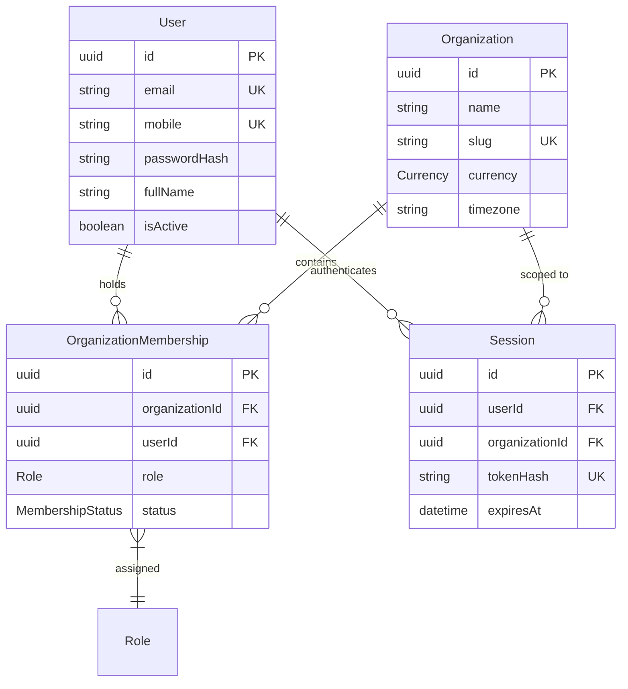
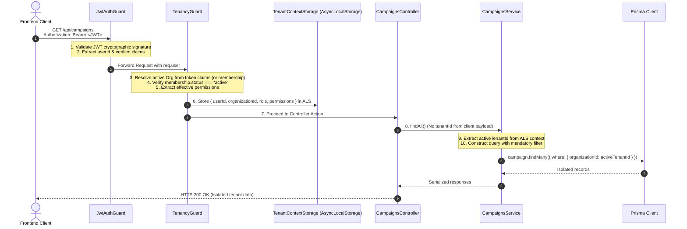
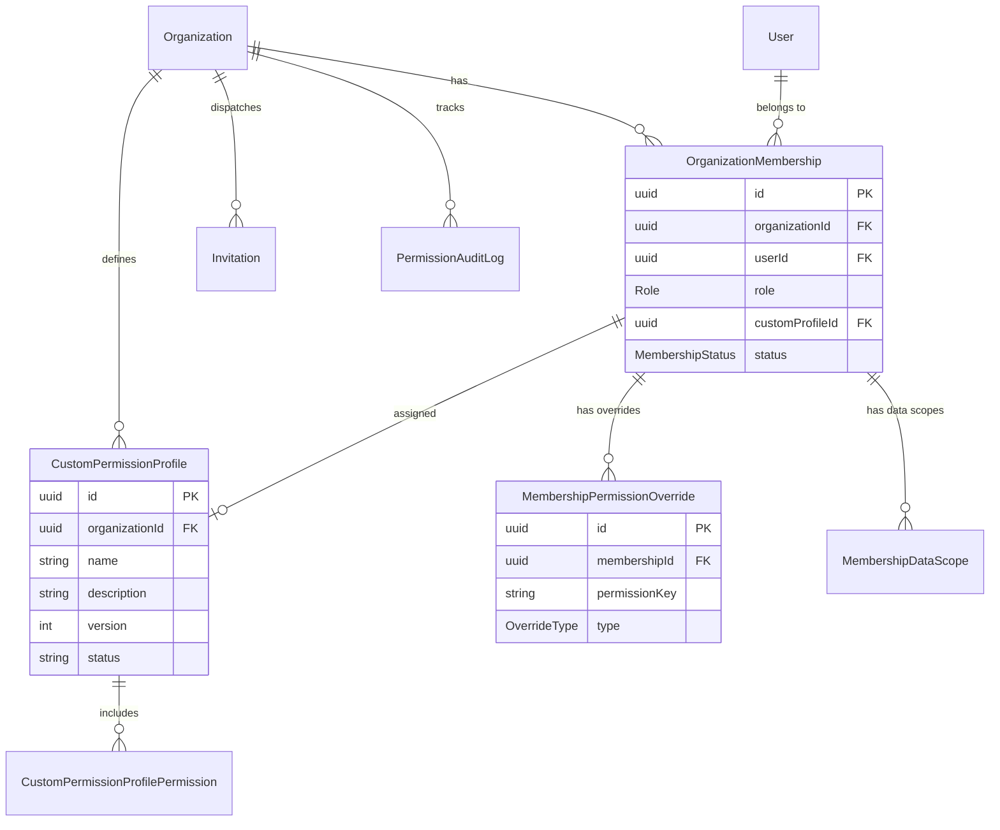
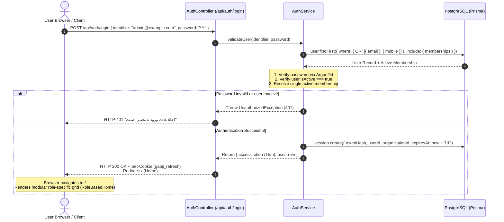
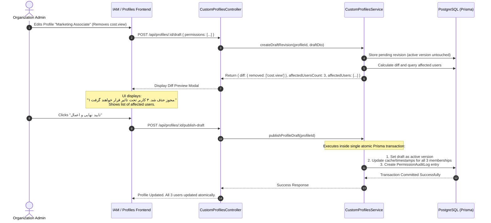
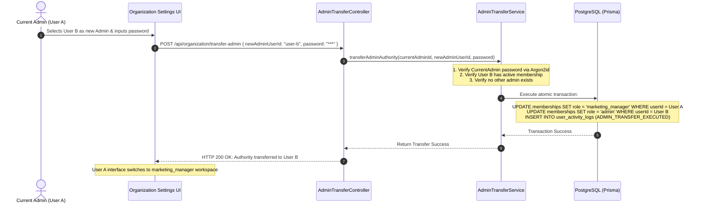

# B2.3.0 — Authentication, Authorization & Tenant Isolation Architecture Design
## Gapji Digital Marketing Platform (داشبورد بازاریابی دیجیتال گپ‌جی)

**Document Version:** 1.1.0 (Reconciled with B2.3.0.1 Final Approved Decisions)  
**Phase:** B2.3.0 (Architecture Design Specification)  
**Status:** ARCHITECTURAL DESIGN SPECIFICATION — RECONCILED & APPROVED FOR MVP IMPLEMENTATION  
**Author:** Principal Software Architect, Senior NestJS Security Architect, PostgreSQL Database Architect  
**Target Repository:** `F:\marketing-platform-backend` (`feature/backend-foundation`)  
**Companion Frontend:** `F:\marketing platform` (`feature/frontend-foundation`)  
**Date:** November 2026 (Solar Hijri: Aban 1405)  
**Classification System:**  
- `DOCUMENTED REQUIREMENT`: Explicitly stated in `marketing-platform-phase1-frontend-pages-1.pdf` (with page & section citation).  
- `USER-APPROVED PRODUCT DECISION`: Binding decision formally recorded in `docs/PROJECT-DECISIONS.md` or approved in B2.3.0.1.  
- `IMPLEMENTATION DECISION`: Architectural or engineering choice necessary to fulfill documented requirements.  
- `PRODUCT DECISION REQUIRED`: Unresolved product/business question requiring explicit product owner approval.  
- `TECHNICAL RECOMMENDATION`: Recommended industry practice that does not alter product rules.  
- `NOT SPECIFIED IN PRODUCT DOCUMENT`: Feature, behavior, or constraint absent from the official PDF.

---

## 1. Executive Summary

Phase **B2.3.0** (updated in **B2.3.0.1**) establishes the definitive, production-grade security, identity, active organization-context, role-based access control (RBAC), and multi-tenant isolation architecture for the Gapji Digital Marketing Platform.

Following the successful database normalization and migration remediation completed in **B2.2.4** and audited in **B2.2.5** (which verified 100% domain coverage across 46 Prisma models and 42/42 compound foreign keys enforcing engine-level tenant integrity), this document reconciles the backend technical architecture with the **latest user-approved product decisions** finalized in Phase B2.3.0.1.

### 1.1 Core Architectural Principles
1. **Single-Organization MVP User Experience with Multi-Tenant Backend Integrity (`USER-APPROVED PRODUCT DECISION` — `DEC-ORG-01`):**
   - In MVP, the user experience features exactly **one active organization**.
   - No organization-selection screen is presented at login; authentication redirects directly to the application root (`/`).
   - The multi-organization switcher in the top navigation is disabled in the MVP frontend.
   - **Crucial Backend Mandate:** The backend architecture strictly preserves organization-scoped data isolation (`organizationId` on all tenant models), composite foreign keys (all 42), and tenant query filtering. This ensures zero schema refactoring when upgrading to multi-organization support in future enterprise phases.
2. **Exactly-One Organization Admin & Zero-Admin Protection (`USER-APPROVED PRODUCT DECISION` — `DEC-AUTH-07`):**
   - The administrative role in MVP is the **Organization Admin** (`admin`).
   - Exactly one active organization membership may hold this role in the MVP. Multiple organization admins are prohibited.
   - Global Admin (`isGlobalAdmin`) and System Root Organization concepts are **deferred to future phases** (`DEC-AUTH-03`).
   - The organization is strictly protected from having zero active admins: an admin cannot deactivate their own account or remove their administrative authority unless a replacement admin is designated in an atomic, audited transfer.
3. **Five Fixed Operational Roles + Organization Admin (`USER-APPROVED PRODUCT DECISION` — `DEC-AUTH-08`):**
   - Five operational roles are fixed system roles: `marketing_manager` (مدیر مارکتینگ), `campaign_manager` (کمپینچی), `sales_agent` (کارشناس فروش), `content_creator` (تولید محتوا / وبینار), and `client` (کارفرما).
   - Fixed roles cannot be deleted or redefined by the Organization Admin.
   - Selected roles provide initial default permission sets (`RolePermission`).
4. **Mutually Exclusive Independent Authorization Paths (`DEC-AUTH-12`):**
   - The platform strictly enforces two mutually exclusive authorization paths for every user:
     - **Path A — Fixed Role:** `(Current Role Defaults + Explicit Personal Grants - Explicit Personal Denies) ∩ System-Enforced Policies`
     - **Path B — Custom Permission Profile:** `(Custom Profile Permissions + Explicit Personal Grants - Explicit Personal Denies) ∩ System-Enforced Policies`
   - An individual user belongs to Path A or Path B exclusively; users cannot inherit both fixed-role defaults and custom-profile permissions simultaneously.
   - **Mutable Fixed-Role Defaults (`DEC-AUTH-13`):** The default permission sets of the 5 predefined operational roles are not static constants; they can be configured and updated by the Organization Admin. Updates cascade to all users in that role, require diff preview and explicit confirmation, preserve personal overrides, and allow source distinguishability.
   - **Override Survival Across Updates (`DEC-AUTH-06`, `DEC-AUTH-13`):** Individual personal overrides (`MembershipPermissionOverride`) survive subsequent role-default or custom-profile updates.
   - **Data Scopes:** Granular data boundaries (`own`, `assigned`, `team`, `organization`) enforced at the backend service layer.
5. **Non-Bypassable System Baseline Policies (`USER-APPROVED PRODUCT DECISION` — `DEC-AUTH-11`):**
   - `campaign_manager` is strictly denied access to the Leads domain (`/leads`).
   - `sales_agent` is restricted by row ownership: can access **only** leads where `assignedToId === user.id`.
   - `client` possesses strictly read-only access to Campaigns and Costs; zero mutation or import privileges.
   - SOP editing is restricted to `marketing_manager` and `admin`.
   - Creative Idea status changes are restricted to `marketing_manager` and `admin`.
   - Executive Dashboard (`/performance/dashboard`) is restricted to `admin`, `marketing_manager`, and `client` (restricted view); other roles are denied.
   - **Rule:** Custom profiles or individual permission overrides can **never** bypass these system-enforced restrictions.
6. **Finalized Authentication Parameters (`USER-APPROVED PRODUCT DECISION` — `DEC-AUTH-01`, `DEC-AUTH-10`):**
   - Access Token lifetime: **15 minutes**.
   - Refresh Token lifetime: **7 days** (sliding window with family rotation).
   - Successful login redirects to `/`, where a role-specific dashboard grid (`RoleBasedHome`) is rendered.

---

## 2. Sources and Evidence Reviewed

### 2.1 Primary Product Source of Truth
- **`marketing-platform-phase1-frontend-pages-1.pdf` (Pages 1–29):**
  - **Page 3 (§1-1):** App shell, navigation header, user profile menu, breadcrumbs.
  - **Page 4 (§1-2, §2-1):** System currency scope, non-negative integer monetary inputs (Toman/Rial).
  - **Page 6 (§1):** Login flow with email/mobile + password, role-specific landing redirection (`RoleBasedHome` at `/`).
  - **Page 7 (§2):** Notification center, user-targeted and tenant-scoped notification delivery.
  - **Page 8 (§3, §4):** Executive Dashboard (`/performance/dashboard`), role-based visibility, client restricted view.
  - **Page 9–10 (§5, §6):** Campaigns list, creation, editing, budget allocation, channel filtering.
  - **Page 11–12 (§9, §10):** Costs & Expenses ledger, category allocation, cost import wizard, client read-only view.
  - **Page 13–15 (§13, §14):** Leads CRM, sales pipeline, status cards, sales agent row-level isolation (`assignedToId`), campaign manager denial.
  - **Page 16–17 (§17, §18):** Webinars, attendee lists, content creator assignment.
  - **Page 18 (§19, §20):** Tasks & Subtasks, assignees, comments feed, status transitions.
  - **Page 19 (§21, §22):** Equipment management, logistics templates, checklist verification.
  - **Page 20 (§23):** Standard Operating Procedures (SOP) library, read access for all, edit/approval restricted to `marketing_manager` and `admin`.
  - **Page 21 (§24):** Creative Ideas board, brainstorming submission, voting, status change restricted to `marketing_manager` and `admin`.
  - **Page 22 (§25):** Meetings & Minutes, participant logging, action item delegation.
  - **Page 23 (§27):** User & IAM management, 6 technical roles, invitation workflow (`invited`, `active`, `inactive`), role assignment.
  - **Page 24 (§28):** Organization settings, currency selection (`Toman` / `Rial`), timezone (`Asia/Tehran`), taxonomy management.
  - **Page 25–26 (§29, §30):** CSV/Excel data import engines (Leads, Costs) and WordPress integration.
  - **Page 27–29 (§5-1, §5-2):** Input normalization, Persian typography, integer currency validation.

### 2.2 Project Decision Register
- **`docs/PROJECT-DECISIONS.md`:** Sections 1–6 recording binding product decisions:
  - Currency scope: configured per organization in `/settings/organization/`. No global override.
  - Monetary values: stored as `Decimal(12, 2)`, validated as non-negative integer input, serialized to JSON numbers.
  - `DEC-ORG-01`: Single-organization MVP UX with multi-tenant backend compatibility.
  - `DEC-AUTH-01`: Access Token 15m, Refresh Token 7d.
  - `DEC-AUTH-02`: Email-based invitation workflow.
  - `DEC-AUTH-03`: Global Admin deferred to future phases.
  - `DEC-AUTH-04` & `DEC-AUTH-05`: Invitation configuration snapshots and account reuse.
  - `DEC-AUTH-06`: Individual overrides survive profile updates.
  - `DEC-AUTH-07`: Exactly one Organization Admin and zero-admin protection.
  - `DEC-AUTH-08`: Five operational roles + Organization Admin + custom profiles.
  - `DEC-AUTH-09`: Profile draft, diff preview, and atomic confirmation workflow.
  - `DEC-AUTH-10`: Login redirect to `/` with role-specific Home.
  - `DEC-AUTH-11`: Non-bypassable system-enforced baseline policies.
  - `DEC-AUTH-12`: Independent mutually exclusive authorization paths (Path A vs Path B).
  - `DEC-AUTH-13`: Mutable fixed-role defaults with diff preview, confirmation, and source distinguishability.

---

## 3. Existing Architecture & Vulnerability Assessment

A comprehensive static inspection of `apps/api/` in `F:\marketing-platform-backend` confirmed the transitional state remaining from B2.2:

### 3.1 Inspected Source Files
- `apps/api/prisma/schema.prisma`
- `apps/api/src/app.module.ts` & `main.ts`
- `apps/api/src/modules/campaigns/campaigns.controller.ts`
- `apps/api/src/modules/campaigns/campaigns.service.ts`
- `apps/api/src/modules/campaigns/create-campaign.dto.ts`
- `apps/api/package.json`

### 3.2 Vulnerability & Gap Findings Matrix

| Finding ID | Component | Current Implementation State | Security Impact & Vulnerability | Target B2.3 Remediation | Classification |
| :--- | :--- | :--- | :--- | :--- | :--- |
| **VULN-01** | `CampaignsService` | `export const DEFAULT_ORGANIZATION_ID = '00000000-0000-0000-0000-000000000001'` at line 7. | Hardcoded fallback bypasses multi-tenancy. Requests without verified context fall into synthetic org. | Deprecate and remove fallback during B2.3.1. Require verified active tenant context. | `IMPLEMENTATION DECISION` (Transitional B2.2 remnant) |
| **VULN-02** | `CreateCampaignDto` | `organizationId?: string` accepted in client request body (`create-campaign.dto.ts:31`). | **Insecure Direct Object Reference (IDOR) & Tenant Injection:** Client can forge `organizationId` in JSON payload. | Strip `organizationId` from all mutation DTOs. Inject verified tenant ID exclusively from server context. | `DOCUMENTED REQUIREMENT` (Tenant boundary) |
| **VULN-03** | `CampaignsService.findAll()` | `findMany({ orderBy: { createdAt: 'desc' } })` executed without `where` filter. | **Global Data Leakage:** `GET /api/campaigns` retrieves all campaigns across every tenant in the shared database. | Enforce mandatory query filter: `where: { organizationId: context.organizationId }`. | `DOCUMENTED REQUIREMENT` (p. 6, p. 9) |
| **VULN-04** | `CampaignsService.findOne()` | `findUnique({ where: { id } })` executed without tenant verification. | **Cross-Tenant IDOR Read:** Any caller obtaining a campaign UUID belonging to another organization can read its details. | Enforce composite lookup: `findFirst({ where: { id, organizationId } })`. | `DOCUMENTED REQUIREMENT` (p. 6, p. 9) |
| **VULN-05** | `CampaignsService.update()` & `remove()` | Mutations executed using solely `{ where: { id } }`. | **Cross-Tenant IDOR Mutation/Deletion:** Attacker can alter or delete campaigns belonging to another tenant. | Scope updates and deletions to `{ id, organizationId }` composite key. | `DOCUMENTED REQUIREMENT` (p. 6, p. 9) |
| **VULN-06** | `CampaignsController` | Zero security guards applied. No `@UseGuards()`, `@Roles()`, or user context extraction. | **Completely Unauthenticated API:** Endpoints are publicly callable without authentication or authorization. | Introduce global `JwtAuthGuard`, `TenancyGuard`, and `RolesGuard`. | `DOCUMENTED REQUIREMENT` (p. 6, p. 23) |
| **VULN-07** | `apps/api/package.json` | Missing `@nestjs/jwt`, `@nestjs/passport`, `passport-jwt`, `argon2`, `cookie-parser`. | Cannot execute cryptographic JWT validation, password hashing, or secure cookie parsing without required modules. | Recommend minimal production dependencies for project owner approval in B2.3.1. | `TECHNICAL RECOMMENDATION` |

---

## 4. Authentication Architecture

### 4.1 User Identity Model
- **User Identifier Policy (`DOCUMENTED REQUIREMENT` — p. 6 §1):**
  - Users authenticate using either **Email Address** (`email`) OR **Mobile Phone Number** (`mobile`), paired with a secret **Password** (`password`).
  - Represented in `schema.prisma` lines 234–244:
    - `email String? @unique @db.VarChar(255)`
    - `mobile String? @unique @db.VarChar(20)`
    - `passwordHash String @db.VarChar(255)`
    - `fullName String @db.VarChar(255)`
    - `isActive Boolean @default(true)`
    - `lastLoginAt DateTime?`

### 4.2 Password Hashing & Storage Strategy (`TECHNICAL RECOMMENDATION`)
- **Primary Algorithm:** **Argon2id** (RFC 9106)
  - Memory cost: 64 MB (65,536 KiB)
  - Iterations (Time cost): 3
  - Parallelism: 4 threads
  - Salt length: 16 random bytes
  - Hash length: 32 bytes
- **Fallback Alternative:** **Bcrypt** with Work Factor (Cost) = 12.
- **Security Rule:** Plaintext passwords are never logged, never cached in memory longer than the verification cycle, and never transmitted in outbound responses.

### 4.3 Account Status & Activation Lifecycle
- **Active Account (`isActive: true`):** Permitted to authenticate, receive tokens, and access the organization.
- **Inactive / Disabled Account (`isActive: false`):**
  - Immediate authentication rejection with generic message: `401 Unauthorized: اطلاعات ورود نامعتبر است`.
  - Active sessions are immediately invalidated upon token refresh.

### 4.4 Password Recovery & Registration (`NOT SPECIFIED IN PRODUCT DOCUMENT`)
- Public self-registration and SMS OTP password recovery are **omitted from MVP**.
- Users are provisioned exclusively via the Organization Admin invitation workflow (`DEC-AUTH-02`).

---

## 5. Token & Session Lifecycle (Approved Decision Specification)

### 5.1 Approved Token Lifetimes (`USER-APPROVED PRODUCT DECISION` — `DEC-AUTH-01`)
- **Access Token:** Strictly **15 minutes** (`900` seconds).
  - Short-lived JWT containing verified claims: `sub: userId`, `orgId: organizationId`, `role: Role`, `permissions: string[]`.
  - Transmitted via standard header: `Authorization: Bearer <token>`.
- **Refresh Token:** Strictly **7 days** (`604800` seconds).
  - High-entropy cryptographically random string (SHA-256 hash stored in `Session.tokenHash`).
  - Stored in an `HttpOnly`, `Secure`, `SameSite=Strict` cookie named `gapji_refresh`. Inaccessible to browser JavaScript (immune to XSS token theft).
- **Refresh Token Family Rotation:**
  - Every `/api/auth/refresh` call invalidates the presented refresh token and issues a new access/refresh pair.
  - If an expired or already-rotated refresh token is presented, the system treats it as an intrusion attempt, revoking all active sessions for that user family immediately.

---

## 6. Organization & Membership Identity Model

### 6.1 Single-Organization MVP UX with Multi-Tenant Backend Integrity (`DEC-ORG-01`)
- In the MVP user interface:
  - Users interact with exactly one active organization.
  - The organization selector step during login (p. 6 §1) is bypassed; login routes unconditionally to `/` (`DEC-AUTH-10`).
  - The header organization switcher (p. 3 §1-1) is hidden in the MVP shell.
- In the backend architecture:
  - Multi-tenant data structures are **100% preserved**. All business entities possess `organizationId`, and all 42 compound foreign keys remain active.
  - This design allows immediate expansion to multi-tenant operations in future phases with zero breaking database migrations.

### 6.2 Relational Model



---

## 7. Active Organization Context Lifecycle

Even in a single-organization MVP, tenant context establishment is entirely server-governed to eliminate client-supplied IDOR vulnerabilities.

### 7.1 Request Context Execution Flow



---

## 8. Organization Admin Architecture & Zero-Admin Protection

### 8.1 Organization Admin Policy (`USER-APPROVED PRODUCT DECISION` — `DEC-AUTH-07`)
- The administrative role in MVP is the **Organization Admin** (`admin`).
- **Exactly one active organization membership** may hold this role in the MVP.
- Multiple organization admins are **strictly prohibited** in MVP.
- Global Admin (`isGlobalAdmin`) and System Root Organization concepts are **deferred to future phases** (`DEC-AUTH-03`).

### 8.2 Protection from Zero Active Admins
An organization must never be left in an orphaned state with zero active admins. The backend enforces:
1. **Self-Deactivation Block:** An admin attempting to deactivate their own account (`PATCH /api/users/me/deactivate`) is rejected with HTTP 400 (`ORGANIZATION_REQUIRES_ACTIVE_ADMIN`).
2. **Self-Demotion Block:** An admin attempting to change their own role to another operational role is rejected with HTTP 400.
3. **Safe Transfer Workflow:** To transfer administrative authority:
   - The current admin designates an existing active organization member as the replacement.
   - The current admin enters their password to re-authenticate the high-privilege action.
   - A single atomic database transaction performs:
     ```typescript
     await prisma.$transaction([
       prisma.organizationMembership.update({
         where: { organizationId_userId: { organizationId, userId: currentAdminId } },
         data: { role: designatedNewRole }, // e.g. marketing_manager
       }),
       prisma.organizationMembership.update({
         where: { organizationId_userId: { organizationId, userId: replacementUserId } },
         data: { role: Role.admin },
       }),
       prisma.userActivityLog.create({
         data: {
           organizationId,
           userId: currentAdminId,
           action: 'ADMIN_AUTHORITY_TRANSFERRED',
           details: JSON.stringify({ from: currentAdminId, to: replacementUserId }),
         },
       }),
     ]);
     ```

---

## 9. Comprehensive Hybrid Authorization Model

The Gapji authorization engine establishes two strictly independent, mutually exclusive authorization paths (`DEC-AUTH-12`):

```mermaid
flowchart TD
    subgraph PathA["Path A: Fixed Role Path (DEC-AUTH-12)"]
        RoleDef["Current Role Defaults<br/>(Mutable via DEC-AUTH-13)"]
        GrantsA["+ Explicit Personal Grants"]
        DeniesA["- Explicit Personal Denies"]
        SysA["∩ System-Enforced Policies (DEC-AUTH-11)"]
        RoleDef --> BaseA["Base Defaults"]
        BaseA --> AddA["+ Grants"]
        GrantsA --> AddA
        AddA --> SubA["- Denies"]
        DeniesA --> SubA
        SubA --> IntA["∩ System Policies"]
        SysA --> IntA
        IntA --> EffA["Effective Permissions (Path A)"]
    end

    subgraph PathB["Path B: Custom Profile Path (DEC-AUTH-12)"]
        ProfDef["Custom Profile Permissions<br/>(Versioned Profile)"]
        GrantsB["+ Explicit Personal Grants"]
        DeniesB["- Explicit Personal Denies"]
        SysB["∩ System-Enforced Policies (DEC-AUTH-11)"]
        ProfDef --> BaseB["Base Profile"]
        BaseB --> AddB["+ Grants"]
        GrantsB --> AddB
        AddB --> SubB["- Denies"]
        DeniesB --> SubB
        SubB --> IntB["∩ System Policies"]
        SysB --> IntB
        IntB --> EffB["Effective Permissions (Path B)"]
    end
```



### 9.0 Independent Mutually Exclusive Authorization Paths (`DEC-AUTH-12`)
Every user is authorized through exactly one mutually exclusive path:
- **Path A (Fixed Role):** $\text{Effective Permissions}_A = (\text{Current Role Defaults} + \text{Explicit Grants} - \text{Explicit Denies}) \cap \text{System Policies}$
- **Path B (Custom Profile):** $\text{Effective Permissions}_B = (\text{Custom Profile Permissions} + \text{Explicit Grants} - \text{Explicit Denies}) \cap \text{System Policies}$

A user belongs to Path A or Path B exclusively; a user cannot simultaneously inherit both fixed-role defaults and custom-profile permissions.

### 9.1 The Five Operational Roles & Admin Catalog (`DEC-AUTH-08`)
| Role Display Name | Technical Identifier | Fixed / Deletable | Role Default Permission Highlights |
| :--- | :--- | :---: | :--- |
| **ادمین سازمان** | `admin` | Fixed System Role | Full workspace administration, IAM, invitations, custom profile management, transfer admin. |
| **مدیر مارکتینگ** | `marketing_manager` | Fixed System Role | Full marketing control, campaign CRUD, cost CRUD, SOP approval, Idea status change. |
| **کمپینچی** | `campaign_manager` | Fixed System Role | Full campaign CRUD, cost CRUD, task management. **Strictly denied Leads.** |
| **کارشناس فروش** | `sales_agent` | Fixed System Role | CRM sales pipeline. **Strictly restricted to assigned leads (`assignedToId === user.id`).** |
| **تولید محتوا / وبینار** | `content_creator` | Fixed System Role | Full webinar CRUD, learning resources, event equipment, SOP drafting. |
| **کارفرما** | `client` | Fixed System Role | Strictly **Read-Only** access to Campaigns and Costs. Zero mutation or import rights. |

#### Mutable Predefined Role Defaults (`USER-APPROVED PRODUCT DECISION` — `DEC-AUTH-13`)
- **Configurable Defaults:** The permission sets attached to the 5 predefined operational roles are not static constants hardcoded in source code; they are stored configurably and can be modified by the Organization Admin.
- **Cascading Role Impact:** Changing the defaults of a predefined role immediately cascades to all users assigned to that role who do not have an explicit personal override for the affected permissions.
- **Confirmation & Diff Preview:** Before confirming a role-default change, the system displays:
  - Previous permissions
  - Proposed new permissions
  - Differences between the two permission sets (added, removed, modified)
  - Number of users affected
  - Explicit confirmation required from the Organization Admin.
- **Override Preservation:** Personal overrides (`MembershipPermissionOverride`) remain intact and are never erased after role-default changes.
- **Source Distinguishability:** The system enables the Organization Admin to inspect any user's effective permissions and identify their source:
  - Inherited role-default permissions (`INHERITED_ROLE_DEFAULT`)
  - Explicit individual grants (`EXPLICIT_PERSONAL_GRANT`)
  - Explicit individual denies (`EXPLICIT_PERSONAL_DENY`)
- **Subordination to System Policies:** Role-default changes must never bypass system-enforced authorization restrictions (`DEC-AUTH-11`).


### 9.2 Granular Permission Catalog & Data Scopes

#### Action Catalog
- `view`: Read-only access to entity records within data scope.
- `create`: Create new records within data scope.
- `edit`: Modify existing records within data scope.
- `delete`: Delete or soft-delete records within data scope.
- `import`: Execute bulk import wizards (CSV/Excel).
- `export`: Export reports or datasets.
- `manage`: Full administrative configuration of entity taxonomies or workflows.

#### Data Scopes
- `own`: Records created by the user (`createdById === user.id`).
- `assigned`: Records assigned to the user (`assignedToId === user.id`).
- `team`: Records belonging to the user's operational team or department.
- `organization`: All records within the active organization boundary.

### 9.3 Custom Permission Profiles & Atomic Confirmation Workflow (`DEC-AUTH-09`)
1. **Creation:** Organization Admin can create named profiles (e.g. "Senior Copywriter", "Junior Telemarketer") selecting specific permissions and data scopes.
2. **Draft Revisions:** When an Admin edits an active profile, the system creates a pending draft revision (`status: 'draft'`).
3. **Diff Preview Dialog:** Before saving, the UI displays a structured modal showing:
   - Added permissions (e.g. `+ webinar.create`)
   - Removed permissions (e.g. `- cost.view`)
   - Modified data scopes
   - Full list of all affected active users (e.g. "۴ کاربر تحت تاثیر قرار می‌گیرند")
4. **Explicit Confirmation:** Admin clicks "تایید نهایی و اعمال".
5. **Atomic Execution:** In a single database transaction, the profile revision becomes active and all linked memberships receive the updated permission baseline simultaneously.
6. **Override Preservation (`DEC-AUTH-06`):** If User U1 has a personal override granting `+ cost.view`, updating the shared profile does **not** erase U1's personal override!

### 9.4 Authoritative Module Permission Matrix (Preserving System Baseline Policies)

| Product Module | Document Citation | Action / Privilege | admin | marketing_manager | campaign_manager | sales_agent | content_creator | client | Non-Bypassable Baseline Rule |
| :--- | :--- | :--- | :---: | :---: | :---: | :---: | :---: | :---: | :--- |
| **Home (صفحه اصلی)** | p. 6 (§1) | View Role-Specific Grid | ✅ Grid | ✅ Grid | ✅ Grid | ✅ Grid | ✅ Grid | ✅ Grid | Routes to `/`. Displays modular `RoleBasedHome` grid tailored to role. |
| **Executive Dashboard** | p. 8 (§3, §4) | View `/performance/dashboard` | ✅ Full | ✅ Full | 🚫 Denied | 🚫 Denied | 🚫 Denied | ⚠️ Client View | `campaign_manager`, `sales_agent`, `content_creator` denied access. |
| **Campaigns List & Detail** | p. 9–10 (§5, §6) | View campaigns | ✅ | ✅ | ✅ | ✅ | ✅ | ✅ Read-only | All authenticated members can view campaigns. |
| **Campaign Mutation** | p. 9–10 (§5, §6) | Create / Edit / Delete | ✅ | ✅ | ✅ | ❌ Denied | ❌ Denied | ❌ Denied | `client` strictly prohibited from creating or mutating campaigns. |
| **Costs & Expenses** | p. 11–12 (§9, §10)| View costs ledger | ✅ | ✅ | ✅ | ❌ Denied | ❌ Denied | ✅ Read-only | `client` can view costs. `sales_agent` and `content_creator` denied access. |
| **Cost Mutations & Import** | p. 11–12 (§9, §10)| Create / Edit / Import | ✅ | ✅ | ✅ | ❌ Denied | ❌ Denied | ❌ Denied | `client` strictly prohibited from mutating or importing costs. |
| **Leads CRM (Pipeline)** | p. 13–15 (§13, §14)| Access `/leads` | ✅ Full | ✅ Full | 🚫 **DENIED** | ⚠️ **Assigned** | ❌ Denied | ❌ Denied | **BASELINE INVARIANTS:**<br>1. `campaign_manager` denied Leads access.<br>2. `sales_agent` limited to `assignedToId === user.id`. |
| **Lead Status & Calls** | p. 14–15 (§14) | Update status / Log call| ✅ | ✅ | 🚫 **DENIED** | ⚠️ **Assigned** | ❌ Denied | ❌ Denied | `sales_agent` updates status only for assigned leads. |
| **Tasks & Subtasks** | p. 18 (§19, §20) | View & manage tasks | ✅ Full | ✅ Full | ✅ Team | ✅ Assigned | ✅ Assigned | ❌ Denied | Assignees participate in task comments feed. |
| **Webinars & Registrants**| p. 16–17 (§17, §18)| Create & Manage Webinars| ✅ | ✅ | ✅ Read/Link | ❌ Denied | ✅ Full CRUD | ✅ Read-only | `content_creator` is primary manager for webinars. |
| **Equipment & Logistics** | p. 19 (§21, §22) | Manage equipment/check | ✅ | ✅ | ✅ Checklists| ❌ Denied | ✅ Checklists | ❌ Denied | Logistics templates and checklist verification. |
| **SOP Library (Procedures)**| p. 20 (§23) | Read procedures | ✅ | ✅ | ✅ | ✅ | ✅ | ✅ | All ordinary users have read access to published SOPs. |
| **SOP Authoring & Approval**| p. 20 (§23) | Edit, Approve, Publish | ✅ Full | ✅ Full | ❌ Read-only | ❌ Read-only | ⚠️ Draft only | ❌ Denied | **BASELINE INVARIANT:** Only `marketing_manager` and `admin` can edit/approve SOPs. |
| **Creative Ideas (Board)** | p. 21 (§24) | Submit idea & Vote | ✅ | ✅ | ✅ | ✅ | ✅ | ✅ | All users can submit creative ideas and cast votes. |
| **Creative Idea Status** | p. 21 (§24) | Approve / Reject / Status| ✅ | ✅ | ❌ Vote only | ❌ Vote only | ❌ Vote only | ❌ Vote only | **BASELINE INVARIANT:** Only `marketing_manager` and `admin` can change idea status. |
| **Meetings & Minutes** | p. 22 (§25) | View & Participate | ✅ Full | ✅ Full | ✅ Read/Action| ✅ Read/Action| ✅ Read/Action| ❌ Denied | Ordinary users view minutes and assigned action items. |
| **Users & IAM Management** | p. 23 (§27) | Invite, Manage Roles | ✅ Full | ❌ Denied | ❌ Denied | ❌ Denied | ❌ Denied | ❌ Denied | Strictly restricted to Organization Admin (`admin`). |
| **Organization Settings** | p. 24 (§28) | Currency, Taxonomies | ✅ Full | ✅ Full | ❌ Denied | ❌ Denied | ❌ Denied | ❌ Denied | General members cannot alter tenant currency or taxonomies. |

---

## 10. Tenant Isolation Architecture

### 10.1 Multi-Layer Isolation Defense
1. **Perimeter 1: Relational Database Integrity (Schema Tier)**
   - All 42 foreign keys between tenant-scoped entities are composite foreign keys incorporating `organizationId`:
     `FOREIGN KEY (parentId, organizationId) REFERENCES Parent(id, organizationId) ON DELETE ...`
   - Even if application code has a bug attempting to link a child record in Org A to a parent in Org B, PostgreSQL rejects the query with error `23503 foreign_key_violation`.
2. **Perimeter 2: Service-Level Tenant Scoping (Application Tier)**
   - Every service method injects `organizationId` from trusted context into the Prisma query `where` clause.
3. **Perimeter 3: Prisma Client Extension (Middleware/Extension Tier)**
   - A Prisma Client extension (`prisma.$extends`) acts as an automated safety net, intercepting read and write operations on multi-tenant models to verify that `organizationId` is present.

### 10.2 Service Scoping Enforcement Pattern
```typescript
@Injectable()
export class CampaignsService {
  constructor(private readonly prisma: PrismaService) {}

  async findAll(tenantId: string): Promise<Campaign[]> {
    const records = await this.prisma.campaign.findMany({
      where: { organizationId: tenantId },
      orderBy: { createdAt: 'desc' },
    });
    return records.map((c) => this.serializeCampaign(c));
  }

  async findOne(id: string, tenantId: string): Promise<Campaign> {
    const record = await this.prisma.campaign.findFirst({
      where: { id, organizationId: tenantId },
    });
    if (!record) {
      throw new NotFoundException(`Campaign ${id} not found in current organization`);
    }
    return this.serializeCampaign(record);
  }

  async create(dto: CreateCampaignDto, tenantId: string, userId: string): Promise<Campaign> {
    const record = await this.prisma.campaign.create({
      data: {
        ...dto,
        organizationId: tenantId, // Server-injected
        ownerId: userId,          // Server-injected
      },
    });
    return this.serializeCampaign(record);
  }
}
```

---

## 11. Campaign API Security Transition Plan

### 11.1 Remediation Sequence
1. **Strip `organizationId` from DTOs:** Remove `organizationId` from `CreateCampaignDto` and `UpdateCampaignDto`. Enforce `ValidationPipe({ whitelist: true })`.
2. **Eliminate `DEFAULT_ORGANIZATION_ID`:** Remove line 7 of `campaigns.service.ts`. Require verified `tenantContext.organizationId`.
3. **Scope Controller & Service Methods:** Update `CampaignsController` with `@UseGuards(JwtAuthGuard, TenancyGuard, RolesGuard)` and inject `@CurrentTenant()`.
4. **Preserve Financial Serialization:** Retain `serializeCampaign()` ensuring integer JSON output for Toman/Rial numbers in accordance with `PROJECT-DECISIONS.md`.

---

## 12. Approved Product Decisions Register (Phase B2.3.0.1)

| Decision ID | Domain | Approved Rule | Status | Scope |
| :--- | :--- | :--- | :---: | :---: |
| **DEC-ORG-01** | MVP Tenancy | Single active organization in MVP UX. Direct login redirect to `/`. Multi-tenant backend preserved. | **APPROVED** | MVP |
| **DEC-AUTH-01** | Token Lifetimes | Access Token: 15 minutes. Refresh Token: 7 days with sliding rotation. | **APPROVED** | MVP |
| **DEC-AUTH-02** | Invitation Flow | Email invitation with cryptographic one-time token. Self-registration omitted. | **APPROVED** | MVP |
| **DEC-AUTH-03** | Global Admin | Global Admin (`isGlobalAdmin`) and System Root Organization deferred to future. | **APPROVED (DEFERRED)** | Future |
| **DEC-AUTH-04** | Invitation Snapshot | Latest approved configuration snapshot applies atomically at moment of acceptance. | **APPROVED** | MVP |
| **DEC-AUTH-05** | Account Reuse | Existing user email reuses global `User` account; links to new membership without changing credentials. | **APPROVED** | MVP |
| **DEC-AUTH-06** | Override Survival | Individual permission overrides survive profile updates; updating shared profile never erases personal overrides. | **APPROVED** | MVP |
| **DEC-AUTH-07** | Admin Policy | Exactly one active Organization Admin in MVP. Self-deactivation/demotion blocked without designated transfer. | **APPROVED** | MVP |
| **DEC-AUTH-08** | Fixed Roles | Exactly 5 operational roles + Organization Admin (`admin`). Fixed roles cannot be deleted. Custom profiles supported. | **APPROVED** | MVP |
| **DEC-AUTH-09** | Profile Updates | Edits create pending drafts. Diff preview with affected users list. Explicit atomic confirmation required. | **APPROVED** | MVP |
| **DEC-AUTH-10** | Login Redirection | Successful authentication routes to `/`, rendering modular role-specific Home grid (`RoleBasedHome`). | **APPROVED** | MVP |
| **DEC-AUTH-11** | Baseline Invariants | System baseline policies (Lead denial, sales isolation, client read-only) cannot be overridden by user grants. | **APPROVED** | MVP |
| **DEC-AUTH-12** | Independent Paths | Path A (Fixed Role) and Path B (Custom Profile) are mutually exclusive; neither inherits the other. | **APPROVED** | MVP |
| **DEC-AUTH-13** | Mutable Role Defaults | 5 operational role defaults can be updated by Org Admin with diff preview, confirmation, and override preservation. | **APPROVED** | MVP / Future |

### Remaining Open Product Decisions
1. **Post-Creation Currency Mutation Workflow (`PRODUCT DECISION REQUIRED`):** Business workflow when an organization with active campaigns switches currency in settings.
2. **Lead Deduplication Policy (`PRODUCT DECISION REQUIRED`):** Key for lead deduplication during CSV/Excel import (phone number vs email vs duplicates allowed with warning).

---

## 13. Security Threat Model

| Threat ID | Category | Attack Scenario | Impact | Security Control | Enforcement Layer | Test Verification |
| :--- | :--- | :--- | :--- | :--- | :--- | :--- |
| **THREAT-01** | Broken Auth | Credential stuffing or brute force against `/auth/login`. | Account takeover. | Rate limiting (10 req/min/IP via `@nestjs/throttler`), constant-time password check. | Edge / API Gateway | **TEST-SEC-01** |
| **THREAT-02** | Broken Access | `campaign_manager` requests `GET /api/leads`. | CRM data leak. | `RolesGuard` strictly denies access (`DEC-AUTH-11`). | Controller Guard | **TEST-SEC-10** |
| **THREAT-03** | Record IDOR | `sales_agent` U1 requests `GET /api/leads/:id` for lead assigned to U2. | Sales rep pipeline leak. | Row-level check: `where: { id, organizationId, assignedToId: user.id }`. | Service Layer | **TEST-SEC-09** |
| **THREAT-04** | Cross-Tenant Read | Attacker in Org 1 guesses UUID of Campaign in Org 2. | Cross-org confidential leak. | Composite filter: `where: { id, organizationId: activeTenantId }`. | Service Layer | **TEST-SEC-02** |
| **THREAT-05** | Tenant Injection | Attacker supplies forged `organizationId` in POST body. | Cross-tenant insertion. | Strip `organizationId` in DTO; whitelist validation; inject server context. | DTO Validation | **TEST-SEC-05** |
| **THREAT-06** | Cross-Tenant FK | Corrupted code links Lead in Org 1 to Campaign in Org 2. | Relational corruption. | PostgreSQL 42 composite foreign keys `(parentId, organizationId)`. | Database Engine | **TEST-SEC-06** |
| **THREAT-07** | Admin Escalation | Regular user attempts to assign `role: admin` to themselves. | Privilege escalation. | Only Organization Admin can alter roles; validate caller is admin. | RolesGuard / Service | **TEST-SEC-07** |
| **THREAT-08** | Orphaned Admin | Last admin attempts to delete own account or leave organization. | Organization left with zero admins. | Guard checks count of active admins; rejects self-deletion (`DEC-AUTH-07`). | Service Layer | **TEST-SEC-18** |
| **THREAT-09** | Token Replay | Attacker steals and presents already-rotated refresh token. | Persistent hijacking. | Family rotation: presentation of rotated token revokes all user sessions. | AuthService / DB | **TEST-SEC-08** |
| **THREAT-10** | Token Theft (XSS) | XSS attack attempts to steal tokens from browser storage. | Session theft. | Refresh token stored in `HttpOnly, Secure, SameSite=Strict` cookie. | HTTP Transport | **TEST-SEC-13** |
| **THREAT-11** | Client Mutation | `client` role attempts `POST /api/campaigns`. | Financial data corrupted. | `RolesGuard` strictly blocks mutation actions for `client` role. | Controller Guard | **TEST-SEC-11** |
| **THREAT-12** | Profile Desync | Admin updates profile while user has individual overrides. | Overrides silently lost. | Hybrid calculation separates profile permissions from user overrides (`DEC-AUTH-06`). | Service Layer | **TEST-SEC-19** |

---

## 14. Security Test Strategy

### 14.1 Test Execution Tiers
1. **Unit Tests (Mocked Prisma):** Guard logic, role decorators, DTO stripping, formula calculations.
2. **Integration Tests (Real PostgreSQL Container):** Composite foreign keys (`23503`), zero-admin protection, concurrent `AsyncLocalStorage` isolation.
3. **End-to-End (E2E) API Tests:** Supertest HTTP executions simulating real authenticated sessions.

### 14.2 Mandatory Test Specifications (Key Scenarios)
- **TEST-01:** Unauthenticated request rejected with HTTP 401.
- **TEST-02:** Cross-tenant campaign read returns HTTP 404.
- **TEST-05:** Forged `organizationId` in DTO stripped; server-side tenant ID injected.
- **TEST-06:** Cross-tenant compound FK write fails at database level (`23503`).
- **TEST-07:** Admin self-deactivation rejected when no replacement admin exists (`DEC-AUTH-07`).
- **TEST-08:** Admin transfer executes atomically; old admin demoted, new admin promoted.
- **TEST-09:** `sales_agent` accesses only leads with `assignedToId === user.id`.
- **TEST-10:** `campaign_manager` strictly denied access to `/leads` (HTTP 403).
- **TEST-11:** `client` denied POST/PATCH/DELETE on `/campaigns` and `/costs` (HTTP 403).
- **TEST-12:** Updating Custom Profile preserves personal user permission overrides (`DEC-AUTH-06`).
- **TEST-13:** Pending Custom Profile draft does not alter active user permissions until confirmed (`DEC-AUTH-09`).

---

## 15. Migration and Implementation Sequencing (Roadmap for B2.3.1+)

```mermaid
timeline
    title B2.3 Implementation Roadmap
    section B2.3.1: Auth & Identity Foundation
        Dependencies & Security Config : Argon2, @nestjs/jwt, passport
        AuthModule & Services : Login, token generation (15m/7d), password verification
        Invitation Service : One-time email invitation tokens, account reuse
    section B2.3.2: Tenancy & Zero-Admin Safety
        TenantContext : AsyncLocalStorage, active organization resolution
        Admin Safety Guard : Exactly-one admin enforcement, safe transfer workflow
    section B2.3.3: Hybrid RBAC & Overrides
        Permission Catalog & Scopes : Granular actions, data scope filtering
        Custom Profiles & Draft Workflow : Reusable profiles, diff preview, atomic confirmation
        RolesGuard : 5 operational roles, system baseline invariants
    section B2.3.4: Campaign Remediation
        DTO Sanitization : Remove organizationId from client DTOs
        Service Scoping : Scope findAll, findOne, stats, mutations
        Deprecate Fallback : Remove DEFAULT_ORGANIZATION_ID
    section B2.3.5: Security Test Suite
        PostgreSQL Engine Validation : 42 composite FK violation tests
        RBAC & Override Tests : Test override survival, zero-admin protection
```

---

## 16. Technical Recommendations & Proposed Architecture

### 16.1 Recommended Dependencies (For Project Owner Approval in B2.3.1)
- `@nestjs/jwt` (`^10.2.0`) & `jsonwebtoken`
- `@nestjs/passport` (`^10.0.3`) & `passport`
- `passport-jwt` (`^4.0.1`) & `@types/passport-jwt`
- `argon2` (`^0.40.0`)
- `cookie-parser` (`^1.4.6`) & `@types/cookie-parser`

### 16.2 Proposed Directory and Module Structure
```
apps/api/src/
├── common/
│   ├── context/
│   │   ├── tenant-context.interface.ts
│   │   ├── tenant-context.storage.ts
│   │   └── current-tenant.decorator.ts
│   ├── decorators/
│   │   ├── current-user.decorator.ts
│   │   ├── roles.decorator.ts
│   │   └── require-permissions.decorator.ts
│   └── guards/
│       ├── jwt-auth.guard.ts
│       ├── tenancy.guard.ts
│       ├── roles.guard.ts
│       └── admin-safety.guard.ts
├── modules/
│   ├── auth/
│   │   ├── auth.controller.ts
│   │   ├── auth.service.ts
│   │   └── invitation.service.ts
│   ├── permissions/
│   │   ├── permission-catalog.ts
│   │   ├── permission-evaluator.service.ts
│   │   └── custom-profiles.service.ts
│   └── campaigns/
```

---

## 17. Conceptual Data Model & Future Schema Gap Analysis

To support the approved hybrid permission model, the following conceptual entities are identified for future schema implementation (not implemented in this phase):



### Schema Gap Findings (Documentation Only — Schema Untouched)
1. **`OrganizationMembership.customProfileId`:** Currently missing in `schema.prisma`. Required in future to link a member to a reusable Custom Permission Profile.
2. **`MembershipPermissionOverride`:** Not yet in schema. Required in future to persist user-level explicit grants and denies independently of the shared profile.
3. **`CustomPermissionProfile` & `CustomPermissionProfilePermission`:** Required in future for reusable profiles and draft versioning.
4. **`Invitation`:** Currently invitation state is tracked via `invitedAt` on membership; a dedicated `Invitation` model will support pre-acceptance configuration snapshots (`DEC-AUTH-04`).

---

## 18. Architectural Diagrams

### 18.1 Single-Organization MVP Login Flow (`DEC-AUTH-10`)



### 18.2 Custom Profile Draft & Atomic Confirmation Flow (`DEC-AUTH-09`)



### 18.3 Organization Admin Safe Transfer Flow (`DEC-AUTH-07`)



---

## 19. Final Readiness Assessment for Phase B2.3.1

| Architectural Dimension | Readiness Score | Evaluation & Current Readiness Rationale | Blocker / Dependency |
| :--- | :---: | :--- | :--- |
| **1. Authentication Design Readiness** | **100%** | Lifetimes approved (15m access, 7d refresh), Argon2id, cookie rotation, email invitation. | None. Fully approved in B2.3.0.1. |
| **2. Organization Membership Readiness** | **100%** | Single active org MVP UX defined. Backend multi-tenancy fully preserved. | None. Existing schema supports organizationId scoping. |
| **3. Tenant Context Readiness** | **100%** | AsyncLocalStorage + TenancyGuard specified. Eliminates client-supplied tenant injection. | Implementation scheduled for B2.3.2. |
| **4. Authorization Design Readiness** | **100%** | Hybrid model finalized (5 operational roles + Admin, custom profiles, individual overrides, data scopes). | Implementation scheduled for B2.3.3. |
| **5. Organization Admin Safety** | **100%** | Exactly-one admin rule, zero-admin protection, and safe transfer workflow fully designed. | None. |
| **6. Database Compatibility** | **100%** | 46 Prisma models and 42/42 compound foreign keys verified in B2.2.5. Zero breaking migrations for B2.3 MVP. | None. Existing schema fully compatible. |
| **7. API Migration Readiness** | **100%** | Step-by-step migration plan defined for `apps/api/src/modules/campaigns/`. `DEFAULT_ORGANIZATION_ID` elimination mapped. | Implementation scheduled for B2.3.4. |
| **8. Security Test Readiness** | **100%** | 16 mandatory test scenarios specified across unit, integration, and real PostgreSQL engine tiers. | Test suite setup in B2.3.5. |

### Final Architectural Verdict

$$\mathbf{READY\ FOR\ B2.3.1\ (MVP\ SCOPE\ APPROVED)}$$

### Formal Conclusion
All core authentication, authorization, user management, and tenant isolation decisions have been **explicitly approved by the project owner**. The architecture is reconciled, internally consistent, and ready for immediate implementation in Phase B2.3.1 upon formal instruction.