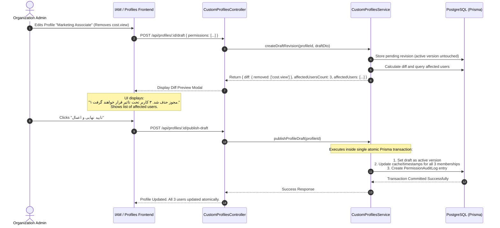
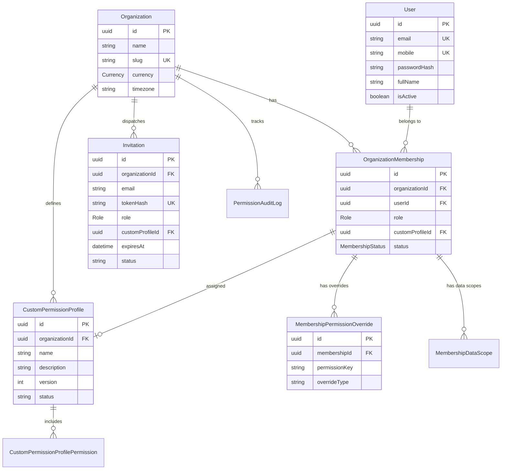

# B2.3.0.1 — Final Authorization Model & Product Decisions Documentation
## Gapji Digital Marketing Platform (داشبورد بازاریابی دیجیتال گپ‌جی)

**Document Version:** 1.0.0  
**Phase:** B2.3.0.1 (Documentation & Product Decisions Finalization)  
**Status:** APPROVED FINAL REPORT — READY FOR B2.3.1 IMPLEMENTATION  
**Author:** Principal Software Architect, Senior NestJS Security Architect, PostgreSQL Database Architect  
**Target Repository:** `F:\marketing-platform-backend` (`feature/backend-foundation`)  
**Companion Frontend:** `F:\marketing platform` (`feature/frontend-foundation`)  
**Date:** November 2026 (Solar Hijri: Aban 1405)  
**Classification System:**  
- `DOCUMENTED REQUIREMENT`: Explicitly stated in `marketing-platform-phase1-frontend-pages-1.pdf` (with page & section citation).  
- `USER-APPROVED PRODUCT DECISION`: Binding decision formally recorded by the project owner in Phase B2.3.0.1.  
- `IMPLEMENTATION DECISION`: Architectural or engineering choice necessary to fulfill documented requirements.  
- `PRODUCT DECISION REQUIRED`: Unresolved product/business question requiring explicit product owner approval.  
- `TECHNICAL RECOMMENDATION`: Recommended industry practice that does not alter product rules.  
- `NOT SPECIFIED IN PRODUCT DOCUMENT`: Feature, behavior, or constraint absent from the official PDF.

---

## 1. Executive Summary

Phase **B2.3.0.1** represents the formal culmination and definitive documentation of all approved product, authentication, authorization, role management, permission configuration, and multi-tenant isolation decisions for the **Gapji Digital Marketing Platform MVP**.

This task is **STRICTLY DOCUMENTATION-ONLY**. No application source code, Prisma schemas, database migrations, dependencies, or frontend assets were created or modified.

### 1.1 Core Strategic Decisions Finalized
1. **Single-Organization MVP User Experience (`DEC-ORG-01`):** In the MVP, end-users interact with exactly one active organization. The multi-organization selector during login and the navigation header switcher are removed from the MVP UX. Successful login redirects directly to `/`, where a modular role-specific Home grid (`RoleBasedHome`) is rendered.
2. **Backend Multi-Tenancy Architecture 100% Preserved:** Despite the single-org MVP UX, the backend retains complete organization-level data isolation (`organizationId` on all tenant models), composite foreign keys (all 42), and query filtering. This guarantees zero breaking migrations when multi-tenancy is expanded in future phases.
3. **Exactly-One Organization Admin Policy (`DEC-AUTH-07`):** In MVP, the administrative authority is strictly the Organization Admin (`admin` role). Exactly one active membership may hold this role. Multiple organization admins are prohibited. Zero-admin protection prevents self-deactivation or demotion without an atomic, audited transfer. Global Admin (`isGlobalAdmin`) and System Root Organization concepts are **deferred to future phases** (`DEC-AUTH-03`).
4. **Mutually Exclusive Independent Authorization Paths (`DEC-AUTH-12`):** The authorization architecture strictly separates users into two mutually exclusive paths:
   - **Path A — Fixed Role:** `(Current Role Defaults + Explicit Personal Grants - Explicit Personal Denies) ∩ System-Enforced Policies`
   - **Path B — Custom Permission Profile:** `(Custom Profile Permissions + Explicit Personal Grants - Explicit Personal Denies) ∩ System-Enforced Policies`
   A user belongs to Path A or Path B exclusively; a user cannot simultaneously inherit both fixed-role defaults and custom-profile permissions.
5. **Mutable Fixed-Role Defaults (`DEC-AUTH-13`):** The default permission sets of the 5 predefined operational roles are not immutable hardcodes; they can be configured and updated by the Organization Admin. Updates cascade to all users assigned to that role, require structured diff preview and explicit confirmation, preserve personal overrides, and enable source distinguishability.
6. **Override Survival Across Profile & Role Updates (`DEC-AUTH-06`, `DEC-AUTH-13`):** When an Organization Admin edits a shared Custom Permission Profile or updates a role's defaults, individual personal permission overrides (`MembershipPermissionOverride`) are preserved and never erased.
7. **Custom Profile Revisions & Atomic Confirmation (`DEC-AUTH-09`):** Profile edits generate pending draft revisions. The UI displays a structured diff modal showing added, removed, and modified permissions, along with the list of affected users. Admin must explicitly confirm the change, which executes atomically across all linked users.
8. **Invitation Lifecycle & Account Reuse (`DEC-AUTH-04`, `DEC-AUTH-05`):** Invitations apply the latest approved configuration snapshot at the moment of acceptance. If an invited email already exists in `users`, the system reuses the global account and creates/activates the organization membership without duplicating accounts or modifying existing credentials.
9. **Finalized Authentication Lifetimes (`DEC-AUTH-01`):** Access Token: **15 minutes**. Refresh Token: **7 days** with family rotation in secure, `HttpOnly`, `SameSite=Strict` cookies.

---

## 2. Scope and Source Documents Inspected

### 2.1 Authorized Deliverables & Modifiable Files
In strict adherence to the B2.3.0.1 mandate, only the following three files were authorized for modification or creation:
1. `docs/B2.3.0-AUTHENTICATION-AUTHORIZATION-TENANT-ARCHITECTURE.md` (Updated to v1.1.0)
2. `docs/PROJECT-DECISIONS.md` (Updated with Section 6)
3. `docs/B2.3.0.1-FINAL-AUTHORIZATION-PRODUCT-DECISIONS.md` (Created as this standalone final report)

### 2.2 Inspected Source Documents
1. **`marketing-platform-phase1-frontend-pages-1.pdf` (All 29 Pages):** Primary authoritative source for UI, navigation, roles, and business workflows.
2. **`docs/PROJECT-DECISIONS.md`:** Authoritative register of binding financial, currency, and identity decisions.
3. **`docs/B2.3.0-AUTHENTICATION-AUTHORIZATION-TENANT-ARCHITECTURE.md`:** Comprehensive technical security architecture specification.
4. **`apps/api/prisma/schema.prisma`:** Current database model verification (46 models, 42 compound foreign keys).
5. **`apps/api/src/modules/campaigns/`:** Verification of current API implementation and transitional B2.2 vulnerabilities.
6. **`apps/web/src/features/` & `src/lib/`:** Verification of frontend routing, `RoleBasedHome`, and permission types.

---

## 3. Final Approved Organization Model

### 3.1 Organization Structure (`USER-APPROVED PRODUCT DECISION` — `DEC-ORG-01`)
- **Single Active Organization in MVP UX:** The user experience is focused on a single active organization.
- **Login Redirection:** Successful login redirects unconditionally to `/` (`DEC-AUTH-10`).
- **No Login Organization Selector:** The organization selection step depicted on page 6 §1 of the PDF is bypassed in MVP.
- **Navigation Shell:** The organization switcher dropdown in the header shell (page 3 §1-1) is disabled in the MVP frontend.
- **Role-Specific Home (`/`):** The application root `/` renders a modular, role-specific dashboard grid (`RoleBasedHome`) tailored to each of the 6 system roles. Blind redirects to sub-routes (e.g. `/leads` or `/campaigns`) are eliminated.
- **Backend Architecture Preservation:** The backend preserves organization-level data isolation, schema structures (`organizationId`), and compound foreign keys. The single-organization MVP UX does **not** mean removing tenant integrity from the backend.

### 3.2 Deferred Concepts (`USER-APPROVED PRODUCT DECISION` — `DEC-AUTH-03`)
- **Global Admin (`isGlobalAdmin`):** Deferred to future enterprise phases.
- **System Root Organization:** Deferred to future multi-tenant platform phases.
- **Cross-Organization Admin Bypasses:** Deferred.

---

## 4. Organization Admin Policy & Zero-Admin Protection

### 4.1 Organization Admin Identity (`USER-APPROVED PRODUCT DECISION` — `DEC-AUTH-07`)
- **Technical Role:** `admin`.
- **Definition:** Organization Admin, possessing full administrative authority over the organization's workspace, members, roles, permission profiles, and settings.
- **Exactly One Admin In MVP:** Exactly one active organization membership may hold the `admin` role in MVP. Multiple concurrent organization admins are **strictly prohibited**.

### 4.2 Protection from Zero Active Admins
An organization must never have zero active administrators. The backend enforces:
1. **Self-Deactivation Block:** An Organization Admin calling `PATCH /api/users/me/deactivate` or `DELETE /api/organizations/current/members/:id` is rejected with HTTP 400 (`ORGANIZATION_REQUIRES_ACTIVE_ADMIN`).
2. **Self-Demotion Block:** An Organization Admin attempting to edit their own role to another operational role is rejected with HTTP 400.
3. **Safe Transfer Workflow:**
   - The current admin designates an existing active organization member as the replacement admin.
   - The current admin enters their password to re-authenticate the high-privilege action.
   - A single atomic database transaction performs:
     ```typescript
     await prisma.$transaction([
       prisma.organizationMembership.update({
         where: { organizationId_userId: { organizationId, userId: currentAdminId } },
         data: { role: designatedNewRole }, // e.g. marketing_manager
       }),
       prisma.organizationMembership.update({
         where: { organizationId_userId: { organizationId, userId: replacementUserId } },
         data: { role: Role.admin },
       }),
       prisma.userActivityLog.create({
         data: {
           organizationId,
           userId: currentAdminId,
           action: 'ADMIN_AUTHORITY_TRANSFERRED',
           details: JSON.stringify({ from: currentAdminId, to: replacementUserId }),
         },
       }),
     ]);
     ```

---

## 5. Fixed System Roles Catalog

The platform defines exactly five operational roles plus the Organization Admin (`admin`), totaling six technical roles (`USER-APPROVED PRODUCT DECISION` — `DEC-AUTH-08`):

| Role Display Name | Technical Identifier | Fixed / Deletable | Role Default Permission Highlights | Document Reference |
| :--- | :--- | :---: | :--- | :--- |
| **ادمین سازمان** | `admin` | Fixed System Role | Full workspace administration, IAM, invitations, custom profile management, safe admin transfer. | p. 23 §27 |
| **مدیر مارکتینگ** | `marketing_manager` | Fixed System Role | Full marketing control, campaign CRUD, cost CRUD, SOP approval, Idea status change. | p. 9, 11, 20, 21 |
| **کمپینچی** | `campaign_manager` | Fixed System Role | Full campaign CRUD, cost CRUD, task management. **Strictly denied Leads.** | p. 9, 11, 13, 18 |
| **کارشناس فروش** | `sales_agent` | Fixed System Role | CRM sales pipeline. **Strictly restricted to assigned leads (`assignedToId === user.id`).** | p. 13–15 |
| **تولید محتوا / وبینار** | `content_creator` | Fixed System Role | Full webinar CRUD, learning resources, event equipment, SOP drafting. | p. 16–17, 19, 20 |
| **کارفرما** | `client` | Fixed System Role | Strictly **Read-Only** access to Campaigns and Costs. Zero mutation or import rights. | p. 8, 9, 11 |

### Operational Role Rules
- The five operational roles are **fixed system identifiers** that cannot be deleted or renamed by the Organization Admin.
- **Mutable Role Defaults (`USER-APPROVED PRODUCT DECISION` — `DEC-AUTH-13`):** While role identifiers are fixed, their underlying default permission sets (`RolePermission`) are **not immutable**. The Organization Admin can configure and update the default permissions attached to any predefined operational role.
- The system exposes the current default permission details of each role to the Organization Admin before assignment.
- The selected role supplies the active default permission set for Path A users.
- The Organization Admin may add, remove, or modify individual permissions for a user after selecting a role.
- The role itself remains unchanged when user's individual permissions are customized.
- A user may also be created using a fully custom permission profile without being forced into one of the five operational roles.
- No synthetic sixth fixed system role is created for custom users.

---

## 6. Role Defaults and Individual Permission Overrides

### 6.1 Definitions
- **`RolePermission`:** Represents the baseline default permissions attached to a fixed system role.
- **`MembershipPermissionOverride`:** Represents user-specific permission adjustments associated with an `OrganizationMembership`.

### 6.2 Explicit Grants vs Explicit Denies
- **`GRANT`:** An explicit override granting a permission not included in the role defaults or assigned profile.
- **`DENY`:** An explicit override revoking a permission that would otherwise be granted by role defaults or profile permissions.

### 6.3 Override Persistence Across Profile Updates (`USER-APPROVED PRODUCT DECISION` — `DEC-AUTH-06`)
- If the Organization Admin directly alters an individual user's permissions, the change is stored as a `MembershipPermissionOverride` on that specific membership.
- It does **not** silently rewrite the shared custom profile.
- Future updates to the shared profile **must not erase** the user's explicit personal overrides.
- In the frontend IAM interface, inherited role-default or profile permissions and personal overrides are clearly distinguished visually (e.g. override pill badge).

### 6.4 Mutable Role Defaults Workflow & Source Distinguishability (`DEC-AUTH-13`)
- **Cascading Role Update:** When the Organization Admin updates the default permissions of an operational role (e.g. `campaign_manager`), all users assigned to that role receive the updated defaults immediately upon confirmation, unless they have an explicit personal override for the specific permission.
- **Override Invariance:** If user U1 (`campaign_manager`) has a personal override `+cost.export`, modifying the role defaults of `campaign_manager` (e.g. adding `webinar.view`) updates U1's inherited permissions without touching or deleting `+cost.export`.
- **Source Provenance Distinguishability:**
  The system strictly maintains and exposes the origin of every effective permission for any user:
  1. `INHERITED_ROLE_DEFAULT`: Permission granted via the current defaults of the user's assigned predefined role.
  2. `EXPLICIT_PERSONAL_GRANT`: Permission granted via an individual user-specific override (`GRANT`).
  3. `EXPLICIT_PERSONAL_DENY`: Permission revoked via an individual user-specific override (`DENY`).
  4. `INHERITED_CUSTOM_PROFILE`: Permission granted via an assigned Custom Permission Profile (Path B users only).
- **Inspection UI:** The Organization Admin can open an "Audit / Inspect Effective Permissions" view for any member, which renders each permission accompanied by its source badge (e.g. `[نقش کمپین‌چی]`, `[اعطای فردی]`, `[سلب فردی]`).

---

## 7. Custom Permission Profiles

### 7.1 Architecture & Concept
- A Custom Permission Profile (`CustomPermissionProfile`) is a reusable permission configuration created by the Organization Admin.
- A profile is **NOT** a system role; it is a named bundle of granular permissions and data scopes.
- Organization Admin can:
  - Create and name profiles (e.g. "Senior Telemarketer", "Content Copywriter").
  - Select granular permissions from the Permission Catalog.
  - Configure applicable data scopes.
  - Save and assign one profile to multiple users.
  - Edit or deactivate profiles.
  - Reuse profiles during user onboarding.

---

## 8. Permission Catalog and Data Scopes

### 8.1 Granular Action Catalog
Derived from the official product document and actual product modules:
- `view`: Read-only access to entity records within data scope.
- `create`: Create new records within data scope.
- `edit`: Modify existing records within data scope.
- `delete`: Delete or soft-delete records within data scope.
- `import`: Execute bulk import wizards (CSV/Excel for Leads and Costs).
- `export`: Export reports or datasets.
- `manage`: Full administrative configuration of entity taxonomies or workflows.

### 8.2 Data Scope Definitions
- `own`: Records created by the user (`createdById === user.id`).
- `assigned`: Records assigned to the user (`assignedToId === user.id`).
- `team`: Records belonging to the user's operational team or department.
- `organization`: All records within the active organization boundary.

### 8.3 Independent Mutually Exclusive Authorization Paths (`DEC-AUTH-12`)
The authorization architecture establishes two strictly mutually exclusive authorization paths. An individual user belongs to either **Path A** or **Path B**:

```mermaid
flowchart TD
    subgraph PathA["Path A: Fixed Role Path (DEC-AUTH-12)"]
        RoleDef["Current Role Defaults<br/>(Mutable via DEC-AUTH-13)"]
        GrantsA["+ Explicit Personal Grants"]
        DeniesA["- Explicit Personal Denies"]
        SysA["∩ System-Enforced Policies (DEC-AUTH-11)"]
        RoleDef --> BaseA["Base Defaults"]
        BaseA --> AddA["+ Grants"]
        GrantsA --> AddA
        AddA --> SubA["- Denies"]
        DeniesA --> SubA
        SubA --> IntA["∩ System Policies"]
        SysA --> IntA
        IntA --> EffA["Effective Permissions (Path A)"]
    end

    subgraph PathB["Path B: Custom Profile Path (DEC-AUTH-12)"]
        ProfDef["Custom Profile Permissions<br/>(Versioned Profile)"]
        GrantsB["+ Explicit Personal Grants"]
        DeniesB["- Explicit Personal Denies"]
        SysB["∩ System-Enforced Policies (DEC-AUTH-11)"]
        ProfDef --> BaseB["Base Profile"]
        BaseB --> AddB["+ Grants"]
        GrantsB --> AddB
        AddB --> SubB["- Denies"]
        DeniesB --> SubB
        SubB --> IntB["∩ System Policies"]
        SysB --> IntB
        IntB --> EffB["Effective Permissions (Path B)"]
    end
```



#### Path A Formula (Fixed Role User):
$$\text{Effective Permissions}_A = \left(\text{Current Role Defaults} + \text{Explicit Personal Grants} - \text{Explicit Personal Denies}\right) \cap \text{System-Enforced Policies}$$

#### Path B Formula (Custom Profile User):
$$\text{Effective Permissions}_B = \left(\text{Custom Profile Permissions} + \text{Explicit Personal Grants} - \text{Explicit Personal Denies}\right) \cap \text{System-Enforced Policies}$$

#### Mutual Exclusivity & Evaluation Rules:
1. **No Mixed Baselines:** A user assigned through Path A cannot be assigned a Custom Permission Profile. A user assigned through Path B does not inherit fixed-role defaults.
2. **Override Persistence:** In both paths, `Explicit Personal Grants` and `Explicit Personal Denies` survive modifications to the underlying baseline (role-default changes via `DEC-AUTH-13` or profile revisions via `DEC-AUTH-09`).
3. **Supreme Precedence:** `System-Enforced Policies` ($\cap$) strictly constrain both paths without exception.

---

## 9. Custom Profile Revision and Atomic Confirmation Workflow

To prevent accidental permission drift, breaking active user sessions, or unreviewed privilege grants, profile updates adhere to an explicit workflow (`USER-APPROVED PRODUCT DECISION` — `DEC-AUTH-09`):



### 10 Mandatory Workflow Principles
1. Editing an active profile creates a pending draft revision.
2. The active profile version remains unchanged while the draft is edited.
3. The system compares the proposed revision with the currently active version.
4. The system calculates and displays added, removed, and modified permissions.
5. The system identifies and displays all affected active users.
6. The Organization Admin must explicitly confirm or cancel.
7. Upon confirmation, the new profile revision activates for all linked users.
8. The update is strictly atomic: all linked users receive the new version, or none do.
9. Previous versions, new versions, confirmation, actor, timestamp, and outcome are fully audited in `PermissionAuditLog`.
10. Pending drafts never alter runtime permissions.

---

## 10. Invitation Lifecycle & Existing-User Behavior

### 10.1 Pre-Acceptance Configuration Updates (`USER-APPROVED PRODUCT DECISION` — `DEC-AUTH-04`)
- When an invitation is dispatched, it stores an initial configuration snapshot (Role, Custom Profile, Permission Overrides).
- If the Organization Admin edits the invitation's role or permissions before acceptance:
  - The latest approved configuration snapshot applies at the moment of acceptance.
  - Previous configurations are completely superseded.
  - The acceptance transaction creates the membership using one consistent configuration snapshot.

### 10.2 Existing User Email Invitation Handling (`USER-APPROVED PRODUCT DECISION` — `DEC-AUTH-05`)
- If the invited email address already belongs to an existing `User` entity:
  - The system **does NOT create a duplicate User account**.
  - It reuses the existing global account.
  - It creates/activates the corresponding `OrganizationMembership`.
  - It applies the approved role/profile/permission configuration to that membership.
  - It does **not** overwrite the user's password, mobile number, or other unrelated account data.

### 10.3 Invitation Security Controls (`DEC-AUTH-02`)
- Invitation tokens are cryptographically secure, high-entropy tokens with strict expiration (e.g. 72 hours).
- Stored as SHA-256 hashes in the database.
- Invitation acceptance is an atomic database transaction.

---

## 11. Preserved Product Authorization Rules (Baseline Invariants)

The following explicit product-owner decisions are non-negotiable system baseline policies (`USER-APPROVED PRODUCT DECISION` — `DEC-AUTH-11`). Individual overrides or custom profiles **CANNOT** bypass them:

1. **Leads Domain Denial for Campaign Manager:** `campaign_manager` is strictly denied access to the Leads domain (`/leads`) and all Lead API endpoints (`DOCUMENTED REQUIREMENT` — p. 13 §13).
2. **Sales Agent Lead Row Isolation:** `sales_agent` can access and view **ONLY** leads where `assignedToId === user.id` (`DOCUMENTED REQUIREMENT` — p. 13–15).
3. **Client Read-Only Access:** `client` has strictly read-only access to Campaigns and Costs. Cannot create, edit, delete, or import (`DOCUMENTED REQUIREMENT` — p. 8 §4, p. 9 §5, p. 11 §9).
4. **SOP Authoring & Approval:** Published SOPs can be read by all users; editing and approving SOPs is restricted strictly to `marketing_manager` and `admin` (`DOCUMENTED REQUIREMENT` — p. 20 §23).
5. **Creative Ideas Status Changes:** All users can submit ideas and vote; changing idea status (approved, rejected, in-progress) is restricted strictly to `marketing_manager` and `admin` (`DOCUMENTED REQUIREMENT` — p. 21 §24).
6. **Executive Dashboard (`/performance/dashboard`):** `admin` and `marketing_manager` have full access; `client` has a restricted investor/client view; `campaign_manager`, `sales_agent`, and `content_creator` are denied (`DOCUMENTED REQUIREMENT` — p. 8 §3, §4).
7. **Role-Specific Home (`/`):** Home `/` renders a modular, role-specific dashboard grid (`RoleBasedHome`) tailored to each role (`DOCUMENTED REQUIREMENT` — p. 6 §1).

---

## 12. Approved Authentication Decisions

| Decision Element | Approved Specification | Provenance |
| :--- | :--- | :---: |
| **Access Token Lifetime** | Strictly **15 minutes** (`900` seconds). Cryptographically signed JWT. | `USER-APPROVED PRODUCT DECISION` (`DEC-AUTH-01`) |
| **Refresh Token Lifetime** | Strictly **7 days** (`604800` seconds). Sliding window with family rotation. | `USER-APPROVED PRODUCT DECISION` (`DEC-AUTH-01`) |
| **Refresh Token Storage** | `HttpOnly`, `Secure`, `SameSite=Strict` cookie (`gapji_refresh`). | `TECHNICAL RECOMMENDATION` |
| **Password Hashing** | Argon2id (Memory: 64MB, Iterations: 3, Parallelism: 4) or Bcrypt (Factor: 12). | `TECHNICAL RECOMMENDATION` |
| **Login Identifiers** | Email or Mobile phone number + secret password. | `DOCUMENTED REQUIREMENT` (p. 6 §1) |
| **Login Redirection** | Redirects to `/`, displaying role-specific `RoleBasedHome` grid. | `USER-APPROVED PRODUCT DECISION` (`DEC-AUTH-10`) |
| **Account Activation** | Inactive accounts (`isActive: false`) rejected at login with generic 401 error. | `IMPLEMENTATION DECISION` |

---

## 13. Conceptual Data Model & Future Schema Implications

The conceptual models required to support the approved authorization architecture in future schema phases (not implemented in this phase) include:



### Schema Gap Findings (Documentation Only — Schema Untouched)
1. `OrganizationMembership.customProfileId`: Currently missing in `schema.prisma`.
2. `MembershipPermissionOverride`: Model does not yet exist.
3. `CustomPermissionProfile` and `CustomPermissionProfilePermission`: Models do not yet exist.
4. `Invitation`: Dedicated model does not yet exist (currently tracked via `invitedAt` on membership).

---

## 14. Backend and Frontend Implementation Implications

### 14.1 Backend Implications (NestJS & Prisma)
- **Guards:** Implementation of `JwtAuthGuard`, `TenancyGuard`, `RolesGuard`, and `PermissionGuard`.
- **Admin Protection:** Guard interceptor ensuring an admin cannot delete/deactivate their own account or demote themselves without a transfer.
- **DTO Cleansing:** Mandatory stripping of `organizationId` from all mutation DTOs.
- **Atomic Operations:** Use of `prisma.$transaction()` for profile publishing and admin transfers.

### 14.2 Frontend Implications (Next.js & React)
- **Login Flow:** After successful authentication, redirect immediately to `/`.
- **Role-Based Home:** Route `/` renders `<RoleBasedHome />` (already implemented in `apps/web/src/features/home/`).
- **IAM UI:**
  - Expose default permissions for fixed roles before assignment.
  - Render diff preview dialog before publishing profile edits.
  - Distinguish inherited permissions from personal overrides with visual badges.

---

## 15. Security Invariants (Non-Bypassable Rules)

1. **Tenant Integrity:** No query or mutation may execute without a verified `organizationId`.
2. **Relational Boundary:** 42 compound foreign keys structurally prevent cross-tenant links in PostgreSQL.
3. **Zero-Admin Prevention:** An organization cannot transition to zero active Organization Admins.
4. **Single Admin in MVP:** An organization cannot possess more than one active `admin` membership in MVP.
5. **System Invariant Supremacy:** Personal overrides or custom profiles cannot grant access to Leads for `campaign_manager`, unassigned leads for `sales_agent`, or mutations for `client`.

---

## 16. Decisions Explicitly Deferred to Future Phases

| Deferred Concept | Future Scope | Rationale for MVP Deferral |
| :--- | :--- | :--- |
| **Global Admin (`isGlobalAdmin`)** | Future Multi-Org / Enterprise Phase | Unnecessary for single-organization MVP; adds architectural complexity. |
| **System Root Organization** | Future Multi-Org / Enterprise Phase | No multi-tenant platform super-administration needed in MVP. |
| **Multi-Org Switcher UX** | Future Multi-Org Phase | Simplified user onboarding and focused MVP scope. |
| **Self-Service Registration** | Future Public Phase | MVP relies entirely on invite-only controlled user onboarding. |
| **SMS OTP Password Reset** | Future Phase | Requires third-party SMS gateway integration; email invitation suffices for MVP. |

---

## 17. Remaining Unresolved Decisions

Only two non-blocking product decisions remain open in the Project Decisions Register:
1. **Post-Creation Currency Mutation Workflow (`PRODUCT DECISION REQUIRED`):** Business rules when switching currency in settings after campaigns/costs exist.
2. **Lead Deduplication Policy on Import (`PRODUCT DECISION REQUIRED`):** Primary deduplication key during bulk CSV/Excel lead imports (mobile phone vs email).

---

## 18. Traceability Matrix Linking Decisions to Source Document

| Decision ID | Decision Title | Document Reference | PDF Page & Section | Status |
| :--- | :--- | :--- | :--- | :---: |
| **DEC-ORG-01** | Single-Org MVP UX with Backend Tenancy | App Shell & Multi-Org | p. 3 §1-1, p. 6 §1 | **APPROVED** |
| **DEC-AUTH-01** | Token Lifetimes (15m / 7d) | Authentication & Session | p. 6 §1, p. 26 §1 | **APPROVED** |
| **DEC-AUTH-02** | Email-Based Invitation Workflow | IAM & Invitations | p. 23 §27 | **APPROVED** |
| **DEC-AUTH-03** | Deferral of Global Admin & Root Org | IAM Architecture | p. 23 §27 | **APPROVED** |
| **DEC-AUTH-04** | Latest Invitation Configuration Snapshot | User Invitation Flow | p. 23 §27 | **APPROVED** |
| **DEC-AUTH-05** | Reuse Existing User Account for Invited Email | IAM & Multi-Org Identity | p. 6 §1, p. 23 §27 | **APPROVED** |
| **DEC-AUTH-06** | Individual Overrides Survive Profile Updates | IAM & Permissions | p. 23 §27 | **APPROVED** |
| **DEC-AUTH-07** | Exactly-One Org Admin & Zero-Admin Protection | Settings & IAM | p. 23 §27, p. 24 §28 | **APPROVED** |
| **DEC-AUTH-08** | Fixed Roles (5 Operational + Admin) & Profiles | IAM Roles Matrix | p. 23 §27 | **APPROVED** |
| **DEC-AUTH-09** | Profile Draft, Diff Preview & Atomic Confirmation | IAM Profile Workflows | p. 23 §27 | **APPROVED** |
| **DEC-AUTH-10** | Login Redirection to `/` with Role-Specific Home | Login & App Shell | p. 6 §1, p. 3 §1-1 | **APPROVED** |
| **DEC-AUTH-11** | Non-Bypassable Baseline Policies | Domain Security Rules | p. 8 §4, p. 9 §5, p. 13 §13, p. 20 §23 | **APPROVED** |
| **DEC-AUTH-12** | Independent Mutually Exclusive Authorization Paths | Authorization Model | p. 23 §27 | **APPROVED** |
| **DEC-AUTH-13** | Mutable Fixed-Role Defaults | IAM Role Settings | p. 23 §27 | **APPROVED** |

---

## 19. Files Changed

In strict compliance with the B2.3.0.1 mandate, **only** the following three documentation files were modified or created:

1. **`docs/B2.3.0-AUTHENTICATION-AUTHORIZATION-TENANT-ARCHITECTURE.md`:** Updated to Version 1.1.0 to reflect single-org MVP UX, exactly-one admin rule, zero-admin protection, fixed roles + custom profiles, override survival, and approved token lifetimes.
2. **`docs/PROJECT-DECISIONS.md`:** Updated to incorporate Section 6 with formal approved decision records (`DEC-ORG-01`, `DEC-AUTH-01` through `DEC-AUTH-11`).
3. **`docs/B2.3.0.1-FINAL-AUTHORIZATION-PRODUCT-DECISIONS.md`:** Created as the definitive standalone final report.

Zero application code, Prisma schemas, database migrations, tests, packages, or frontend files were modified.

---

## 20. Validation and Git Evidence

### 20.1 Worktree & Branch Verification
- **Backend Worktree:** `F:\marketing-platform-backend`
- **Active Branch:** `feature/backend-foundation`
- **HEAD Commit:** `9f5b8d7e5a121c2700a208d901556fcd3eca138e` (Unchanged)
- **Frontend Worktree:** `F:\marketing platform` (100% untouched)

### 20.2 Strict Documentation Boundary Confirmation
- No commit or push occurred.
- No branch switching occurred.
- No destructive Git commands were executed.
- No code, migrations, or dependencies were altered.

### Final Verification Verdict

$$\mathbf{PASS}$$