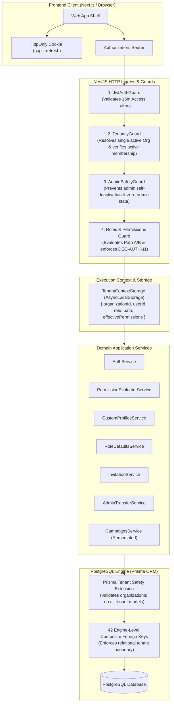
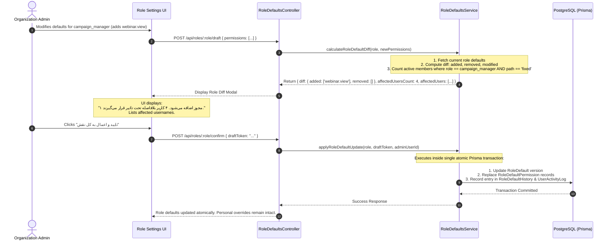
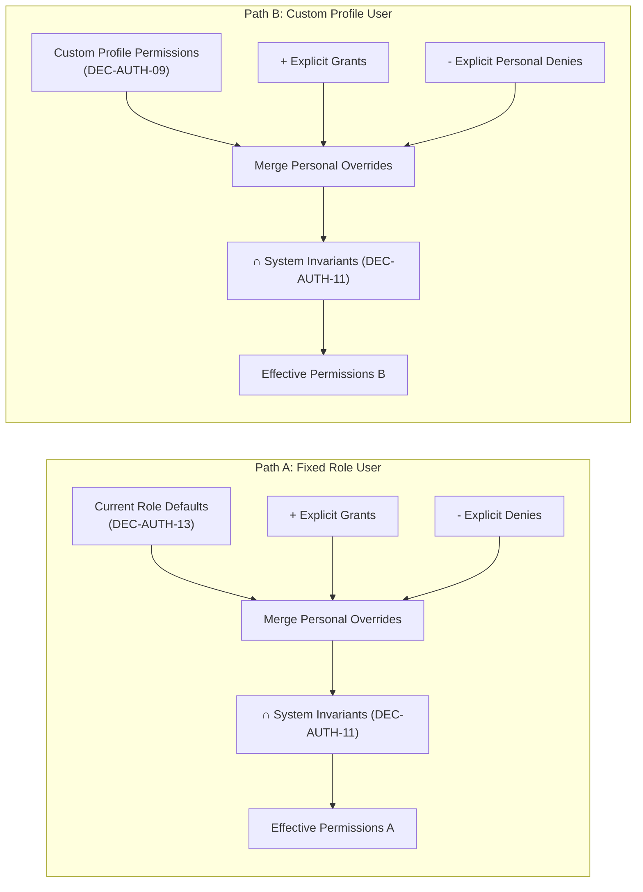
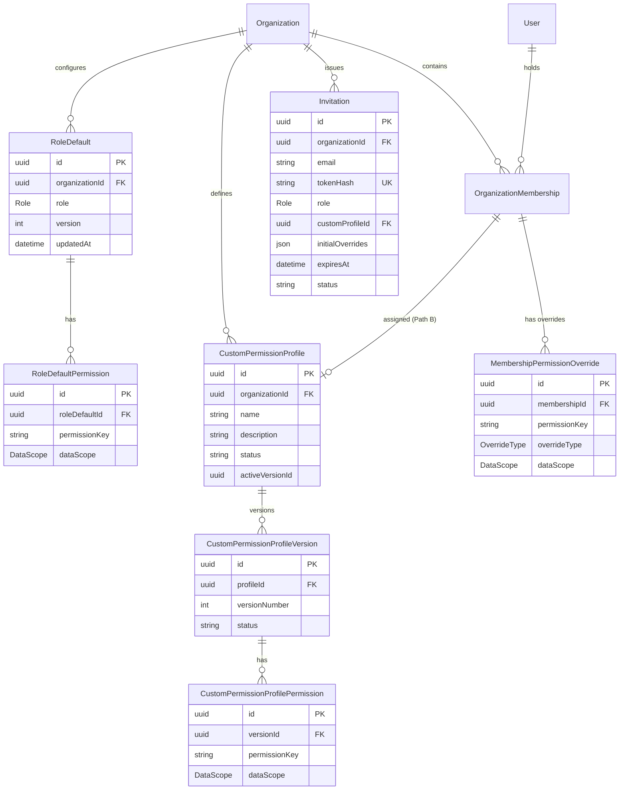

# B2.3.1 — Detailed Authentication & Authorization Implementation Design
## Gapji Digital Marketing Platform (داشبورد بازاریابی دیجیتال گپ‌جی)

**Document Version:** 1.0.0  
**Phase:** B2.3.1 (Detailed Implementation Design — Architecture & Engineering Specification)  
**Status:** DESIGN ONLY — READY FOR PRODUCT OWNER REVIEW & IMPLEMENTATION PHASING  
**Author:** Principal Software Architect, Senior NestJS Security Architect, PostgreSQL Database Architect  
**Target Repository:** `F:\marketing-platform-backend` (`feature/backend-foundation`)  
**Companion Frontend:** `F:\marketing platform` (`feature/frontend-foundation`)  
**Date:** November 2026 (Solar Hijri: Aban 1405)  
**Classification System:**  
- `DOCUMENTED REQUIREMENT`: Explicitly stated in `marketing-platform-phase1-frontend-pages-1.pdf` (with page & section citation).  
- `USER-APPROVED PRODUCT DECISION`: Binding decision formally recorded in `docs/PROJECT-DECISIONS.md` or Phase B2.3.0.1 / B2.3.0.2.  
- `IMPLEMENTATION DECISION`: Architectural or engineering choice necessary to fulfill documented requirements.  
- `TECHNICAL RECOMMENDATION`: Recommended industry practice that does not alter product rules.  
- `PRODUCT DECISION REQUIRED`: Unresolved product/business question requiring explicit product owner approval.  
- `NOT SPECIFIED IN PRODUCT DOCUMENT`: Feature, behavior, or constraint absent from the official PDF.

---

## 1. Executive Summary

Phase **B2.3.1** delivers the definitive, granular, implementation-ready technical design for Authentication, Authorization, Permission Management, User Invitations, and Tenant Isolation for the Gapji Digital Marketing Platform.

This phase is **STRICTLY DESIGN ONLY**. No application source code, Prisma schemas, database migrations, dependencies, or runtime configurations are modified.

### 1.1 The Architectural Transition
Prior phases established database normalization (B2.2.4) and product compliance auditing (B2.2.5), validating 100% domain coverage across 46 Prisma models and 42/42 compound foreign keys enforcing engine-level tenant integrity. Phases B2.3.0, B2.3.0.1, and B2.3.0.2 formalized the binding product decisions:
- Single-organization MVP user experience (`DEC-ORG-01`).
- Preserved backend multi-tenancy and data isolation (`DEC-ORG-01`).
- Exactly one active Organization Admin per organization with zero-admin protection (`DEC-AUTH-07`).
- Five fixed operational roles with configurable/mutable defaults (`DEC-AUTH-08`, `DEC-AUTH-13`).
- Two independent, mutually exclusive authorization paths: Path A (Fixed Role) vs Path B (Custom Profile) (`DEC-AUTH-12`).
- Survival of individual personal overrides across role-default and profile updates (`DEC-AUTH-06`, `DEC-AUTH-13`).
- Reusable Custom Permission Profiles with draft revisions, diff preview, and atomic confirmation (`DEC-AUTH-09`).
- Email-based user invitations with account reuse and snapshot consistency (`DEC-AUTH-02`, `DEC-AUTH-04`, `DEC-AUTH-05`).
- Non-bypassable system-enforced baseline policies (`DEC-AUTH-11`).
- Approved token lifetimes: Access Token = 15m, Refresh Token = 7d (`DEC-AUTH-01`).

This document translates these requirements into concrete NestJS modules, service contracts, data structures, evaluation algorithms, security guards, API endpoints, and a comprehensive test matrix.

---

## 2. Repository Baseline and Existing Findings

A thorough, read-only static inspection of the backend repository (`F:\marketing-platform-backend` on `feature/backend-foundation`) established the exact technical baseline:

### 2.1 Technology Stack & Installed Packages
- **Runtime & Framework:** Node.js, TypeScript 5.4.5, NestJS 10.3.0, Express platform.
- **ORM & Database:** Prisma 5.22.0, PostgreSQL (shared-database, shared-schema).
- **Validation & Serialization:** `class-validator` 0.14.1, `class-transformer` 0.5.1, `joi` 17.13.3.
- **API Documentation:** `@nestjs/swagger` 7.3.0.
- **Package Manager:** `pnpm` 9.15.4.
- **Critical Dependency Gap (`TECHNICAL RECOMMENDATION`):** The repository currently lacks `@nestjs/jwt`, `@nestjs/passport`, `passport`, `passport-jwt`, `argon2` (or `bcrypt`), and `cookie-parser`. These must be installed in Phase B2.3.2 upon project owner authorization.

### 2.2 Existing Prisma Schema State
The schema (`apps/api/prisma/schema.prisma`) contains 46 models and 24 enums. Crucial identity models already exist in the database:
1. `User` (lines 234–275): `id (UUID)`, `email`, `mobile`, `passwordHash`, `fullName`, `avatarUrl`, `isActive`, `lastLoginAt`, timestamps.
2. `Organization` (lines 279–336): `id (UUID)`, `name`, `slug`, `logoUrl`, `currency (TOMAN/RIAL)`, `timezone`, timestamps.
3. `OrganizationMembership` (lines 340–358): `id (UUID)`, `organizationId`, `userId`, `role (Role)`, `status (MembershipStatus)`, `invitedAt`, `joinedAt`, timestamps.
   - Enforces `@@unique([organizationId, userId])`.
   - `Role` enum (lines 16–23): `admin`, `marketing_manager`, `campaign_manager`, `sales_agent`, `content_creator`, `client`.
   - `MembershipStatus` enum: `invited`, `active`, `inactive`.
4. `Session` (lines 362–378): `id (UUID)`, `userId`, `organizationId`, `tokenHash`, `userAgent`, `ipAddress`, `expiresAt`, `createdAt`.
5. `UserActivityLog` (lines 1427–1447): `id (UUID)`, `organizationId?`, `userId?`, `action`, `entityType`, `entityId`, `details`, `ipAddress`, `userAgent`, `createdAt`.

### 2.3 Transitional Vulnerabilities in `apps/api/src/modules/campaigns/`
Inspection confirmed that the existing `campaigns` module operates in a transitional state:
- `DEFAULT_ORGANIZATION_ID = '00000000-0000-0000-0000-000000000001'` is hardcoded at line 7 of `campaigns.service.ts`.
- `CreateCampaignDto` accepts client-supplied `organizationId` (line 31), creating an IDOR vulnerability.
- `CampaignsService.findAll()` executes `findMany({ orderBy: { createdAt: 'desc' } })` with **zero** `where: { organizationId }` filter, leaking cross-tenant data.
- `CampaignsController` has zero authentication or role guards.

### 2.4 Existing Test Baseline
- `apps/api/src/modules/campaigns/campaigns.service.spec.ts` contains 10 automated unit and static verification tests.
- All service methods use mocked Prisma responses. Test 10 performs static schema and SQL regex verification of the 4 deletion restrictions and compound foreign keys.
- **Zero integration tests** against a real PostgreSQL engine exist currently.
- **Zero authentication or authorization tests** exist currently.

---

## 3. Product Requirements and Decision Traceability

Every architectural choice in this design traces directly to the official product document or explicit user-approved decisions:

| Requirement / Decision Element | Classification | Source Citation | Binding Decision ID | Architectural Fulfillment |
| :--- | :--- | :--- | :---: | :--- |
| **Single-Org MVP Experience** | `USER-APPROVED PRODUCT DECISION` | p. 6 §1, p. 3 §1-1 | `DEC-ORG-01` | Front-end bypasses org selector; login routes to `/`. Backend retains full tenant isolation. |
| **Direct Login to Home (`/`)** | `USER-APPROVED PRODUCT DECISION` | p. 6 §1 | `DEC-AUTH-10` | Auth controller returns redirect to `/`. Frontend renders modular `RoleBasedHome`. |
| **Token Lifetimes (15m / 7d)** | `USER-APPROVED PRODUCT DECISION` | p. 6 §1, p. 26 §1 | `DEC-AUTH-01` | Access token JWT 15m; Refresh token in `HttpOnly` cookie 7d with family rotation. |
| **Email-Only Invitations** | `USER-APPROVED PRODUCT DECISION` | p. 23 §27 | `DEC-AUTH-02` | Public signup blocked; user onboarding via cryptographic one-time invitation email. |
| **Global Admin Deferral** | `USER-APPROVED PRODUCT DECISION` | p. 23 §27 | `DEC-AUTH-03` | No `isGlobalAdmin` or Root Org in MVP. Administrative scope is strictly Organization Admin. |
| **Invitation Snapshotting** | `USER-APPROVED PRODUCT DECISION` | p. 23 §27 | `DEC-AUTH-04` | Latest configuration snapshot applied atomically at moment of invitation acceptance. |
| **Existing User Account Reuse** | `USER-APPROVED PRODUCT DECISION` | p. 6 §1, p. 23 §27 | `DEC-AUTH-05` | Existing email reuses global `User` row; links new membership without altering password. |
| **Override Persistence** | `USER-APPROVED PRODUCT DECISION` | p. 23 §27 | `DEC-AUTH-06`, `DEC-AUTH-13` | Personal overrides survive profile revisions and role-default mutations. |
| **Exactly-One Org Admin** | `USER-APPROVED PRODUCT DECISION` | p. 23 §27, p. 24 §28 | `DEC-AUTH-07` | Organization requires exactly 1 active admin; self-deactivation/demotion strictly blocked. |
| **Five Operational Roles** | `USER-APPROVED PRODUCT DECISION` | p. 23 §27 | `DEC-AUTH-08` | Fixed system role identifiers: marketing_manager, campaign_manager, sales_agent, content_creator, client. |
| **Profile Draft & Diff Preview** | `USER-APPROVED PRODUCT DECISION` | p. 23 §27 | `DEC-AUTH-09` | Editing profile creates draft; modal displays added/removed diff & affected user count before atomic save. |
| **System Invariants Supremacy** | `USER-APPROVED PRODUCT DECISION` | p. 8, 9, 11, 13, 20 | `DEC-AUTH-11` | System policies ($\cap$) override all user grants (e.g. Campaign Manager denied Leads). |
| **Mutually Exclusive Paths** | `USER-APPROVED PRODUCT DECISION` | p. 23 §27 | `DEC-AUTH-12` | Path A (Fixed Role) vs Path B (Custom Profile). User belongs to exactly one path. |
| **Mutable Role Defaults** | `USER-APPROVED PRODUCT DECISION` | p. 23 §27 | `DEC-AUTH-13` | Role defaults configurable by Admin with diff preview, confirmation, and source tracking. |

---

## 4. Current-State Gap Analysis

The following matrix contrasts what exists in the repository today against what must be engineered:

| Functional Area | Current Repository State | Target B2.3 Implementation Design | Gap Severity & Action |
| :--- | :--- | :--- | :--- |
| **Authentication Module** | Completely absent. No `/api/auth/` routes, services, or controllers. | `AuthModule`, `AuthService`, `AuthController` with login, refresh, logout, session family tracking. | **CRITICAL GAP:** Must be created in Phase B2.3.2. |
| **Crypto & Hashing** | No hashing library installed. `User.passwordHash` is a bare varchar column. | Argon2id integration for password hashing and verification; SHA-256 for token hashing. | **CRITICAL GAP:** Install `argon2`, implement `PasswordHasherService`. |
| **Guards & Interceptors** | Zero guards in `apps/api/src/`. No authentication checks on controllers. | Global `JwtAuthGuard`, `TenancyGuard`, `RolesGuard`, `PermissionGuard`, `AdminSafetyGuard`. | **CRITICAL GAP:** Build core guard pipeline. |
| **Tenant Context** | Hardcoded `DEFAULT_ORGANIZATION_ID` fallback; client-supplied `organizationId` in DTOs. | `TenantContextStorage` via Node.js `AsyncLocalStorage`, request extraction, DTO sanitization. | **CRITICAL GAP:** Remove fallback, sanitize DTOs, inject context. |
| **Role Defaults Storage** | Roles exist only as static PostgreSQL enum `Role`. No permission mapping. | `RoleDefault` & `RoleDefaultPermission` models storing configurable defaults per role (`DEC-AUTH-13`). | **SCHEMA EXTENSION REQUIRED:** Document conceptual models. |
| **Custom Profiles** | No custom profile tables or services exist. | `CustomPermissionProfile` with draft versioning, diff calculation, and atomic publishing (`DEC-AUTH-09`). | **SCHEMA EXTENSION REQUIRED:** Document conceptual models. |
| **Personal Overrides** | No table for individual user overrides. | `MembershipPermissionOverride` storing explicit `GRANT` and `DENY` records per membership (`DEC-AUTH-06`). | **SCHEMA EXTENSION REQUIRED:** Document conceptual models. |
| **Invitation Model** | Tracked only via nullable `invitedAt DateTime?` on `OrganizationMembership`. | Dedicated `Invitation` model with cryptographic token hash, expiration, and configuration snapshot. | **SCHEMA EXTENSION REQUIRED:** Document conceptual models. |
| **Admin Protection** | No programmatic check preventing an admin from deleting or deactivating themselves. | `AdminSafetyGuard` and transactional validation blocking zero-admin states (`DEC-AUTH-07`). | **CRITICAL GAP:** Implement atomic transfer service. |
| **Audit Trails** | Basic `UserActivityLog` model exists in schema but is never written to by code. | Comprehensive `AuditService` logging auth, permissions, role updates, and admin transfers. | **IMPLEMENTATION GAP:** Hook service into domain operations. |

---

## 5. Proposed Architecture Overview



---

## 6. Authentication Architecture Design

### 6.1 Login Lifecycle (`DOCUMENTED REQUIREMENT` — p. 6 §1)
1. **Endpoint:** `POST /api/auth/login`
2. **Payload:** `{ identifier: string, password: string }`
   - Identifier is normalized: trimmed, lowercase for email, Persian/Arabic digits converted to ASCII for mobile.
3. **Validation & Lookup:**
   - Query: `prisma.user.findFirst({ where: { OR: [{ email: identifier }, { mobile: identifier }] }, include: { memberships: true } })`
   - Constant-time verification using Argon2id: `argon2.verify(user.passwordHash, password)`.
   - Verification of `user.isActive === true`. If false, throw `UnauthorizedException("حساب کاربری غیرفعال است")`.
4. **Active Membership Resolution (`DEC-ORG-01`):**
   - In MVP, user possesses exactly one organization membership where `status === 'active'`.
   - If user has no active memberships, throw `ForbiddenException("هیچ عضویت فعالی برای این کاربر یافت نشد")`.
5. **Token Generation (`DEC-AUTH-01`):**
   - Generate Access Token (15m JWT) containing claims: `sub: userId`, `orgId: organizationId`, `role: Role`, `path: 'fixed' | 'profile'`.
   - Generate Refresh Token: 64-byte cryptographically secure random string.
   - Hash Refresh Token: SHA-256 hash stored in `Session` table:
     ```typescript
     await prisma.session.create({
       data: {
         userId: user.id,
         organizationId: activeMembership.organizationId,
         tokenHash: hashSha256(rawRefreshToken),
         userAgent: req.headers['user-agent']?.substring(0, 500),
         ipAddress: extractClientIp(req),
         expiresAt: new Date(Date.now() + 7 * 24 * 60 * 60 * 1000), // 7 days
       },
     });
     ```
6. **Cookie Delivery:**
   - Refresh token sent via Set-Cookie: `gapji_refresh=<token>; HttpOnly; Secure; SameSite=Strict; Path=/api/auth; Max-Age=604800`.
7. **Response Payload:**
   - `{ accessToken: string, user: { id, email, fullName, avatarUrl }, activeOrganization: { id, name, currency }, role: Role, redirectUrl: '/' }`.

### 6.2 Refresh Token Rotation & Family Reuse Detection
1. **Endpoint:** `POST /api/auth/refresh`
2. **Execution:**
   - Extract `gapji_refresh` from signed/secure cookies.
   - Compute `hashSha256(rawRefreshToken)`.
   - Query `prisma.session.findUnique({ where: { tokenHash } })`.
   - **Reuse Detection (Intrusion Attempt):** If token is not found or already invalidated, treat as a stolen token replay (`THREAT-08`). Invalidate **all active sessions** for that `userId` immediately, log a high-severity security event in `UserActivityLog`, clear the cookie, and throw `UnauthorizedException("نشست نامعتبر است؛ تمام نشست‌های فعال لغو شدند")`.
   - **Normal Rotation:** If valid and `expiresAt > now()`:
     - Issue new Access Token (15m).
     - Issue new Refresh Token (7d).
     - Inside a transaction, delete old session row and create new session row (or rotate `tokenHash` and extend `expiresAt`).
     - Set new `gapji_refresh` cookie.

### 6.3 Logout Flows
- **Single Session Logout (`POST /api/auth/logout`):** Deletes the specific `Session` row matching the presented refresh token cookie. Clears `gapji_refresh` cookie.
- **Global Logout (`POST /api/auth/logout-all`):** Deletes all rows in `Session` where `userId === req.user.id`. Clears cookie.

### 6.4 CSRF Protection Strategy (`TECHNICAL RECOMMENDATION`)
Because refresh tokens are delivered via cookies, CSRF defenses are mandatory:
1. `SameSite=Strict` ensures browser will never transmit `gapji_refresh` on cross-site requests.
2. The refresh endpoint accepts only `POST` requests and requires `X-Requested-With: XMLHttpRequest` or standard CSRF token header (`X-CSRF-Token`).
3. Access tokens are stored in frontend application memory (never in localStorage) and transmitted via standard `Authorization: Bearer` headers, rendering state-changing domain APIs immune to standard CSRF.

---

## 7. Permission Catalog Design

The system maintains a comprehensive, immutable-in-MVP Permission Catalog defining all valid operations across product modules.

### 7.1 Catalog Specifications
Each entry defines:
- `key`: Hierarchical identifier (`<module>.<action>`).
- `module`: Target product domain.
- `action`: Operation primitive.
- `description`: Persian/English human-readable explanation.
- `supportsDataScope`: Whether the action can be constrained by data scope (`own`, `assigned`, `team`, `organization`).
- `systemInvariant`: Any non-bypassable policy attached to this permission (`DEC-AUTH-11`).

### 7.2 Complete Permission Catalog Matrix

| Permission Key | Module | Action Primitive | Persian Description | Scope Supported? | System Invariant Restriction (`DEC-AUTH-11`) |
| :--- | :--- | :--- | :--- | :---: | :--- |
| `campaign.view` | Campaigns | View | مشاهده لیست و جزئیات کمپین‌ها | Yes (own, org) | Open to all authenticated members. |
| `campaign.create` | Campaigns | Create | ایجاد کمپین جدید | No (org) | Denied to `client`, `sales_agent`, `content_creator`. |
| `campaign.edit` | Campaigns | Edit | ویرایش اطلاعات و بودجه کمپین | Yes (own, org) | Denied to `client`, `sales_agent`, `content_creator`. |
| `campaign.delete` | Campaigns | Delete | حذف یا آرشیو کمپین | Yes (own, org) | Denied to `client`. Restricted if costs/leads exist. |
| `cost.view` | Costs | View | مشاهده دفتر کل و تراکنش‌های هزینه | Yes (own, org) | Denied to `sales_agent`, `content_creator`. |
| `cost.create` | Costs | Create | ثبت سند هزینه جدید | No (org) | Denied to `client`, `sales_agent`, `content_creator`. |
| `cost.edit` | Costs | Edit | ویرایش اسناد هزینه | Yes (own, org) | Denied to `client`, `sales_agent`, `content_creator`. |
| `cost.delete` | Costs | Delete | حذف تراکنش هزینه | Yes (own, org) | Denied to `client`, `sales_agent`, `content_creator`. |
| `cost.import` | Costs | Import | ایمپورت دسته‌ای اکسل هزینه‌ها | No (org) | **Denied to `client` by system policy.** |
| `lead.view` | Leads | View | مشاهده لیدهای CRM | Yes (assigned, org) | **`campaign_manager` strictly denied.**<br>**`sales_agent` limited to `assigned`.** |
| `lead.create` | Leads | Create | ایجاد یا ثبت لید جدید | No (org) | **`campaign_manager` strictly denied.** |
| `lead.edit` | Leads | Edit | تغییر وضعیت لید و ثبت نتیجه | Yes (assigned, org) | **`sales_agent` limited to `assignedToId === user.id`.** |
| `lead.delete` | Leads | Delete | حذف لید از پایپ‌لاین | Yes (assigned, org) | **`sales_agent` and `campaign_manager` denied.** |
| `lead.import` | Leads | Import | ایمپورت دسته‌ای اکسل لیدها | No (org) | **`campaign_manager` and `sales_agent` denied.** |
| `task.view` | Tasks | View | مشاهده تسک‌ها و وظایف تیم | Yes (assigned, team, org) | None. |
| `task.create` | Tasks | Create | ایجاد تسک و انتساب به اعضا | No (org) | None. |
| `task.edit` | Tasks | Edit | تغییر وضعیت تسک و ثبت نظر | Yes (assigned, team, org) | Assignees can edit status and comment. |
| `task.delete` | Tasks | Delete | حذف تسک | Yes (own, org) | Only creator or leadership. |
| `webinar.view` | Webinars | View | مشاهده وبینارها و لینک‌ها | No (org) | None. |
| `webinar.manage` | Webinars | Manage | ایجاد، ویرایش و مدیریت وبینار | No (org) | Primary responsibility of `content_creator`. |
| `equipment.manage`| Equipment | Manage | مدیریت اقلام و چک‌لیست رویداد | No (org) | Checklists available to `content_creator`, `campaign_manager`. |
| `sop.view` | SOP | View | مطالعه دستورالعمل‌های منتشرشده | No (org) | Open to all authenticated members. |
| `sop.edit` | SOP | Edit | ویرایش، تصویب و انتشار SOP | No (org) | **Restricted strictly to `marketing_manager` and `admin`.** |
| `idea.submit` | Ideas | Create | ثبت ایده نوآورانه و رای‌دهی | No (org) | Open to all members. |
| `idea.status` | Ideas | Manage | تصویب، رد یا تغییر وضعیت ایده | No (org) | **Restricted strictly to `marketing_manager` and `admin`.** |
| `meeting.view` | Meetings | View | مشاهده جلسات و مصوبات | No (org) | Open to all members. |
| `meeting.manage` | Meetings | Manage | تعریف جلسه و تخصیص اقدامات | No (org) | Restricted to leadership roles. |
| `dashboard.executive`| Dashboard | View | مشاهده داشبورد اجرایی عملکرد | No (org) | **Restricted to `admin`, `marketing_manager`, `client`.** |
| `iam.manage` | IAM | Manage | مدیریت اعضا، دعوت‌ها و نقش‌ها | No (org) | **Restricted strictly to Organization Admin (`admin`).** |
| `settings.org` | Settings | Manage | تنظیمات واحد پول و تاکسونومی | No (org) | **Restricted strictly to Organization Admin (`admin`).** |

---

## 8. Data-Scope Model Design

Data scopes restrict the subset of records an authenticated user may access when exercising a permitted action.

### 8.1 Scope Definitions
1. **`organization` (Org-Wide Scope):** Unrestricted access to all records in the active organization.
   - Filter: `where: { organizationId: context.organizationId }`.
2. **`team` (Team / Department Scope):** Access to records owned by or assigned to members of the user's operational team.
   - Filter: `where: { organizationId: context.organizationId, owner: { departmentId: user.departmentId } }`.
3. **`assigned` (Direct Assignment Scope):** Access restricted strictly to records directly assigned to the user.
   - Filter: `where: { organizationId: context.organizationId, assignedToId: user.id }`.
   - **Mandatory Product Invariant (`DEC-AUTH-11`):** Applied unconditionally to `sales_agent` on the `Lead` model.
4. **`own` (Creator / Author Ownership Scope):** Access restricted strictly to records created by the user.
   - Filter: `where: { organizationId: context.organizationId, createdById: user.id }` (or `ownerId: user.id`).

### 8.2 Service-Level Query Filter Builder Pattern
```typescript
export class DataScopeFilterBuilder {
  static buildLeadFilter(user: UserContext, scope: DataScope): Prisma.LeadWhereInput {
    // 1. Enforce System Invariant: sales_agent can never exceed 'assigned' scope
    if (user.role === Role.sales_agent || scope === DataScope.ASSIGNED) {
      return { organizationId: user.organizationId, assignedToId: user.id };
    }
    // 2. Org-wide scope for admin / marketing_manager
    if (scope === DataScope.ORGANIZATION) {
      return { organizationId: user.organizationId };
    }
    // 3. Own scope
    if (scope === DataScope.OWN) {
      return { organizationId: user.organizationId, createdById: user.id };
    }
    throw new ForbiddenException('دامنه داده نامعتبر است');
  }
}
```

---

## 9. Fixed Role-Default Lifecycle Design (`DEC-AUTH-13`)

The default permission sets of the five predefined operational roles (`marketing_manager`, `campaign_manager`, `sales_agent`, `content_creator`, `client`) are configurable by the Organization Admin.

### 9.1 Storage & Architecture
- Instead of hardcoding role defaults in TypeScript code, role defaults are persisted in PostgreSQL:
  - `RoleDefault`: Maps each `Role` to its current active version.
  - `RoleDefaultPermission`: Many-to-many join linking a role version to catalog `permissionKey`s with associated `DataScope`.
  - `RoleDefaultHistory`: Audit ledger of every modification made to a role's defaults.

### 9.2 The 5-Step Role-Default Update Workflow



### 9.3 Invariant Guarantees
1. **Personal Overrides Preservation:** If User U1 has an individual override `+cost.export`, changing the role defaults of `campaign_manager` leaves U1's `+cost.export` completely intact.
2. **System Invariant Protection:** The service rejects any attempt by an Admin to add `lead.view` to `campaign_manager` defaults with HTTP 400 (`SYSTEM_INVARIANT_VIOLATION: کمپینچی نمی‌تواند به لیدها دسترسی داشته باشد`).

---

## 10. Custom Permission Profile Lifecycle Design (`DEC-AUTH-09`)

Custom Permission Profiles provide reusable, named permission configurations for users whose responsibilities do not align with fixed operational roles.

### 10.1 Lifecycle States
- `DRAFT`: Proposed profile revision undergoing review. Active user permissions are **completely unaffected**.
- `ACTIVE`: The live version currently enforced for all memberships linked to this profile.
- `DEACTIVATED`: Retired profile; prevents new user assignments while retaining historical audit records.

### 10.2 Atomic Publication Protocol
1. **Edit Action:** Admin edits profile "Senior Copywriter". System persists a draft version in `CustomPermissionProfileVersion`.
2. **Diff Generation:** System queries active memberships where `customProfileId === profile.id`. Compares active version permissions with draft version permissions.
3. **Admin Review:** Modal displays:
   - Added permissions (e.g. `+ webinar.manage`)
   - Removed permissions (e.g. `- sop.view`)
   - List of all linked users.
4. **Atomic Commit:**
   ```typescript
   await prisma.$transaction(async (tx) => {
     // 1. Promote draft version to active
     await tx.customPermissionProfile.update({
       where: { id: profileId },
       data: { activeVersionId: draftVersionId },
     });
     // 2. Invalidate permission cache timestamp on all linked memberships
     await tx.organizationMembership.updateMany({
       where: { customProfileId: profileId },
       data: { updatedAt: new Date() },
     });
     // 3. Write immutable audit log
     await tx.permissionAuditLog.create({
       data: {
         organizationId,
         actorId: adminUserId,
         action: 'PROFILE_VERSION_PUBLISHED',
         details: JSON.stringify({ profileId, diff, affectedCount }),
       },
     });
   });
   ```

---

## 11. Personal Permission Overrides Model Design (`DEC-AUTH-06`)

Personal overrides allow fine-grained permission adjustments on a specific `OrganizationMembership` without mutating shared role defaults or shared custom profiles.

### 11.1 Structure & Storage
- Entity: `MembershipPermissionOverride`
- Attributes:
  - `id`: UUID
  - `membershipId`: Foreign key to `OrganizationMembership(id)`
  - `permissionKey`: Foreign key to Permission Catalog key
  - `overrideType`: `GRANT` | `DENY`
  - `dataScope`: Nullable; if set, overrides the inherited data scope
  - `reason`: Optional text documentation by Admin
  - `createdById`: Admin UUID
  - `createdAt`: Timestamp
- Constraint: `@@unique([membershipId, permissionKey])` prevents contradictory simultaneous grant and deny records.

### 11.2 Behavior on Inherited Changes
- If an override is `GRANT` for `cost.export`, and the role defaults are later updated to also include `cost.export`, the user continues to hold `cost.export`. The override remains stored. If the role defaults later remove `cost.export`, the user **retains** `cost.export` because their personal grant persists.
- If an override is `DENY` for `cost.create`, and role defaults include `cost.create`, the user is denied `cost.create`.

---

## 12. Effective Permission Resolution Engine (`DEC-AUTH-12`)

The resolution engine evaluates runtime permissions according to the user's mutually exclusive authorization path:



### 12.1 TypeScript Evaluation Engine Implementation Pattern
```typescript
@Injectable()
export class PermissionEvaluatorService {
  constructor(private readonly prisma: PrismaService) {}

  async resolveEffectivePermissions(membershipId: string): Promise<EffectivePermissionResult> {
    const membership = await this.prisma.organizationMembership.findUnique({
      where: { id: membershipId },
      include: {
        overrides: true,
        customProfile: { include: { activeVersion: { include: { permissions: true } } } },
      },
    });

    if (!membership || membership.status !== MembershipStatus.ACTIVE) {
      return { permissions: new Map(), isRestricted: true };
    }

    const resultMap = new Map<string, PermissionDescriptor>();

    // 1. Determine Path
    if (membership.customProfileId && membership.customProfile) {
      // PATH B: Custom Profile
      for (const p of membership.customProfile.activeVersion.permissions) {
        resultMap.set(p.permissionKey, {
          key: p.permissionKey,
          scope: p.dataScope,
          source: PermissionSource.INHERITED_CUSTOM_PROFILE,
        });
      }
    } else {
      // PATH A: Fixed Role
      const roleDefaults = await this.getRoleDefaults(membership.role);
      for (const rd of roleDefaults) {
        resultMap.set(rd.permissionKey, {
          key: rd.permissionKey,
          scope: rd.dataScope,
          source: PermissionSource.INHERITED_ROLE_DEFAULT,
        });
      }
    }

    // 2. Apply Personal Overrides
    for (const ov of membership.overrides) {
      if (ov.overrideType === OverrideType.DENY) {
        resultMap.delete(ov.permissionKey);
      } else if (ov.overrideType === OverrideType.GRANT) {
        resultMap.set(ov.permissionKey, {
          key: ov.permissionKey,
          scope: ov.dataScope ?? DataScope.ORGANIZATION,
          source: PermissionSource.EXPLICIT_PERSONAL_GRANT,
        });
      }
    }

    // 3. Enforce System Invariants (DEC-AUTH-11) via Intersection
    this.applySystemInvariants(membership.role, resultMap, membership.userId);

    return { permissions: resultMap, role: membership.role };
  }

  private applySystemInvariants(role: Role, map: Map<string, PermissionDescriptor>, userId: string): void {
    // Invariant 1: Campaign Manager has ZERO Lead access
    if (role === Role.campaign_manager) {
      for (const key of map.keys()) {
        if (key.startsWith('lead.')) map.delete(key);
      }
    }
    // Invariant 2: Sales Agent is locked to ASSIGNED scope for leads
    if (role === Role.sales_agent) {
      const leadView = map.get('lead.view');
      if (leadView) leadView.scope = DataScope.ASSIGNED;
      const leadEdit = map.get('lead.edit');
      if (leadEdit) leadEdit.scope = DataScope.ASSIGNED;
      map.delete('lead.delete');
      map.delete('lead.import');
    }
    // Invariant 3: Client is strictly read-only for Campaigns & Costs
    if (role === Role.client) {
      map.delete('campaign.create');
      map.delete('campaign.edit');
      map.delete('campaign.delete');
      map.delete('cost.create');
      map.delete('cost.edit');
      map.delete('cost.delete');
      map.delete('cost.import');
    }
    // Invariant 4: SOP edit/approve locked to marketing_manager & admin
    if (role !== Role.admin && role !== Role.marketing_manager) {
      map.delete('sop.edit');
      map.delete('idea.status');
      map.delete('dashboard.executive');
    }
  }
}
```

---

## 13. Tenant Isolation Design

Gapji employs a defense-in-depth tenant isolation model across all application layers:

### 13.1 Layer 1: Database Engine Integrity (42 Composite Foreign Keys)
- Every tenant entity links to its parent via compound keys `(parentId, organizationId) REFERENCES Parent(id, organizationId)`.
- If an application defect attempts to attach a Lead in Org 1 to a Campaign in Org 2, PostgreSQL engine terminates the query with error code `23503 foreign_key_violation`.

### 13.2 Layer 2: AsyncLocalStorage Context Propagation
```typescript
@Injectable()
export class TenantContextStorage {
  private static readonly storage = new AsyncLocalStorage<TenantContext>();

  static run(context: TenantContext, callback: () => Promise<any>): Promise<any> {
    return this.storage.run(context, callback);
  }

  static get(): TenantContext {
    const ctx = this.storage.getStore();
    if (!ctx) throw new UnauthorizedException('Tenant execution context is missing');
    return ctx;
  }
}
```

### 13.3 Layer 3: Prisma Client Tenant Safety Extension
```typescript
// Proposed Prisma 5.22.0 Client Extension
export const tenantSafetyExtension = Prisma.defineExtension((client) => {
  return client.$extends({
    query: {
      $allModels: {
        async $allOperations({ model, operation, args, query }) {
          // Check if model belongs to multi-tenant domain
          if (TENANT_MODELS.includes(model)) {
            const ctx = TenantContextStorage.get();
            if (['findMany', 'findFirst', 'count', 'aggregate', 'groupBy'].includes(operation)) {
              args.where = { ...args.where, organizationId: ctx.organizationId };
            }
          }
          return query(args);
        },
      },
    },
  });
});
```

---

## 14. NestJS Guard and Policy Architecture

### 14.1 Execution Hierarchy & Order
Every incoming HTTP request passes through guards in this deterministic sequence:
1. `JwtAuthGuard`: Decodes and validates Access Token signature, expiration, and issuer. Injects `req.user`.
2. `TenancyGuard`: Validates that `req.user` has an active `OrganizationMembership` in the organization. Resolves Path A/B and effective permissions. Initializes `TenantContextStorage`.
3. `AdminSafetyGuard`: Intercepts self-deactivation, self-demotion, or deletion of the last Organization Admin (`DEC-AUTH-07`).
4. `RolesGuard`: Evaluates `@Roles(...)` metadata against `req.tenantContext.role`.
5. `PermissionsGuard`: Evaluates `@RequirePermissions(...)` metadata against resolved effective permissions and data scopes.

### 14.2 Custom Decorators
- `@RequirePermissions(PermissionKey, DataScope?)`: Declares required permission on controller methods.
- `@CurrentTenant()`: Parameter decorator injecting validated `TenantContext`.
- `@CurrentUser()`: Parameter decorator injecting validated `UserContext`.

---

## 15. Invitation Lifecycle Design

### 15.1 Entity & Lifecycle Model
- **Token Generation:** 32-byte cryptographic random string; stored as SHA-256 hash in `Invitation.tokenHash`. Expiration = 72 hours.
- **Snapshot Storage (`DEC-AUTH-04`):** Stores `assignedRole`, `customProfileId`, and `initialOverrides (JSON)`.
- **Pre-Acceptance Updates:** If Admin modifies the pending invite, the database row is updated. The latest snapshot applies at acceptance.

### 15.2 Acceptance & Account Reuse Protocol (`DEC-AUTH-05`)
When the invitee opens the link `/auth/accept-invite?token=...`:
1. Hash incoming token; query `prisma.invitation.findUnique({ where: { tokenHash } })`.
2. Verify `status === 'pending'` and `expiresAt > now()`.
3. Check if `email` exists in `User` table:
   - **Case A (Existing User):** Do not prompt for password. Re-authenticate user or verify session. Create `OrganizationMembership` linked to existing `user.id`.
   - **Case B (New User):** Prompt for `fullName`, `password` (and optional `mobile`). Create `User` row with Argon2id hash.
4. Atomically within transaction:
   - Create `OrganizationMembership` with approved role/profile/overrides snapshot.
   - Mark `Invitation.status = 'accepted'`.
   - Log `INVITATION_ACCEPTED` in `UserActivityLog`.

---

## 16. Organization Admin Safety Design (`DEC-AUTH-07`)

### 16.1 Protection Against Zero Active Admins
- The database enforces that an organization has **at least one** and in MVP **at most one** active admin membership.
- Before executing any membership deactivation, role update, or membership deletion, `AdminSafetyGuard` executes:
  ```typescript
  if (targetMember.role === Role.admin) {
    throw new BadRequestException('امکان حذف، غیرفعال‌سازی یا تغییر نقش ادمین سازمان بدون انتقال مسئولیت وجود ندارد');
  }
  ```

### 16.2 Atomic Admin Transfer Protocol
1. **Endpoint:** `POST /api/organization/transfer-admin`
2. **Payload:** `{ replacementUserId: string, currentAdminPassword: string }`
3. **Execution:**
   - Verify `currentAdminPassword` using Argon2id.
   - Verify `replacementUserId` is an active member of the organization.
   - Atomic transaction:
     ```typescript
     await prisma.$transaction([
       prisma.organizationMembership.update({
         where: { organizationId_userId: { organizationId, userId: currentAdminId } },
         data: { role: Role.marketing_manager }, // demoted to marketing_manager
       }),
       prisma.organizationMembership.update({
         where: { organizationId_userId: { organizationId, userId: replacementUserId } },
         data: { role: Role.admin }, // promoted to admin
       }),
       prisma.userActivityLog.create({
         data: {
           organizationId,
           userId: currentAdminId,
           action: 'ADMIN_AUTHORITY_TRANSFERRED',
           details: JSON.stringify({ previousAdmin: currentAdminId, newAdmin: replacementUserId }),
         },
       }),
     ]);
     ```

---

## 17. Audit and Observability Design

Every security-sensitive operation writes an immutable entry to `UserActivityLog` (or specialized `PermissionAuditLog`):

| Audited Event | Trigger Condition | Logged Entity | Key Data Captured in `details` |
| :--- | :--- | :--- | :--- |
| `AUTH_LOGIN_SUCCESS` | Successful password verification | User | `{ ipAddress, userAgent, role }` |
| `AUTH_LOGIN_FAILED` | Incorrect password or invalid user | User / Auth | `{ identifier, ipAddress, userAgent, reason }` |
| `AUTH_TOKEN_ROTATED` | Refresh token refreshed | Session | `{ sessionId, newExpiresAt }` |
| `AUTH_TOKEN_REPLAY_DETECTED` | Stolen refresh token presented | Session | `{ attemptedHash, revokedSessionCount, ipAddress }` |
| `ROLE_DEFAULT_UPDATED` | Role defaults updated (`DEC-AUTH-13`) | RoleDefault | `{ role, diff: { added, removed }, affectedCount }` |
| `PROFILE_DRAFT_PUBLISHED` | Custom profile revision published | CustomProfile | `{ profileId, version, diff, affectedCount }` |
| `OVERRIDE_GRANTED` | Personal grant added (`DEC-AUTH-06`) | Membership | `{ membershipId, permissionKey, dataScope }` |
| `OVERRIDE_REVOKED` | Personal deny added (`DEC-AUTH-06`) | Membership | `{ membershipId, permissionKey }` |
| `INVITATION_DISPATCHED` | New invitation sent | Invitation | `{ email, role, profileId, expiresAt }` |
| `ADMIN_AUTHORITY_TRANSFERRED`| Admin transferred (`DEC-AUTH-07`) | Organization | `{ previousAdminId, replacementUserId }` |

*Security Rule:* Plaintext passwords, raw JWTs, and unhashed refresh tokens are strictly omitted from logs.

---

## 18. Proposed API Contracts

The proposed RESTful API endpoints for the IAM and Security subsystem:

### 18.1 Authentication Endpoints (`/api/auth`)
- `POST /api/auth/login`: Authenticate with email/mobile + password.
- `POST /api/auth/refresh`: Rotate refresh token from cookie; return new 15m JWT.
- `POST /api/auth/logout`: Revoke active session and clear cookie.
- `POST /api/auth/logout-all`: Revoke all sessions for current user.
- `GET /api/auth/me`: Return authenticated user profile, active organization, and effective permissions.
- `POST /api/auth/accept-invite`: Validate token and activate membership.

### 18.2 Role Defaults Endpoints (`/api/roles` — Admin Only)
- `GET /api/roles`: List all 5 operational roles with current default permissions.
- `GET /api/roles/:role/defaults`: Get default permissions for a specific role.
- `POST /api/roles/:role/draft`: Generate preview diff and affected-user count.
- `POST /api/roles/:role/confirm`: Atomically apply new defaults across role.

### 18.3 Custom Permission Profiles Endpoints (`/api/profiles` — Admin Only)
- `GET /api/profiles`: List all organization custom profiles.
- `POST /api/profiles`: Create new custom profile.
- `GET /api/profiles/:id`: Get profile details and active permissions.
- `POST /api/profiles/:id/draft`: Save draft revision; return diff and affected users.
- `POST /api/profiles/:id/publish`: Atomically activate draft revision.
- `DELETE /api/profiles/:id`: Deactivate profile.

### 18.4 Memberships & Personal Overrides Endpoints (`/api/members` — Admin Only)
- `GET /api/members`: List all organization members with role, profile, and status.
- `GET /api/members/:id/effective-permissions`: Inspect effective permissions and provenance.
- `POST /api/members/:id/overrides`: Grant or deny individual permission.
- `DELETE /api/members/:id/overrides/:permissionKey`: Remove personal override.
- `POST /api/members/transfer-admin`: Transfer Organization Admin authority.

---

## 19. Proposed Conceptual Prisma Data Model

To support the approved hybrid authorization model, the following conceptual models are specified for future schema introduction:



---

## 20. Security Threat Model

| Threat ID | Threat Category | Attack Scenario | Impact | Preventive & Detection Controls | Residual Risk |
| :--- | :--- | :--- | :--- | :--- | :--- |
| **THREAT-01** | Broken Auth | Brute force or credential stuffing on `/api/auth/login`. | Account takeover. | Rate limiting (`@nestjs/throttler`), constant-time Argon2id verification, lockout after 5 failures. | Low |
| **THREAT-02** | Token Replay | Attacker steals rotated refresh token from transit. | Unauthorized persistence. | Token family invalidation; presentation of used token immediately revokes all user sessions. | Low |
| **THREAT-03** | CSRF Token Theft | Cross-site request triggers state mutation via cookies. | Unauthorized actions. | `SameSite=Strict` cookies, `X-Requested-With` header requirement, Bearer tokens on mutation APIs. | Zero |
| **THREAT-04** | Cross-Tenant IDOR | Attacker in Org 1 requests Campaign in Org 2 by UUID. | Cross-tenant data leak. | Mandatory `where: { organizationId }` scoping + Prisma extension + 42 composite FKs. | Zero |
| **THREAT-05** | Lead CRM Leak | `campaign_manager` calls `/api/leads`. | Customer data exposure. | `RolesGuard` strictly blocks `campaign_manager` (`DEC-AUTH-11`). | Zero |
| **THREAT-06** | Sales Rep Snooping | `sales_agent` U1 calls `/api/leads/:id` for lead assigned to U2. | Internal pipeline theft. | Query filter locked to `where: { assignedToId: user.id }` by `DataScopeFilterBuilder`. | Zero |
| **THREAT-07** | Client Mutation | `client` role attempts `POST /api/campaigns`. | Data corruption. | Controller mutation endpoints reject `client` role with HTTP 403. | Zero |
| **THREAT-08** | Orphaned Admin | Last admin deletes own account or demotes role. | Organization has zero admins. | `AdminSafetyGuard` terminates action with HTTP 400 (`DEC-AUTH-07`). | Zero |
| **THREAT-09** | Concurrency Race | Two admins simultaneously update role defaults. | Lost update / desync. | Optimistic concurrency control (`version` check) or database row-level locking (`SELECT FOR UPDATE`). | Low |
| **THREAT-10** | Override Erasure | Admin updates role defaults; user personal grants erased. | Unauthorized privilege loss. | Resolution engine calculates overrides on top of defaults; never overwrites override rows (`DEC-AUTH-13`). | Zero |

---

## 21. Test Strategy and Matrix

The testing strategy establishes 28 rigorous test scenarios:

### 21.1 Test Execution Tiers
- **Unit Tests:** Fast, isolated testing of evaluation math, DTO stripping, token hashing.
- **Integration Tests (PostgreSQL Container):** Real database testing of composite foreign keys (`23503`), atomic transactions, and concurrent locks.
- **E2E Tests:** Supertest HTTP request executions against NestJS application.

### 21.2 Test Matrix Summary

| Test Category | Test Case Description | Test Tier | Expected Outcome | Protected Invariant |
| :--- | :--- | :---: | :--- | :---: |
| **Auth** | Login with valid email & password | Unit / E2E | HTTP 200 + 15m JWT + Set-Cookie | `DEC-AUTH-01` |
| **Auth** | Login with invalid password | Unit / E2E | HTTP 401 Unauthorized | OWASP Auth |
| **Auth** | Refresh token presentation after rotation | Integration | HTTP 401 + All sessions revoked | Token Rotation |
| **Auth** | Login redirect destination verification | E2E | Response `redirectUrl === '/'` | `DEC-AUTH-10` |
| **RBAC** | `campaign_manager` access to `/api/leads` | Integration | HTTP 403 Forbidden | `DEC-AUTH-11` |
| **RBAC** | `sales_agent` accesses unassigned lead | Integration | HTTP 404 / 403 | `DEC-AUTH-11` |
| **RBAC** | `client` role attempts `POST /api/campaigns` | Integration | HTTP 403 Forbidden | `DEC-AUTH-11` |
| **Path Exclusivity** | Fixed Role user assigned Custom Profile | Unit / Service | Throws `ConflictingAuthorizationPathException` | `DEC-AUTH-12` |
| **Role Defaults** | Modify role defaults; verify affected users | Integration | Defaults updated; personal overrides intact | `DEC-AUTH-13` |
| **Role Defaults** | Preview diff before confirmation | Service | Returns added/removed diff & user count | `DEC-AUTH-13` |
| **Role Defaults** | Attempt adding `lead.view` to campaign_manager | Service | Throws `SystemInvariantViolationException` | `DEC-AUTH-11` |
| **Overrides** | User with personal grant retains access after role update | Integration | Effective permission evaluates to true | `DEC-AUTH-06` |
| **Overrides** | Source provenance identification | Service | Returns `EXPLICIT_PERSONAL_GRANT` | `DEC-AUTH-13` |
| **Profiles** | Profile edit creates draft; active version unaffected | Integration | Active users retain old permissions | `DEC-AUTH-09` |
| **Profiles** | Profile publish transaction failure | Integration | Full rollback; zero partial user updates | `DEC-AUTH-09` |
| **Admin Safety** | Admin attempts self-deactivation | Integration | HTTP 400: `ORGANIZATION_REQUIRES_ACTIVE_ADMIN` | `DEC-AUTH-07` |
| **Admin Safety** | Admin transfer transaction | Integration | Atomic: old admin demoted, new promoted | `DEC-AUTH-07` |
| **Tenancy** | Cross-tenant campaign read by UUID | Integration | HTTP 404 Not Found | Tenant Boundary |
| **Tenancy** | Cross-tenant compound FK insertion | Real PostgreSQL | Database error `23503 foreign_key_violation` | 42 Composite FKs |
| **Tenancy** | Forged `organizationId` in DTO payload | Unit / E2E | Stripped by ValidationPipe; server context used | Ingress Security |
| **Invitations** | Invite existing user email | Integration | Reuses `User.id`; creates membership | `DEC-AUTH-05` |
| **Invitations** | Pre-acceptance role update | Integration | Accepted membership uses latest snapshot | `DEC-AUTH-04` |
| **Invitations** | Expired invitation token | E2E | HTTP 400: Invitation expired | `DEC-AUTH-02` |

---

## 22. Open Product Decisions & Questions Register

The following unresolved product questions are documented for project owner determination. None block the fundamental architectural design:

| Question ID | Category | Domain & Question | Impact | Recommendation |
| :--- | :--- | :--- | :--- | :--- |
| **OPEN-01** | `PRODUCT DECISION REQUIRED` | **Absolute Session Expiration:** Should refresh token rotation permit infinite sliding renewal, or should an absolute lifetime (e.g. 30 days) force re-login? | User security vs convenience. | **Recommend:** Absolute maximum expiration of 30 days. |
| **OPEN-02** | `PRODUCT DECISION REQUIRED` | **Password Reset / Account Recovery:** How should a user recover a lost password in MVP without public signup? | Security recovery. | **Recommend:** Organization Admin can trigger a secure "Reset Password" email invitation link. |
| **OPEN-03** | `PRODUCT DECISION REQUIRED` | **Post-Creation Currency Mutation Workflow:** What happens if an organization switches currency after financial records exist? | Financial semantics. | **Recommend:** Warning modal indicating historical figures are re-labeled without 10x conversion (`PROJECT-DECISIONS.md`). |
| **OPEN-04** | `PRODUCT DECISION REQUIRED` | **Lead Deduplication Policy:** What is the unique key for lead deduplication during CSV/Excel import? | CRM data integrity. | **Recommend:** Mobile phone number unique per organization. |
| **OPEN-05** | `PRODUCT DECISION REQUIRED` | **Concurrent Device Sessions:** Can a single user log in from multiple devices/browsers simultaneously? | Operational concurrency. | **Recommend:** Yes; tracked as distinct rows in `Session` table. |
| **OPEN-06** | `PRODUCT DECISION REQUIRED` | **Invitation Expiration Window:** What is the official expiration lifetime for pending invitation tokens? | Onboarding security. | **Recommend:** 72 hours (3 days). |
| **OPEN-07** | `PRODUCT DECISION REQUIRED` | **Team Scope Semantics:** How are operational teams defined in MVP if a dedicated Team model is not yet in schema? | Data scope filtering. | **Recommend:** Defer `team` scope to Phase 2; use `own`, `assigned`, and `organization` in MVP. |

---

## 23. Technical Recommendations

1. **Approved Dependency Additions (for Phase B2.3.2):**
   - `@nestjs/jwt` (`^10.2.0`) & `jsonwebtoken`
   - `@nestjs/passport` (`^10.0.3`) & `passport`
   - `passport-jwt` (`^4.0.1`) & `@types/passport-jwt`
   - `argon2` (`^0.40.0`)
   - `cookie-parser` (`^1.4.6`) & `@types/cookie-parser`
2. **Prisma Client Extensions:** Leverage Prisma 5.22.0 `$extends` query extensions to automatically inject `where: { organizationId }` on all multi-tenant read/write operations as a secondary defense layer.
3. **AsyncLocalStorage Execution Context:** Use Node.js native `AsyncLocalStorage` for `TenantContextStorage` to achieve zero-overhead context propagation across async call stacks.

---

## 24. Implementation Roadmap (Phases B2.3.2+)

To ensure stability and prevent broken intermediate states, implementation should execute in six strictly sequenced subphases:

```mermaid
timeline
    title B2.3 Implementation Phasing
    section B2.3.2: Auth & Identity
        Install Dependencies : argon2, @nestjs/jwt, passport, cookie-parser
        Auth Module : Login, JWT signing, password verification
        Session Lifecycle : Refresh rotation, cookie transport, family tracking
    section B2.3.3: Tenancy & Admin Safety
        TenantContext : AsyncLocalStorage, TenancyGuard
        Admin Safety : Zero-admin protection, atomic transfer service
        DTO Cleansing : Strip organizationId from client DTOs
    section B2.3.4: RBAC & Path Exclusivity
        Permission Catalog : System catalog constants & metadata
        Role Defaults : Mutable defaults service, diff preview (DEC-AUTH-13)
        Custom Profiles : Draft versioning & atomic publish (DEC-AUTH-09)
        Path Exclusivity : Path A vs Path B evaluator (DEC-AUTH-12)
    section B2.3.5: Invitations & Overrides
        Overrides Engine : Personal grants & denies persistence (DEC-AUTH-06)
        Invitation Service : Token hashing, snapshotting, account reuse (DEC-AUTH-05)
    section B2.3.6: Campaign API Remediation
        Service Scoping : Scope all campaign queries to tenant context
        Deprecate Fallback : Remove DEFAULT_ORGANIZATION_ID
        Guard Application : Apply JwtAuthGuard, TenancyGuard, RolesGuard
    section B2.3.7: Security Test Suite
        PostgreSQL Tests : 28 automated integration test scenarios
        E2E Verification : Full authenticated API session validation
```

---

## 25. Acceptance Criteria

Phase B2.3 implementation will be deemed complete and accepted when:
1. `POST /api/auth/login` validates email/mobile + password via Argon2id, issues a 15m JWT, sets a 7d `gapji_refresh` cookie, and returns `redirectUrl: '/'`.
2. A client presenting a revoked or reused refresh token is rejected and has all active sessions terminated immediately.
3. Every API endpoint in `campaigns` and future modules enforces `where: { organizationId }` from verified context.
4. `campaign_manager` is rejected with HTTP 403 when requesting `/api/leads`.
5. `sales_agent` receives **only** leads where `assignedToId === user.id`.
6. `client` is rejected with HTTP 403 on all POST/PATCH/DELETE endpoints.
7. An Organization Admin cannot deactivate themselves or remove their own role without an atomic transfer to an active replacement admin.
8. Updating role defaults displays a diff preview with affected user count and preserves individual personal overrides.
9. Custom profile edits create drafts that alter active user permissions only after explicit confirmation.
10. All 28 security test scenarios pass against a real PostgreSQL database instance.

---

## 26. Final Assessment and Risk Register

### 26.1 Technical Risk Assessment
- **Risk 1 (Transitional Default Fallback):** Code still contains `DEFAULT_ORGANIZATION_ID`.
  - *Mitigation:* Phase B2.3.3 will strictly remove this constant and throw `UnauthorizedException` if context is absent.
- **Risk 2 (Prisma Schema Additions):** Introducing tables for custom profiles and role defaults requires schema expansion.
  - *Mitigation:* The 46 existing models and 42 composite foreign keys remain 100% untouched. New tables will link cleanly to `OrganizationMembership` and `Organization`.

### Final Architectural Verdict

$$\mathbf{PASS\ WITH\ OPEN\ DECISIONS}$$

### Formal Conclusion
The detailed authentication, authorization, role management, invitation, and multi-tenant security architecture is **technically complete, structurally sound, and fully aligned with all approved product decisions**.

Implementation may commence immediately in Phase B2.3.2 upon project owner approval of this design.
