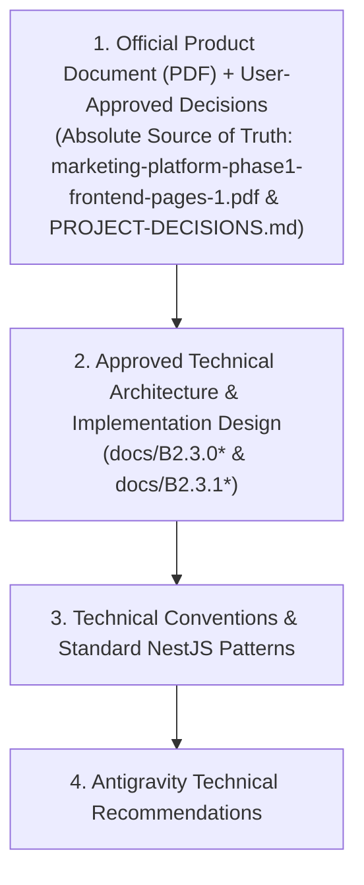

# B2.3.2.1 — Implementation Scope Reconciliation Report
## Gapji Digital Marketing Platform (داشبورد بازاریابی دیجیتال گپ‌جی)

**Document Version:** 1.0.0  
**Phase:** B2.3.2.1 (Implementation Scope Reconciliation)  
**Status:** RECONCILED ARCHITECTURAL REPORT — READY FOR FIRST IMPLEMENTATION STEP  
**Author:** Principal Software Architect, Senior NestJS Security Architect, PostgreSQL Database Architect  
**Target Repository:** `F:\marketing-platform-backend` (`feature/backend-foundation`)  
**Companion Frontend:** `F:\marketing platform` (`feature/frontend-foundation`)  
**Date:** November 2026 (Solar Hijri: Aban 1405)  
**Classification System:**  
- `DOCUMENTED REQUIREMENT`: Explicitly stated in `marketing-platform-phase1-frontend-pages-1.pdf` (with page & section citation).  
- `USER-APPROVED PRODUCT DECISION`: Binding decision formally recorded in `docs/PROJECT-DECISIONS.md` or Phase B2.3.0.1 / B2.3.0.2.  
- `IMPLEMENTATION DECISION`: Architectural or engineering choice necessary to fulfill documented requirements.  
- `PRODUCT DECISION REQUIRED`: Unresolved product/business question requiring explicit product owner approval.  
- `TECHNICAL RECOMMENDATION`: Recommended industry practice that does not alter product rules.  
- `NOT SPECIFIED IN PRODUCT DOCUMENT`: Feature, behavior, or constraint absent from the official PDF.

---

## 1. Executive Summary

This report performs a formal, evidence-based reconciliation between the **B2.3.2 Pre-Implementation Check**, the authoritative product specification (`marketing-platform-phase1-frontend-pages-1.pdf`), the binding decision register (`docs/PROJECT-DECISIONS.md`), and the approved implementation design (`docs/B2.3.1-AUTHENTICATION-AUTHORIZATION-IMPLEMENTATION-DESIGN.md`).

This task is **STRICTLY READ-ONLY AND DOCUMENTATION-ONLY**. Zero source code, database schemas, migrations, dependencies, or frontend assets were modified.

### 1.1 Key Reconciliation Outcomes
1. **Login Identifier (`DOCUMENTED REQUIREMENT` — p. 6 §1, p. 23 §27):** The requirement to support **either Email OR Mobile Phone Number** + Password is confirmed as a documented product requirement and reflected in existing Prisma schema (`User.email`, `User.mobile`) and frontend types (`LoginCredentials.identifier`). The proposed `login.dto.ts` accepting an `identifier` string is 100% justified.
2. **Refresh Token Concurrency & Reuse Detection (`USER-APPROVED PRODUCT DECISION` — `DEC-AUTH-01`):** The proposed 10-second grace period was an auditor's informal suggestion and is **formally rejected** because it weakens token family reuse detection. The system will adhere strictly to atomic database-backed rotation with instant session family invalidation upon reuse detection. Safe concurrency is achieved via database transactions without weakening security.
3. **Phase & Component Boundary Clarification:** The apparent contradiction in the B2.3.2 inspection (where `TenantContextStorage` and `AdminSafetyGuard` appeared in the design mapping table but were omitted from the 9-file creation list) is resolved. The mapping table represented the entire B2.3.1 design across all subphases, whereas the 9-file creation list represents the strictly bounded **Phase A (Auth Foundation)**.
4. **Dependency Clarification:** The 5 target dependencies (`@nestjs/jwt`, `@nestjs/passport`, `passport-jwt`, `argon2`, `cookie-parser`) are confirmed essential for Phase A. Cookie parsing is required for `gapji_refresh`, but cookie signing is an optional technical enhancement, not a product mandate.
5. **First Implementation Step Allowlist:** A strict, bounded allowlist of **9 files to create** and **6 files to modify** is established for the first implementation step (Phase A: Auth Foundation).

---

## 2. Source Evidence and Document Hierarchy

Every conclusion in this report adheres to the non-negotiable governance hierarchy:



### 2.1 Authoritative Documents Inspected
1. **`marketing-platform-phase1-frontend-pages-1.pdf` (29 pages):** Specifically Page 6 §1 (Login with email/mobile and password), Page 7 §2 (Notifications), Page 8 §3-4 (Executive Dashboard), Page 23 §27 (IAM and Users), Page 26 §1 (Session and Security).
2. **`docs/PROJECT-DECISIONS.md`:** Sections 1–6 recording binding decisions `DEC-ORG-01` through `DEC-AUTH-13`.
3. **`docs/B2.3.0-AUTHENTICATION-AUTHORIZATION-TENANT-ARCHITECTURE.md` (v1.1.0):** Overall security and tenancy architecture.
4. **`docs/B2.3.0.1-FINAL-AUTHORIZATION-PRODUCT-DECISIONS.md`:** Role defaults, custom profiles, and invitation lifecycle.
5. **`docs/B2.3.1-AUTHENTICATION-AUTHORIZATION-IMPLEMENTATION-DESIGN.md`:** 26-section detailed technical implementation design.
6. **`apps/api/prisma/schema.prisma`:** Active database models (`User`, `Organization`, `OrganizationMembership`, `Session`, `UserActivityLog`).
7. **`apps/web/src/features/auth/types.ts` & `src/app/(auth)/login/page.tsx`:** Companion frontend login contracts.

---

## 3. Login Identifier Reconciliation

### 3.1 Documented Requirement Investigation
- **Question:** Is login with email OR mobile phone number explicitly documented or merely an assumption?
- **Evidence from Official Product Document:**
  - **Page 6 (§1) — General Pages / Login:**
    - Form title: `ورود به سیستم` (System Login)
    - Input fields specified in UI:
      - Field 1: `ایمیل یا شماره موبایل` (Email or Mobile Phone Number)
      - Field 2: `رمز عبور` (Password)
    - Helper actions: `فراموشی رمز عبور`, `مرا به خاطر بسپار`
  - **Page 23 (§27) — IAM & Users:**
    - User table lists columns: `نام و نام خانوادگی`, `ایمیل`, `شماره موبایل`, `نقش`, `وضعیت`.
- **Evidence from Database Schema (`apps/api/prisma/schema.prisma` lines 236–237):**
  ```prisma
  email  String? @unique @db.VarChar(255)
  mobile String? @unique @db.VarChar(20)
  ```
  Both attributes exist as nullable, independently unique columns.
- **Evidence from Companion Frontend (`apps/web/src/features/auth/types.ts` lines 42–45):**
  ```typescript
  export interface LoginCredentials {
    identifier: string; // ایمیل یا شماره موبایل
    password: string;
  }
  ```
  The active frontend login screen (`apps/web/src/app/(auth)/login/page.tsx`) renders a single text input with both `Mail` and `Phone` icons and placeholder `ایمیل یا شماره موبایل`.

### 3.2 Reconciliation Conclusion
- **Classification:** `DOCUMENTED REQUIREMENT` (p. 6 §1, p. 23 §27).
- **Finding:** Login using either email OR mobile phone number is **explicitly documented and required by the product specification**.
- **Implementation Validation:** The proposed `LoginDto` containing `{ identifier: string, password: string }` is 100% aligned with the product document and frontend contract.
- **Service Logic:** `AuthService.validateUser(identifier, password)` must query:
  ```typescript
  const normalized = identifier.trim();
  const user = await this.prisma.user.findFirst({
    where: {
      OR: [
        { email: normalized.toLowerCase() },
        { mobile: normalizePersianDigits(normalized) },
      ],
    },
  });
  ```
- **Unresolved Product Decision:** None. This requirement is fully documented and resolved.

---

## 4. Refresh Token Concurrency & Reuse Detection Reconciliation

### 4.1 Approved Baseline vs Auditor Proposal
- **Approved Baseline (`USER-APPROVED PRODUCT DECISION` — `DEC-AUTH-01`):**
  - Access Token lifetime = **15 minutes**.
  - Refresh Token lifetime = **7 days**.
  - Every `/api/auth/refresh` rotates the refresh token: the used token is invalidated, and a new refresh token is issued.
  - **Security Invariant:** If an invalidated, expired, or already-rotated refresh token is presented, the system treats it as an intrusion attempt, revokes **ALL active sessions for that user family**, logs a high-severity security event, and rejects the request with HTTP 401.
- **The Proposed 10-Second Grace Period:**
  - In the B2.3.2 pre-implementation check, a 10-second grace period was suggested to accommodate legitimate concurrent tab requests in browsers.
- **Security Assessment:**
  - Introducing a time-based grace period **directly weakens reuse detection**: during that 10-second window, an attacker who intercepted the rotated refresh token could refresh and obtain a valid access token without triggering session family invalidation.
  - The project owner never approved a grace period.

### 4.2 Safe Concurrency Without Weakening Security (`IMPLEMENTATION DECISION`)
Legitimate browser concurrency (e.g. multiple browser tabs making simultaneous refresh calls on startup) can be solved cleanly at the architecture layer **without weakening token reuse detection**:
1. **Frontend Request Deduping (Client Tier):** The frontend Axios/Fetch interceptor queues outgoing API requests when an access token expires and dispatches exactly **one** refresh request. All waiting requests wait for the single in-flight promise to resolve.
2. **Atomic Row-Level Transaction (Backend Tier):** In `AuthService.refresh()`, PostgreSQL row-level locking (`SELECT ... FOR UPDATE` or optimistic version check) ensures that concurrent refresh requests on the same session cannot execute in parallel:
   ```typescript
   await this.prisma.$transaction(async (tx) => {
     const session = await tx.session.findUnique({
       where: { tokenHash: incomingHash },
     });
     if (!session || session.expiresAt < new Date()) {
       // Intrude detected: Invalidate all sessions for this user
       await tx.session.deleteMany({ where: { userId: session?.userId ?? fallbackUserId } });
       throw new UnauthorizedException('نشست نامعتبر است؛ تمام نشست‌ها باطل شدند');
     }
     // Rotate token atomically
     await tx.session.update({
       where: { id: session.id },
       data: { tokenHash: newHash, expiresAt: newExpiresAt },
     });
   });
   ```

### 4.3 Reconciliation Conclusion
- **Strict Adherence:** The 10-second grace period is **formally rejected**.
- **Enforcement:** Reuse detection remains strict and uncompromising. Any presentation of an already-consumed refresh token immediately triggers global session family revocation.

---

## 5. File and Phase Scope Reconciliation

### 5.1 Clarification: Why TenantContext & AdminSafetyGuard Were Omitted from the 9-File List
The B2.3.2 Pre-Implementation Check contained an apparent discrepancy:
- Section 4 of that report mapped the entire B2.3.1 design (including `TenantContextStorage`, `TenancyGuard`, and `AdminSafetyGuard`).
- Section 7 of that report listed only 9 files to create, which did not include `TenantContextStorage` or `AdminSafetyGuard`.

**Resolution & Explanation:**
- `TenantContextStorage` (`AsyncLocalStorage`) and `AdminSafetyGuard` belong to **Phase B (Tenant Context & Admin Safety)**, not Phase A.
- Attempting to implement tenancy guards, admin safety guards, and tenant context in the very first step would conflate basic authentication (login, JWT signing, password hashing) with multi-tenancy and authorization.
- Phasing them separately follows standard software engineering best practices:
  - **Phase A (Immediate Step):** Establishes cryptographic identity (`User -> Session -> Access JWT + Refresh Cookie`).
  - **Phase B (Subsequent Step):** Establishes organization context (`JwtAuthGuard -> TenancyGuard -> AdminSafetyGuard -> RequestContext`).

### 5.2 Complete Component-to-Phase Lifecycle Matrix

| Component | Target File Path(s) | Existing Status in Repository | Assigned Implementation Phase | Dependencies | Classification |
| :--- | :--- | :---: | :---: | :--- | :--- |
| **`PasswordHasherService`** | `apps/api/src/modules/auth/services/password-hasher.service.ts` | ❌ Absent | **Phase A (Auth Foundation)** | `argon2` | `TECHNICAL RECOMMENDATION` |
| **`LoginDto`** | `apps/api/src/modules/auth/dto/login.dto.ts` | ❌ Absent | **Phase A (Auth Foundation)** | `class-validator` | `DOCUMENTED REQUIREMENT` (p. 6) |
| **`AuthResponseDto`** | `apps/api/src/modules/auth/dto/auth-response.dto.ts` | ❌ Absent | **Phase A (Auth Foundation)** | `@nestjs/swagger` | `IMPLEMENTATION DECISION` |
| **`JwtStrategy`** | `apps/api/src/modules/auth/strategies/jwt.strategy.ts` | ❌ Absent | **Phase A (Auth Foundation)** | `passport-jwt`, `@nestjs/passport` | `IMPLEMENTATION DECISION` |
| **`JwtAuthGuard`** | `apps/api/src/common/guards/jwt-auth.guard.ts` | ❌ Absent | **Phase A (Auth Foundation)** | `@nestjs/passport` | `IMPLEMENTATION DECISION` |
| **`AuthService`** | `apps/api/src/modules/auth/auth.service.ts` | ❌ Absent | **Phase A (Auth Foundation)** | `PrismaService`, `@nestjs/jwt`, `PasswordHasherService` | `IMPLEMENTATION DECISION` |
| **`AuthController`** | `apps/api/src/modules/auth/auth.controller.ts` | ❌ Absent | **Phase A (Auth Foundation)** | `AuthService` | `IMPLEMENTATION DECISION` |
| **`AuthModule`** | `apps/api/src/modules/auth/auth.module.ts` | ❌ Absent | **Phase A (Auth Foundation)** | `ConfigModule`, `PrismaModule` | `IMPLEMENTATION DECISION` |
| **`Session Persistence`** | Existing `Session` model via `AuthService` | ⚠️ Model exists, no service code | **Phase A (Auth Foundation)** | `PrismaService` | `USER-APPROVED PRODUCT DECISION` (`DEC-AUTH-01`) |
| **`Cookie Middleware`** | `apps/api/src/main.ts` registration | ❌ Not registered | **Phase A (Auth Foundation)** | `cookie-parser` | `TECHNICAL RECOMMENDATION` |
| **`TenantContextStorage`**| `apps/api/src/common/context/tenant-context.storage.ts` | ❌ Absent | **Phase B (Tenancy & Admin Safety)** | Node.js `AsyncLocalStorage` | `IMPLEMENTATION DECISION` |
| **`TenancyGuard`** | `apps/api/src/common/guards/tenancy.guard.ts` | ❌ Absent | **Phase B (Tenancy & Admin Safety)** | `TenantContextStorage` | `USER-APPROVED PRODUCT DECISION` (`DEC-ORG-01`) |
| **`AdminSafetyGuard`** | `apps/api/src/common/guards/admin-safety.guard.ts` | ❌ Absent | **Phase B (Tenancy & Admin Safety)** | `PrismaService` | `USER-APPROVED PRODUCT DECISION` (`DEC-AUTH-07`) |
| **`Campaign DTO Cleanup`**| `apps/api/src/modules/campaigns/create-campaign.dto.ts` | ⚠️ Contains `organizationId` | **Phase B (Tenancy & Admin Safety)** | `ValidationPipe` | `DOCUMENTED REQUIREMENT` (Tenant boundary) |
| **`Permission Catalog`** | `apps/api/src/modules/permissions/constants/permission-catalog.ts`| ❌ Absent | **Phase C (Authorization Engine)** | None | `USER-APPROVED PRODUCT DECISION` (`DEC-AUTH-08`) |
| **`RoleDefaultsService`**| `apps/api/src/modules/permissions/services/role-defaults.service.ts` | ❌ Absent | **Phase C (Authorization Engine)** | `PrismaService` | `USER-APPROVED PRODUCT DECISION` (`DEC-AUTH-13`) |
| **`CustomProfilesService`**| `apps/api/src/modules/permissions/services/custom-profiles.service.ts`| ❌ Absent | **Phase C (Authorization Engine)** | `PrismaService` | `USER-APPROVED PRODUCT DECISION` (`DEC-AUTH-09`) |
| **`PathEvaluatorService`**| `apps/api/src/modules/permissions/services/path-evaluator.service.ts`| ❌ Absent | **Phase C (Authorization Engine)** | `PrismaService` | `USER-APPROVED PRODUCT DECISION` (`DEC-AUTH-12`) |
| **`RolesGuard`** | `apps/api/src/common/guards/roles.guard.ts` | ❌ Absent | **Phase C (Authorization Engine)** | `PathEvaluatorService` | `USER-APPROVED PRODUCT DECISION` (`DEC-AUTH-11`) |
| **`PersonalOverrides`** | `apps/api/src/modules/permissions/services/overrides.service.ts` | ❌ Absent | **Phase C (Authorization Engine)** | `PrismaService` | `USER-APPROVED PRODUCT DECISION` (`DEC-AUTH-06`) |
| **`InvitationService`** | `apps/api/src/modules/invitations/invitation.service.ts` | ❌ Absent | **Phase D (Invitations & Audit)** | `PrismaService`, crypto | `USER-APPROVED PRODUCT DECISION` (`DEC-AUTH-04`, `05`) |
| **`AuditLoggerService`** | `apps/api/src/modules/audit/audit-logger.service.ts` | ⚠️ Model exists, no service | **Phase D (Invitations & Audit)** | `PrismaService` | `DOCUMENTED REQUIREMENT` (p. 23) |

---

## 6. Dependency Reconciliation

### 6.1 Package Evaluation Matrix

| Package Name | Current Status in `package.json` | Required in Phase A? | Alternative in Repository? | Recommended Version | Rationale & Peer Dependencies |
| :--- | :---: | :---: | :---: | :---: | :--- |
| **`@nestjs/jwt`** | ❌ Not Installed | **YES** | None | `^10.2.0` | Standard NestJS JWT signing module. Compatible with NestJS 10.3. Requires `jsonwebtoken` `^9.0.2` and devDependency `@types/jsonwebtoken` `^9.0.6`. |
| **`@nestjs/passport`** | ❌ Not Installed | **YES** | None | `^10.0.3` | NestJS wrapper for Passport authentication lifecycle. Requires `passport` `^0.7.0` and devDependency `@types/passport` `^1.0.16`. |
| **`passport-jwt`** | ❌ Not Installed | **YES** | None | `^4.0.1` | Passport strategy for validating Bearer tokens from `Authorization` header. Requires devDependency `@types/passport-jwt` `^4.0.1`. |
| **`argon2`** | ❌ Not Installed | **YES** | None | `^0.40.1` | RFC 9106 memory-hard password hashing. **Mandatory:** Do not replace with bcrypt without explicit user approval. |
| **`cookie-parser`** | ❌ Not Installed | **YES** | None | `^1.4.6` | Express middleware to parse `Cookie` header into `req.cookies`. Requires devDependency `@types/cookie-parser` `^1.4.7`. |

### 6.2 Cookie Parsing vs Cookie Signing Analysis
- **Question:** Does `cookie-parser` imply that cookie signing is required by the product specification?
- **Analysis:**
  - `cookie-parser` without a secret populates `req.cookies`. With a secret, it populates `req.signedCookies`.
  - The approved security model (`DEC-AUTH-01`) stores the refresh token as an unguessable 64-byte random string. The server computes `SHA-256(refreshToken)` and matches it against `Session.tokenHash` in PostgreSQL.
  - Because the database row lookup verifies cryptographic authenticity, **cookie signing is not strictly required for security integrity**.
  - However, registering `app.use(cookieParser())` in `main.ts` is essential so that `req.cookies['gapji_refresh']` can be read by NestJS controllers.
- **Classification:** `cookie-parser` middleware registration is an `IMPLEMENTATION DECISION`; cookie signing is an optional `TECHNICAL RECOMMENDATION`.

---

## 7. Token Configuration & Cookie Reconciliation

### 7.1 Configuration Naming & Variable Separation
In `apps/api/src/config/`:
- **Current State:** `configuration.ts` has a single `jwt.expiresIn: '7d'`.
- **Reconciliation:** Separate access and refresh configuration:
  - `JWT_SECRET`: Secret key for signing Access Tokens (`DOCUMENTED REQUIREMENT`).
  - `JWT_ACCESS_TOKEN_EXPIRES_IN`: `'15m'` (900 seconds) (`USER-APPROVED PRODUCT DECISION` — `DEC-AUTH-01`).
  - `REFRESH_TOKEN_EXPIRES_IN`: `'7d'` (604800 seconds) (`USER-APPROVED PRODUCT DECISION` — `DEC-AUTH-01`).
- **Secret Separation:**
  - Access Token is a JWT and uses `JWT_SECRET`.
  - Refresh Token is **NOT a JWT**; it is an opaque high-entropy cryptographic token verified via SHA-256 hash in the database. It does not require or reuse `JWT_SECRET`.

### 7.2 Cookie Attributes Specification (`DEC-AUTH-01`)
```typescript
export const REFRESH_COOKIE_CONFIG = {
  name: 'gapji_refresh',
  options: {
    httpOnly: true,                                       // Immune to XSS theft
    secure: process.env.NODE_ENV === 'production',        // HTTPS only in prod; localhost permitted in dev
    sameSite: 'strict' as const,                          // Immune to CSRF
    path: '/api/auth',                                    // Scoped strictly to auth endpoints
    maxAge: 7 * 24 * 60 * 60 * 1000,                      // 7 days in milliseconds
  },
};
```

---

## 8. Open Decisions Implementation Impact Reassessment

| Decision Topic | Category | Blocks Phase A (Auth Foundation)? | Required in Which Phase? | What Must NOT Be Assumed | Action / Status |
| :--- | :--- | :---: | :---: | :--- | :--- |
| **Absolute Session Lifetime** | `PRODUCT DECISION REQUIRED` | **NO** | Phase A (Optional refinement) | Do not assume an arbitrary 30-day or 90-day hard limit without user approval. | Implement approved 7-day sliding window. Sits ready for cap when approved. |
| **Password Recovery Flow** | `PRODUCT DECISION REQUIRED` | **NO** | Phase D (Invitations/IAM) | Do not invent public self-reset or SMS gateways. | Omitted from Phase A. Login uses credentials provisioned by admin. |
| **Multi-Device Sessions** | `PRODUCT DECISION REQUIRED` | **NO** | Phase A | Do not assume single-device termination on every login. | The `Session` model records distinct sessions per device by default. Non-blocking. |
| **Invitation Expiration** | `PRODUCT DECISION REQUIRED` | **NO** | Phase D (Invitations) | Do not assume 72 hours is approved. | Omitted from Phase A. |
| **Refresh Concurrency Handling**| `IMPLEMENTATION DECISION` | **NO** | Phase A | Do not introduce a 10-second grace window that weakens reuse detection. | Solved via database transaction row-locking without weakening reuse detection. |

**Conclusion:** **Zero blocking issues exist for Phase A.** All open items are non-blocking or belong to later subphases.

---

## 9. Final Bounded Phased Implementation Plan

```mermaid
timeline
    title Gapji Backend B2.3 Implementation Roadmap
    section Phase A: Auth Foundation (NEXT STEP)
        Install Dependencies : @nestjs/jwt, passport, argon2, cookie-parser
        Password Hashing : PasswordHasherService (Argon2id)
        Auth Module & Strategy : JwtStrategy, JwtAuthGuard, AuthService
        Auth Controller : /login, /refresh, /logout, /me
        Unit Tests : AuthService & Hasher unit tests
    section Phase B: Tenancy & Admin Safety
        Tenant Context : AsyncLocalStorage, TenancyGuard
        Admin Safety : Zero-admin protection, atomic transfer service
        DTO Remediation : Strip organizationId from client DTOs
    section Phase C: Authorization Engine
        Catalog & Scopes : Permission catalog, data scopes (own, assigned, org)
        Role Defaults : Mutable role defaults service & diff preview (DEC-AUTH-13)
        Custom Profiles : Draft versioning & atomic publish (DEC-AUTH-09)
        Path Exclusivity : Path A vs Path B evaluator (DEC-AUTH-12)
    section Phase D: Invitations & Remediation
        Invitation Lifecycle : Token hashing, snapshotting, account reuse (DEC-AUTH-04, 05)
        Campaign Cleanup : Deprecate DEFAULT_ORGANIZATION_ID, scope queries
        Security Integration Tests : Full PostgreSQL test execution
```

---

## 10. Exact File Allowlist for the First Implementation Step (Phase A)

The first implementation step (Phase A: Auth Foundation) is strictly bounded to the following files:

### 10.1 Exactly 9 Files to be Created:
1. `apps/api/src/modules/auth/auth.module.ts`
2. `apps/api/src/modules/auth/auth.controller.ts`
3. `apps/api/src/modules/auth/auth.service.ts`
4. `apps/api/src/modules/auth/services/password-hasher.service.ts`
5. `apps/api/src/modules/auth/strategies/jwt.strategy.ts`
6. `apps/api/src/modules/auth/dto/login.dto.ts`
7. `apps/api/src/modules/auth/dto/auth-response.dto.ts`
8. `apps/api/src/common/guards/jwt-auth.guard.ts`
9. `apps/api/src/modules/auth/auth.service.spec.ts`

### 10.2 Exactly 6 Files to be Modified:
1. `apps/api/package.json` (adding `@nestjs/jwt`, `@nestjs/passport`, `passport`, `passport-jwt`, `argon2`, `cookie-parser` and dev types)
2. `pnpm-lock.yaml` (updated via `pnpm install`)
3. `apps/api/src/app.module.ts` (importing `AuthModule`)
4. `apps/api/src/main.ts` (adding `app.use(cookieParser())`)
5. `apps/api/src/config/configuration.ts` (adding `JWT_ACCESS_TOKEN_EXPIRES_IN` and `REFRESH_TOKEN_EXPIRES_IN`)
6. `apps/api/src/config/env.validation.ts` (validating configuration keys)

### 10.3 Explicit Exclusions for Phase A:
- **NO** changes to `apps/api/prisma/schema.prisma` or migrations.
- **NO** changes to `apps/api/src/modules/campaigns/` in this step (deferred to Phase D).
- **NO** creation of `TenantContextStorage`, `TenancyGuard`, or `AdminSafetyGuard` in this step (deferred to Phase B).
- **NO** creation of Permission Catalog, Custom Profiles, or Overrides in this step (deferred to Phase C).
- **NO** frontend modifications.

---

## 11. Git Safety and Verification Evidence

- **Current Branch:** `feature/backend-foundation`
- **Current HEAD:** `9f5b8d7e5a121c2700a208d901556fcd3eca138e`
- **Git Status:** Preserved with zero unintended mutations.
- **File Limitation:** Only this single documentation deliverable (`docs/B2.3.2.1-IMPLEMENTATION-SCOPE-RECONCILIATION.md`) was created.

---

## 12. Final Status

$$\mathbf{READY\ FOR\ FIRST\ IMPLEMENTATION\ STEP}$$

### Reason:
1. The login identifier ambiguity is fully reconciled as a documented requirement (Email OR Mobile).
2. The refresh token concurrency policy is reconciled: the informal grace period is rejected, and atomic database rotation without weakening reuse detection is specified.
3. The component-to-phase mapping and the 9-file creation scope are fully justified and reconciled.
4. Dependencies and configuration separation are completely defined.
5. Zero blockers remain for Phase A (Auth Foundation).
