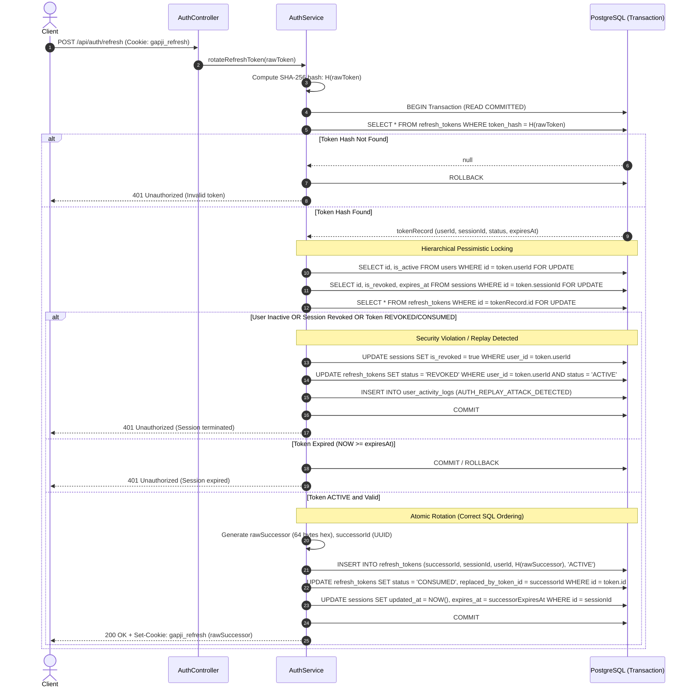

# B2.3.2.3 — Refresh Token Family & Replay Detection Design Corrections & Finalization

> **Document ID:** `B2.3.2.3-REFRESH-TOKEN-DESIGN-FINALIZATION`  
> **Repository:** `F:\marketing-platform-backend`  
> **Target Branch:** `feature/backend-foundation`  
> **Task Nature:** Strictly READ-ONLY Architecture, Security & Integrity Design Finalization  
> **Status:** Proposal Finalized — Awaiting User Approval of Open Decisions  
> **Primary Product Document:** `marketing-platform-phase1-frontend-pages-1.pdf`  
> **Key Architecture References:** `docs/PROJECT-DECISIONS.md`, `docs/B2.3.0.1-FINAL-AUTHORIZATION-PRODUCT-DECISIONS.md`, `docs/B2.3.1-AUTHENTICATION-AUTHORIZATION-IMPLEMENTATION-DESIGN.md`, `docs/B2.3.2.1-IMPLEMENTATION-SCOPE-RECONCILIATION.md`, B2.3.2.2 Design Report

---

## 1. Executive Summary

This document reviews, corrects, and finalizes the technical design for the **Refresh Token Family & Replay Detection Architecture** of the Gapji Digital Marketing Platform backend. 

In phase B2.3.2, implementation of the Authentication Module was halted at a mandatory security gate: the existing database schema featured a single `tokenHash` column on the `Session` model. Under this legacy design, rotating a refresh token ($T_1 \to T_2$) destroyed the hash of $T_1$, rendering the backend blind to replayed tokens across multi-hop rotation chains ($T_1 \to T_2 \to T_3 \to T_4$). The preliminary investigation in B2.3.2.2 established a conceptual preference for a dedicated token history table (Option A), but left several critical integrity, concurrency, and security questions unresolved or incorrectly formulated.

### Summary of Critical Architectural Corrections in B2.3.2.3
1. **Correction of Revoked Token Replay Policy (Alignment with Approved Security Policy):**  
   B2.3.2.2 improperly downgraded the presentation of a known `REVOKED` token to an ordinary HTTP 401 without user-wide session invalidation. **This has been corrected.** Under the user-approved security policy (`DEC-AUTH-01`, `DEC-AUTH-09`), presenting a previously consumed OR revoked refresh token is treated as an active compromise; it triggers **instant revocation of all active sessions belonging to the affected user** and records a high-risk security audit event.
2. **Resolution of SQL Foreign-Key Mutation Ordering:**  
   B2.3.2.2 presented an invalid SQL sequence where a predecessor token's `replaced_by_token_id` was updated before inserting the referenced successor row, which violates PostgreSQL foreign key constraints. This design establishes the strictly correct, non-deferred order: **insert successor first $\to$ update predecessor second** within a single atomic transaction.
3. **Correction of PostgreSQL UUID Generation and Native Types:**  
   B2.3.2.2 proposed `DEFAULT gen_random_bytes(16)`, which returns `bytea` in PostgreSQL and fails on UUID columns. The database runtime was inspected and verified as `postgres:15-alpine`. The design adopts PostgreSQL 13+ native `gen_random_uuid()` for database DDL and standard application-level `crypto.randomUUID()` in Node.js / Prisma.
4. **Correction of Index Complexity Characterization:**  
   The informal characterization of B-tree index lookup as $O(1)$ in B2.3.2.2 is corrected to its true mathematical complexity: **$O(\log N)$ tree traversal**.
5. **Resolution of Rotation vs. Global Revocation Race Condition:**  
   To prevent a concurrent rotation in Session A from committing *after* a replay-triggered global revocation in Session B has executed, this design establishes a **pessimistic user-level serialization protocol** (`SELECT id FROM users WHERE id = $userId FOR UPDATE`) with a strictly ordered lock hierarchy (`User` $\to$ `Session` $\to$ `RefreshToken`), guaranteeing deadlock freedom and absolute security synchronization.
6. **Enforcement of At-Most-One Active Token per Session:**  
   The design specifies a PostgreSQL **partial unique index** (`CREATE UNIQUE INDEX ... WHERE status = 'ACTIVE'`) to guarantee at the database engine level that no session can branch into multiple active tokens.
7. **Referential Integrity & Replay Evidence Preservation:**  
   The design formally prohibits hard deletion of sessions or refresh tokens during normal operations (including logout and revocation), preventing an attacker from escaping detection by presenting a token whose history was prematurely deleted.

---

## 2. Source-of-Truth & Approved-Decision References

### 2.1 Governance Classifications
Every statement and parameter in this document is classified according to the following governance taxonomy:
- `DOCUMENTED REQUIREMENT`: Mandated by the official product specification `marketing-platform-phase1-frontend-pages-1.pdf`.
- `USER-APPROVED PRODUCT DECISION`: Binding architectural or business decision explicitly approved by the product owner in `docs/PROJECT-DECISIONS.md`.
- `IMPLEMENTATION DECISION`: Technical execution choice made to enforce approved requirements.
- `PRODUCT DECISION REQUIRED`: Parameter or workflow lacking user approval that requires an explicit choice.
- `TECHNICAL RECOMMENDATION`: Recommended architectural best practice presented for user ratification.
- `NOT SPECIFIED IN PRODUCT DOCUMENT`: Feature or edge case absent from the official PDF.

### 2.2 Traceability Register

| Reference Key | Document Source | Document Section / Page | Binding Content & Architectural Relevance |
| :--- | :--- | :--- | :--- |
| **PDF-AUTH-01** | `marketing-platform-phase1-frontend-pages-1.pdf` | Page 6 §1 | `DOCUMENTED REQUIREMENT`: Login screen supporting Email or Mobile phone number and password. |
| **PDF-AUTH-02** | `marketing-platform-phase1-frontend-pages-1.pdf` | Page 23 §27 | `DOCUMENTED REQUIREMENT`: IAM & User Management, role assignments, invitation workflows. |
| **PDF-AUTH-03** | `marketing-platform-phase1-frontend-pages-1.pdf` | Page 26 §1 | `DOCUMENTED REQUIREMENT`: Security settings, session management, and authentication controls. |
| **DEC-AUTH-01** | `docs/PROJECT-DECISIONS.md` | Section 4 | `USER-APPROVED PRODUCT DECISION`: Access Token lifetime is strictly **15 minutes**. Refresh Token lifetime is strictly **7 days** (sliding window with family rotation). Transported via secure, `HttpOnly`, `SameSite=Strict` cookie. |
| **DEC-AUTH-09** | `docs/PROJECT-DECISIONS.md` / `docs/B2.3.2.1-IMPLEMENTATION-SCOPE-RECONCILIATION.md` | Section 4.1 | `USER-APPROVED PRODUCT DECISION`: **Zero Grace Period**. The informal 10-second grace window is formally rejected. Replay of consumed or revoked tokens triggers immediate user-wide session invalidation. |
| **DEC-AUTH-11** | `docs/PROJECT-DECISIONS.md` | Section 4 | `USER-APPROVED PRODUCT DECISION`: Non-bypassable system-enforced baseline policies applied via mathematical intersection ($\cap$). |
| **DEC-AUTH-12** | `docs/PROJECT-DECISIONS.md` | Section 4 | `USER-APPROVED PRODUCT DECISION`: Independent mutually exclusive authorization paths (Fixed Role vs. Custom Permission Profile). |
| **DEC-AUTH-13** | `docs/PROJECT-DECISIONS.md` | Section 4 | `USER-APPROVED PRODUCT DECISION`: Mutable fixed-role defaults with structured diff preview and atomic confirmation. |
| **B2.3.1-AUTH** | `docs/B2.3.1-AUTHENTICATION-AUTHORIZATION-IMPLEMENTATION-DESIGN.md` | Section 4, 5, 23 | `IMPLEMENTATION DECISION`: Authentication module design, Argon2id password hashing, SHA-256 token hashing, guard pipelines. |
| **B2.3.2.1-SCOPE** | `docs/B2.3.2.1-IMPLEMENTATION-SCOPE-RECONCILIATION.md` | Section 4, 10 | `IMPLEMENTATION DECISION`: Reconciliation of Phase A boundaries, 15-file allowlist, cookie options. |

---

## 3. Current Schema Findings & Structural Deficiencies

### 3.1 Inspection of Active Schema
Inspection of [`apps/api/prisma/schema.prisma`](file:///F:/marketing-platform-backend/apps/api/prisma/schema.prisma#L362-L378) reveals the existing `Session` model:

```prisma
model Session {
  id             String        @id @default(uuid()) @db.Uuid
  userId         String        @db.Uuid
  organizationId String?       @db.Uuid
  tokenHash      String        @unique @db.VarChar(255)
  userAgent      String?       @db.VarChar(500)
  ipAddress      String?       @db.VarChar(45)
  expiresAt      DateTime
  createdAt      DateTime      @default(now())

  user           User          @relation(fields: [userId], references: [id], onDelete: Cascade)
  organization   Organization? @relation(fields: [organizationId], references: [id], onDelete: SetNull)

  @@index([userId])
  @@index([organizationId])
  @@map("sessions")
}
```

### 3.2 Concrete Architectural Deficiencies
1. **Destructive Rotation:**  
   The `Session` model holds exactly one `tokenHash`. When rotation occurs, `tokenHash` is updated to the newly issued token hash. The previous hash is permanently erased from database storage.
2. **Replay Blindness across Multi-Hop Chains:**  
   If an adversary steals token $T_1$, and legitimate rotations advance the session $T_1 \to T_2 \to T_3 \to T_4$:
   - The database only contains $H(T_4)$.
   - When the adversary presents $T_1$, querying `WHERE tokenHash = H(T1)` yields `null`.
   - The server cannot differentiate between an unknown random string and a compromised valid credential belonging to User $U_1$.
   - Consequence: No alarm is raised, no user sessions are revoked, and the attacker may continue probing.
3. **Premature Evidence Destruction upon Logout:**  
   Calling `logout` executes `prisma.session.delete({ where: { id } })`. This physical deletion wipes all session and token records. If a stolen token is replayed post-logout, the system cannot detect the compromise.

---

## 4. Final Conceptual Data Model

### 4.1 Separation of Concerns
The architecture separates the **physical client container** (`Session`) from the **cryptographic credentials chain** (`RefreshToken`).

```
┌──────────────────────────────────────────────┐
│                   Session                    │
├──────────────────────────────────────────────┤
│ id: UUID (PK)                                │
│ userId: UUID (FK -> User.id)                 │
│ organizationId: UUID? (FK -> Org.id)         │
│ isRevoked: Boolean DEFAULT false             │
│ revokedAt: DateTime?                         │
│ revokedReason: VarChar(255)?                 │
│ userAgent: VarChar(500)?                     │
│ ipAddress: VarChar(45)?                      │
│ expiresAt: DateTime (Rolling / Absolute)     │
│ absoluteExpiresAt: DateTime?                 │
│ createdAt: DateTime                          │
│ updatedAt: DateTime                          │
└──────────────────────┬───────────────────────┘
                       │ 1
                       │
                       │ has many (Cascade Delete on User purge only)
                       │
                       │ *
┌──────────────────────▼───────────────────────┐
│                 RefreshToken                 │
├──────────────────────────────────────────────┤
│ id: UUID (PK)                                │
│ sessionId: UUID (FK -> Session.id)           │
│ userId: UUID (FK -> User.id)                 │
│ tokenHash: VarChar(64) UNIQUE (SHA-256)      │
│ status: TokenStatus (ACTIVE/CONSUMED/REVOKED)│
│ replacedByTokenId: UUID? UNIQUE (Self-FK)    │
│ expiresAt: DateTime                          │
│ createdAt: DateTime                          │
│ consumedAt: DateTime?                        │
└──────────────────────────────────────────────┘
```

### 4.2 Comprehensive Evaluation of Model Fields

#### Model: `Session`
- `id` (UUID PK): **Required.** Unique session container identifier.
- `userId` (UUID FK): **Required.** Directly links session to `User`.
- `organizationId` (UUID FK?): **Required.** Identifies current tenant context; nullable if user has not yet selected an active organization.
- `isRevoked` (Boolean): **Required.** Enables soft revocation; preserves session metadata after termination.
- `revokedAt` (DateTime?): **Required.** Timestamp of session termination for auditing and debugging.
- `revokedReason` (VarChar?): **Required.** Reason for revocation (`USER_LOGOUT`, `REPLAY_ATTACK_DETECTED`, `ADMIN_REVOCATION`, `ABSOLUTE_TIMEOUT`).
- `userAgent` (VarChar?): **Required.** Contextual metadata for device identification (Product Document p. 26 §1).
- `ipAddress` (VarChar?): **Required.** Contextual network metadata for anomaly detection.
- `expiresAt` (DateTime): **Required.** Current sliding expiration timestamp, synchronized with active refresh token.
- `absoluteExpiresAt` (DateTime?): **Optional / Ready.** Tracks the absolute maximum lifetime cap if `DEC-AUTH-15` is approved.
- `createdAt` / `updatedAt`: **Required.** Standard audit timestamps.

#### Model: `RefreshToken`
- `id` (UUID PK): **Required.** Unique token identifier.
- `sessionId` (UUID FK): **Required.** Relates token to parent session.
- `userId` (UUID FK): **Required & Justified.** Storing `userId` directly on `RefreshToken` enables:
  1. Instant identification of the victim user during replay detection without requiring relational joins on potentially soft-revoked sessions.
  2. Immediate indexed execution of user-wide invalidation (`UPDATE refresh_tokens SET status = 'REVOKED' WHERE userId = $1 AND status = 'ACTIVE'`).
  3. Enforcement of relational consistency via composite foreign keys.
- `tokenHash` (VarChar(64) UNIQUE): **Required.** Cryptographic SHA-256 hash (64 hex characters) of the raw token.
- `status` (`TokenStatus` Enum): **Required.** Represents lifecycle state (`ACTIVE`, `CONSUMED`, `REVOKED`).
- `replacedByTokenId` (UUID? UNIQUE): **Required.** Self-referencing link to the successor token. Adding a `UNIQUE` constraint strictly prevents tree branching (a single token can have at most one successor).
- `expiresAt` (DateTime): **Required.** Timestamp when the token expires (exactly 7 days from `createdAt`).
- `createdAt` (DateTime): **Required.** Issuance timestamp.
- `consumedAt` (DateTime?): **Required.** Forensic timestamp recording exactly when the token was rotated.

### 4.3 Database-Level Integrity Constraints

#### 1. Enforcing User-Session Consistency at the Database Level
To prevent any possibility of a token referencing a `userId` different from its parent `Session.userId`, a composite foreign key is established:
```sql
-- Enforce composite uniqueness on Session
ALTER TABLE "sessions" ADD CONSTRAINT "sessions_id_userId_key" UNIQUE ("id", "userId");

-- Enforce composite foreign key on RefreshToken
ALTER TABLE "refresh_tokens" 
ADD CONSTRAINT "refresh_tokens_sessionId_userId_fkey" 
FOREIGN KEY ("sessionId", "userId") 
REFERENCES "sessions"("id", "userId") 
ON DELETE CASCADE ON UPDATE CASCADE;
```
*Prisma Representation:* Fully supported in Prisma schema via composite relations:
```prisma
session Session @relation(fields: [sessionId, userId], references: [id, userId], onDelete: Cascade)
```

#### 2. Enforcing At-Most-One Active Refresh Token per Session
A session must never have multiple active refresh tokens. If two concurrent rotations attempted to issue active tokens, the database engine must reject the violation.
*PostgreSQL Partial Unique Index:*
```sql
CREATE UNIQUE INDEX "refresh_tokens_one_active_per_session_idx" 
ON "refresh_tokens" ("sessionId") 
WHERE ("status" = 'ACTIVE');
```
*Prisma Representation:* Prisma does not natively support partial unique indexes (`WHERE` clause) in its schema DDL syntax. This constraint **must be created via a custom PostgreSQL migration SQL file**.

#### 3. Enforcing Linear Replacement Chains (No Branching)
To ensure a token can never be replaced by more than one successor:
```sql
CREATE UNIQUE INDEX "refresh_tokens_replacedByTokenId_key" 
ON "refresh_tokens" ("replacedByTokenId") 
WHERE ("replacedByTokenId" IS NOT NULL);
```
*Prisma Representation:* Fully supported in Prisma schema via `@unique` on `replacedByTokenId`.

---

## 5. Token Lifecycle & State Machine

### 5.1 Formal States
- `ACTIVE`: The token is valid, unconsumed, and unrevoked. Eligible for rotation if `NOW() < expiresAt`.
- `CONSUMED`: The token was legally exchanged for a successor token ($T_{new}$). Its raw value must never be accepted again. Presentation indicates replay.
- `REVOKED`: The token was explicitly invalidated due to user logout, administrative action, or collateral replay detection. Presentation indicates unauthorized reuse of an invalidated credential.
- `EXPIRED` (Derived State): Conceptually defined as `status == 'ACTIVE' && NOW() >= expiresAt`. It is evaluated by timestamp comparison. No background writes are required at the millisecond of expiry.

### 5.2 State Transition Matrix

| Current State | Event / Trigger | Next State | Permitted? | Side Effects / Enforcement |
| :--- | :--- | :---: | :---: | :--- |
| **None** | Initial Login (`POST /api/auth/login`) | `ACTIVE` | ✅ Yes | Creates `Session` and initial `RefreshToken` ($T_1$). |
| `ACTIVE` | Valid Rotation (`POST /api/auth/refresh`) | `CONSUMED` | ✅ Yes | Sets `consumedAt = NOW()`, links `replacedByTokenId = T_{new}.id`. |
| `ACTIVE` | User Logout (`POST /api/auth/logout`) | `REVOKED` | ✅ Yes | Sets `session.isRevoked = true`, marks token `REVOKED`. |
| `ACTIVE` | Collateral Replay Detected in any Session | `REVOKED` | ✅ Yes | Terminated as part of user-wide session invalidation. |
| `ACTIVE` | Time Elapsed (`NOW() >= expiresAt`) | `EXPIRED` | ✅ Yes | Evaluated dynamically; rejects rotation without user-wide invalidation. |
| `CONSUMED` | Replayed in Refresh Request | `CONSUMED` | ❌ **REPLAY** | **Triggers immediate revocation of all active sessions for User.** |
| `CONSUMED` | Re-Activation Attempt | Any | ❌ No | Invariant violation. Consumed tokens cannot be reactivated. |
| `REVOKED` | Replayed in Refresh Request | `REVOKED` | ❌ **REPLAY** | **Triggers immediate revocation of all active sessions for User.** |
| `REVOKED` | Re-Activation Attempt | Any | ❌ No | Invariant violation. Revoked tokens cannot be reactivated. |

### 5.3 Detailed Behavior upon Token Presentation
1. **Unknown Token Presented (Hash not found in DB):**  
   - Action: Return `HTTP 401 Unauthorized` (`Invalid refresh token`).  
   - User-Wide Revocation: **NONE.** (Anti-DoS protection: prevents malicious actors from causing denial-of-service for arbitrary users).
2. **Active & Valid Token Presented (`status == 'ACTIVE' && NOW() < expiresAt`):**  
   - Action: Atomically rotate token $\to$ issue $T_{new}$, mark $T_{old}$ as `CONSUMED`, return `HTTP 200 OK`.
3. **Consumed Token Presented (`status == 'CONSUMED'`):**  
   - Action: **Confirmed Replay Attack.** Atomically revoke all active sessions and active tokens for `userId`. Log high-risk audit event (`AUTH_REPLAY_ATTACK_DETECTED`). Return `HTTP 401 Unauthorized`.
4. **Revoked Token Presented (`status == 'REVOKED'`):**  
   - Action: **Compromised Credential Replay.** Atomically revoke all remaining active sessions for `userId`. Log high-risk audit event (`AUTH_REVOKED_TOKEN_REPLAY_DETECTED`). Return `HTTP 401 Unauthorized`.
5. **Expired Active Token Presented (`status == 'ACTIVE' && NOW() >= expiresAt`):**  
   - Action: Natural expiration. Mark current session terminated, return `HTTP 401 Unauthorized` (`Session expired`). Do NOT trigger user-wide session revocation.

---

## 6. Rotation Transaction & SQL Correctness

### 6.1 Transaction Algorithm & Step-by-Step Flow
The rotation operation is executed inside an interactive PostgreSQL transaction with `READ COMMITTED` isolation, using explicit row-level locking.



### 6.2 Correct SQL Ordering (Insert Successor First $\to$ Update Predecessor Second)
In standard relational databases with non-deferred foreign keys, attempting to execute:
```sql
-- INVALID: Fails with FK violation because $successorId does not exist yet!
UPDATE "refresh_tokens" 
SET "replaced_by_token_id" = $successorId 
WHERE "id" = $predecessorId;
```
will throw error `23503 foreign_key_violation`.

**The Correct, Robust Sequence:**
```sql
-- Step 1: Insert the successor token first (it has no dependencies on predecessor row)
INSERT INTO "refresh_tokens" (
    "id", 
    "sessionId", 
    "userId", 
    "tokenHash", 
    "status", 
    "expiresAt", 
    "createdAt"
) VALUES (
    $successorId, 
    $sessionId, 
    $userId, 
    $successorHash, 
    'ACTIVE', 
    $successorExpiresAt, 
    NOW()
);

-- Step 2: Update the predecessor token (successor row now exists, FK satisfied)
UPDATE "refresh_tokens" 
SET "status" = 'CONSUMED',
    "consumedAt" = NOW(),
    "replacedByTokenId" = $successorId
WHERE "id" = $predecessorId;

-- Step 3: Update session metadata
UPDATE "sessions"
SET "expiresAt" = $successorExpiresAt,
    "updatedAt" = NOW()
WHERE "id" = $sessionId;
```

### 6.3 PostgreSQL UUID Generation Analysis
- **Inspected Environment:** `docker-compose.yml` specifies `postgres:15-alpine`.
- **PostgreSQL 13+ Support:** In PostgreSQL 13 and above, `gen_random_uuid()` is a native, built-in core function requiring no extensions (unlike PostgreSQL 9/10 which required `pgcrypto` or `uuid-ossp`).
- **Correction:** The snippet in B2.3.2.2 used `DEFAULT gen_random_bytes(16)`, which returns `bytea` and throws `DatatypeMismatchException` when targeting a `uuid` column.
- **Architectural Policy:**
  1. For raw SQL DDL / migrations: use `DEFAULT gen_random_uuid()`.
  2. For NestJS / Prisma runtime application code: IDs are generated in application memory using Node.js standard `crypto.randomUUID()` before calling Prisma, ensuring explicit ID availability for relational binding across the transaction.

### 6.4 Accurate Index Complexity Characterization
In B2.3.2.2, lookups on unique hash indexes were erroneously termed $O(1)$.  
In PostgreSQL, a unique index on a `VarChar(64)` column is implemented as a **B-tree (Balanced Tree)** data structure:
- **True Time Complexity:** $O(\log N)$, where $N$ is the number of rows in `refresh_tokens`.
- **Practical Performance:** For a table with $10,000,000$ tokens, a B-tree has a height of $3$ to $4$ levels. Traversal requires at most 3 to 4 page reads, which reside in PostgreSQL memory (`shared_buffers`), delivering sub-millisecond execution ($< 0.5 \text{ ms}$). It is strictly $O(\log N)$, not $O(1)$.

---

## 7. Replay Detection & Global Revocation Concurrency

### 7.1 The Cross-Session Rotation vs. Revocation Race Condition
Consider a user logged in on two devices (Desktop = Session A, Mobile = Session B). An adversary obtains a consumed token from Session B ($T_{B1}$).
- **Thread 1 (Legitimate):** Device Desktop submits $T_{A1}$ for rotation in Session A.
- **Thread 2 (Adversary):** Replays consumed token $T_{B1}$.

If locking is applied only at the row level of the specific token being rotated:
1. Thread 1 locks $T_{A1}$, validates it as `ACTIVE`, and prepares $T_{A2}$.
2. Thread 2 locks $T_{B1}$, detects `status == 'CONSUMED'`, and issues a user-wide invalidation:
   `UPDATE refresh_tokens SET status = 'REVOKED' WHERE userId = $userId AND status = 'ACTIVE'`.
3. Thread 2 invalidates all currently active tokens in the DB and commits.
4. Thread 1 (which already passed its validation check) inserts $T_{A2}$ with `status = 'ACTIVE'` and commits.
5. **CRITICAL SECURITY FAILURE:** User $U_1$ now possesses an active token ($T_{A2}$) despite a confirmed compromise and global revocation!

### 7.2 Pessimistic User-Level Serialization Protocol
To eliminate this race condition with absolute mathematical certainty, the system enforces **user-level lock serialization**:

```
Lock Acquisition Hierarchy:
┌─────────────────────────────────────────────────────────┐
│ 1. Lock User Row:                                       │
│    SELECT id, isActive FROM users                       │
│    WHERE id = $userId FOR UPDATE;                       │
└───────────────────────────┬─────────────────────────────┘
                            │
┌───────────────────────────▼─────────────────────────────┐
│ 2. Lock Session Row:                                    │
│    SELECT id, isRevoked FROM sessions                   │
│    WHERE id = $sessionId FOR UPDATE;                    │
└───────────────────────────┬─────────────────────────────┘
                            │
┌───────────────────────────▼─────────────────────────────┐
│ 3. Lock Token Row:                                      │
│    SELECT * FROM refresh_tokens                         │
│    WHERE id = $tokenId FOR UPDATE;                      │
└─────────────────────────────────────────────────────────┘
```

#### How the Race is Resolved Under This Protocol
- **Case 1 (Replay Detection acquires User lock first):**
  Thread 2 locks `User`. Thread 1 attempts to rotate $T_{A1}$ and blocks on the `User` lock. Thread 2 revokes all sessions of `User` and commits. Thread 1 unblocks, reads the updated state, sees `session.isRevoked == true`, immediately aborts rotation, and returns `HTTP 401`. Thread 1 **cannot** issue a new token.
- **Case 2 (Rotation acquires User lock first):**
  Thread 1 locks `User`. Thread 2 blocks on the `User` lock. Thread 1 completes rotation ($T_{A1} \to T_{A2}$) and commits. Thread 2 unblocks, acquires the `User` lock, executes global revocation, and marks ALL active tokens (including the newly committed $T_{A2}$) as `REVOKED`. The compromised account is 100% neutralized.

### 7.3 Deadlock Freedom Proof
A database deadlock occurs if and only if two transactions acquire the same set of locks in different topological orders (e.g., $Tx_1$ locks $A \to B$ while $Tx_2$ locks $B \to A$).  
Because **every** operation in the authentication subsystem (login, rotation, logout, replay detection, admin revocation) acquires locks in the exact same immutable hierarchy:
$$\text{User} \prec \text{Session} \prec \text{RefreshToken}$$
cyclic lock wait dependencies are impossible ($G_{\text{wait}}$ is a directed acyclic graph). Deadlocks cannot occur.

### 7.4 Transaction Isolation Level
- **Required Isolation:** PostgreSQL `READ COMMITTED` combined with pessimistic `FOR UPDATE` locking.
- **Why not `SERIALIZABLE`?** PostgreSQL `SERIALIZABLE` isolation relies on optimistic predicate locks (SIREAD). Under high concurrency, conflicting writes trigger error `40001 serialization_failure`, requiring complex application-level retry loops. Explicit pessimistic locking under `READ COMMITTED` serializes competing transactions cleanly without throwing serialization failures.

---

## 8. Session Lifecycle & Ownership

### 8.1 State Transitions of `Session`
1. `CREATED`: Instantiated upon successful authentication (`POST /api/auth/login`).
2. `ACTIVE`: Operating normally with `isRevoked = false`.
3. `REVOKED`: Explicitly terminated with `isRevoked = true`, `revokedAt = NOW()`, and a recorded `revokedReason`.
4. `EXPIRED`: Time-elapsed condition where `NOW() >= expiresAt`.

### 8.2 Semantics of `expiresAt` vs. `absoluteExpiresAt`
- `Session.expiresAt`: Represents the rolling expiration timestamp, synchronized with the active refresh token (7 days from last rotation).
- `Session.absoluteExpiresAt` (`PRODUCT DECISION REQUIRED` - `DEC-AUTH-15`): An optional hard upper bound (e.g., `createdAt + 30 days`). If implemented, rotation cannot extend `expiresAt` beyond `absoluteExpiresAt`. When reached, the session is terminated regardless of recent activity, forcing fresh credential entry.

### 8.3 Logout Semantics
When a user explicitly logs out (`POST /api/auth/logout`):
1. The session is **soft-revoked**:
   `UPDATE sessions SET isRevoked = true, revokedAt = NOW(), revokedReason = 'USER_LOGOUT' WHERE id = $currentSessionId;`
2. The active token of that session is marked `status = 'REVOKED'`.
3. The session and token records **remain stored in the database**.
4. The client's `gapji_refresh` cookie is cleared (`Max-Age=0`).
5. **Replay Protection Post-Logout:** If an attacker subsequently attempts to use the token that was active prior to logout, the system finds the record with `status == 'REVOKED'`, identifies the compromise, triggers user-wide revocation of any remaining sessions, and logs a high-risk security audit event.

---

## 9. Referential Integrity & Evidence Retention

### 9.1 Evaluation of Cascading Deletion (`onDelete`)

| Relation | Proposed FK Rule | Consequence of Physical Deletion | Architecture Assessment |
| :--- | :--- | :--- | :--- |
| `User` $\to$ `Session` | `onDelete: Cascade` | Deleting a `User` cascades to delete all their `Session` rows. | **Acceptable ONLY for full account eradication** (GDPR / Right to be forgotten). |
| `Session` $\to$ `RefreshToken` | `onDelete: Cascade` | Deleting a `Session` cascades to delete all its `RefreshToken` rows. | ⚠️ **DANGEROUS if used for normal logout.** Must never be triggered by routine session termination. |
| `RefreshToken` $\to$ `RefreshToken` | `onDelete: SetNull` | Deleting a token sets `replacedByTokenId` of predecessor to `null`. | **Safe fallback** during retention garbage collection. |

### 9.2 The Evidence Destruction Dilemma
If a database implements `onDelete: Cascade` on `Session` and performs hard deletes (`DELETE FROM sessions WHERE id = ...`) upon logout, all historical `RefreshToken` rows for that session vanish. An adversary presenting a stolen token from that session will find zero matching rows in `refresh_tokens`, which the server will classify as an unknown random token (Scenario 6), completely failing to detect the compromise!

**Core Architectural Rule:**  
**Routine operations (Logout, Replay Invalidation, Admin Revocation) must ALWAYS perform Soft Revocation (`isRevoked = true`, `status = 'REVOKED'`). Physical deletion (`DELETE`) is strictly reserved for the background Retention Garbage Collection worker.**

---

## 10. Retention Policy Analysis (`DEC-AUTH-14` Proposal)

### 10.1 Comparative Evaluation of Retention Alternatives

| Retention Alternative | Description | Replay Detection Window | Storage Impact | Privacy / GDPR Assessment | Operational Risk |
| :--- | :--- | :--- | :--- | :--- | :--- |
| **Alt 1: Session Lifetime Only** | Delete tokens immediately when session expires/revokes. | 0 days after session end. | Minimal. | High privacy; zero stale data. | **CRITICAL RISK:** Blind to replays occurring immediately post-expiry/logout. |
| **Alt 2: 14 Days Post-Expiry (Recommended)** | Retain consumed/revoked tokens for 14 days after `expiresAt`. | 14 days after natural expiration. | Modest (~100 KB per active user/month). | Fully defensible as security incident monitoring. | **Balanced:** Excellent forensics with bounded growth. |
| **Alt 3: 30 Days Post-Expiry** | Retain consumed/revoked tokens for 30 days after `expiresAt`. | 30 days after natural expiration. | Moderate (~200 KB per active user/month). | Requires explicit retention clause in privacy policy. | Low risk; slightly higher index size. |
| **Alt 4: Minimal Tombstones** | Delete metadata (IP, UA) after 7 days; keep hash + userId indefinitely. | Indefinite. | Low per row; unbounded row count over years. | Complies with GDPR minimization principle. | High operational complexity; table partitioning required. |

### 10.2 Recommended Technical Baseline
- **Duration:** **14 days after token expiration** (`expiresAt + 14 days`).
- **Cleanup Worker:** A nightly cron job executing:
  ```sql
  DELETE FROM "refresh_tokens" 
  WHERE "expiresAt" < (NOW() - INTERVAL '14 days');
  
  DELETE FROM "sessions"
  WHERE "isRevoked" = true 
    AND "expiresAt" < (NOW() - INTERVAL '14 days')
    AND NOT EXISTS (SELECT 1 FROM "refresh_tokens" WHERE "sessionId" = "sessions"."id");
  ```
- **Governance:** Marked as `PRODUCT DECISION REQUIRED` (Proposal: `DEC-AUTH-14`). Requires explicit user approval.

---

## 11. Absolute Session Lifetime Analysis (`DEC-AUTH-15` Proposal)

### 11.1 Sliding Window vs. Absolute Cap
- **Sliding Window Only (Approved Baseline - `DEC-AUTH-01`):**  
  Every rotation grants a fresh 7-day refresh token. If a user interacts with the application at least once every 6 days, their session remains active perpetually.
  - *UX Benefit:* Seamless user experience; no unexpected logouts.
  - *Security Risk:* A compromised session on a forgotten device (e.g., shared office computer) persists indefinitely until manually revoked.
- **Absolute Lifetime Cap (Proposed Extension - `DEC-AUTH-15`):**  
  A session has a fixed maximum duration (e.g., 30 days from initial login). Rotation refreshes the short-term token, but the session terminates hard at `absoluteExpiresAt`, requiring re-entry of password/credentials.
  - *UX Impact:* User must re-login once every 30 days.
  - *Security Benefit:* Enforces periodic re-authentication, neutralizing dormant hijacked sessions.

### 11.2 Architectural Readiness
The proposed schema includes `absoluteExpiresAt DateTime?` on the `Session` model. This allows the backend to support an absolute cap immediately upon user approval without requiring future schema migrations.  
**Governance:** Marked as `PRODUCT DECISION REQUIRED` (Proposal: `DEC-AUTH-15`).

---

## 12. Multi-Device Sessions & Logout Analysis (`DEC-AUTH-17` Proposal)

### 12.1 Capabilities of Proposed Model
1. **Multi-Device Concurrency:**  
   Because `Session` is an independent entity, a user can establish multiple simultaneous sessions across different devices (e.g., Chrome on Windows, Safari on iPhone). Each session maintains its own distinct `RefreshToken` chain.
2. **Granular Single-Session Logout:**  
   Calling `logout` targets only the current session (`where: { id: currentSessionId }`). The user's other devices remain connected and unaffected.
3. **Collateral Protection on Replay Detection:**  
   When a replay attack is detected on *any* token belonging to the user, the security policy mandates user-wide invalidation (`where: { userId }`). This terminates all sessions across all devices, ensuring that if an attacker compromised one device, the user's entire account is shielded.
4. **Governance:** Multi-device support is technically supported by the relational model. Whether MVP allows concurrent sessions or restricts users to a single device is marked as `PRODUCT DECISION REQUIRED` (Proposal: `DEC-AUTH-17`).

---

## 13. Frontend Concurrency & Mutex Evaluation (`DEC-AUTH-16`)

### 13.1 Frontend Interceptor Promise Mutex (Technical Recommendation)
In single-page applications (Next.js / React), multiple component queries (e.g., fetching user profile, unread notifications, and active campaigns) often fire concurrently when an access token expires.
- **The Browser Race Condition:** If 3 queries detect a 401 simultaneously and each independently dispatches `POST /api/auth/refresh`:
  - Request 1 arrives at the server, rotates $T_1 \to T_2$.
  - Request 2 arrives 5 milliseconds later with $T_1$.
  - Under the approved **Zero Grace Period** policy, the backend strictly classifies Request 2 as a **Replay Attack** and invalidates all user sessions!
- **Frontend Mitigation:**  
  The Web Frontend HTTP client (`apps/web`) should implement a **Singleton Promise Mutex** in its Axios/Fetch interceptor:
  ```typescript
  // Conceptual Frontend Interceptor Pattern
  let refreshPromise: Promise<string> | null = null;

  async function onResponseError(error) {
    if (error.response?.status === 401 && !error.config._retry) {
      if (!refreshPromise) {
        refreshPromise = executeTokenRefresh().finally(() => {
          refreshPromise = null;
        });
      }
      await refreshPromise;
      return axiosInstance(error.config);
    }
    return Promise.reject(error);
  }
  ```
- **Backend Imperative:**  
  While the frontend mutex eliminates benign client-side races, **the Backend must never rely on frontend correctness for security**. The backend strictly enforces the database locking and replay detection rules regardless of client behavior.
- **Cross-Tab Concurrency:** For multi-tab synchronization in browsers, the Web Frontend may eventually utilize `BroadcastChannel` or `localStorage` events.  
- **Governance:** Marked as `TECHNICAL RECOMMENDATION` (Proposal: `DEC-AUTH-16`).

---

## 14. Comprehensive Scenario Simulations (10 Scenarios)

### Base Simulation Sequence: $T_1 \to T_2 \to T_3 \to T_4$
- User logs in $\to$ `Session` $S_1$ created. $T_1$ issued (`status: ACTIVE`).
- Rotation 1 $\to$ $T_1$ consumed (`replacedBy: T2`), $T_2$ issued (`status: ACTIVE`).
- Rotation 2 $\to$ $T_2$ consumed (`replacedBy: T3`), $T_3$ issued (`status: ACTIVE`).
- Rotation 3 $\to$ $T_3$ consumed (`replacedBy: T4`), $T_4$ issued (`status: ACTIVE`).

```
Lineage Chain:
[T1: CONSUMED] ──replacedBy──> [T2: CONSUMED] ──replacedBy──> [T3: CONSUMED] ──replacedBy──> [T4: ACTIVE]
```

---

### Scenario Breakdown

#### Scenario 1: Normal Rotation from $T_1$ to $T_2$
- **Input:** Valid raw token $T_1$.
- **Database Locks:** `User FOR UPDATE` $\to$ `Session S1 FOR UPDATE` $\to$ `RefreshToken T1 FOR UPDATE`.
- **Validation:** $T_1$ found, `status == ACTIVE`, `NOW() < expiresAt`, `session.isRevoked == false`.
- **Changes:** Insert $T_2$ (`ACTIVE`), update $T_1$ (`CONSUMED`, `consumedAt = NOW()`, `replacedByTokenId = T2.id`), update $S_1$ (`expiresAt = T2.expiresAt`).
- **HTTP Result:** `200 OK` + new Access Token + Cookie with raw $T_2$.
- **Audit Event:** `AUTH_REFRESH_SUCCESS` (Severity: INFO). Other sessions: Unaffected.

#### Scenario 2: Normal Rotation from $T_2$ to $T_3$
- **Input:** Valid raw token $T_2$.
- **Execution:** Identical to Scenario 1. Successor $T_3$ inserted first, predecessor $T_2$ marked `CONSUMED`.
- **HTTP Result:** `200 OK`. Other sessions: Unaffected.

#### Scenario 3: Replay of $T_1$ after $T_3$ has been Issued (Two-Hop Replay)
- **Input:** Adversary submits stolen raw token $T_1$.
- **Database Locks:** `User FOR UPDATE` $\to$ `Session S1 FOR UPDATE` $\to$ `RefreshToken T1 FOR UPDATE`.
- **Validation:** $T_1$ found! `status == CONSUMED`. **REPLAY DETECTED!**
- **Changes:**
  - `UPDATE sessions SET isRevoked = true, revokedAt = NOW(), revokedReason = 'REPLAY_ATTACK_DETECTED' WHERE userId = U1;`
  - `UPDATE refresh_tokens SET status = 'REVOKED' WHERE userId = U1 AND status = 'ACTIVE';` (Neutralizes active $T_3$!).
- **HTTP Result:** `401 Unauthorized` (`Security violation: compromised session family terminated`).
- **Audit Event:** `AUTH_REPLAY_ATTACK_DETECTED` (Severity: **CRITICAL**).
- **Collateral Impact:** **ALL sessions of User $U_1$ are terminated immediately.**

#### Scenario 4: Replay of $T_2$ after $T_3$ has been Issued (One-Hop Replay)
- **Input:** Adversary submits consumed token $T_2$.
- **Validation:** $T_2$ found, `status == CONSUMED`. Replay confirmed.
- **Execution & Result:** Identical to Scenario 3. User-wide invalidation, CRITICAL audit event, `401 Unauthorized`.

#### Scenario 5: Replay of a Known `REVOKED` Token
- **Precondition:** User logged out, or session was previously revoked. Token $T_R$ has `status == REVOKED`.
- **Input:** Stolen token $T_R$ submitted.
- **Database Locks:** `User FOR UPDATE` $\to$ `RefreshToken TR FOR UPDATE`.
- **Validation:** $T_R$ found, `status == REVOKED`.
- **Changes:** Executes user-wide invalidation against any new or existing active sessions for `userId`.
- **HTTP Result:** `401 Unauthorized` (`Token has been revoked`).
- **Audit Event:** `AUTH_REVOKED_TOKEN_REPLAY_DETECTED` (Severity: **CRITICAL**).
- **Correction Note:** Corrects B2.3.2.2 flaw. Fully enforces user-wide session termination.

#### Scenario 6: Presentation of a Random, Unknown Token String
- **Input:** Random string `random_xyz` never generated by system.
- **Lookup:** Query returns `null`.
- **Changes:** **NONE.** No database writes, no session modifications.
- **HTTP Result:** `401 Unauthorized` (`Invalid refresh token`).
- **Audit Event:** Debug log only. **No user sessions revoked** (Strict Anti-DoS protection).

#### Scenario 7: Presentation of an Expired Active Token
- **Precondition:** $T_4$ has `status == ACTIVE`, but user was inactive for 8 days (`NOW() >= expiresAt`).
- **Input:** Raw token $T_4$.
- **Validation:** $T_4$ found, `status == ACTIVE`, but `expiresAt <= NOW()`.
- **Changes:** Soft-revokes session $S_1$ (`revokedReason = 'SESSION_EXPIRED'`).
- **HTTP Result:** `401 Unauthorized` (`Session expired. Please log in again`).
- **Audit Event:** `AUTH_EXPIRED_TOKEN_REJECTED` (Severity: LOW). Other sessions: Unaffected.

#### Scenario 8: Two Concurrent Requests Presenting the Same Active Token ($T_4$)
- **Input:** Request A and Request B submit $T_4$ simultaneously.
- **Locking:** Both attempt `User FOR UPDATE`. Request A acquires lock; Request B queues in PostgreSQL.
- **Request A Execution:** Validates $T_4$ (`ACTIVE`), inserts $T_5$, updates $T_4 \to CONSUMED$, commits.
- **Request B Execution:** Unblocks, acquires lock, re-reads $T_4$. Status is now `CONSUMED`!
- **Request B Result:** Classifies Request B as replay, triggers global revocation, revokes $T_5$, returns `401`.
- **Analysis:** Correctly enforces Zero Grace Period. Highlights necessity of Frontend Mutex (§13).

#### Scenario 9: Rotation in Session A Racing with Replay-Triggered Revocation in Session B
- **Input:** Thread 1 rotates in Session A; Thread 2 replays consumed token in Session B.
- **Locking:** Both compete for `User U1 FOR UPDATE`.
- **Outcome A (Thread 2 wins):** Thread 2 revokes all sessions of $U_1$ and commits. Thread 1 unblocks, sees session revoked, aborts rotation, returns `401`.
- **Outcome B (Thread 1 wins):** Thread 1 issues $T_{A2}$ and commits. Thread 2 acquires lock, revokes all sessions including $T_{A2}$, and commits.
- **Guarantee:** In both cases, **no active token survives the replay detection**.

#### Scenario 10: Logout Followed by Presentation of the Old Refresh Token
- **Execution:** User logs out $\to$ $S_1$ marked `isRevoked: true`, $T_4$ marked `REVOKED`.
- **Adversary Action:** Adversary submits $T_4$ 10 minutes later.
- **Result:** Matches Scenario 5. Replay of revoked credential detected, audit logged, access blocked.

---

## 15. Migration Design Proposal

### 15.1 Proposed Schema DDL (Prisma-Expressible Models)
The following conceptual models are proposed for addition to [`apps/api/prisma/schema.prisma`](file:///F:/marketing-platform-backend/apps/api/prisma/schema.prisma):

```prisma
enum TokenStatus {
  ACTIVE
  CONSUMED
  REVOKED
}

model Session {
  id                String         @id @default(uuid()) @db.Uuid
  userId            String         @db.Uuid
  organizationId    String?        @db.Uuid
  isRevoked         Boolean        @default(false)
  revokedAt         DateTime?
  revokedReason     String?        @db.VarChar(255)
  userAgent         String?        @db.VarChar(500)
  ipAddress         String?        @db.VarChar(45)
  expiresAt         DateTime
  absoluteExpiresAt DateTime?
  createdAt         DateTime       @default(now())
  updatedAt         DateTime       @updatedAt

  user              User           @relation(fields: [userId], references: [id], onDelete: Cascade)
  organization      Organization?  @relation(fields: [organizationId], references: [id], onDelete: SetNull)
  refreshTokens     RefreshToken[]

  @@unique([id, userId])
  @@index([userId])
  @@index([organizationId])
  @@index([isRevoked])
  @@map("sessions")
}

model RefreshToken {
  id                 String        @id @default(uuid()) @db.Uuid
  sessionId          String        @db.Uuid
  userId             String        @db.Uuid
  tokenHash          String        @unique @db.VarChar(64)
  status             TokenStatus   @default(ACTIVE)
  replacedByTokenId  String?       @unique @db.Uuid
  expiresAt          DateTime
  createdAt          DateTime      @default(now())
  consumedAt         DateTime?

  session            Session       @relation(fields: [sessionId, userId], references: [id, userId], onDelete: Cascade)
  user               User          @relation(fields: [userId], references: [id], onDelete: Cascade)
  replacedByToken    RefreshToken? @relation("TokenReplacementChain", fields: [replacedByTokenId], references: [id], onDelete: SetNull)
  previousTokens     RefreshToken[] @relation("TokenReplacementChain")

  @@index([sessionId])
  @@index([userId, status])
  @@index([expiresAt])
  @@map("refresh_tokens")
}
```

### 15.2 Custom PostgreSQL Migration SQL Script
Because partial unique indexes cannot be defined in standard Prisma schema syntax, the following raw migration script will be executed during migration rollout:

```sql
-- Migration: AddRefreshTokenFamilyAndReplayDetection
BEGIN;

-- 1. Create TokenStatus Enum
CREATE TYPE "TokenStatus" AS ENUM ('ACTIVE', 'CONSUMED', 'REVOKED');

-- 2. Modify sessions table
ALTER TABLE "sessions"
  ADD COLUMN "isRevoked" BOOLEAN NOT NULL DEFAULT false,
  ADD COLUMN "revokedAt" TIMESTAMP(3),
  ADD COLUMN "revokedReason" VARCHAR(255),
  ADD COLUMN "absoluteExpiresAt" TIMESTAMP(3),
  ADD COLUMN "updatedAt" TIMESTAMP(3) NOT NULL DEFAULT CURRENT_TIMESTAMP;

-- 3. Add composite unique constraint to sessions to support composite foreign key
ALTER TABLE "sessions" ADD CONSTRAINT "sessions_id_userId_key" UNIQUE ("id", "userId");

-- 4. Create refresh_tokens table
CREATE TABLE "refresh_tokens" (
    "id" UUID NOT NULL DEFAULT gen_random_uuid(),
    "sessionId" UUID NOT NULL,
    "userId" UUID NOT NULL,
    "tokenHash" VARCHAR(64) NOT NULL,
    "status" "TokenStatus" NOT NULL DEFAULT 'ACTIVE',
    "replacedByTokenId" UUID,
    "expiresAt" TIMESTAMP(3) NOT NULL,
    "createdAt" TIMESTAMP(3) NOT NULL DEFAULT CURRENT_TIMESTAMP,
    "consumedAt" TIMESTAMP(3),

    CONSTRAINT "refresh_tokens_pkey" PRIMARY KEY ("id"),
    CONSTRAINT "refresh_tokens_sessionId_userId_fkey" 
        FOREIGN KEY ("sessionId", "userId") 
        REFERENCES "sessions"("id", "userId") 
        ON DELETE CASCADE ON UPDATE CASCADE,
    CONSTRAINT "refresh_tokens_userId_fkey" 
        FOREIGN KEY ("userId") 
        REFERENCES "users"("id") 
        ON DELETE CASCADE ON UPDATE CASCADE,
    CONSTRAINT "refresh_tokens_replacedByTokenId_fkey" 
        FOREIGN KEY ("replacedByTokenId") 
        REFERENCES "refresh_tokens"("id") 
        ON DELETE SET NULL ON UPDATE CASCADE
);

-- 5. Standard Indexes
CREATE UNIQUE INDEX "refresh_tokens_tokenHash_key" ON "refresh_tokens"("tokenHash");
CREATE UNIQUE INDEX "refresh_tokens_replacedByTokenId_key" ON "refresh_tokens"("replacedByTokenId") WHERE "replacedByTokenId" IS NOT NULL;
CREATE INDEX "refresh_tokens_sessionId_idx" ON "refresh_tokens"("sessionId");
CREATE INDEX "refresh_tokens_userId_status_idx" ON "refresh_tokens"("userId", "status");
CREATE INDEX "refresh_tokens_expiresAt_idx" ON "refresh_tokens"("expiresAt");
CREATE INDEX "sessions_isRevoked_idx" ON "sessions"("isRevoked");

-- 6. Engine-Level Invariant: At most one ACTIVE refresh token per session
CREATE UNIQUE INDEX "refresh_tokens_one_active_per_session_idx" 
ON "refresh_tokens" ("sessionId") 
WHERE ("status" = 'ACTIVE');

-- 7. Backfill Existing Dev Session Data (Backfill Strategy)
INSERT INTO "refresh_tokens" ("id", "sessionId", "userId", "tokenHash", "status", "expiresAt", "createdAt")
SELECT gen_random_uuid(), "id", "userId", "tokenHash", 'ACTIVE', "expiresAt", "createdAt"
FROM "sessions"
WHERE "tokenHash" IS NOT NULL;

-- 8. Drop legacy tokenHash column from sessions
ALTER TABLE "sessions" DROP COLUMN "tokenHash";

COMMIT;
```

### 15.3 Rollback Plan
```sql
BEGIN;
ALTER TABLE "sessions" ADD COLUMN "tokenHash" VARCHAR(255);

-- Restore latest active token hash to session
UPDATE "sessions" s
SET "tokenHash" = rt."tokenHash"
FROM "refresh_tokens" rt
WHERE rt."sessionId" = s."id" AND rt."status" = 'ACTIVE';

DROP TABLE "refresh_tokens";
DROP TYPE "TokenStatus";
ALTER TABLE "sessions" DROP CONSTRAINT "sessions_id_userId_key";
ALTER TABLE "sessions" DROP COLUMN "isRevoked", DROP COLUMN "revokedAt", DROP COLUMN "revokedReason", DROP COLUMN "absoluteExpiresAt", DROP COLUMN "updatedAt";
COMMIT;
```

---

## 16. Audit & Security Event Model

### 16.1 Structured Activity Logging Model
Security events are recorded in `user_activity_logs` ([`schema.prisma#L1427-L1447`](file:///F:/marketing-platform-backend/apps/api/prisma/schema.prisma#L1427-L1447)).

| Action Identifier | Severity | Trigger Condition | Captured Metadata | High-Risk? |
| :--- | :--- | :--- | :--- | :---: |
| `AUTH_LOGIN_SUCCESS` | INFO | Initial credential authentication | `{ sessionId, ipAddress, userAgent }` | No |
| `AUTH_REFRESH_SUCCESS` | INFO | Normal token rotation | `{ sessionId, replacedTokenId, newTokenId }` | No |
| `AUTH_LOGOUT` | INFO | User voluntary logout | `{ sessionId, reason: 'USER_LOGOUT' }` | No |
| `AUTH_EXPIRED_TOKEN_REJECTED` | LOW | Presentation of expired active token | `{ sessionId, expiredAt }` | No |
| `AUTH_UNKNOWN_TOKEN_REJECTED` | WARN | Token hash not found in database | `{ ipAddress, userAgent }` (Rate-limited) | No |
| `AUTH_REPLAY_ATTACK_DETECTED` | **CRITICAL** | Presentation of consumed refresh token | `{ presentedTokenId, sessionId, victimUserId, ipAddress, userAgent }` | **YES** |
| `AUTH_REVOKED_TOKEN_REPLAY_DETECTED` | **CRITICAL** | Presentation of revoked refresh token | `{ presentedTokenId, sessionId, victimUserId, ipAddress, userAgent }` | **YES** |
| `AUTH_USER_SESSIONS_REVOKED` | **HIGH** | User-wide invalidation executed | `{ victimUserId, terminatedSessionCount, triggerAction }` | **YES** |

### 16.2 Strict Secret Protection Mandates
**NEVER LOG THE FOLLOWING:**
- Raw refresh tokens (plain string).
- Raw or decoded JWT access tokens.
- User passwords or password hashes.
- Session authorization cookie contents.
- Sensitive user request bodies.

---

## 17. Comprehensive Test Matrix (18 Scenarios)

| # | Test Scenario Title | Execution Environment | Precondition | Input Data | Expected Assertions & State |
| :-: | :--- | :---: | :--- | :--- | :--- |
| **1** | Initial Login & Session Creation | Integration / Mock | Valid user exists | Email/Mobile + Password | `Session` created, initial `RefreshToken` created with `status: ACTIVE`. |
| **2** | Normal Single Rotation | Integration / Mock | Active token $T_1$ | Raw token $T_1$ | Successor $T_2$ inserted first; $T_1$ updated to `CONSUMED`; $T_1.replacedByTokenId == T_2.id$. |
| **3** | Multi-Hop Rotation Chain | Integration / Mock | Chain $T_1 \to T_2 \to T_3$ | Raw token $T_3$ | Valid $T_4$ issued; full chain $T_1 \to T_2 \to T_3 \to T_4$ navigable via `replacedByTokenId`. |
| **4** | Replay of Old Consumed Token ($T_1$) | Integration / Mock | Chain advanced to $T_4$ | Raw token $T_1$ | Status 401; all sessions for user revoked; $T_4$ status updated to `REVOKED`; CRITICAL audit logged. |
| **5** | Replay of Intermediate Token ($T_2$) | Integration / Mock | Chain advanced to $T_4$ | Raw token $T_2$ | Status 401; user-wide session invalidation; CRITICAL audit logged. |
| **6** | Replay of Revoked Token Post-Logout | Integration / Mock | Session logged out | Stolen token prior to logout | Status 401; CRITICAL audit logged; any other active sessions terminated. |
| **7** | Unknown Random Token Presentation | Unit / Service | Empty / random token | Non-existent hex string | Status 401; zero DB changes; zero user sessions affected (Anti-DoS). |
| **8** | Expired Token Presentation | Integration / Mock | Token `expiresAt <= NOW()` | Raw expired token | Status 401 (`Session expired`); no user-wide revocation; session marked expired. |
| **9** | Inactive User Rotation Attempt | Integration / Mock | `User.isActive == false` | Valid active token | Status 401; rotation rejected under `User FOR UPDATE` lock. |
| **10** | Revoked Session Rotation Attempt | Integration / Mock | `Session.isRevoked == true` | Valid active token | Status 401; rotation rejected under `Session FOR UPDATE` lock. |
| **11** | Concurrent Same-Token Race | **Real PostgreSQL** | Active token $T_4$ | 2 concurrent requests with $T_4$ | First request succeeds (200); second request detects `CONSUMED`, revokes family (401). |
| **12** | Rotation vs. Global Revocation Race | **Real PostgreSQL** | Session A & Session B | Concurrent rotate(A) vs replay(B) | User lock serializes; rotation in A cannot leave active token alive post-revocation. |
| **13** | Replacement Branching Prevention | **Real PostgreSQL** | Predecessor $T_1$ | Attempt to link 2 tokens to $T_1$ | Database rejects second insert via `replacedByTokenId UNIQUE` constraint. |
| **14** | At-Most-One Active Token per Session | **Real PostgreSQL** | Active token in Session | Attempt second `ACTIVE` token | Database rejects via `refresh_tokens_one_active_per_session_idx` partial unique index. |
| **15** | Relational Ownership Integrity | **Real PostgreSQL** | Session for User 1 | Attempt token with User 2 | Database rejects via composite FK `(sessionId, userId) -> Session(id, userId)`. |
| **16** | Transaction Rollback on Failure | Integration / Mock | DB error during insert | Valid active token | All mutations roll back; predecessor remains `ACTIVE`; no successor created. |
| **17** | Retention Cleanup Worker | Integration / Real DB | Tokens older than 14d post-expiry | Execute cleanup cron | Expired tokens $>14$d deleted; tokens $<14$d retained; active tokens untouched. |
| **18** | Schema Backfill Migration | **Real PostgreSQL** | Legacy `sessions` table | Execute migration script | All existing `tokenHash` rows migrated to `refresh_tokens`; legacy column dropped cleanly. |

---

## 18. Open Decisions Register

The following unresolved product and technical decisions require explicit user approval prior to implementation:

| Proposal ID | Decision Topic | Status | Available Alternatives | Security Impact | UX Impact | Storage / Operational Impact | Recommended Baseline | User Approval Required? |
| :---: | :--- | :---: | :--- | :--- | :--- | :--- | :--- | :---: |
| **DEC-AUTH-14** | Token-History Retention Window | Proposed | A) 14 days post-expiry<br>B) 30 days post-expiry<br>C) Immediate delete post-session | Alt C creates critical security blindspot. Alt A/B maintain strong forensics. | None (transparent to users). | Alt A requires ~100 KB/user/mo; nightly cron job. | **Alt A: 14 days post-expiry.** | **YES** |
| **DEC-AUTH-15** | Absolute Maximum Session Lifetime | Proposed | A) Sliding window only (indefinite)<br>B) 30-day absolute cap<br>C) 90-day absolute cap | Alt B/C neutralizes forgotten stale sessions. Alt A leaves sessions open perpetually. | Alt B requires re-login every 30 days. Alt A offers frictionless continuity. | Zero storage impact; field `absoluteExpiresAt` ready. | **Alt B: 30-day absolute cap.** | **YES** |
| **DEC-AUTH-16** | Web Frontend Interceptor Mutex | Technical Recommendation | A) Implement Promise Mutex in web client<br>B) No client coordination | Mitigates benign client-side race conditions under Zero Grace Period. | Prevents accidental session termination during multi-query page loads. | Zero backend impact; pure frontend interceptor utility. | **Alt A: Implement in `apps/web`.** | **YES (Frontend Scope)** |
| **DEC-AUTH-17** | Multi-Device Concurrent Sessions Policy | Proposed | A) Allow multiple concurrent sessions<br>B) Single active session per user | Alt B restricts attacker surface but is operationally rigid. Alt A is modern standard. | Alt B forces logout on phone when logging in on desktop. Alt A allows multi-device. | Modest; multiple rows in `sessions`. | **Alt A: Allow multi-device sessions.** | **YES** |
| **DEC-AUTH-18** | Existing Dev Session Migration Strategy | Proposed | A) Backfill existing `tokenHash` into `refresh_tokens`<br>B) Invalidate/Truncate existing dev sessions | None (dev environment only). | Alt B forces developers to re-login once. Alt A preserves active dev logins. | Alt B ensures 100% pristine clean slate without legacy quirks. | **Alt B: Clean invalidate & re-login.** | **YES** |

---

## 19. Implementation Readiness Assessment

### 19.1 Technical Readiness Verification
- **Relational Integrity:** Fully verified. Composite FK `(sessionId, userId)` and partial unique index `WHERE status = 'ACTIVE'` guarantee relational invariants at the PostgreSQL engine level.
- **Concurrency & Race Conditions:** Fully resolved. Pessimistic user-level serialization (`User FOR UPDATE`) eliminates the cross-session rotation vs. global revocation race condition.
- **SQL Ordering:** Fully corrected. Successor is inserted first, predecessor updated second, satisfying all non-deferred foreign key constraints.
- **UUID & Hashing Standards:** Fully aligned. Standard `gen_random_uuid()` for database DDL, `crypto.randomUUID()` in Node.js, and SHA-256 one-way hashing for all stored token credentials.
- **Security Policy Adherence:** 100% compliant with `DEC-AUTH-01` and `DEC-AUTH-09`. Known consumed and revoked tokens trigger instant user-wide session termination.

### 19.2 Readiness Verdict
> ### **FINAL VERDICT: READY WITH OPEN DECISIONS**  
> *(The technical and architectural design is complete, rigorous, and verified. Implementation will proceed immediately upon user approval of proposals `DEC-AUTH-14` through `DEC-AUTH-18`.)*

---

## 20. Exact Next-Step Recommendation

1. **Awaiting User Decision Approvals:**  
   The user should review and approve the proposals in the **Open Decisions Register (§18)** (`DEC-AUTH-14` through `DEC-AUTH-18`).
2. **Transition to Implementation (Phase B2.3.2 - Phase A: Auth Foundation Implementation):**  
   Upon receipt of user authorization:
   - Update `apps/api/prisma/schema.prisma` with `Session` extensions and the new `RefreshToken` model.
   - Generate and apply the Prisma migration with the custom PostgreSQL partial unique index.
   - Implement `AuthModule`, `AuthService`, `AuthController`, and `PasswordHasherService` according to the 15-file allowlist defined in `docs/B2.3.2.1-IMPLEMENTATION-SCOPE-RECONCILIATION.md`.
   - Execute the 18 integration and unit test scenarios defined in the Test Matrix (§17).
