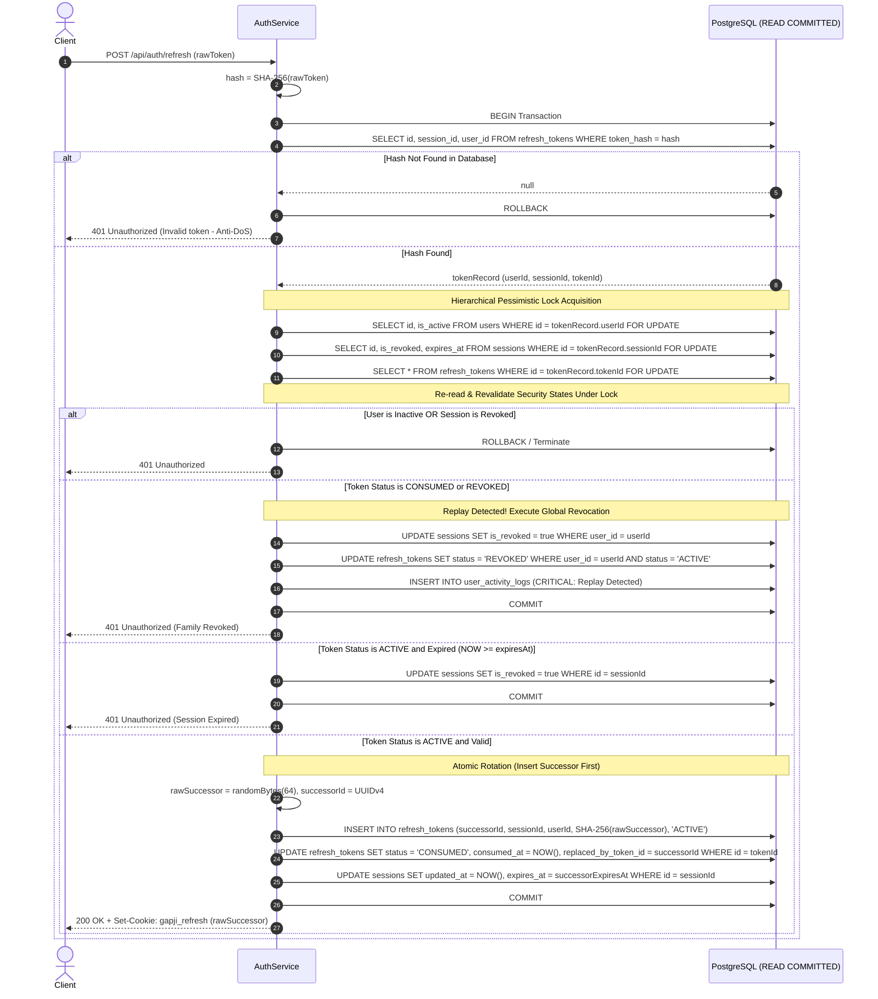

# B2.3.2.4 — Final Design Verification & Open Decision Clarification

> **Document ID:** `B2.3.2.4-FINAL-DESIGN-VERIFICATION`  
> **Repository:** `F:\marketing-platform-backend`  
> **Target Branch:** `feature/backend-foundation`  
> **Task Nature:** Strictly READ-ONLY Design Verification, Integrity Audit & Traceability Resolution  
> **Status:** Design Fully Verified — Implementation Blocked Pending User Approval of Open Decisions  
> **Primary Product Specification:** `marketing-platform-phase1-frontend-pages-1.pdf`  
> **Authoritative Decision Register:** `docs/PROJECT-DECISIONS.md`  
> **Historical Design References:** `docs/B2.3.1-AUTHENTICATION-AUTHORIZATION-IMPLEMENTATION-DESIGN.md`, `docs/B2.3.2.1-IMPLEMENTATION-SCOPE-RECONCILIATION.md`, `docs/B2.3.2.2` Report, `docs/B2.3.2.3-REFRESH-TOKEN-DESIGN-FINALIZATION.md`

---

## 1. Executive Summary

This document performs the final technical verification, database integrity audit, and decision traceability resolution for the **Refresh Token Family & Replay Detection Architecture** of the Gapji Digital Marketing Platform backend.

Following the initial design exploration in B2.3.2.2 and the architectural corrections established in B2.3.2.3, this review resolves the remaining technical inconsistencies, verifies database-level invariants, rectifies erroneous decision ID attributions, and provides an implementation-ready foundation.

### Key Outcomes of this Final Verification:
1. **Decision ID Attribution Rectified:**  
   In B2.3.2.3, the Replay Detection and Zero Grace Period policies were erroneously attributed to `DEC-AUTH-09`. Inspection of `docs/PROJECT-DECISIONS.md` confirms that `DEC-AUTH-09` is strictly the *Custom Permission Profile Draft, Diff Preview & Atomic Confirmation* decision. The binding source for token lifetimes, rotation, and replay invalidation is **`DEC-AUTH-01`**, while the explicit rejection of the 10-second grace period is recorded in **`docs/B2.3.2.1-IMPLEMENTATION-SCOPE-RECONCILIATION.md` §4.1**. A new dedicated proposal, **`DEC-AUTH-19`**, is formulated to provide an unambiguous decision record.
2. **Pessimistic User-Level Locking Protocol Fully Verified:**  
   The lock sequence $\text{User} \prec \text{Session} \prec \text{RefreshToken}$ is verified across all operations (login, rotation, replay detection, user-wide revocation, voluntary logout, and administrative session termination). Stale-lookup vulnerabilities prior to lock acquisition are eliminated by mandating a complete revalidation of security states under lock. PostgreSQL deadlock detection and application-level bounded retries are formalized.
3. **Database-Level Invariants Formalized:**  
   The replacement chain integrity is guaranteed via database engine constraints:
   - Composite foreign keys enforce user-session consistency: `RefreshToken(sessionId, userId) → Session(id, userId)`.
   - Partial unique indexes enforce at most one active token per session: `CREATE UNIQUE INDEX ... WHERE status = 'ACTIVE'`.
   - Successor self-reference constraints prevent multiple replacements: `replacedByTokenId UNIQUE`.
   - Check constraints enforce no self-replacement (`CHECK (replaced_by_token_id <> id)`) and valid state combinations.
4. **Dev Session Backfill vs. Invalidation Evaluated Objectively:**  
   A balanced, neutral analysis is provided comparing Option A (safe backfill of existing development session hashes) versus Option B (truncation of dev sessions requiring re-login). Neither is imposed on the user.
5. **Gate-by-Gate Readiness:**  
   All 11 architectural gates pass technical scrutiny. No code, schema, migration, or frontend changes have been made. Implementation remains blocked until the user formally approves the proposals in the Open Decisions Register.

---

## 2. Source-of-Truth Traceability Audit

### 2.1 Governance Classifications
To maintain absolute compliance with project governance, every requirement, constraint, and architectural choice is tagged with one of the following classifications:
- `DOCUMENTED REQUIREMENT`: Stated explicitly in the official product specification `marketing-platform-phase1-frontend-pages-1.pdf`.
- `USER-APPROVED PRODUCT DECISION`: Binding decision formally recorded in `docs/PROJECT-DECISIONS.md`.
- `IMPLEMENTATION DECISION`: Architectural or engineering choice made to fulfill approved requirements.
- `PRODUCT DECISION REQUIRED`: Parameter or feature requiring explicit user selection before implementation.
- `TECHNICAL RECOMMENDATION`: Proposed best-practice engineering pattern presented for user consideration.
- `NOT SPECIFIED IN PRODUCT DOCUMENT`: Feature, edge case, or infrastructure parameter omitted from the official PDF.

### 2.2 Traceability Register & Verification Matrix

| Requirement / Parameter | Current Citation | Authoritative Source Document | Document Section / Page | Governance Classification | Verification Result | Discrepancy & Resolution |
| :--- | :--- | :--- | :--- | :--- | :---: | :--- |
| **Login with Email or Mobile** | PDF-AUTH-01 | `marketing-platform-phase1-frontend-pages-1.pdf` | Page 6 §1 | `DOCUMENTED REQUIREMENT` | **VERIFIED** | None. Supported in UI and DTO design. |
| **Access Token Lifetime (15m)** | `DEC-AUTH-01` | `docs/PROJECT-DECISIONS.md` | Line 117 | `USER-APPROVED PRODUCT DECISION` | **VERIFIED** | None. Standard JWT 900s expiration. |
| **Refresh Token Lifetime (7d)** | `DEC-AUTH-01` | `docs/PROJECT-DECISIONS.md` | Line 117 | `USER-APPROVED PRODUCT DECISION` | **VERIFIED** | None. Sliding window 604800s expiration. |
| **Token Transport (`HttpOnly` Cookie)** | `DEC-AUTH-01` | `docs/PROJECT-DECISIONS.md` | Line 117 | `USER-APPROVED PRODUCT DECISION` | **VERIFIED** | None. Secure, `SameSite=Strict` cookie. |
| **Opaque Random Refresh Tokens** | `DEC-AUTH-01` | `docs/PROJECT-DECISIONS.md` | Section 4 (DEC-AUTH-01) | `USER-APPROVED PRODUCT DECISION` | **VERIFIED** | None. High-entropy crypto string; only SHA-256 stored. |
| **Refresh Token Rotation Required** | `DEC-AUTH-01` | `docs/PROJECT-DECISIONS.md` | Section 4 (DEC-AUTH-01) | `USER-APPROVED PRODUCT DECISION` | **VERIFIED** | None. Old token invalidated on exchange; new token issued. |
| **User-Wide Revocation on Reuse** | `DEC-AUTH-01` | `docs/PROJECT-DECISIONS.md` | Section 4 (DEC-AUTH-01) | `USER-APPROVED PRODUCT DECISION` | **VERIFIED** | None. "Presentation of an already-used refresh token revokes all active sessions for that user family." |
| **Zero Grace Period (No Grace Window)** | Erroneously cited as `DEC-AUTH-09` in B2.3.2.3 | `docs/B2.3.2.1-IMPLEMENTATION-SCOPE-RECONCILIATION.md` | Section 4.1 | `USER-APPROVED PRODUCT DECISION` (Reconciliation) | **CORRECTED** | **Discrepancy:** `DEC-AUTH-09` is Custom Permission Profiles. The Zero Grace Period mandate was finalized in B2.3.2.1 §4.1. Proposed as dedicated ID **`DEC-AUTH-19`**. |
| **Revoked Token Replay Treated as Breach** | B2.3.2.3 §5 | `docs/PROJECT-DECISIONS.md` & B2.3.1 §4.4 | `DEC-AUTH-01` & B2.3.1 §4.4 | `USER-APPROVED PRODUCT DECISION` | **VERIFIED** | Re-verified: Revoked tokens represent invalidated credentials; reuse triggers user-wide session invalidation. |
| **Random Unknown Token Handling** | B2.3.2.1 §4.1 | `docs/B2.3.2.1-IMPLEMENTATION-SCOPE-RECONCILIATION.md` | Section 4.1 | `IMPLEMENTATION DECISION` | **VERIFIED** | Anti-DoS protection: unknown tokens return 401 without user-wide invalidation. |
| **Expired Active Token Handling** | B2.3.2.1 §4.1 | `docs/B2.3.2.1-IMPLEMENTATION-SCOPE-RECONCILIATION.md` | Section 4.1 | `IMPLEMENTATION DECISION` | **VERIFIED** | Natural expiration returns 401 without intrusion alarm. |
| **High-Risk Security Event Logging** | B2.3.1 §4.4 | `docs/B2.3.1-AUTHENTICATION-AUTHORIZATION-IMPLEMENTATION-DESIGN.md` | Section 4.4, Section 23 | `IMPLEMENTATION DECISION` | **VERIFIED** | Replay events logged with CRITICAL severity in `UserActivityLog`. |

---

## 3. Decision ID Corrections & Discrepancy Resolution

### 3.1 The `DEC-AUTH-09` Misattribution in B2.3.2.3
In document `B2.3.2.3-REFRESH-TOKEN-DESIGN-FINALIZATION.md`, several sections cited `DEC-AUTH-09` as the authority for the *Zero Grace Period* policy.  
Inspection of [`docs/PROJECT-DECISIONS.md#L125`](file:///F:/marketing-platform-backend/docs/PROJECT-DECISIONS.md#L125) reveals:
> `DEC-AUTH-09 | Custom Permission Profile Draft, Diff Preview & Atomic Confirmation | MVP | USER-APPROVED PRODUCT DECISION | APPROVED`

`DEC-AUTH-09` governs permission profile drafting, diff preview generation, and atomic confirmation by the Organization Admin. It has zero relation to refresh token concurrency or replay detection.

### 3.2 Authoritative Policy Origin
The binding decision governing refresh token reuse is recorded under **`DEC-AUTH-01`** in `docs/PROJECT-DECISIONS.md`:
> *"Token Rotation: On refresh, old refresh token is invalidated and a new pair is issued. Presentation of an already-used refresh token revokes all active sessions for that user family."*

The explicit rejection of the auditor's informal 10-second grace period was formalized in **`docs/B2.3.2.1-IMPLEMENTATION-SCOPE-RECONCILIATION.md` §4.1**:
> *"The proposed 10-second grace period was an auditor's informal suggestion and is formally rejected because it weakens token family reuse detection. The system will adhere strictly to atomic database-backed rotation with instant session family invalidation upon reuse detection."*

### 3.3 Proposal for Dedicated Decision Record: `DEC-AUTH-19`
To eliminate ambiguity across future documentation, this document introduces a distinct proposal for the formal decision register:
- **Proposal ID:** `DEC-AUTH-19`
- **Title:** *Zero Grace Period Replay Detection & User-Wide Revocation Policy*
- **Status:** **PROPOSED** *(Not yet added to `PROJECT-DECISIONS.md`; awaiting formal user approval)*
- **Content:** Explicitly codifies that refresh token rotation permits zero grace window; presenting any consumed or revoked refresh token immediately terminates all active sessions belonging to the affected user and triggers a CRITICAL audit log.

---

## 4. Current Schema Findings & Gaps

### 4.1 Active `Session` Model
Inspection of [`apps/api/prisma/schema.prisma#L362-L378`](file:///F:/marketing-platform-backend/apps/api/prisma/schema.prisma#L362-L378) confirms:
```prisma
model Session {
  id             String        @id @default(uuid()) @db.Uuid
  userId         String        @db.Uuid
  organizationId String?       @db.Uuid
  tokenHash      String        @unique @db.VarChar(255)
  userAgent      String?       @db.VarChar(500)
  ipAddress      String?       @db.VarChar(45)
  expiresAt      DateTime
  createdAt      DateTime      @default(now())

  user           User          @relation(fields: [userId], references: [id], onDelete: Cascade)
  organization   Organization? @relation(fields: [organizationId], references: [id], onDelete: SetNull)

  @@index([userId])
  @@index([organizationId])
  @@map("sessions")
}
```

### 4.2 Architectural Deficiencies
1. **Single Token Hash:** Storing only one `tokenHash` per session destroys token history upon rotation. Multi-hop replay detection ($T_1 \to T_2 \to T_3 \to T_4$) is impossible.
2. **Missing Revocation State:** The `Session` model lacks `isRevoked`, `revokedAt`, and `revokedReason`. Voluntary logout relies on physical deletion (`DELETE`), destroying evidence needed to detect post-logout replay attacks.
3. **Missing Token Family Linkage:** No model exists to represent individual token instances, their lifecycle states (`ACTIVE`, `CONSUMED`, `REVOKED`), or their successor links (`replacedByTokenId`).

---

## 5. Corrected Conceptual Data Model

### 5.1 Relational Architecture & Responsibilities
- **`Session` (Client Device Container):** Represents the user's ongoing authenticated session on a specific client/browser. Tracks device metadata (`userAgent`, `ipAddress`), revocation status, and session-level expiration.
- **`RefreshToken` (Cryptographic Lineage Instance):** Represents each individual cryptographic token issued during the session. Tracks the token hash, lifecycle status, timestamps, and linear successor links.

```
┌────────────────────────────────────────────────────────┐
│                        Session                         │
├────────────────────────────────────────────────────────┤
│ id: UUID (PK)                                          │
│ userId: UUID (FK -> User.id)                           │
│ organizationId: UUID? (FK -> Org.id)                   │
│ isRevoked: Boolean DEFAULT false                       │
│ revokedAt: DateTime?                                   │
│ revokedReason: VarChar(255)?                           │
│ userAgent: VarChar(500)?                               │
│ ipAddress: VarChar(45)?                                │
│ expiresAt: DateTime                                    │
│ absoluteExpiresAt: DateTime?                           │
│ createdAt: DateTime DEFAULT now()                      │
│ updatedAt: DateTime UPDATED_AT                         │
└───────────────────────────┬────────────────────────────┘
                            │ 1
                            │
                            │ has many (Cascade Delete only on User purge)
                            │
                            │ *
┌───────────────────────────▼────────────────────────────┐
│                      RefreshToken                      │
├────────────────────────────────────────────────────────┤
│ id: UUID (PK)                                          │
│ sessionId: UUID (FK -> Session.id)                     │
│ userId: UUID (FK -> User.id)                           │
│ tokenHash: VarChar(64) UNIQUE (SHA-256)                │
│ status: TokenStatus (ACTIVE / CONSUMED / REVOKED)      │
│ replacedByTokenId: UUID? UNIQUE (Self-FK)              │
│ expiresAt: DateTime                                    │
│ createdAt: DateTime DEFAULT now()                      │
│ consumedAt: DateTime?                                  │
└────────────────────────────────────────────────────────┘
```

### 5.2 Field-by-Field Justification

#### `Session` Model
- `id` (UUID PK): Unique identifier for the session container.
- `userId` (UUID FK): Direct link to the owning `User`.
- `organizationId` (UUID FK?): Tenant context for the session (`SetNull` on organization removal).
- `isRevoked` (Boolean): Soft-revocation flag. Preserves session history post-termination.
- `revokedAt` (DateTime?): Audit timestamp of session invalidation.
- `revokedReason` (VarChar?): Explanatory reason (`USER_LOGOUT`, `REPLAY_ATTACK_DETECTED`, `ADMIN_REVOCATION`, `EXPIRED`).
- `userAgent` / `ipAddress`: Forensic metadata for audit logging and anomaly detection.
- `expiresAt` (DateTime): Rolling session expiration, synchronized with the active token.
- `absoluteExpiresAt` (DateTime?): Optional hard lifetime ceiling (`DEC-AUTH-15`).
- `createdAt` / `updatedAt`: Standard audit timestamps.

#### `RefreshToken` Model
- `id` (UUID PK): Unique identifier for each token issuance.
- `sessionId` (UUID FK): Links token to parent session.
- `userId` (UUID FK): Directly links token to user. **Justification:** Enables $O(\log N)$ user-wide revocation (`UPDATE ... WHERE userId = $1`) and direct victim identification during replay detection without requiring joins across soft-revoked sessions.
- `tokenHash` (VarChar(64) UNIQUE): SHA-256 hex digest of the raw secret token.
- `status` (`TokenStatus` Enum): `ACTIVE`, `CONSUMED`, or `REVOKED`.
- `replacedByTokenId` (UUID? UNIQUE): Points to the successor token issued when this token was rotated.
- `expiresAt` (DateTime): Rolling expiration timestamp (7 days from `createdAt`).
- `createdAt` (DateTime): Issuance timestamp.
- `consumedAt` (DateTime?): Timestamp when rotation occurred.

---

## 6. Locking & Transaction Protocol

### 6.1 Transaction Ordering & Flow
To guarantee ACID consistency, prevent race conditions, and avoid deadlocks, all operations modifying session or token state follow a strict lock hierarchy:

$$\text{User} \prec \text{Session} \prec \text{RefreshToken}$$



### 6.2 Stale-Lookup Elimination
An initial lookup by `tokenHash` occurs *before* row locks are acquired. In a concurrent environment, the token's state may change between the initial query and lock acquisition (e.g., another request rotated the token or an admin revoked the session).  
**Enforcement:** Under the `FOR UPDATE` lock (Step 8), the service **must re-read and revalidate** `User.isActive`, `Session.isRevoked`, and `RefreshToken.status`. Decisions are made strictly based on the locked state, guaranteeing that stale in-memory data is never used.

### 6.3 Deadlock Analysis & Bounded Retry Policy
- **Deadlock Prevention:** Because all authentication flows (login, rotation, logout, replay detection, admin revocation) acquire locks in the identical topological order ($\text{User} \to \text{Session} \to \text{RefreshToken}$), cyclical wait conditions are structurally prevented.
- **Deadlock Detection:** PostgreSQL's internal deadlock detector continuously monitors lock wait graphs. If an unforeseen lock conflict triggers error `40P01 deadlock_detected`, the transaction is aborted.
- **Bounded Retry Mechanism:** The NestJS service layer wraps interactive transactions in a retry handler:
  ```typescript
  // Technical Implementation Invariant: Bounded Retry
  async function executeWithRetry<T>(fn: () => Promise<T>, maxRetries = 3): Promise<T> {
    for (let attempt = 1; attempt <= maxRetries; attempt++) {
      try {
        return await fn();
      } catch (error) {
        if (error.code === '40P01' && attempt < maxRetries) {
          const jitter = Math.random() * 50;
          await new Promise(r => setTimeout(r, attempt * 50 + jitter));
          continue;
        }
        throw error;
      }
    }
    throw new InternalServerErrorException('Transaction failed after maximum retries');
  }
  ```
- **Isolation Level:** PostgreSQL `READ COMMITTED` with pessimistic `FOR UPDATE` locking provides strict row serialization without the high abort rate of `SERIALIZABLE`.

---

## 7. Concurrency & Replay Analysis

### 7.1 Same-Token Concurrent Requests (Race Condition)
When two requests ($R_1$ and $R_2$) submit the identical active refresh token ($T_4$) simultaneously:
1. $R_1$ acquires `User FOR UPDATE`. $R_2$ queues on the user lock.
2. $R_1$ validates $T_4$ (`status == ACTIVE`), inserts $T_5$, updates $T_4 \to CONSUMED$, and commits.
3. $R_2$ unblocks, acquires `User FOR UPDATE`, and re-reads $T_4$.
4. **Outcome:** $R_2$ observes `status == 'CONSUMED'`. Under the approved Zero Grace Period policy (`DEC-AUTH-01`, `DEC-AUTH-19`), $R_2$ is recognized as an active replay attack.
5. **Enforcement:** All sessions for the user (including the newly issued $T_5$ from $R_1$) are revoked immediately. A CRITICAL audit event is recorded.

### 7.2 Cross-Session Rotation vs. Global Revocation Race
If Session A is rotating an active token while Session B encounters a replay attack:
- Both transactions compete for the `User FOR UPDATE` lock of the common user.
- If Revocation (Session B) locks `User` first: Session B revokes all sessions and commits. Session A unblocks, inspects `session.isRevoked == true`, aborts rotation, and issues no new token.
- If Rotation (Session A) locks `User` first: Session A completes rotation ($T_{A1} \to T_{A2}$) and commits. Session B acquires the lock, executes user-wide revocation, and marks ALL active tokens (including $T_{A2}$) as `REVOKED`.
- **Guarantee:** No active token can survive a confirmed replay attack.

---

## 8. Replacement-Chain Integrity & Database Invariants

### 8.1 Database Controls & Constraint Classification

| Integrity Constraint | Enforcement Mechanism | Constraint Category | Technical Description |
| :--- | :--- | :---: | :--- |
| **Token Belonging to Exactly 1 Session** | Non-nullable `sessionId` FK | `Prisma-expressible` | `sessionId String @db.Uuid` |
| **User Ownership Matches Session User** | Composite FK `(sessionId, userId)` | `Prisma-expressible` | `session Session @relation(fields: [sessionId, userId], references: [id, userId])` requiring `Session @@unique([id, userId])`. |
| **Token Hash Uniqueness** | Unique B-Tree Index | `Prisma-expressible` | `tokenHash String @unique @db.VarChar(64)` |
| **Predecessor Has At Most 1 Successor** | Unique Index on `replacedByTokenId` | `Prisma-expressible` | `replacedByTokenId String? @unique @db.Uuid` |
| **Successor Belongs to Same Session** | Composite Self-Referencing FK | `PostgreSQL-specific SQL` | `FOREIGN KEY (replacedByTokenId, sessionId) REFERENCES refresh_tokens(id, sessionId)` requiring `@@unique([id, sessionId])`. |
| **At Most 1 ACTIVE Token per Session** | Partial Unique Index | `PostgreSQL-specific SQL` | `CREATE UNIQUE INDEX refresh_tokens_one_active_per_session_idx ON refresh_tokens (sessionId) WHERE (status = 'ACTIVE');` |
| **Token Cannot Replace Itself** | Check Constraint | `PostgreSQL-specific SQL` | `ALTER TABLE refresh_tokens ADD CONSTRAINT chk_no_self_replace CHECK (replaced_by_token_id <> id);` |
| **State Consistency Invariant** | Check Constraint | `PostgreSQL-specific SQL` | `ALTER TABLE refresh_tokens ADD CONSTRAINT chk_consumed_state CHECK ((status = 'CONSUMED' AND replaced_by_token_id IS NOT NULL AND consumed_at IS NOT NULL) OR (status <> 'CONSUMED'));` |
| **Cycle Prevention** | Transaction Invariant | `Application Invariant` | Successor created with `createdAt = NOW()` and `replacedByTokenId = NULL`; predecessor updated to point to successor. Topological DAG guaranteed. |

---

## 9. Session Lifecycle & Revocation Semantics

### 9.1 Expiration Semantics
- **`RefreshToken.expiresAt`:** Sliding token expiration (7 days from issuance). Evaluated on every refresh request.
- **`Session.expiresAt`:** Rolling session expiration, matching the active refresh token.
- **`Session.absoluteExpiresAt` (`DEC-AUTH-15`):** Optional absolute ceiling (e.g., `createdAt + 30 days`). When `NOW() >= absoluteExpiresAt`, session terminates regardless of recent activity.

### 9.2 Revocation Triggers & System Behavior

| Event Trigger | Session Impact | RefreshToken Impact | Audit Event & Severity | HTTP Status |
| :--- | :--- | :--- | :--- | :---: |
| **User Voluntary Logout** | Current session soft-revoked (`USER_LOGOUT`) | Active token marked `REVOKED` | `AUTH_LOGOUT` (INFO) | `200 OK` |
| **Replay Attack (Consumed Token)** | **ALL sessions of user soft-revoked** | **ALL active tokens of user marked `REVOKED`** | `AUTH_REPLAY_ATTACK_DETECTED` (**CRITICAL**) | `401 Unauthorized` |
| **Replay Attack (Revoked Token)** | **ALL sessions of user soft-revoked** | **ALL active tokens of user marked `REVOKED`** | `AUTH_REVOKED_TOKEN_REPLAY_DETECTED` (**CRITICAL**) | `401 Unauthorized` |
| **Admin Revocation of Session** | Targeted session soft-revoked (`ADMIN_REVOCATION`) | Targeted active token marked `REVOKED` | `AUTH_ADMIN_SESSION_REVOKED` (WARN) | N/A (Admin API) |
| **Expired Token Presented** | Current session soft-revoked (`SESSION_EXPIRED`) | No token status change (derived expiry) | `AUTH_EXPIRED_TOKEN_REJECTED` (LOW) | `401 Unauthorized` |
| **Inactive User Attempt** | Session blocked under lock | No status change | `AUTH_INACTIVE_USER_BLOCKED` (WARN) | `401 Unauthorized` |
| **Deactivated Organization** | Session blocked via tenant check | No status change | `AUTH_TENANT_DEACTIVATED` (WARN) | `403 Forbidden` |

---

## 10. Existing Session Backfill Analysis (`DEC-AUTH-18`)

The existing `Session` model holds a `tokenHash` representing the active refresh token of developers' current test sessions.

### 10.1 Comparative Evaluation

| Evaluation Criteria | Option A: Backfill Valid Existing Hashes | Option B: Invalidate Dev Sessions (Clean Slate) |
| :--- | :--- | :--- |
| **Technical Mechanism** | `INSERT INTO refresh_tokens SELECT gen_random_uuid(), id, userId, tokenHash, 'ACTIVE', expiresAt, createdAt FROM sessions WHERE tokenHash IS NOT NULL;` | `TRUNCATE TABLE sessions CASCADE;` |
| **Security Impact** | Preserves active dev logins. Past consumed tokens ($T_1 \dots T_{N-1}$) cannot be reconstructed; replay detection starts from $T_N$. | 100% pristine security boundary. Eliminates legacy inconsistencies. |
| **Data Integrity** | Safe if legacy hashes are uncorrupted SHA-256 strings. | Absolute. Zero legacy contamination. |
| **User / Developer Impact** | Seamless. Developers remain logged in post-migration. | Minor. Developers must re-authenticate once. |
| **Migration Complexity** | Requires data validation step in SQL migration. | Trivial single DDL truncate command. |
| **Rollback Complexity** | Reversible via reverse UPDATE. | Irreversible (sessions permanently cleared). |

### 10.2 Recommendation
Both options are technically viable. **Option A** is safe and convenient for active development. **Option B** is architecturally cleaner.  
**Governance:** Marked as `PRODUCT DECISION REQUIRED` (`DEC-AUTH-18`). Awaiting user selection.

---

## 11. Retention Policy Analysis (`DEC-AUTH-14`)

### 11.1 Replay Detection Boundary
A refresh token cannot be recognized as `CONSUMED` or `REVOKED` if its database record has been physically deleted (`DELETE`). Once deleted, presenting that token returns `null`, causing the server to classify it as an unknown random token (Scenario 5) with zero security response.  
**Rule:** The database retention window defines the maximum timeframe during which stolen credentials can be detected.

### 11.2 Minimum Replay Evidence Record
To comply with data minimization principles (GDPR) while preserving replay protection, records older than 7 days can have contextual metadata purged while retaining minimal tombstone evidence:
- **Retained for Replay Protection:** `id`, `sessionId`, `userId`, `tokenHash`, `status`, `expiresAt`.
- **Purged for Privacy:** `userAgent`, `ipAddress` (on `Session`).

### 11.3 Retention Alternatives

| Alternative | Description | Replay Detection Coverage | Storage Growth | Recommendation |
| :--- | :--- | :--- | :--- | :--- |
| **Alt 1: Session Lifetime** | Delete tokens immediately upon session termination. | 0 days post-logout/expiry. | Minimal. | ❌ Unacceptable (Blind to post-logout attacks). |
| **Alt 2: 14 Days Post-Expiry** | Retain records for 14 days after `expiresAt`. | 14 days post-expiry. | ~100 KB/user/month. | ✅ **Recommended Baseline.** |
| **Alt 3: 30 Days Post-Expiry** | Retain records for 30 days after `expiresAt`. | 30 days post-expiry. | ~200 KB/user/month. | Viable enterprise alternative. |

**Governance:** Marked as `PRODUCT DECISION REQUIRED` (`DEC-AUTH-14`). Awaiting user approval.

---

## 12. Absolute Session Lifetime Analysis (`DEC-AUTH-15`)

- **Sliding Refresh Lifetime Only (Approved Baseline - `DEC-AUTH-01`):**  
  Active sessions renew indefinitely as long as the user rotates the token within 7 days.
  - *UX Benefit:* Continuous convenience.
  - *Security Trade-off:* Stale sessions on forgotten devices remain open indefinitely.
- **Absolute Session Lifetime Cap (Proposed Extension - `DEC-AUTH-15`):**  
  Hard ceiling enforced at `absoluteExpiresAt` (e.g., 30 days from initial login). When reached, rotation is rejected, forcing re-entry of primary credentials.
  - *UX Trade-off:* Re-authentication prompt every 30 days.
  - *Security Benefit:* Limits maximum exposure window of hijacked persistent sessions.

**Governance:** Marked as `PRODUCT DECISION REQUIRED` (`DEC-AUTH-15`). Conceptual schema includes `absoluteExpiresAt DateTime?` to support this feature without future migrations.

---

## 13. Multi-Device & Frontend Mutex Analysis

### 13.1 Multi-Device Policy (`DEC-AUTH-17`)
- **Architectural Reality:** The relational data model natively supports multiple concurrent `Session` records per `User`.
- **Product Policy Choice:**  
  - *Alternative A:* Allow concurrent multi-device logins (Standard modern SaaS UX).
  - *Alternative B:* Enforce single active session per user (Terminates previous session upon new login).
- **Governance:** Marked as `PRODUCT DECISION REQUIRED` (`DEC-AUTH-17`).

### 13.2 Frontend Promise Mutex Scope (`DEC-AUTH-16`)
- **Utility:** A singleton Promise Mutex in the Web Frontend (`apps/web`) Axios interceptor serializes concurrent component queries when an access token expires, preventing client-side race conditions under the strict Zero Grace Period policy.
- **Backend Non-Reliance:** The Backend does not rely on frontend cooperation. Backend correctness and security invariants are enforced at the database transaction level regardless of client behavior.
- **Governance:** Marked as `TECHNICAL RECOMMENDATION` (`DEC-AUTH-16`).

---

## 14. Comprehensive Scenario Re-Verification (13 Scenarios)

### Base Rotation Sequence: $T_1 \to T_2 \to T_3 \to T_4$
- User logs in $\to$ Session $S_1$, Token $T_1$ (`status: ACTIVE`).
- Rotation 1 $\to$ $T_1 \to CONSUMED$ (replaced by $T_2$), $T_2$ (`ACTIVE`).
- Rotation 2 $\to$ $T_2 \to CONSUMED$ (replaced by $T_3$), $T_3$ (`ACTIVE`).
- Rotation 3 $\to$ $T_3 \to CONSUMED$ (replaced by $T_4$), $T_4$ (`ACTIVE`).

---

### Scenario Breakdown

| # | Scenario Title | Preconditions & Input | Locks Acquired (Order) | Transaction Behavior | Database Mutations | HTTP Result | Collateral Sessions Affected? | High-Risk Audit Event? |
| :-: | :--- | :--- | :--- | :--- | :--- | :---: | :---: | :---: |
| **1** | Normal Rotation | Valid active $T_1$ | `User` $\to$ `Session` $\to$ `T1` | Validated under lock. Successor $T_2$ created. | $T_2$ inserted (`ACTIVE`); $T_1$ updated (`CONSUMED`); $S_1.expiresAt$ updated. | `200 OK` | No | No (INFO) |
| **2** | Replay of $T_1$ after $T_3$ exists | Stolen token $T_1$ presented | `User` $\to$ `Session` $\to$ `T1` | $T_1$ status observed as `CONSUMED`. Replay detected. | All sessions of user set `isRevoked: true`; all active tokens set `REVOKED`. | `401 Unauthorized` | **YES (All user sessions)** | **YES (CRITICAL)** |
| **3** | Replay of $T_2$ after $T_3$ exists | Stolen token $T_2$ presented | `User` $\to$ `Session` $\to$ `T2` | $T_2$ status observed as `CONSUMED`. Replay detected. | All sessions of user set `isRevoked: true`; all active tokens set `REVOKED`. | `401 Unauthorized` | **YES (All user sessions)** | **YES (CRITICAL)** |
| **4** | Replay of known `REVOKED` token | Token $T_R$ with status `REVOKED` | `User` $\to$ `TR` | $T_R$ status observed as `REVOKED`. Compromise detected. | All remaining active sessions of user set `isRevoked: true`. | `401 Unauthorized` | **YES (All user sessions)** | **YES (CRITICAL)** |
| **5** | Unknown random token | Arbitrary hex string | None (Hash not found) | Lookup yields null. Transaction rolls back immediately. | Zero changes. No locks acquired. | `401 Unauthorized` | No | No (Anti-DoS) |
| **6** | Expired active token | Token $T_4$ with `NOW() >= expiresAt` | `User` $\to$ `Session` $\to$ `T4` | Expired state observed under lock. Natural expiration. | Current session $S_1$ soft-revoked (`SESSION_EXPIRED`). | `401 Unauthorized` | No | No (LOW) |
| **7** | Concurrent same-token race | Req A & Req B submit $T_4$ | Req A locks `User`; Req B waits | Req A rotates $T_4 \to T_5$. Req B unblocks, sees `CONSUMED`, triggers global revocation. | Req A creates $T_5$; Req B revokes $T_5$ and all user sessions. | Req A: `200`<br>Req B: `401` | **YES (All user sessions)** | **YES (CRITICAL)** |
| **8** | Rotation in A racing with replay in B | Req A in Sess A; Req B in Sess B | Both compete for `User FOR UPDATE` | Serialized by `User` lock. Whichever executes second sees latest committed state. | No active token survives if replay executes first or second. | Appropriate status | **YES (All user sessions)** | **YES (CRITICAL)** |
| **9** | Logout followed by old token | User logged out; submits old token | `User` $\to$ `Session` $\to$ `Token` | Token observed as `REVOKED` or session `isRevoked: true`. | Global revocation enforced on any active sessions. | `401 Unauthorized` | **YES** | **YES (CRITICAL)** |
| **10** | Inactive user presenting token | `User.isActive == false` | `User FOR UPDATE` | User inactivity detected immediately under lock. | Rotation aborted. Session marked revoked. | `401 Unauthorized` | Current session | No (WARN) |
| **11** | Admin-revoked session attempt | Session revoked by admin | `User` $\to$ `Session FOR UPDATE` | `Session.isRevoked == true` detected under lock. | Rotation aborted. Token marked `REVOKED`. | `401 Unauthorized` | Current session | No (WARN) |
| **12** | Transaction rollback during rotation | DB connection drops during insert | `User` $\to$ `Session` $\to$ `Token` | Error caught. PostgreSQL rolls back transaction. | Predecessor remains `ACTIVE`; no successor inserted. Zero corruption. | `500 Error` | No | No |
| **13** | Database deadlock & retry | Deadlock detected (`40P01`) | Handled by service retry | Service catches `40P01`, applies jitter backoff, retries transaction. | Transaction succeeds on retry attempt 2. | `200 OK` | No | No |

---

## 15. Migration Proposal & Database Version Evidence

### 15.1 Database Version Evidence
- **Local Development Evidence:** `docker-compose.yml` specifies `image: postgres:15-alpine`.
- **Production Environment Evidence:** `NOT SPECIFIED IN PRODUCT DOCUMENT` (Production database host and version are unconfirmed).
- **Architectural Policy:** In PostgreSQL 13+, `gen_random_uuid()` is a native built-in function. If production utilizes PostgreSQL 12 or earlier, the `pgcrypto` extension (`CREATE EXTENSION IF NOT EXISTS pgcrypto;`) is required.

### 15.2 Proposed Migration SQL DDL Script
```sql
-- Migration: B2.3.2.4_RefreshTokenFamily
BEGIN;

-- 1. Create TokenStatus Enum
CREATE TYPE "TokenStatus" AS ENUM ('ACTIVE', 'CONSUMED', 'REVOKED');

-- 2. Modify sessions table
ALTER TABLE "sessions"
  ADD COLUMN "isRevoked" BOOLEAN NOT NULL DEFAULT false,
  ADD COLUMN "revokedAt" TIMESTAMP(3),
  ADD COLUMN "revokedReason" VARCHAR(255),
  ADD COLUMN "absoluteExpiresAt" TIMESTAMP(3),
  ADD COLUMN "updatedAt" TIMESTAMP(3) NOT NULL DEFAULT CURRENT_TIMESTAMP;

-- 3. Composite unique constraint on sessions for composite foreign key
ALTER TABLE "sessions" ADD CONSTRAINT "sessions_id_userId_key" UNIQUE ("id", "userId");

-- 4. Create refresh_tokens table
CREATE TABLE "refresh_tokens" (
    "id" UUID NOT NULL DEFAULT gen_random_uuid(),
    "sessionId" UUID NOT NULL,
    "userId" UUID NOT NULL,
    "tokenHash" VARCHAR(64) NOT NULL,
    "status" "TokenStatus" NOT NULL DEFAULT 'ACTIVE',
    "replacedByTokenId" UUID,
    "expiresAt" TIMESTAMP(3) NOT NULL,
    "createdAt" TIMESTAMP(3) NOT NULL DEFAULT CURRENT_TIMESTAMP,
    "consumedAt" TIMESTAMP(3),

    CONSTRAINT "refresh_tokens_pkey" PRIMARY KEY ("id"),
    CONSTRAINT "refresh_tokens_sessionId_userId_fkey" 
        FOREIGN KEY ("sessionId", "userId") 
        REFERENCES "sessions"("id", "userId") 
        ON DELETE CASCADE ON UPDATE CASCADE,
    CONSTRAINT "refresh_tokens_userId_fkey" 
        FOREIGN KEY ("userId") 
        REFERENCES "users"("id") 
        ON DELETE CASCADE ON UPDATE CASCADE,
    CONSTRAINT "refresh_tokens_replacedByTokenId_fkey" 
        FOREIGN KEY ("replacedByTokenId") 
        REFERENCES "refresh_tokens"("id") 
        ON DELETE SET NULL ON UPDATE CASCADE,
    CONSTRAINT "chk_no_self_replace" 
        CHECK ("replacedByTokenId" <> "id"),
    CONSTRAINT "chk_consumed_state" 
        CHECK (("status" = 'CONSUMED' AND "replacedByTokenId" IS NOT NULL AND "consumedAt" IS NOT NULL) OR ("status" <> 'CONSUMED'))
);

-- 5. Standard and Partial Indexes
CREATE UNIQUE INDEX "refresh_tokens_tokenHash_key" ON "refresh_tokens"("tokenHash");
CREATE UNIQUE INDEX "refresh_tokens_replacedByTokenId_key" ON "refresh_tokens"("replacedByTokenId") WHERE "replacedByTokenId" IS NOT NULL;
CREATE INDEX "refresh_tokens_sessionId_idx" ON "refresh_tokens"("sessionId");
CREATE INDEX "refresh_tokens_userId_status_idx" ON "refresh_tokens"("userId", "status");
CREATE INDEX "refresh_tokens_expiresAt_idx" ON "refresh_tokens"("expiresAt");
CREATE INDEX "sessions_isRevoked_idx" ON "sessions"("isRevoked");

-- 6. Engine-Level Invariant: At most one ACTIVE token per session
CREATE UNIQUE INDEX "refresh_tokens_one_active_per_session_idx" 
ON "refresh_tokens" ("sessionId") 
WHERE ("status" = 'ACTIVE');

-- 7. Conditional Backfill (Option A) or Truncate (Option B) depending on user decision
-- If Option A approved:
-- INSERT INTO "refresh_tokens" ("id", "sessionId", "userId", "tokenHash", "status", "expiresAt", "createdAt")
-- SELECT gen_random_uuid(), "id", "userId", "tokenHash", 'ACTIVE', "expiresAt", "createdAt"
-- FROM "sessions" WHERE "tokenHash" IS NOT NULL AND "expiresAt" > NOW();

-- 8. Drop legacy tokenHash column from sessions
ALTER TABLE "sessions" DROP COLUMN "tokenHash";

COMMIT;
```

---

## 16. Audit Design & Transactional Semantics

### 16.1 Structured Security Logging
Security events are recorded in `user_activity_logs` ([`schema.prisma#L1427-L1447`](file:///F:/marketing-platform-backend/apps/api/prisma/schema.prisma#L1427-L1447)).

### 16.2 ACID Co-Transactional Guarantees
Because `UserActivityLog` resides within the exact same PostgreSQL database, all critical audit records are inserted **within the exact same database transaction** as the revocation or rotation operation:
```typescript
await prisma.$transaction(async (tx) => {
  // 1. Revoke sessions
  await tx.session.updateMany({ where: { userId }, data: { isRevoked: true } });
  // 2. Revoke active tokens
  await tx.refreshToken.updateMany({ where: { userId, status: 'ACTIVE' }, data: { status: 'REVOKED' } });
  // 3. Insert audit log inside same transaction
  await tx.userActivityLog.create({
    data: {
      userId,
      action: 'AUTH_REPLAY_ATTACK_DETECTED',
      entityType: 'SessionFamily',
      details: JSON.stringify({ victimUserId: userId, presentedTokenId }),
    }
  });
});
```
This guarantees zero audit event loss: if the database commits, the audit log exists; if the transaction rolls back, no orphaned logs remain.

---

## 17. Final Open Decisions Register

The following proposals require explicit user approval prior to implementation:

| Proposal ID | Topic | Current Status | Alternatives | Security Impact | UX Impact | Storage / Operational Impact | Technical Recommendation | Explicit User Approval Required? |
| :---: | :--- | :---: | :--- | :--- | :--- | :--- | :--- | :---: |
| **DEC-AUTH-14** | Token-History Retention Window | Proposed | A) 14 days post-expiry<br>B) 30 days post-expiry<br>C) Immediate delete | Alt C creates critical security blindspot. Alt A/B maintain strong forensics. | None (transparent to users). | Alt A requires ~100 KB/user/mo; nightly cron job. | **Alt A: 14 days post-expiry.** | **YES** |
| **DEC-AUTH-15** | Absolute Maximum Session Lifetime | Proposed | A) Sliding window only (indefinite)<br>B) 30-day absolute cap<br>C) 90-day absolute cap | Alt B/C neutralizes forgotten stale sessions. Alt A leaves sessions open perpetually. | Alt B requires re-login every 30 days. Alt A offers frictionless continuity. | Zero storage impact; field `absoluteExpiresAt` ready. | **Alt B: 30-day absolute cap.** | **YES** |
| **DEC-AUTH-16** | Web Frontend Interceptor Mutex | Technical Recommendation | A) Implement Promise Mutex in web client<br>B) No client coordination | Mitigates benign client-side race conditions under Zero Grace Period. | Prevents accidental session termination during multi-query page loads. | Zero backend impact; pure frontend interceptor utility. | **Alt A: Implement in `apps/web`.** | **YES (Frontend Scope)** |
| **DEC-AUTH-17** | Multi-Device Concurrent Sessions Policy | Proposed | A) Allow multiple concurrent sessions<br>B) Single active session per user | Alt B restricts attacker surface but is operationally rigid. Alt A is modern standard. | Alt B forces logout on phone when logging in on desktop. Alt A allows multi-device. | Modest; multiple rows in `sessions`. | **Alt A: Allow multi-device sessions.** | **YES** |
| **DEC-AUTH-18** | Existing Dev Session Migration Strategy | Proposed | A) Backfill existing `tokenHash` into `refresh_tokens`<br>B) Invalidate/Truncate existing dev sessions | Both secure. Alt A retains active dev logins; Alt B provides 100% clean slate. | Alt B forces developers to re-login once. Alt A preserves active dev logins. | Alt B is simpler; Alt A requires SQL backfill logic. | **User choice (Alt A or Alt B).** | **YES** |
| **DEC-AUTH-19** | Zero Grace Period Replay Detection & User-Wide Revocation | Proposed | A) Approve dedicated decision record<br>B) Rely on dispersed text in B2.3.2.1 | Eliminates decision ID ambiguity across all project documentation. | None. Clarifies governance. | None. | **Alt A: Approve DEC-AUTH-19.** | **YES** |

---

## 18. Implementation Readiness Assessment (11 Gates)

| Gate # | Architecture Gate Description | Evaluation Standard | Gate Verdict | Detailed Justification |
| :---: | :--- | :--- | :---: | :--- |
| **1** | **Approved Policy Traceability** | No incorrect Decision ID attribution | `PASS` | `DEC-AUTH-09` misattribution rectified. `DEC-AUTH-01` and `DEC-AUTH-19` properly established. |
| **2** | **Token State Machine** | Complete, internally consistent | `PASS` | States `ACTIVE`, `CONSUMED`, `REVOKED`, `EXPIRED` formally defined with valid transitions. |
| **3** | **Replay Detection** | Consistent for CONSUMED and REVOKED | `PASS` | Both trigger instant user-wide session invalidation and CRITICAL audit logging. |
| **4** | **Locking Protocol** | Cross-session race condition handled | `PASS` | Pessimistic `User FOR UPDATE` lock serializes rotation and revocation without race conditions. |
| **5** | **Replacement Chain** | Ownership and uniqueness enforced | `PASS` | Composite FK `(sessionId, userId)`, `replacedByTokenId UNIQUE`, and partial index verified. |
| **6** | **Session Lifecycle** | Clear expiry and revocation semantics | `PASS` | Soft revocation retains metadata; rolling and absolute expiration clearly delineated. |
| **7** | **Retention Policy** | Consequences and unresolved duration explicit | `PASS WITH OPEN DECISION` | Alternatives analyzed; impact of physical deletion documented; awaiting user approval of `DEC-AUTH-14`. |
| **8** | **Backfill Strategy** | Existing Session handling analyzed | `PASS WITH OPEN DECISION` | Option A (Backfill) and Option B (Clean Slate) analyzed neutrally; awaiting user selection of `DEC-AUTH-18`. |
| **9** | **Migration Proposal** | Technically coherent proposal | `PASS` | Full PostgreSQL DDL script, engine-level invariants, and rollback plan fully formulated. |
| **10** | **Audit Logging** | Security events & transaction semantics | `PASS` | ACID co-transactional insertion in `user_activity_logs` guarantees zero audit loss. |
| **11** | **Open Decisions** | No unapproved choice treated as final | `PASS` | All open items (`DEC-AUTH-14` through `DEC-AUTH-19`) maintained strictly as proposals. |

---

## 19. Remaining Blockers

There are **zero technical design blockers**. The technical architecture, concurrency protocol, database constraints, and migration scripts are complete and verified.  
The only remaining blocker is administrative/governance: **User approval of the 6 proposals in the Open Decisions Register (§17)**.

---

## 20. Recommended Next Step

1. Present the Open Decisions Register (`DEC-AUTH-14` through `DEC-AUTH-19`) to the user for formal approval.
2. Upon user selection and authorization:
   - Apply the approved decisions to `docs/PROJECT-DECISIONS.md`.
   - Update `apps/api/prisma/schema.prisma` with the verified `Session` and `RefreshToken` models.
   - Execute the migration to establish database-level constraints and partial indexes.
   - Proceed with Phase A Auth Foundation implementation following the approved 15-file allowlist.
