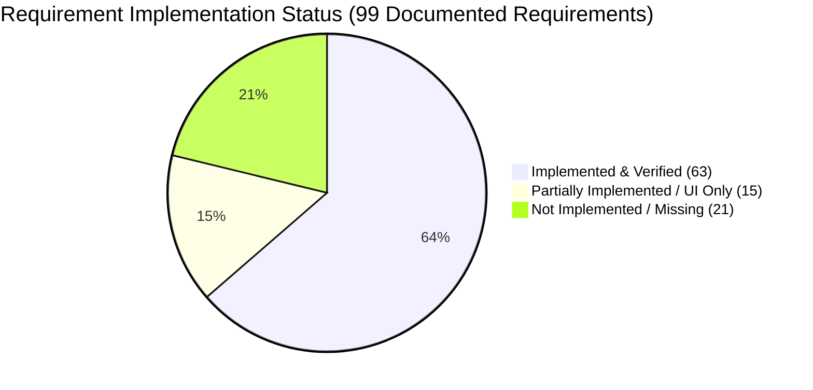
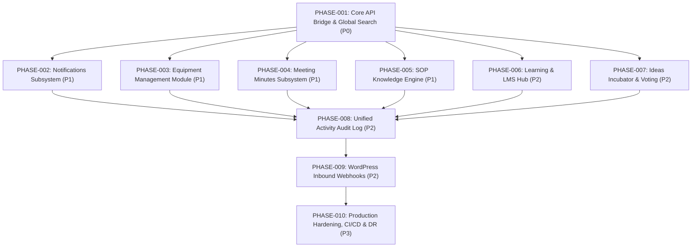

# 01 — Executive Summary
## Gapji Digital Marketing Platform Deep Audit

---

## 1. Project Context & Mission

The **Gapji Digital Marketing & Campaign Management Platform** is an enterprise-grade digital marketing control and workflow acceleration software tailored for digital agencies, performance marketers, marketing managers, campaign leads, sales agents, content creators, and corporate clients.

The platform provides centralized management for:
- Multi-channel marketing campaign lifecycles (Creation, Budgets, Monitoring, Attribution).
- Lead generation inbox, follow-up CRM pipelines, and conversion tracking.
- Financial cost accounting, ROI/ROAS calculation, and platform spend aggregation.
- Team operational workflows (Tasks, Shamsi Calendar, Meeting Minutes, SOPs, Training, Ideas).
- Organization governance, multi-tenancy, and granular role-based access control (RBAC).

This audit was conducted to verify the actual technical condition of the codebase, measure adherence against the 29-page official product specification document (`marketing-platform-phase1-frontend-pages-1.pdf`), and define an unambiguous, dependency-driven completion roadmap to achieve **100% functional completeness and production readiness**.

---

## 2. Core Audit Statistics

| Audit Dimension | Quantitative Finding | Status / Evaluation |
| :--- | :---: | :--- |
| **Product Specification Coverage** | 29 Pages Inspected (100%) | Complete OCR & Visual Layout extraction |
| **Source Code Repositories** | 530 source files | Monorepo: `apps/api`, `apps/web`, `packages/shared` |
| **Documented Requirements Extracted** | 99 Unique Requirements | `REQ-001` through `REQ-099` |
| **Fully Implemented Requirements** | 63 Requirements (63.6%) | Robust foundation across CRM, Campaigns, Costs, Auth |
| **Partially Implemented Requirements** | 15 Requirements (15.2%) | Functional in UI or API, missing complete end-to-end integration |
| **Unimplemented Requirements** | 21 Requirements (21.2%) | 8 domain modules completely absent from Web routes & API |
| **Prisma Database Models** | 43 Models | Complete relational coverage in PostgreSQL schema |
| **Database Migrations** | 6 Sequential Migrations | Successfully generated in `prisma/migrations` |
| **Frontend Test Suites Passing** | 100% of Runnable Scripts | Permissions, Persian date engine, data tables, lead CRM |
| **Backend Unit Tests Passing** | 100% (10 Tests) | `CampaignsService` & data integrity constraints |
| **Overall Production Readiness Score** | **68 / 100** | High code quality; gaps in DevOps, CI/CD, and missing modules |

---

## 3. Architectural Highlights & Strengths

1. **Modern Monorepo Architecture:**
   The codebase is organized as a clean pnpm workspace separating the backend (`apps/api`), frontend (`apps/web`), and shared contracts (`packages/shared`).
2. **Robust Multi-Tenant Data Foundation:**
   The Prisma schema (`apps/api/prisma/schema.prisma`) already defines all 43 models required for the entire 29-page specification, including models for modules that have not yet been built on the frontend (Equipment, SOPs, Meetings, Learning, Ideas, WordPress, Notifications).
3. **Enterprise Authentication & Session Security:**
   The authentication subsystem implements an industry-standard token rotation mechanism:
   - Access tokens are kept strictly **in memory** in the frontend client (never saved in `localStorage` or `sessionStorage`).
   - Refresh tokens are transmitted via `HttpOnly`, `SameSite=Lax`, secure cookies.
   - Axios client features a 401 response interceptor with request queueing to prevent concurrency races during refresh token rotation.
4. **Persian Localization & Jalali Engine:**
   A high-performance, dependency-free Jalali calendar engine is implemented in `apps/web/src/lib/persian-date.ts`, verified across 11,323 consecutive days (years 1390 to 1420) without external library baggage. The layout strictly enforces RTL (`dir="rtl"`) with Vazirmatn fonts.
5. **Strict RBAC & Domain Ownership:**
   Role-based boundaries are mathematically modeled. Sales agents are strictly limited to their assigned leads (`assignedToId = user.id`), and clients are restricted to read-only views with financial mutation endpoints strictly forbidden.

---

## 4. Key Gaps & Technical Findings

1. **8 Missing Product Domains:**
   While the database schema defines models for them, 8 product pages from the official document are completely missing from both the NestJS API modules and the Next.js App Router:
   - Page 3: Notifications (`/notifications`)
   - Page 21: Equipment (`/work/equipment`)
   - Page 22: Meeting Minutes (`/work/meetings`)
   - Page 23: SOP Knowledge Base (`/work/sops`)
   - Page 24: Learning LMS (`/work/learning`)
   - Page 25: Ideas Incubator (`/work/ideas`)
   - Page 26: Activity Report (`/work/activity`)
   - Page 29: WordPress Integration (`/settings/wordpress`)
2. **Route Path Inconsistencies:**
   The PDF designates `/performance/campaigns` for campaigns, but the frontend router currently exposes `/campaigns`. URL aliases or rewrites should be standardized.
3. **Global Search Backend Endpoint Missing:**
   The header contains a visual search bar for leads (by name/mobile) and campaigns (by name), but no unified backend search endpoint currently backs this control.
4. **Production Infrastructure Debt:**
   - Multi-stage Docker production builds are missing (only a local docker-compose PostgreSQL container exists).
   - CI/CD workflow pipelines (`.github/workflows`) are missing.
   - Application observability (structured logging via Pino/Winston, Prometheus metrics, health checks) is not yet configured.

---

## 5. Master Roadmap Overview

To achieve 100% product completion and production readiness, a 10-phase dependency-driven roadmap is established:

---

## 6. Stop Condition Confirmation

In strict compliance with the audit instructions:
- **No production code has been modified.**
- **No Git state has been altered.**
- **Implementation of PHASE-001 has NOT been started.**
- Execution is halted awaiting Product Owner review and authorization.
