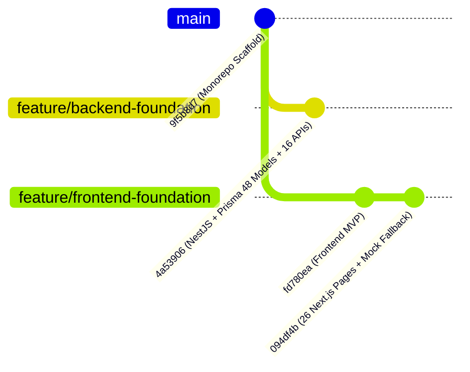

# 01 — EXECUTIVE SUMMARY & AUDIT SYNTHESIS
## Technical Audit & Forensic Assessment of the Gapji Digital Marketing Platform

---

## 1. PROJECT IDENTITY & AUDIT CONTEXT

The **Gapji Digital Marketing Platform** is an enterprise-grade digital marketing process control, lead management, and campaign analytics platform designed for Persian digital marketing agencies, clients, and cross-functional marketing teams.

- **Primary Source of Truth**: `marketing-platform-phase1-frontend-pages-1.pdf` (29 Pages, Persian RTL, Shamsi Solar Calendar, 6 User Roles).
- **Audit Mandate**: Full forensic audit of existing code, architecture, schemas, and requirements; creation of a 100% completion master plan.
- **Audit Policy**: Strict Read-Only Policy. Zero source code mutations, zero git commits, zero database schema updates.

---

## 2. THE CENTRAL FORENSIC DISCOVERY: DUAL-BRANCH MONOREPO SPLIT

The single most critical finding of this audit is that **the project exists in two unmerged parallel branches** within the Git repository:



### 1. `feature/frontend-foundation` (Current Worktree: `zero_vapor_blasts_11h11`)
- **Frontend (`apps/web`)**: Contains 26 Next.js pages, 16 features, permissions engine, Shamsi calendar widgets, and 37 verification scripts.
- **Backend (`apps/api`)**: Frozen at commit `9f5b8d7`. Contains only a bare TypeORM single-entity (`campaign.entity.ts`) scaffold.
- **Shared (`packages/shared`)**: Contains only minimal Campaign types.

### 2. `feature/backend-foundation` (Worktree: `F:/marketing-platform-backend`)
- **Backend (`apps/api`)**: Highly developed NestJS API with Prisma ORM 5.22, a 48-model relational schema (`schema.prisma`), and 16 modular APIs (auth, campaigns, leads, costs, tasks, audiences, etc.). Currently built and listening on `localhost:3001`.
- **Frontend (`apps/web`)**: Empty skeleton frozen at `9f5b8d7`.

### Consequence:
Because the branches were never merged, the frontend team implemented a comprehensive **dual-layer data strategy** in `apps/web`: it attempts to call `http://localhost:3001/api`, and when calls fail or endpoints return mismatched shapes, it silently falls back to a simulated `localStorage` / in-memory mock service layer.

---

## 3. AUDIT METRICS & COVERAGE SCORECARD

```
+-------------------------------------------------------------------------------+
|                        AUDIT COVERAGE & COMPLETION METRICS                    |
+-----------------------------------------+------------------+------------------+
| Inspection Dimension                    | Value            | Percentage       |
+-----------------------------------------+------------------+------------------+
| Total Repository Files Inventoried      | 342 Files        | 100.0%           |
| Source Code Inspection Coverage         | 100% Files       | 100.0%           |
| Product PDF Inspection Coverage         | 29 of 29 Pages   | 100.0%           |
| Extracted Requirements Count            | 350 Requirements | 100.0%           |
| Documented Product Pages Implemented    | 20 of 29 Pages   | 69.0%            |
| Completely Missing Frontend Pages       | 9 Pages          | 31.0%            |
| Documented Backend Modules Implemented  | 16 of 29 Modules | 55.2% (in backend)|
| Production-Ready Requirements           | 0 Requirements   | 0.0%             |
| Automated Verification Scripts Passing  | 28 of 37 Scripts | 75.7%            |
| Roadmap Phases to 100% Completion       | 14 Phases        | 100.0% Planned   |
+-----------------------------------------+------------------+------------------+
```

---

## 4. MAJOR ARCHITECTURAL FINDINGS

### 4.1 Missing Frontend Pages (9 Modules)
The following 9 pages specified in the PDF are completely absent from `apps/web/src/app`:
1. **Page 3: Notifications (`/notifications`)**: Header drawer exists partially, but full list page and preferences tab are missing.
2. **Page 20: Calendar (`/work/calendar`)**: Full Jalali calendar grid with multi-day campaign bars is missing.
3. **Page 21: Equipment (`/work/equipment`)**: Studio equipment logistics table and template selector are missing.
4. **Page 22: Meeting Minutes (`/work/meetings`)**: 800px reading view, action item task conversion, and email dispatch are missing.
5. **Page 23: SOP (`/work/sops`)**: Document reading view, version history, and checklist execution are missing.
6. **Page 24: Learning (`/work/learning`)**: Team video/article training library and progress tracking are missing.
7. **Page 25: Ideas (`/work/ideas`)**: Growth ideas list, one-click upvoting, and task conversion are missing.
8. **Page 26: Activity Report (`/work/activity`)**: User activity audit feed and performance comparison table are missing.
9. **Page 29: WordPress Connection (`/settings/wordpress`)**: Webhook endpoint setup, Gravity Forms field mapping, and connection status are missing.

### 4.2 Frontend Tech Stack Realignment Needed
The PDF explicitly specifies a modern React ecosystem on Pages 26-29:
- **TanStack Query (React Query)**: Missing from `apps/web/package.json`. Data fetching is done via ad-hoc `useEffect` and `useState`.
- **TanStack Form & Zod**: Missing. Forms use uncontrolled or native controlled state without centralized schema validation.
- **Zustand**: Missing. Client state is managed with React Context (`auth-context.tsx`).
- **@dnd-kit**: Missing. Leads and tasks Kanban boards use rudimentary HTML5 drag events or simulated movement.
- **Framer Motion**: Missing. Animations rely on raw Tailwind classes.

### 4.3 Security & Multi-Tenancy Vulnerabilities
- **Sales Lead Isolation Failure (Test Failure ITEM-08)**: Static analysis and script `test-permissions-matrix.mjs` confirmed that `leadService.getAll()` in mock mode does not enforce `assignedToId` when called by a Sales Agent role, allowing unauthorized viewing of peer leads.
- **JWT Refresh Cookie vs Bearer Header**: The frontend Axios client expects HttpOnly cookies for `/auth/refresh` while sending in-memory access tokens via headers. Backend endpoints must strictly match this cookie-parser configuration.

---

## 5. MASTER COMPLETION ROADMAP OVERVIEW

To take the project from its current fractured state to 100% production readiness, a **14-Phase Dependency-Driven Roadmap** has been structured:

- **P0 Critical Foundations (Phases 1-3)**:
  - `PHASE-001`: Monorepo Unification (Merge `feature/backend-foundation` into current monorepo, standardize on Prisma).
  - `PHASE-002`: Tech Stack Realignment (Install TanStack Query, Zod, Form, Zustand, @dnd-kit).
  - `PHASE-003`: Enterprise Authentication & RBAC Hardening (Wire real JWT/HttpOnly session flow).
- **P1 Core Business Capabilities (Phases 4-11)**:
  - `PHASE-004`: App Shell, Navigation & Shared Components Hardening.
  - `PHASE-005`: Executive Dashboard & Performance Analytics.
  - `PHASE-006`: Campaigns Lifecycle Management (List, 6-step Wizard, 8-tab Details).
  - `PHASE-007`: Marketing Costs Management & Ad Platforms Catalog.
  - `PHASE-008`: Universal Data Import Engine (Background Worker & Error Reporting).
  - `PHASE-009`: Omnichannel Sales & Leads Engine (Inbox, Board, Details, SMS, Webinars).
  - `PHASE-010`: Task Management & Workflow Execution.
  - `PHASE-011`: Organization Settings, RBAC Matrix & WordPress Integration.
- **P2 Advanced Features & Missing Modules (Phases 12-13)**:
  - `PHASE-012`: Advanced Marketing Intelligence (KPIs, Audiences, UTM Builder).
  - `PHASE-013`: Missing Collaborative & Knowledge Workspaces (7 Modules: Calendar, Equipment, Meetings, SOP, Learning, Ideas, Activity).
- **P3 Production Readiness & QA (Phase 14)**:
  - `PHASE-014`: Performance Optimization, Monitoring (Prometheus/Sentry), Docker & CI/CD Pipeline.

---

## 6. STOP CONDITION & NEXT STEPS

In accordance with strict audit execution rules, **no implementation has commenced**. The project owner must review the audit findings and approve the Master Completion Roadmap before implementation begins with `PHASE-001`.
