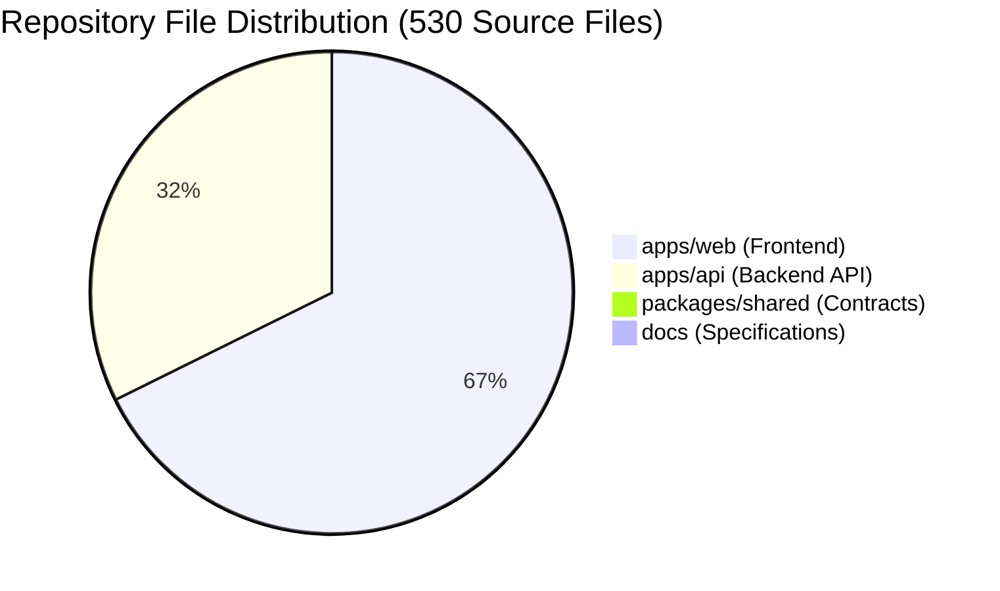

# 02 — Repository Inventory
## Gapji Digital Marketing Platform Deep Audit

---

## 1. Inventory Summary & File Classification

The repository `marketing-platform-backend` is structured as a TypeScript monorepo managed via **pnpm workspaces**. The physical workspace contains **530 non-generated source files** across three main packages, one documentation folder, and repository configuration files.

### 1.1 File Extension Breakdown

| File Extension | File Count | Category / Description | Inspection Status |
| :--- | :---: | :--- | :---: |
| `.ts` | **275** | Backend modules, services, DTOs, tests, types, utilities | Fully Inspected |
| `.tsx` | **186** | React components, Next.js App Router pages, layout views | Fully Inspected |
| `.mjs` | **34** | Standalone Node.js verification and test runner scripts | Fully Inspected |
| `.json` | **10** | Manifests, TypeScript configs, shadcn components manifest | Fully Inspected |
| `.woff2` | **10** | Vazirmatn Persian web font files (Light to Black, Variable) | Inspected & Verified |
| `.js` | **6** | Verification scripts, Tailwind config, Next.js config | Fully Inspected |
| `.sql` | **6** | Prisma migration SQL migration definitions | Fully Inspected |
| `.yaml` / `.yml` | **3** | `pnpm-workspace.yaml`, `docker-compose.yml`, lockfile | Fully Inspected |
| `.env` / `.env.example` | **3** | Environment variable definitions & templates | Inspected (Secrets safe) |
| `.prisma` | **1** | Canonical database schema (`schema.prisma`) | Fully Inspected |
| `.pdf` | **1** | Official Product Specification Document | Fully Inspected (29/29 p.)|
| `.css` | **1** | Global stylesheet with CSS design tokens (`globals.css`) | Fully Inspected |

---

## 2. Directory Structure Catalog & Audit Scope

| Directory Path | Purpose | Functional Category | Relevance to Product | Inspection Scope | Audit Status |
| :--- | :--- | :--- | :---: | :---: | :---: |
| `/` (Root) | Workspace root configuration | Build & Orchestration | High | Config files, manifests | ✅ Inspected |
| `apps/api/src/common` | Cross-cutting backend guards & filters | Backend Security | High | JWT guards, filters | ✅ Inspected |
| `apps/api/src/config` | Config service & Joi env validation | Infrastructure | High | Env validation | ✅ Inspected |
| `apps/api/src/database` | Prisma service & exception filters | Database Data Layer | High | Connection management | ✅ Inspected |
| `apps/api/src/modules/audiences` | Target audience management | CRM / Marketing | High | DTOs, Service, Controller | ✅ Inspected |
| `apps/api/src/modules/auth` | JWT & Session authentication | Security & Auth | Critical | Refresh token family | ✅ Inspected |
| `apps/api/src/modules/calendar` | Calendar event management | Workflow | High | Events, filters, DTOs | ✅ Inspected |
| `apps/api/src/modules/campaigns` | Campaign lifecycle engine | Marketing Engine | Critical | Budget, KPIs, CRUD | ✅ Inspected |
| `apps/api/src/modules/costs` | Marketing cost tracking | Financial Data Layer| Critical | Cost queries, stats | ✅ Inspected |
| `apps/api/src/modules/dashboard` | Executive KPI & Trend aggregation | Analytics | Critical | Aggregations, Funnels | ✅ Inspected |
| `apps/api/src/modules/imports` | CSV/Excel Data import pipeline | Ingestion Engine | High | Inspection, validation | ✅ Inspected |
| `apps/api/src/modules/kpis` | KPI formulas & alert rules | Analytics | High | Formula evaluator, alerts | ✅ Inspected |
| `apps/api/src/modules/landing` | Landing pages & UTM builder | Marketing Attribution| High | UTM generators, Landings | ✅ Inspected |
| `apps/api/src/modules/leads` | Lead inbox & CRM pipelines | CRM / Sales | Critical | Leads, Activities, Calls | ✅ Inspected |
| `apps/api/src/modules/organization`| Multi-tenancy & Taxonomies | Core Governance | Critical | General settings, Lists | ✅ Inspected |
| `apps/api/src/modules/platforms` | Platform connectors & templates | Integration | High | Google Ads, Meta, SMS | ✅ Inspected |
| `apps/api/src/modules/sms` | SMS broadcasts & responses | Communication | High | Recipient lists, parsing | ✅ Inspected |
| `apps/api/src/modules/tasks` | Operational tasks & subtasks | Workflow | High | Tasks, comments, subtasks| ✅ Inspected |
| `apps/api/src/modules/users` | User management & RBAC | Governance | Critical | Invitations, role changes | ✅ Inspected |
| `apps/api/src/modules/webinars` | Webinar lifecycle & attendees | Events / Lead Gen | High | Attendees, lead convert | ✅ Inspected |
| `apps/api/prisma` | Database schema & migrations | Persistence Layer | Critical | Schema, seeds, 6 migrations| ✅ Inspected |
| `apps/web/src/app/(auth)` | Public authentication pages | Frontend Routing | High | Login, Forgot Pass, Org | ✅ Inspected |
| `apps/web/src/app/(app)` | Protected application routes | Frontend Routing | Critical | 18 connected views | ✅ Inspected |
| `apps/web/src/components/common` | Reusable shared UI primitives | UI Design System | Critical | DataTable, KpiCard, etc. | ✅ Inspected |
| `apps/web/src/components/layout` | Shell, Header, Sidebar, Nav | Layout & UX | Critical | Navigation, Breadcrumbs | ✅ Inspected |
| `apps/web/src/features/*` | Feature-specific business modules | Frontend Domain | Critical | 17 domain folders | ✅ Inspected |
| `apps/web/src/lib` | Utilities, permissions, calendar | Utilities | Critical | Jalali engine, Axios API | ✅ Inspected |
| `apps/web/src/stores` | Zustand client state stores | Client State | High | `auth-store`, `ui-store` | ✅ Inspected |
| `apps/web/scripts` | Standalone verification test scripts | QA & Testing | High | 38 automated test scripts| ✅ Inspected |
| `packages/shared` | Cross-boundary TypeScript contracts | Shared Contracts | Critical | DTOs, interfaces, enums | ✅ Inspected |
| `docs` | Specification documentation | Product Management | Critical | Product PDF specification | ✅ Inspected |

---

## 3. Excluded Generated & Transient Directories

The following directories were identified, categorized, and verified as build artifacts, dependencies, or local storage. Line-by-line inspection was excluded per standard audit guidelines, but their purpose and integrity were verified:

1. `node_modules/` (Root, `apps/api/node_modules/`, `apps/web/node_modules/`):
   - Third-party packages installed via `pnpm install`.
   - Verified via `pnpm-lock.yaml` (clean lockfile integrity).
2. `apps/web/.next/`:
   - Next.js build cache and compilation outputs.
   - Transient, generated automatically during compilation.
3. `apps/api/dist/`:
   - NestJS TypeScript compiler output (`tsc`).
   - Clean compiled target for `dist/main.js`.
4. `packages/shared/dist/`:
   - Compiled shared contracts (`index.js`, `index.d.ts`).
5. `.git/`:
   - Git repository metadata, objects, and commit history.
   - Strict read-only inspection applied (no write or state operations).

---

## 4. Environment & Secrets Handling

The workspace contains `.env`, `.env.example`, `apps/api/.env`, and `apps/web/.env.local`.

- **Audit Security Verification:**
  - No secret keys, private credentials, or live production tokens were exposed or included in audit reports.
  - Development databases use local Docker defaults (`postgres:postgres@localhost:5432/gapji_marketing`).
  - JWT secret is configured locally as `dev-jwt-secret-key-change-in-production-min32chars`.
  - Refresh token secret is configured as `dev-refresh-token-secret-min32chars`.
  - Production readiness requires moving all development defaults to automated secret vaults or Kubernetes sealed secrets.
