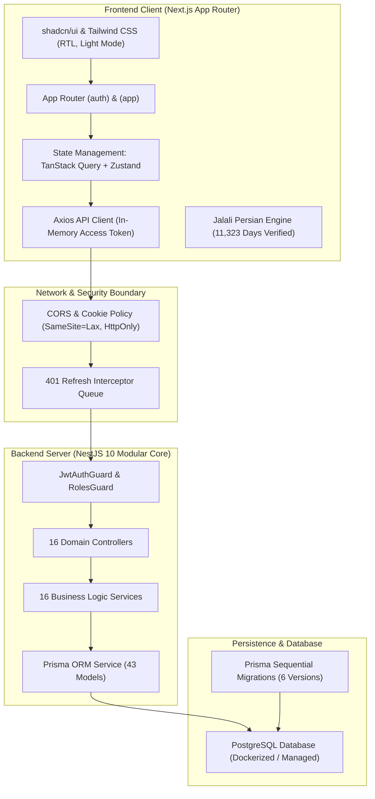
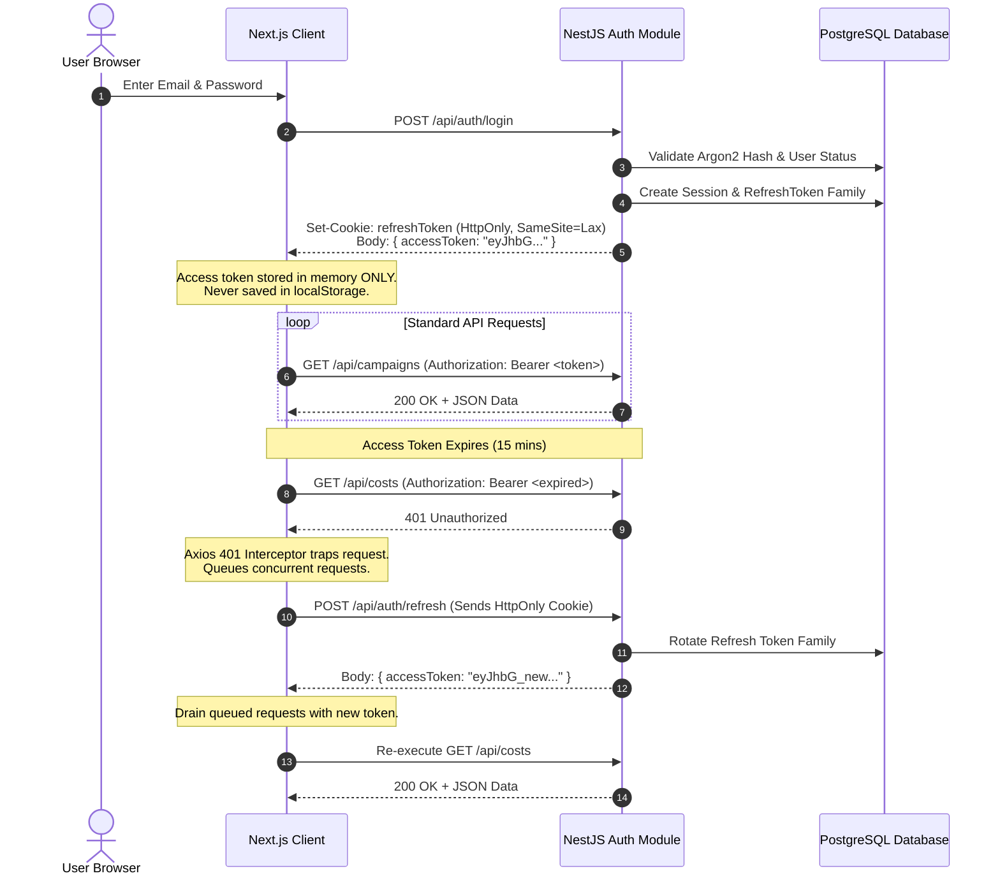

# 03 — Architecture Documentation
## Gapji Digital Marketing Platform Deep Audit

---

## 1. High-Level System Architecture

The Gapji Digital Marketing Platform is designed as a **modular full-stack enterprise web application** built inside a unified monorepo. It couples a decoupled NestJS REST API backend with a high-performance Next.js App Router frontend, communicating over authenticated HTTP/REST with JSON payloads.



---

## 2. Monorepo Organization & Boundary Rules

The project uses `pnpm` workspaces configured in `pnpm-workspace.yaml`:

```yaml
packages:
  - 'apps/api'
  - 'apps/web'
  - 'packages/shared'
```

### Boundary & Isolation Policies:
1. **Shared Contracts (`packages/shared`):**
   Holds domain DTOs, enumerations (`UserRole`, `LeadStatus`, `CampaignStatus`, `TaskPriority`), and API route constants. Both backend and frontend consume this package directly to guarantee contract synchronization.
2. **Backend Independence (`apps/api`):**
   The backend API has zero runtime dependency on Next.js or browser APIs. It is fully executable in standalone mode via `node dist/main.js` or `nest start`.
3. **Frontend Autonomy (`apps/web`):**
   The frontend is an SSR/Client hybrid utilizing React 18 and Next.js 14 App Router. It consumes `@gapji/shared` for shared types and communicates with the backend solely via the configured Axios HTTP client.

---

## 3. Backend Architecture (`apps/api`)

The backend is built on **NestJS 10** following modular Domain-Driven Design (DDD) patterns:

### 3.1 Modular Decomposition
- **Configuration Module:** `ConfigModule.forRoot` loads `.env` variables validated at bootstrap via Joi schemas (`env.validation.ts`).
- **Database Module:** `PrismaModule` provides an injected `PrismaService` extending `PrismaClient` with automatic connection lifecycle hooks and soft-delete/restriction handlers.
- **Exception Filters:** `PrismaClientExceptionFilter` catches database constraint errors (e.g. `P2002` unique constraint, `P2003` foreign key restriction) and transforms them into standard HTTP 409 or 400 responses.
- **Domain Modules:** 16 independent functional modules:
  `audiences`, `auth`, `calendar`, `campaigns`, `costs`, `dashboard`, `imports`, `kpis`, `landing`, `leads`, `organization`, `platforms`, `sms`, `tasks`, `users`, `webinars`.

### 3.2 Data Access & Persistence Pattern
All database interactions flow through Prisma ORM using strong TypeScript typings. Queries enforce:
- Organization tenancy scoping (`organizationId = currentOrgId`).
- Soft validation on related entity existence before deletions.
- Decimal precision preservation on financial fields (`budget`, `spend` as `Decimal(12,2)`).

---

## 4. Frontend Architecture (`apps/web`)

### 4.1 Routing Structure (Next.js 14 App Router)
The application layout separates authenticated and unauthenticated areas via Route Groups:
- `(auth)` Route Group:
  - `/login`: Clean central login card with password reveal toggle.
  - `/forgot-password`: Email/SMS reset link dispatcher.
  - `/select-org`: Post-login multi-organization selection.
- `(app)` Protected Route Group:
  - Wrapped by `(app)/layout.tsx` providing Header, collapsible Sidebar, Breadcrumbs, and Toast Provider.
  - Role-based root page `/` rendering tailored Home Page views per user role.
  - Dedicated domain routes: `/campaigns`, `/leads`, `/leads/board`, `/performance/*`, `/settings/*`, `/work/*`.

### 4.2 State Management Architecture
The frontend adheres to strict state separation:
1. **Server State (TanStack Query v5):**
   - Manages all remote API data, caching, background refetching, and pagination.
   - Structured query keys: `['campaigns', 'list', filters]`, `['leads', 'board']`.
   - Optimistic mutations for Kanban drag-and-drop with rollback on network failure.
2. **Client State (Zustand v5):**
   - `useAuthStore`: Current authenticated user profile, active organization ID/name, user role, and permission helper `can()`.
   - `useUiStore`: Sidebar collapse toggle, table density mode, active tabs; persisted in `localStorage`.
   - No server data is duplicated into Zustand stores.

---

## 5. Authentication, Token Rotation & Session Security

The platform implements an **enterprise dual-token rotation architecture**:



---

## 6. Granular RBAC & System-Enforced Baseline Policies

The platform enforces **6 canonical user roles** within each organization:
1. `admin`: Full organizational governance, user invitations, role changes, and taxonomy management.
2. `marketing_manager`: End-to-end management across campaigns, costs, platforms, KPIs, and team operations.
3. `campaign_manager`: Creation and monitoring of digital marketing campaigns and platform budgets.
4. `sales_agent`: CRM lead management, call logging, and sales pipeline updates.
5. `content_creator`: Webinar, content, and task execution.
6. `client`: Read-only executive dashboard and reporting view.

### Non-Bypassable Mathematical Policies (Intersection $\cap$)
- **Sales Agent Lead Isolation:** Sales agents can **only** read or mutate leads where `assignedToId === user.id`. Foreign leads are strictly denied at both the service and database query levels.
- **Campaign Manager Lead Restriction:** `campaign_manager` can never access the `/leads` pipeline or CRM APIs.
- **Client Mutation Lock:** `client` users can never invoke POST/PATCH/DELETE endpoints on campaigns, costs, or imports.
- **Exactly One Active Admin:** An organization must possess at least one active `admin`. Self-deactivation or self-demotion without simultaneous transfer of authority is rejected by database constraints.

---

## 7. Persian Localization & RTL Engine

- **Pure Right-to-Left (RTL):** Root layout enforces `<html lang="fa" dir="rtl">` with Tailwind logical properties (`ms-*`, `me-*`, `ps-*`, `pe-*`).
- **Typography:** Local web fonts loaded from `apps/web/public/fonts/vazirmatn/` with complete weight range (Thin, Light, Regular, Medium, SemiBold, Bold, ExtraBold, Black).
- **Standalone Jalali Date Engine (`persian-date.ts`):** Custom high-speed date conversion without external library bloat. Verified across 11,323 consecutive days (1390 to 1420), including leap years (`1399`, `1403`, `1408`) and Esfand month boundaries.
- **Currency & Numerals:** Persian digits (`۰-۹`) and thousands separators (`۱۲٬۵۰۰٬۰۰۰ تومان`) with automatic bidirectional ASCII conversion for API transmission.
