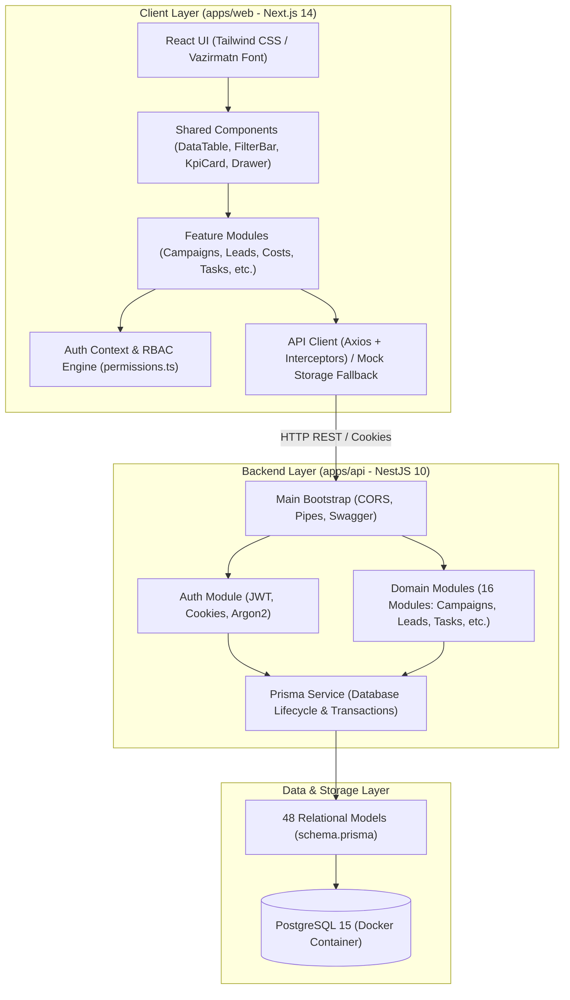
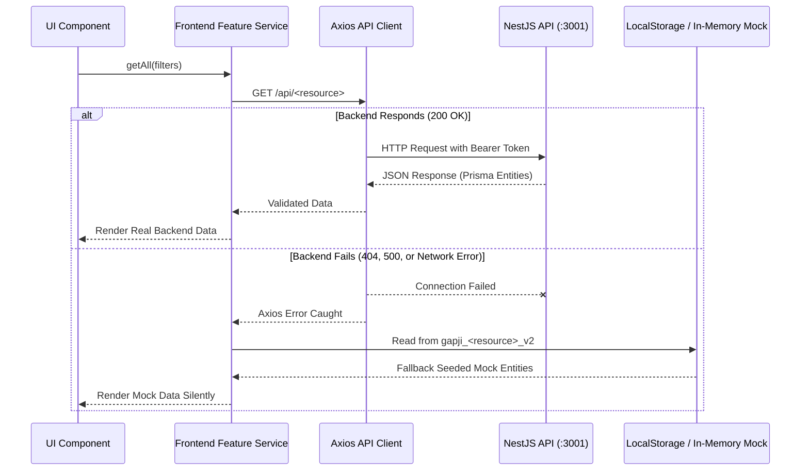
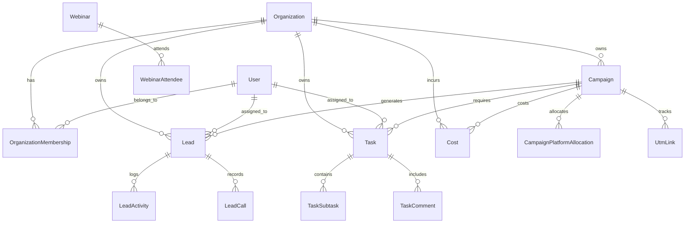

# 03 — SYSTEM ARCHITECTURE & DATA FLOW
## Architectural Blueprints, Component Hierarchies, and Data Flow Analysis

---

## 1. HIGH-LEVEL SYSTEM ARCHITECTURE

The target architecture is a **modular monorepo** consisting of a Next.js App Router client, a NestJS REST API, and a PostgreSQL database orchestrated through Prisma ORM.



---

## 2. DUAL-LAYER DATA ACCESS PATTERN (EXISTING WORKAROUND)

Because `feature/frontend-foundation` and `feature/backend-foundation` diverged in Git, the frontend implements a **resilient dual-layer pattern**:



> [!WARNING]
> While this architecture enabled isolated frontend UI development and demo testing without a running database, it is **unsuitable for production**. State mutations made by one user are persisted only in that browser's `localStorage` and never synchronize across users or devices.

---

## 3. APPLICATION ENTRY POINTS & ROUTING TOPOLOGY

### 3.1 Next.js 14 Frontend (`apps/web`)
- **Root Entry Point**: `apps/web/src/app/layout.tsx`
  - Injects local Vazirmatn fonts via `next/font/local`.
  - Sets root HTML direction to `<html lang="fa" dir="rtl">`.
  - Mounts `AuthProvider` to maintain user session across all routes.
  - Mounts `ToastProvider` for notifications.
- **Route Groups**:
  - `(auth)`: Unauthenticated routes (`/login`, `/forgot-password`, `/select-org`). Uses `apps/web/src/app/(auth)/layout.tsx` with centered modal card and no navigation shell.
  - `(app)`: Authenticated enterprise routes. Uses `apps/web/src/app/(app)/layout.tsx` wrapping all views in `AppShell` (Global Header, Collapsible Sidebar, Breadcrumbs, ToastContainer).

### 3.2 NestJS Backend (`apps/api`)
- **Main Entry Point**: `apps/api/src/main.ts`
  - Global API prefix: `/api`.
  - Swagger UI documentation: `/docs` and JSON at `/docs-json`.
  - Global `ValidationPipe` with `whitelist: true`, `transform: true`.
  - CORS with credentials support enabled for `localhost:3000`.

---

## 4. AUTHENTICATION & ACCESS CONTROL ARCHITECTURE (RBAC)

### 4.1 Canonical User Roles (6 Roles)
1. `admin` (مدیر ارشد سازمانی / ادمین): Full access across all 29 pages and system settings.
2. `marketing_manager` (مدیر مارکتینگ): Comprehensive management of campaigns, costs, leads, tasks, and reports.
3. `campaign_manager` (کمپین‌چی): Create and manage own campaigns, enter costs, view assigned tasks.
4. `sales_agent` (کارشناس فروش): Manage assigned leads, record call outcomes, advance lead Kanban pipeline.
5. `content_creator` (تولید محتوا و وبینار): Manage webinars, equipment, content tasks, and calendar events.
6. `client` (کارفرما): Read-only executive dashboard and high-level campaign reports.

### 4.2 Frontend Access Enforcement (`apps/web/src/lib/permissions.ts`)
- Implements `can(permission, context)` for fine-grained capability checks.
- Implements `canAccessRoute(pathname)` for page-level navigation guards.
- Implements data masking: `maskPhoneNumber(phone, role)` automatically replaces middle digits with asterisks (`0912***4567`) for roles without explicit unmasked phone permissions.

---

## 5. SHARED UI COMPONENT HIERARCHY

```
apps/web/src/components/
├── layout/
│   ├── app-shell.tsx         # Main responsive grid wrapper (Sidebar + Header + Main)
│   ├── header.tsx            # Global topbar (Org switcher, global search, user menu)
│   ├── sidebar.tsx           # 3-group navigation menu with RBAC filtering
│   ├── mobile-sidebar.tsx    # Slide-over drawer for mobile viewports
│   └── breadcrumb.tsx        # Dynamic 3-level route hierarchy trail
├── common/
│   ├── data-table/           # TanStack-inspired table with pagination & multi-select
│   ├── filter-bar.tsx        # Jalali date picker, multi-select dropdowns, search
│   ├── kpi-card.tsx          # Metric cards with trend indicators & formula tooltips
│   ├── status-badge.tsx      # Domain status badges with standard colors & icons
│   ├── timeline/             # Chronological audit trail and lead journey
│   ├── drawer.tsx            # Right-docked slide-in drawer for quick forms
│   ├── modal.tsx             # Centered dialogs with backdrop blur
│   ├── empty-state.tsx       # Standard empty placeholder with CTA
│   ├── confirm-modal.tsx     # Dangerous action confirmation modal
│   └── toast.tsx             # Operation status notifications (5s auto-dismiss)
└── ui/
    ├── persian-date-picker.tsx # Jalali date & range selector
    ├── money-input.tsx       # Thousand-separator currency input
    ├── button.tsx            # Standard buttons with loading spinner
    ├── input.tsx             # Input with label and error styling
    ├── select.tsx            # Dropdown menu
    └── badge.tsx             # Low-level badge
```

---

## 6. BACKEND DATABASE ARCHITECTURE (PRISMA SCHEMA — 48 MODELS)

The full relational schema in `feature/backend-foundation` (`apps/api/prisma/schema.prisma`) models the entire digital marketing domain across 48 entities:


