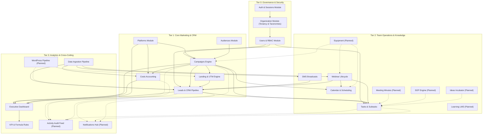

# 06 — Dependency Map
## Gapji Digital Marketing Platform Deep Audit

---

## 1. System Module Dependency Graph

The Gapji Digital Marketing Platform features a structured, layered dependency graph. Foundational modules (Auth, Organization, Users) provide security and multi-tenancy contexts that support core marketing modules (Campaigns, Costs, Leads), which in turn feed aggregated data into Analytics and Workflow subsystems.

---

## 2. Database Entity Relationships (Prisma 43-Model Schema)

The relational schema in `apps/api/prisma/schema.prisma` defines 43 models linked by strict foreign key constraints:

```mermaid
erDiagram
    Organization ||--o{ OrganizationMembership : "has members"
    Organization ||--o{ Campaign : "owns"
    Organization ||--o{ Lead : "owns"
    Organization ||--o{ Cost : "owns"
    Organization ||--o{ Task : "owns"
    Organization ||--o{ Platform : "configures"
    Organization ||--o{ TargetAudience : "defines"
    Organization ||--o{ LandingPage : "hosts"
    Organization ||--o{ CalendarEvent : "schedules"
    Organization ||--o{ EquipmentItem : "owns"
    Organization ||--o{ Meeting : "records"
    Organization ||--o{ Sop : "documents"
    Organization ||--o{ LearningResource : "maintains"
    Organization ||--o{ Idea : "collects"
    Organization ||--o{ Notification : "broadcasts"

    User ||--o{ OrganizationMembership : "participates"
    User ||--o{ Session : "authenticates"
    User ||--o{ RefreshToken : "holds tokens"
    User ||--o{ Task : "assigned"
    User ||--o{ Lead : "manages"
    User ||--o{ UserActivityLog : "triggers"

    Campaign ||--o{ CampaignPlatformAllocation : "budget split"
    Campaign ||--o{ CampaignAudience : "targets"
    Campaign ||--o{ UtmLink : "tracks"
    Campaign ||--o{ Cost : "incurs"
    Campaign ||--o{ Lead : "generates"
    Campaign ||--o{ Task : "spawns"
    Campaign ||--o{ SmsCampaign : "executes"
    Campaign ||--o{ Webinar : "hosts"

    Lead ||--o{ LeadActivity : "logs events"
    Lead ||--o{ LeadCall : "records calls"
    Lead ||--o{ Task : "follow-up tasks"

    Task ||--o{ TaskSubtask : "breaks down into"
    Task ||--o{ TaskComment : "discusses"

    Meeting ||--o{ MeetingActionItem : "decides"
    MeetingActionItem }o--|| Task : "converts to"

    Sop ||--o{ SopVersion : "tracks versions"
    Idea ||--o{ IdeaVote : "community votes"
    Webinar ||--o{ WebinarAttendee : "registers"
```

---

## 3. API Endpoints Registry & Integration Points

| Module | Base Path | Key HTTP Endpoints | Downstream Consumers |
| :--- | :--- | :--- | :--- |
| **Auth** | `/api/auth` | `POST /login`, `POST /refresh`, `POST /logout`, `GET /me` | Web Auth Store, App Router Middleware |
| **Users** | `/api/users` | `GET /`, `POST /invite`, `PATCH /:id/role`, `GET /matrix` | User Management, Team Assignment Dropdowns |
| **Organization** | `/api/organization` | `GET /general`, `PATCH /general`, `GET/POST /taxonomies/:type` | Org Settings, Lead Statuses, Cost Categories |
| **Campaigns** | `/api/campaigns` | `GET /`, `POST /`, `GET /:id`, `PATCH /:id`, `GET /stats` | Campaigns List, Wizard, Details, Home Widgets |
| **Costs** | `/api/costs` | `GET /`, `POST /`, `GET /:id`, `PATCH /:id`, `GET /stats` | Costs Tracking Table, Dashboard Trends |
| **Dashboard** | `/api/dashboard` | `GET /overview`, `GET /compare` | Executive Dashboard, Role-Based Home Views |
| **Leads** | `/api/leads` | `GET /`, `POST /`, `GET /:id`, `PATCH /:id/status`, `POST /bulk-assign` | Lead Inbox, Kanban Board, Lead Details |
| **Platforms** | `/api/platforms` | `GET /`, `POST /`, `GET /templates`, `GET /:id` | Campaign Wizard, Platform Settings, Costs |
| **Audiences** | `/api/audiences` | `GET /`, `POST /`, `GET /:id`, `PATCH /:id` | Audiences Page, Campaign Wizard Step 2 |
| **Landing** | `/api/landing` | `GET /pages`, `POST /pages`, `GET/POST /utm`, `POST /utm/preview` | Landing Table, UTM Builder, GA4 Guide |
| **SMS** | `/api/sms` | `GET /`, `POST /`, `GET /:id`, `POST /import-results` | SMS Broadcasts List, Recipients Table |
| **Webinars** | `/api/webinars` | `GET /`, `POST /`, `GET /:id`, `POST /:id/attendees/convert` | Webinars List, Attendees Table, Lead Pipeline |
| **Tasks** | `/api/tasks` | `GET /`, `POST /`, `GET /:id`, `POST /:id/comments`, `POST /:id/subtasks` | Tasks List, Kanban Board, Task Drawer |
| **Calendar** | `/api/calendar` | `GET /events`, `POST /events`, `PATCH /events/:id` | Shamsi Calendar View, Campaign Schedule Tab |
| **Imports** | `/api/imports` | `GET /fields`, `POST /inspect`, `POST /validate`, `POST /execute` | Data Import History, 4-Step Wizard |
| **KPIs** | `/api/kpis` | `GET /`, `POST /`, `POST /metrics`, `POST /validate-formula`, `POST /rules` | KPI Table, Formula Builder, Alert Rules |

---

## 4. Coupling Risks & Architectural Bottlenecks

1. **Dashboard Heavy Aggregation Query Coupling:**
   `/api/dashboard/overview` aggregates data across Campaigns, Costs, Platforms, and Leads. High data volumes could degrade response times. *Recommendation:* Implement Redis/in-memory caching with event-driven invalidation.
2. **Sales Agent Lead Assignment Cascades:**
   When reassigning leads in bulk, related `LeadActivity` and future `Task` deadlines must update atomically in a single PostgreSQL transaction.
3. **Campaign Deletion Restrictions (`P2003`):**
   Prisma enforces `Restrict` on campaign deletions if connected Costs or Leads exist. Deletion must present clear error feedback to users rather than generic failures.
4. **Offline Mock Fallbacks in Web Layer:**
   Several feature services (e.g. `platforms.api.ts`) contain fallback mock templates if the backend API fails. In production, these should fail gracefully with standard ErrorState rather than disguising backend outages.
