# 06 — DEPENDENCY MAP & INTERACTION TOPOLOGY
## Cross-Module Dependency Graph, Data Lineage, and Blast Radius Analysis

---

## 1. CROSS-MODULE DEPENDENCY GRAPH

The Gapji platform consists of four primary workspace clusters connected through shared authentication, enterprise settings, and common UI foundations:

```mermaid
graph TD
    subgraph Foundation ["Core Foundation Layer"]
        AUTH["Auth & Multi-Tenancy (P01)"]
        USERS["Users & RBAC (P27)"]
        ORG["Organization & Taxonomy (P28)"]
        SHELL["App Shell & UI Foundations"]
    end

    subgraph Workspace1 ["Workspace 1: Performance & Analytics"]
        DASH["Executive Dashboard (P04)"]
        CAMP["Campaigns List, Wizard & Details (P05-P07)"]
        PLAT["Ad Platforms Catalog (P08)"]
        COST["Marketing Costs (P09)"]
        IMP["Universal Import (P10)"]
        KPI["KPIs & Alert Rules (P11)"]
        AUD["Target Audiences (P12)"]
        LAND["Landing Pages & UTMs (P13)"]
    end

    subgraph Workspace2 ["Workspace 2: Sales & Leads"]
        LEADS["Leads Inbox & Board (P14-P15)"]
        LEAD_DET["Lead Details & Journey (P16)"]
        SMS["SMS Dispatches (P17)"]
        WEBINAR["Webinars & Funnel (P18)"]
    end

    subgraph Workspace3 ["Workspace 3: Execution & Knowledge"]
        TASKS["Task Management (P19)"]
        CALENDAR["Marketing Calendar (P20)"]
        EQUIP["Equipment Logistics (P21)"]
        MEETINGS["Meeting Minutes (P22)"]
        SOP["SOP Knowledge Base (P23)"]
        LEARN["Team Training (P24)"]
        IDEAS["Ideas Board (P25)"]
        ACT["Activity Report (P26)"]
        NOTIF["Notifications (P03)"]
    end

    subgraph Integrations ["External Integrations"]
        WP["WordPress Webhooks (P29)"]
    end

    %% Foundation Bindings
    AUTH --> USERS
    AUTH --> ORG
    SHELL --> AUTH
    SHELL --> ORG

    %% Workspace 1 Bindings
    CAMP --> PLAT
    CAMP --> AUD
    CAMP --> LAND
    COST --> CAMP
    COST --> PLAT
    DASH --> CAMP
    DASH --> COST
    DASH --> LEADS
    IMP --> COST
    IMP --> LEADS
    KPI --> DASH
    KPI --> CAMP

    %% Workspace 2 Bindings
    LEADS --> CAMP
    LEADS --> LAND
    LEAD_DET --> LEADS
    LEAD_DET --> USERS
    SMS --> CAMP
    WEBINAR --> CAMP
    WP --> LEADS

    %% Workspace 3 Bindings
    TASKS --> CAMP
    TASKS --> LEADS
    TASKS --> USERS
    TASKS --> SOP
    CALENDAR --> CAMP
    CALENDAR --> WEBINAR
    CALENDAR --> TASKS
    EQUIP --> WEBINAR
    EQUIP --> CAMP
    MEETINGS --> TASKS
    IDEAS --> TASKS
    ACT --> TASKS
    ACT --> LEADS
    ACT --> COST
    NOTIF --> TASKS
    NOTIF --> LEADS
```

---

## 2. CRITICAL INTEGRATION POINTS & BLAST RADIUS ANALYSIS

| Component / Service | Depended Upon By | Blast Radius If Mutated | Mitigation Strategy |
| :--- | :--- | :---: | :--- |
| **`auth-context.tsx` / `authStore`** | Every single authenticated page (P01–P29), Sidebar, Header | **Catastrophic (100%)** | Preserve interface signature; use strict TypeScript types; run `test-auth-p0-1.mjs`. |
| **`permissions.ts` (`can`, `canAccessRoute`)** | Navigation, Action buttons, Phone masking, Access Matrix | **Critical (90%)** | Centralize 29-page permission table; test with `test-permissions-matrix.mjs`. |
| **`persian-date.ts` & `PersianDatePicker`**| FilterBar, Dashboard, Campaigns, Leads, Tasks, Calendar | **Critical (85%)** | Standardize ISO 8601 boundary conversions; verify leap year tests (`test-persian-date.mjs`). |
| **`Campaign` Entity & Endpoints** | Dashboard, Costs, Leads, Landing/UTM, Tasks, Calendar | **High (75%)** | Implement backwards-compatible DTOs; keep `/campaigns` and `/campaigns/stats` stable. |
| **`Lead` Entity & Pipeline Statuses** | Leads Inbox, Kanban Board, Details, Activity Feed, Dashboard | **High (70%)** | Enforce Organization Taxonomy bindings; validate status enum transitions in backend. |
| **`Organization` Taxonomy Engine** | Costs categories, Lead sources, Loss reasons, Platforms | **High (60%)** | Prevent physical deletion of active taxonomy rows; soft-disable only. |

---

## 3. ARCHITECTURAL INCONSISTENCIES & COUPLING HOTSPOTS

### 3.1 Dual-Branch Monorepo Disconnect
- **Problem**: `feature/frontend-foundation` and `feature/backend-foundation` are completely decoupled in Git.
- **Risk**: Frontend assumes API responses that differ slightly in naming from the backend Prisma schema (e.g., `budgetSpendPercentage` vs `spendPercentage`, `leadConversionRate` vs `conversionRate`).
- **Resolution**: Phase 1 of the roadmap will merge the branches and establish `@gapji/shared` as the single source of truth for TypeScript types.

### 3.2 Mock Storage State Duplication
- **Problem**: `apps/web/src/features/*` contains duplicate mock seeds across `costs.mock.ts`, `lead.mock.ts`, `task.mock.ts`, and `users.mock.ts`.
- **Risk**: Changes to user IDs in `users.mock.ts` cause broken relational joins in `task-storage.ts` and `lead-storage.ts`.
- **Resolution**: Deprecate and remove mock storage files once real PostgreSQL APIs are connected via TanStack Query.

### 3.3 Circular Dependency Risks
- **Inspection Finding**: `apps/web/src/features/leads` imports from `apps/web/src/features/campaigns` and vice-versa (Campaign Details tab imports `LeadsTable`; Lead Journey timeline links to Campaign Details).
- **Current State**: Handled cleanly via shallow barrel imports (`index.ts`), but direct cross-feature deep imports must be avoided to prevent circular webpack bundling cycles.
- **Rule**: Cross-feature communication must happen either through URL navigation (`router.push`) or via shared contracts in `packages/shared`.
