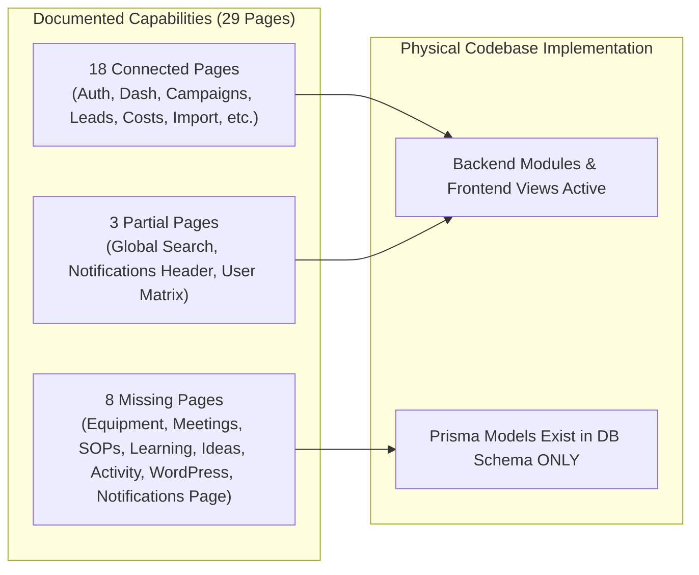

# 07 — Technical Debt and Gap Analysis
## Gapji Digital Marketing Platform Deep Audit

---

## 1. Technical Debt Register

| Debt ID | Classification | Severity | Area / Module | Description & Root Cause | Impact | Recommended Remediation |
| :--- | :--- | :---: | :--- | :--- | :--- | :--- |
| **DEBT-01** | Missing Domain Modules | `P0 / Critical` | Backend API & Web | 8 documented product modules have Prisma models but zero controllers, services, or web views. | 27% of product specification is unexecutable. | Implement dedicated modules in NestJS and routes in Next.js (`PHASE-002` to `009`). |
| **DEBT-02** | Header Search Disconnected | `P1 / High` | Application Shell | Visual search input exists in `Header` but lacks a backend cross-entity search endpoint. | Users cannot execute documented search for leads/campaigns. | Build `/api/search/global` indexing leads and campaigns (`PHASE-001`). |
| **DEBT-03** | Route Alias Inconsistency | `P1 / High` | Routing Structure | PDF defines `/performance/campaigns`, while Next.js routes to `/campaigns`. | Potential navigation breakage or external bookmark mismatches. | Add Next.js rewrite or alias redirecting `/performance/campaigns` to `/campaigns` (`PHASE-001`). |
| **DEBT-04** | Mock Notification Fallback | `P1 / High` | Notifications | Header contains hardcoded static notifications array in React state. | In-app alerts do not reflect real system events. | Implement `NotificationModule` with SSE/WebSocket push (`PHASE-002`). |
| **DEBT-05** | Permissions Matrix Persistence | `P1 / High` | Settings / Users | Permissions Matrix UI table in `/settings/users` renders toggles without a save mutation endpoint. | Custom role overrides cannot be persisted to PostgreSQL. | Add `PATCH /api/users/permissions/matrix` endpoint (`PHASE-001`). |
| **DEBT-06** | Mock Fallback in Feature APIs | `P2 / Medium` | Frontend Services | Feature APIs (`platforms.api.ts`, `task.api.ts`) contain fallback mocks on HTTP error. | Can mask backend outages or API contract mismatches. | Remove silent mock fallbacks in favor of standardized `ErrorState` retry UI (`PHASE-001`). |
| **DEBT-07** | Client-Side Campaign Filtering | `P2 / Medium` | Performance / Campaigns | `campaignApi.getAll()` fetches all records and applies text/status filters in client memory. | Will degrade frontend performance as campaign records scale past thousands. | Move filtering to SQL queries via Prisma in `campaigns.service.ts` (`PHASE-001`). |
| **DEBT-08** | Incomplete PDF Export Pipeline | `P2 / Medium` | Performance / Dashboard | Dashboard features Excel export via client, but PDF export is missing or uses print stylesheet. | Executive stakeholders cannot download formatted reports. | Add server-side PDF generator (e.g. Puppeteer / PDFKit) (`PHASE-001`). |
| **DEBT-09** | Missing Production Dockerfile | `P3 / Medium` | DevOps / Infrastructure | Workspace contains only `docker-compose.yml` for local Postgres; lacks multi-stage production Dockerfiles. | Cannot be deployed to Kubernetes or production container hosts. | Create production multi-stage Dockerfiles for API and Web (`PHASE-010`). |
| **DEBT-10** | Missing CI/CD Automated Pipelines| `P3 / Medium` | DevOps / QA | No GitHub Actions or CI pipeline configurations in repository root. | Regressions can be introduced without automated pull-request validation. | Add `.github/workflows/ci.yml` running lint, typecheck, and tests (`PHASE-010`). |

---

## 2. Deep Gap Analysis: Documented vs Actual Implementation

### 2.1 Detailed Review of the 8 Missing Product Domains

#### 1. Page 3: Notifications Hub (`/notifications`)
- **Documented Requirements:** Header drawer with 10 recent notifications; full page with notifications list and Settings tab (Event Type × Channel matrix with toggles); mark all as read; click to navigate to entity; counter capped at `+99`.
- **Current State:** Header has mock counter and 3 static items. Backend models `Notification` and `NotificationPreference` exist in Prisma, but no API module exists.
- **Remediation:** Build `apps/api/src/modules/notifications` and `apps/web/src/app/(app)/notifications/page.tsx` (`PHASE-002`).

#### 2. Page 21: Equipment Management (`/work/equipment`)
- **Documented Requirements:** Two views: "Shortages" (default) and "All Equipment"; Shortages grouped by event date with `< 3 days` warning; All Equipment table with status/assignee filters; equipment templates; apply template to campaign/webinar.
- **Current State:** Tagged `comingSoon: true` in navigation. Prisma models `EquipmentItem`, `EquipmentTemplate`, `EquipmentTemplateItem`, `EventEquipment` exist. No backend module or frontend page exists.
- **Remediation:** Build `apps/api/src/modules/equipment` and `apps/web/src/app/(app)/work/equipment/page.tsx` (`PHASE-003`).

#### 3. Page 22: Meeting Minutes (`/work/meetings`)
- **Documented Requirements:** Meetings list; reading view (max 800px); meeting form (Attendees, Agenda, Decisions, Action Items table); distribution status; "Send to all" with email preview; "Convert action items to tasks"; version history.
- **Current State:** Tagged `comingSoon: true` in navigation. Prisma models `Meeting`, `MeetingActionItem` exist. No backend module or frontend page exists.
- **Remediation:** Build `apps/api/src/modules/meetings` and `apps/web/src/app/(app)/work/meetings/page.tsx` (`PHASE-004`).

#### 4. Page 23: SOP Knowledge Base (`/work/sops`)
- **Documented Requirements:** Categorized card list; reading view (800px) with edit mode; numbered procedure steps, checklist, attachments; version selector & history; "Create task from SOP" prominent button; draft vs published badges; print stylesheet.
- **Current State:** Tagged `comingSoon: true` in navigation. Prisma models `Sop`, `SopVersion` exist. No backend module or frontend page exists.
- **Remediation:** Build `apps/api/src/modules/sops` and `apps/web/src/app/(app)/work/sops/page.tsx` (`PHASE-005`).

#### 5. Page 24: Learning & LMS Hub (`/work/learning`)
- **Documented Requirements:** "Library" and "My Courses" tabs for users; "Team Progress" tab for managers; library cards (software, duration); inline video/article player with speed control and resume playback timestamp; course assignment; completion tracking.
- **Current State:** Tagged `comingSoon: true` in navigation. Prisma models `LearningResource`, `UserLearningProgress` exist. No backend module or frontend page exists.
- **Remediation:** Build `apps/api/src/modules/learning` and `apps/web/src/app/(app)/work/learning/page.tsx` (`PHASE-006`).

#### 6. Page 25: Ideas Incubator (`/work/ideas`)
- **Documented Requirements:** Quick submit input at top; status filter; card list with 1-click reversible upvotes; details drawer; manager change status; "Convert to task" button; "Log execution result" for implemented ideas; executed ideas highlighted.
- **Current State:** Tagged `comingSoon: true` in navigation. Prisma models `Idea`, `IdeaVote` exist. No backend module or frontend page exists.
- **Remediation:** Build `apps/api/src/modules/ideas` and `apps/web/src/app/(app)/work/ideas/page.tsx` (`PHASE-007`).

#### 7. Page 26: Activity Report & Audit Feed (`/work/activity`)
- **Documented Requirements:** Role-filtered activity report (managers see all, users see own); date range filter; summary KPI cards; team comparison table; live activity feed ("User X changed lead Y to Qualified" + timestamp + link); Excel export.
- **Current State:** Tagged `comingSoon: true` in navigation. Prisma model `UserActivityLog` exists. No backend module or frontend page exists.
- **Remediation:** Build `apps/api/src/modules/activity` and `apps/web/src/app/(app)/work/activity/page.tsx` (`PHASE-008`).

#### 8. Page 29: WordPress Connection & Inbound Leads (`/settings/wordpress`)
- **Documented Requirements:** Connection status card; single-view API key generation with rotation confirmation; setup guide; "Test Connection" button; field mapping table (WordPress form field -> Lead system field); rejected webhooks log table.
- **Current State:** Tagged `comingSoon: true` in navigation. Prisma models `WordpressIntegration`, `WordpressWebhookLog` exist. Partial status endpoint in landing; no dedicated settings page or webhook receiver.
- **Remediation:** Build `apps/api/src/modules/wordpress` and `apps/web/src/app/(app)/settings/wordpress/page.tsx` (`PHASE-009`).

---

## 3. Risk Assessment Matrix

| Risk Factor | Probability | Impact | Exposure | Mitigation Strategy |
| :--- | :---: | :---: | :---: | :--- |
| **Scope Creep during Module Completion** | Medium | High | **High** | Strictly constrain new modules to documented fields in PDF (`REQ-084` to `REQ-092`). |
| **API/Database Data Desynchronization** | Low | High | **Medium** | Rely strictly on existing Prisma models; do not alter schema unless verified non-destructive. |
| **UI Route Breakage on Refactor** | Low | Medium | **Low** | Maintain route aliases (`/performance/campaigns` -> `/campaigns`) to prevent dead links. |
| **Memory Pressure on Heavy Aggregations** | Medium | Medium | **Medium** | Introduce index optimization and server-side pagination for costs and leads before prod launch. |
