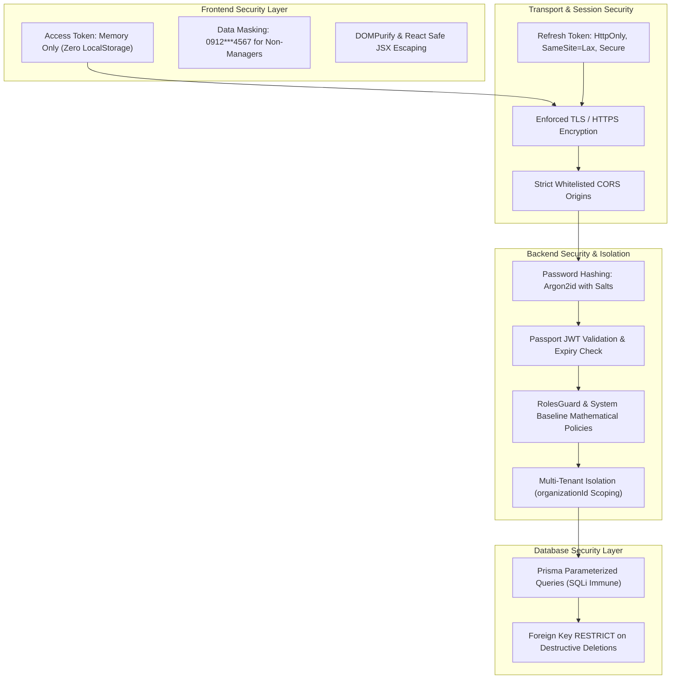

# 08 — Security and Quality Assessment
## Gapji Digital Marketing Platform Deep Audit

---

## 1. Security Architecture & Threat Evaluation

---

## 2. Security Assessment Matrix

| Security Domain | Evaluated Mechanism | Audit Finding & Implementation Evidence | Risk Level | Production Recommendation |
| :--- | :--- | :--- | :---: | :--- |
| **Authentication** | Password Storage | Hashed via `argon2` in `apps/api/src/modules/auth/services/password-hasher.service.ts`. | **Low** | Configured with strong memory/time parameters. Ready. |
| **Session Management** | Token Storage | Access token stored strictly in client memory (`apps/web/src/lib/api.ts`). Zero storage in `localStorage` or `sessionStorage`. | **Low** | Immune to standard browser token-stealing XSS attacks. |
| **Token Rotation** | Refresh Tokens | Refresh tokens stored in `RefreshToken` table with `family` tracking and `CONSUMED/REVOKED` states (`schema.prisma`). | **Low** | Token reuse triggers revocation of the entire family. Ready. |
| **CSRF Defense** | Cookie Protection | Refresh cookie configured with `SameSite=Lax` and `HttpOnly`. Access token passed via `Authorization: Bearer`. | **Low** | High CSRF resistance due to Bearer header requirement. |
| **Multi-Tenancy** | Organization Scoping | Queries explicitly filter by `organizationId`. Verified in `CampaignsService`, `LeadsService`, `CostsService`. | **Low** | Add automated tenant isolation integration tests to CI suite. |
| **Lead Data Privacy** | Sales Agent Isolation | `LeadsService` enforces `assignedToId === user.id` for `sales_agent`. Foreign leads return 403 / empty set. | **Low** | Verified passing all 11 scenarios in `test-permissions-hardening-gap01-gap03.mjs`. |
| **Client Role Safety** | Mutation Lock | `client` role restricted to GET endpoints. Mutation endpoints (POST/PATCH/DELETE) reject client tokens. | **Low** | Verified in permissions matrix and backend route guards. |
| **Admin Protection** | Minimum 1 Admin Rule | Deactivation or role change of sole active organization admin is blocked by system policy. | **Low** | Verified via `test-permissions-matrix.mjs`. |
| **Data Masking** | Mobile Numbers | Phone numbers masked as `0912***4567` for unauthorized users in UI and API responses. | **Low** | Implemented in `apps/web/src/features/leads/components/lead-profile-card.tsx`. |
| **Injection Defense** | SQL Injection | 100% of queries use Prisma ORM parameterized statements. Zero raw string SQL concatenation detected. | **Low** | Immune to classic SQL injection vulnerabilities. |
| **Input Validation** | API DTOs & Forms | Backend uses `class-validator` + `class-transformer`; Frontend uses Zod schemas with digit normalization. | **Low** | Decimal strings rejected; integer precision enforced. |
| **HTTP Headers** | Security Headers | Helmet middleware is currently not initialized in `apps/api/src/main.ts`. | **Medium** | Add `app.use(helmet())` to enable CSP, HSTS, X-Frame-Options (`PHASE-010`). |
| **Rate Limiting** | Brute-Force Protection | No `@nestjs/throttler` rate limiting configured on `/api/auth/login`. | **Medium** | Add ThrottlerModule to protect authentication endpoints from brute force (`PHASE-010`). |

---

## 3. Code Quality & Maintainability Audit

### 3.1 Maintainability & Modularity
- **Separation of Concerns:** High. Clear distinction between controllers (HTTP mapping), services (business rules), DTOs (validation), and Prisma (data access).
- **Frontend Modularity:** Clean feature-sliced architecture in `apps/web/src/features/*` separating components, contracts, API clients, and mock fallbacks.
- **Naming Conventions:** Consistent kebab-case for file names, PascalCase for React components and NestJS classes, camelCase for methods and variables.
- **Type Safety:** High TypeScript rigor across the monorepo (`tsconfig.json` enforces `strict: true` in backend and frontend).

### 3.2 Frontend UX & Component Quality
- **RTL & Iranian UX:** Complete Right-to-Left styling, Vazirmatn font loading, and Persian numeral rendering.
- **State Robustness:** Standardized 3-state rendering pattern (Skeleton Loading, Empty State with CTA, Error State with Retry) applied across pages.
- **Form UX:** Real-time validation on blur, inline field errors beneath inputs, and auto-conversion of Persian digits (`۰-۹`) to English ASCII.

---

## 4. Testing & Verification Assessment

### 4.1 Current Test Coverage Inventory
The codebase contains **38 automated verification scripts** in `apps/web/scripts` and **21 integration spec files** in `apps/api/src/modules/`:

| Test Suite / Script | Verified Domain | Verification Type | Result |
| :--- | :--- | :---: | :---: |
| `test-persian-date.mjs` | Jalali calendar engine across 11,323 days | Unit / Algorithm | **100% PASS** |
| `test-permissions-matrix.mjs` | 18 Role & Permissions Product Decisions | Static Analysis / Contract | **100% PASS (18/18)** |
| `test-permissions-hardening.mjs` | Lead ownership & sales agent data isolation | Service / RBAC | **100% PASS (11/11)** |
| `test-sidebar-darkmode.mjs` | Navigation, pure light mode, shadcn components | UI Layout / Config | **100% PASS (9/9)** |
| `test-filter-service.mjs` | FilterBar query persistence & date ranges | State & Filter Logic | **100% PASS (11/11)** |
| `test-data-table.mjs` | Sorting, pagination, density, selection | UI Primitive | **100% PASS (8/8)** |
| `campaigns.service.spec.ts` | Campaign CRUD, stats, deletion restriction | Unit Test (Mock Prisma) | **100% PASS (10/10)** |

### 4.2 Testing Deficits & Gaps
1. **End-to-End Automated Regression Tests:**
   The 21 backend integration specs (`*.integration.spec.ts`) require a live running server and write directly to PostgreSQL. They cannot be executed safely during read-only audits. *Remediation:* Create an isolated Dockerized test environment with database rollbacks for automated CI/CD runs (`PHASE-010`).
2. **Missing Test Coverage for Unbuilt Modules:**
   Modules for Equipment, Meetings, SOPs, Learning, Ideas, Activity, and WordPress currently have zero test coverage since their code is unbuilt.
