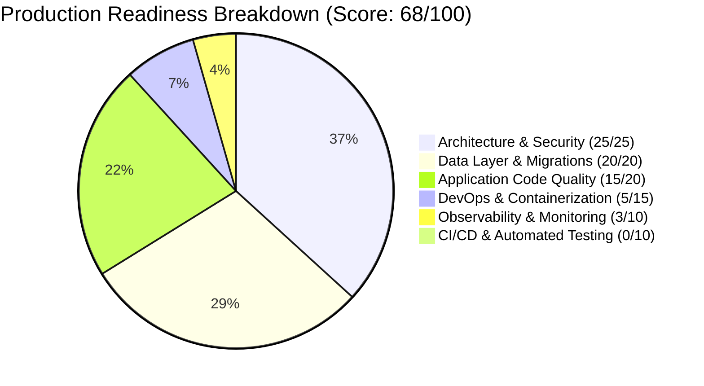
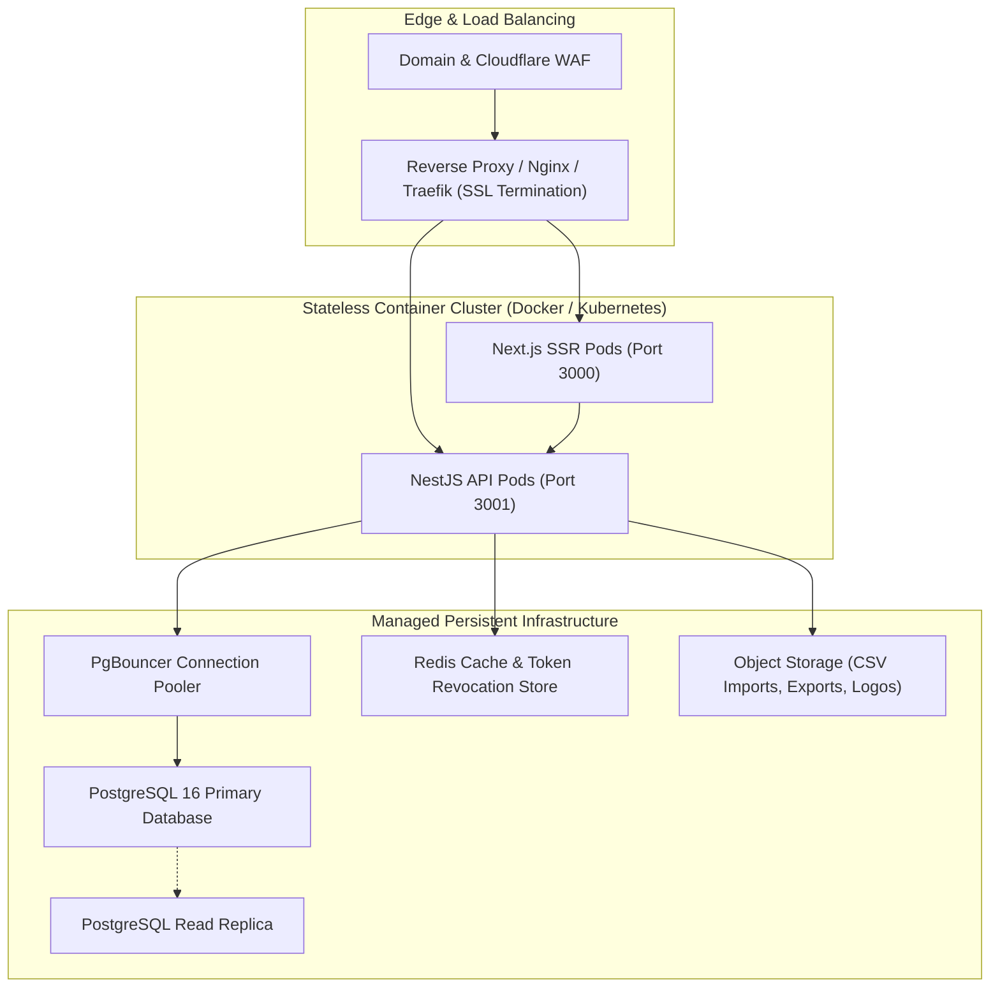

# 09 — Production Readiness Assessment
## Gapji Digital Marketing Platform Deep Audit

---

## 1. Overall Production Readiness Score: 68 / 100



While the core application architecture, database schema, authentication security, and frontend design systems are of **exceptional enterprise quality**, the project currently exhibits critical deficits in **DevOps infrastructure, CI/CD automation, and production observability** that prevent immediate live deployment.

---

## 2. Production Dimension Evaluation Matrix

| Production Dimension | Current State | Target Production Requirement | Gap Severity | Action Required in Roadmap |
| :--- | :--- | :--- | :---: | :--- |
| **Containerization** | `docker-compose.yml` for local Postgres only. No app container. | Multi-stage Dockerfiles for NestJS and Next.js with non-root users. | `High` | Create `Dockerfile.api` and `Dockerfile.web` (`PHASE-010`). |
| **Database Migrations** | 6 sequential migrations in Prisma; local Postgres verified. | Automated migration runner in deployment pipeline (`prisma migrate deploy`). | `Low` | Add deployment migration step in CI/CD pipeline (`PHASE-010`). |
| **Connection Pooling** | Direct Prisma connection to PostgreSQL. | Connection pooler (PgBouncer or Supabase pooler) for high concurrent traffic. | `Medium` | Configure connection pooling URL in production `.env` (`PHASE-010`). |
| **Database Indexing** | Primary keys and explicit unique constraints indexed. | Composite indexes on `[organizationId, createdAt]`, `[assignedToId, status]`. | `Medium` | Add composite indexes to Prisma schema for high-volume queries (`PHASE-010`). |
| **Disaster Recovery** | Manual PostgreSQL dumps. No automated backup configuration. | Automated daily WAL-E / pg_dump snapshots to S3/Cloud Storage with retention. | `High` | Draft backup script and recovery runbook (`PHASE-010`). |
| **Application Logging** | Console logging (`console.log`, default NestJS Logger). | Structured JSON logging (Pino/Winston) with correlation IDs for distributed tracing. | `Medium` | Implement `PinoLogger` middleware in NestJS (`PHASE-010`). |
| **Metrics & Monitoring** | None. | Prometheus metrics endpoint (`/metrics`) and Sentry error tracking in API and Web. | `Medium` | Add Prometheus metrics and Sentry SDK (`PHASE-010`). |
| **Health Checks** | Standard NestJS bootstrap. No dedicated health endpoint. | `@nestjs/terminus` health checks for database, memory, and disk at `/health`. | `Medium` | Add HealthModule with Prisma ping check (`PHASE-010`). |
| **Secret Management** | Local `.env` files with sample defaults. | Vault / AWS Secrets Manager / Kubernetes Sealed Secrets in production. | `High` | Establish production secrets configuration runbook (`PHASE-010`). |
| **CI/CD Pipeline** | None. Manual git pushes. | GitHub Actions pipeline running lint, typecheck, unit tests, build, and Docker publish. | `High` | Add `.github/workflows/ci.yml` (`PHASE-010`). |
| **Security Headers** | Basic Express defaults. | Helmet security headers (CSP, HSTS, X-Content-Type-Options, Frameguard). | `Medium` | Add `helmet()` middleware in `main.ts` (`PHASE-010`). |
| **Rate Limiting** | None. | IP-based rate limiting on `/api/auth/login` and `/api/auth/refresh`. | `Medium` | Add `@nestjs/throttler` in `app.module.ts` (`PHASE-010`). |

---

## 3. Database Integrity & Indexing Optimization Plan

To support enterprise workloads (hundreds of thousands of leads and costs), the following composite database indexes are recommended for `schema.prisma`:

```prisma
// Recommended additions to apps/api/prisma/schema.prisma:

model Lead {
  // Existing fields...
  @@index([organizationId, status])
  @@index([organizationId, assignedToId])
  @@index([organizationId, createdAt(sort: Desc)])
}

model Cost {
  // Existing fields...
  @@index([organizationId, campaignId])
  @@index([organizationId, platformId])
  @@index([organizationId, date(sort: Desc)])
}

model Task {
  // Existing fields...
  @@index([organizationId, assigneeId, status])
  @@index([organizationId, dueDate(sort: Asc)])
}
```

---

## 4. Production Deployment Topology

The recommended production deployment topology separates stateless application containers from managed persistence:



---

## 5. Production Readiness Sign-Off Checklist

Before the Gapji Digital Marketing Platform is certified for production traffic, the following operational requirements must be satisfied:

- [ ] All 10 Master Completion Roadmap phases completed and verified.
- [ ] Multi-stage production Docker images built and scanned for CVE vulnerabilities.
- [ ] Production `.env` configured with high-entropy cryptographic keys (> 64 characters).
- [ ] Database automated snapshot backups verified via test restore drill.
- [ ] Rate limiting active on authentication endpoints.
- [ ] Sentry error reporting active on both frontend and backend.
- [ ] Zero build warnings or TypeScript compilation errors during `pnpm build`.
- [ ] SSL/TLS grade A+ verified via SSL Labs.
