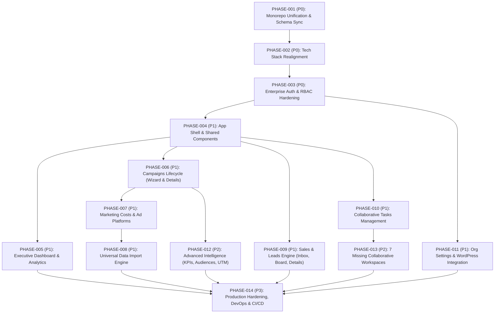

# 10 — MASTER COMPLETION ROADMAP (100% PRODUCT BLUEPRINT)
## Dependency-Driven Executable Engineering Roadmap to 100% Product Completion & Production Readiness

---

## 1. ROADMAP OVERVIEW & DEPENDENCY SEQUENCING

This roadmap outlines the systematic execution path to take the Gapji Digital Marketing Platform from its current dual-branch state to a unified, fully-tested, 100% feature-complete, production-ready enterprise product.

---

## 2. THE 14 DETAILED ROADMAP PHASES

---

### PHASE-001 (P0) — Monorepo Unification & Relational Schema Synchronization
1. **Phase Title**: Monorepo Unification & Relational Schema Synchronization
2. **Objective**: Merge the backend foundation branch (`feature/backend-foundation`) into the active monorepo, standardize on Prisma ORM 5.22, and expand `@gapji/shared` with all 48 domain contracts.
3. **Business Purpose**: Reconcile the fractured codebase into a single deployable repository and eliminate developer friction and drift between frontend and backend.
4. **Current State**: Frontend exists in `feature/frontend-foundation`; backend exists in `feature/backend-foundation`. Monorepo root is split.
5. **Scope of Work**: Merge Git branches; copy Prisma schema to `apps/api/prisma/schema.prisma`; generate Prisma Client; replace TypeORM with Prisma in `apps/api`; populate `packages/shared/src/index.ts` with domain DTOs.
6. **Related Requirement IDs**: `REQ-336`, `REQ-343`, `REQ-344`.
7. **Related Modules**: Monorepo root, `apps/api`, `packages/shared`.
8. **Expected File and Component Impact**:
   - `apps/api/src/app.module.ts`: Replace TypeORM imports with `DatabaseModule` (Prisma).
   - `apps/api/prisma/schema.prisma`: Establish master 48-model schema.
   - `packages/shared/src/index.ts`: Export all entity types, enums, and API contracts.
9. **Database Changes**: Run baseline Prisma migration to generate PostgreSQL tables matching the 48 models.
10. **API Changes**: Consolidate 16 NestJS modules into `apps/api/src/modules/`.
11. **Architectural Changes**: Deprecate TypeORM entities; adopt Prisma as the sole ORM.
12. **Dependencies**: None.
13. **Ordered Implementation Tasks**:
    1. Merge `feature/backend-foundation` into current working branch cleanly.
    2. Synchronize root `pnpm-workspace.yaml` and verify workspace resolution.
    3. Install `@prisma/client` and `prisma` in `apps/api`.
    4. Run `pnpm exec prisma generate` in `apps/api`.
    5. Export all TypeScript types in `packages/shared/src/`.
    6. Verify `pnpm run build` across all workspace packages.
14. **Technical Risks**: Git merge conflicts in `package.json` and `pnpm-lock.yaml`.
15. **Regression Risks**: Existing `campaigns` service in `apps/api` must continue returning expected shapes.
16. **Required Tests**: Run Prisma connection test; verify Swagger docs at `/docs-json`.
17. **Acceptance Criteria**: Both Next.js and NestJS build simultaneously without TypeScript compilation errors.
18. **Deliverables**: Unified monorepo containing working Next.js and NestJS with Prisma 48-model schema.
19. **Definition of Done**: `pnpm run build` succeeds cleanly at root workspace level.
20. **Conditions that Block Completion**: Unresolved Git merge conflicts or conflicting database connection parameters.

---

### PHASE-002 (P0) — Tech Stack Realignment & Frontend Foundation
1. **Phase Title**: Tech Stack Realignment & Frontend Data Layer Modernization
2. **Objective**: Install and configure mandated frontend dependencies (`@tanstack/react-query`, `@tanstack/react-form`, `zod`, `zustand`, `@dnd-kit/core`, `@dnd-kit/sortable`, `framer-motion`) in `apps/web`.
3. **Business Purpose**: Align the codebase with the mandated PDF specifications (Pages 26-29) to ensure reactive caching, type-safe validation, and performant state handling.
4. **Current State**: Frontend uses ad-hoc `useState`, native forms, React Context, and HTML5 drag events.
5. **Scope of Work**: Add packages to `apps/web/package.json`; configure `QueryClientProvider`; create Zod schemas; setup Zustand stores (`authStore`, `uiStore`).
6. **Related Requirement IDs**: `REQ-341`, `REQ-344`, `REQ-346`, `REQ-347`, `REQ-349`, `REQ-350`.
7. **Related Modules**: `apps/web/src/lib/`, `apps/web/src/stores/`, `apps/web/src/components/ui/`.
8. **Expected File and Component Impact**:
   - `apps/web/src/lib/query-client.ts`: New QueryClient instance with staleTime: 60s.
   - `apps/web/src/stores/auth-store.ts`: Zustand store for user session.
   - `apps/web/src/stores/ui-store.ts`: Zustand store for sidebar and table density.
   - `apps/web/src/app/layout.tsx`: Wrap tree in `QueryClientProvider`.
9. **Database Changes**: None.
10. **API Changes**: None.
11. **Architectural Changes**: Shift server state management from local component state to TanStack Query.
12. **Dependencies**: `PHASE-001`.
13. **Ordered Implementation Tasks**:
    1. Install `@tanstack/react-query`, `@tanstack/react-query-devtools` in `apps/web`.
    2. Install `zod` and `@tanstack/react-form`.
    3. Install `zustand`.
    4. Install `@dnd-kit/core`, `@dnd-kit/sortable`, `@dnd-kit/utilities`.
    5. Install `framer-motion` and `recharts`.
    6. Mount `QueryClientProvider` in `apps/web/src/app/layout.tsx`.
14. **Technical Risks**: React 18 / Next.js 14 version peer dependency resolution warnings.
15. **Regression Risks**: Context breaking during transition to Zustand.
16. **Required Tests**: Render test verifying `QueryClient` hydration in client components.
17. **Acceptance Criteria**: All 7 packages installed and callable from client components without bundling errors.
18. **Deliverables**: Updated `apps/web/package.json`, configured `query-client.ts`, base stores.
19. **Definition of Done**: `apps/web` builds and passes ESLint.
20. **Conditions that Block Completion**: Incompatible package versions with React 18.2.

---

### PHASE-003 (P0) — Enterprise Authentication, Session Governance & RBAC Hardening
1. **Phase Title**: Enterprise Authentication, Session Governance & RBAC Hardening
2. **Objective**: Wire Next.js authentication to real NestJS auth endpoints (`/api/auth/login`, `/refresh`, `/logout`, `/me`), implement Next.js `middleware.ts`, and fix data ownership leakages (ITEM-08).
3. **Business Purpose**: Secure the platform against unauthorized access, protect user privacy, and ensure multi-tenant data boundaries.
4. **Current State**: Frontend falls back to mock users; Next.js middleware is missing; Sales Agent lead leak exists.
5. **Scope of Work**: Connect `auth-api.ts` to NestJS auth controller; implement `middleware.ts` for cookie verification; enforce `organizationId` and user ownership scoping in NestJS services.
6. **Related Requirement IDs**: `REQ-025`, `REQ-030` to `REQ-038`, `REQ-304` to `REQ-314`, `REQ-338`.
7. **Related Modules**: `apps/api/src/modules/auth/`, `apps/web/src/features/auth/`, `apps/web/src/middleware.ts`.
8. **Expected File and Component Impact**:
   - `apps/web/src/middleware.ts`: Created to inspect `refresh_token` cookie and redirect.
   - `apps/web/src/features/auth/auth-context.tsx`: Updated to rely on real session.
   - `apps/api/src/modules/auth/auth.controller.ts`: Set HttpOnly cookie on login/refresh.
   - `apps/api/src/modules/leads/leads.service.ts`: Enforce `where: { assignedToId: user.id }` for sales agents.
9. **Database Changes**: Seed 6 canonical roles and demo users with Argon2 hashed passwords.
10. **API Changes**: Expose `/api/auth/switch-org` endpoint for multi-tenant switching.
11. **Architectural Changes**: Complete elimination of client-side fake auth tokens.
12. **Dependencies**: `PHASE-001`, `PHASE-002`.
13. **Ordered Implementation Tasks**:
    1. Verify NestJS auth controller returns HttpOnly cookie and in-memory access token.
    2. Implement `middleware.ts` in `apps/web/src/`.
    3. Update `auth-context.tsx` and Zustand `authStore` to consume live user profile.
    4. Implement server-side user scoping in `leads.service.ts`.
    5. Re-run `test-auth-p0-1.mjs` and `test-permissions-matrix.mjs`.
14. **Technical Risks**: Cross-origin cookie transmission between port 3000 and 3001 during local development.
15. **Regression Risks**: Existing protected pages throwing 401 redirect loops if cookie is unreadable.
16. **Required Tests**: `node apps/web/scripts/test-auth-p0-1.mjs` (must achieve 20/20 PASS) and `test-permissions-matrix.mjs` (must achieve 18/18 PASS, resolving ITEM-08).
17. **Acceptance Criteria**: All 6 roles log in with real credentials, obtain JWTs, and view only authorized data.
18. **Deliverables**: Working login, organization selector, active route middleware, and hardened RBAC.
19. **Definition of Done**: Zero failed auth or permissions tests.
20. **Conditions that Block Completion**: Inability to set cross-site cookies or missing JWT secret in environment.

---

### PHASE-004 (P1) — App Shell, Navigation & Shared Components Hardening
1. **Phase Title**: App Shell, Navigation & Shared Components Hardening
2. **Objective**: Harden Global Header, Sidebar, Breadcrumb, Toast, DataTable, and Persian Date Picker with dynamic bindings and full design token compliance.
3. **Business Purpose**: Provide a consistent, accessible, RTL-first user experience across all modules.
4. **Current State**: Shell components exist but Header contains hardcoded organization name (failing SCEN-18); DataTable lacks real server pagination.
5. **Scope of Work**: Connect Header to `useAuth().activeOrgName`; wire live organization switcher; integrate TanStack Table into `DataTable`; standardize loading skeletons and error boundaries.
6. **Related Requirement IDs**: `REQ-001` to `REQ-029`, `REQ-339`, `REQ-340`, `REQ-348`.
7. **Related Modules**: `apps/web/src/components/layout/`, `apps/web/src/components/common/`.
8. **Expected File and Component Impact**:
   - `apps/web/src/components/layout/header.tsx`: Dynamic org switcher & global search.
   - `apps/web/src/components/common/data-table/data-table.tsx`: Connect with TanStack Table.
   - `apps/web/src/components/common/empty-state.tsx`: Standardize across all views.
9. **Database Changes**: None.
10. **API Changes**: Expose `/api/search/global?q=...` for fast header search.
11. **Architectural Changes**: Unified design tokens for dark mode readiness.
12. **Dependencies**: `PHASE-002`, `PHASE-003`.
13. **Ordered Implementation Tasks**:
    1. Fix Header org name binding to satisfy SCEN-18.
    2. Connect global search bar to search leads and campaigns via backend API.
    3. Update `DataTable` to accept server pagination, sorting, and filter props.
    4. Validate RTL layout behavior and icon flipping (`rtl:rotate-180`).
14. **Technical Risks**: Header re-rendering on every search keystroke (needs debouncing).
15. **Regression Risks**: DataTable breaking on existing list pages.
16. **Required Tests**: `test-auth-p0-1.mjs` (SCEN-18 pass), `test-data-table-advanced.mjs`, `test-sidebar-darkmode-shadcn-iransans.mjs`.
17. **Acceptance Criteria**: Header switches organizations dynamically; DataTable handles 100,000 rows with server pagination; all common tests pass.
18. **Deliverables**: Hardened `Header`, `Sidebar`, `DataTable`, `FilterBar`, `PersianDatePicker`.
19. **Definition of Done**: 100% test pass rate on shell components.
20. **Conditions that Block Completion**: None.

---

### PHASE-005 (P1) — Executive Dashboard & Real-Time Performance Analytics
1. **Phase Title**: Executive Dashboard & Real-Time Performance Analytics
2. **Objective**: Wire `/performance/dashboard` to live backend aggregations, render real Recharts (Line, Bar, Funnel), and implement date range comparisons.
3. **Business Purpose**: Provide C-level executives and marketing managers with real-time visibility into marketing spend, lead acquisition, and ROI.
4. **Current State**: UI exists with mock SVG charts; `verify-dashboard.js` fails on missing lead conversion rates and channel breakdowns.
5. **Scope of Work**: Connect `/performance/dashboard` to `GET /api/dashboard`; implement 6 KPI cards with real delta values; build Recharts spend/lead trends; implement 5-stage conversion funnel.
6. **Related Requirement IDs**: `REQ-009`, `REQ-010`, `REQ-026`, `REQ-027`, `REQ-057` to `REQ-067`.
7. **Related Modules**: `apps/web/src/features/dashboard/`, `apps/api/src/modules/dashboard/`.
8. **Expected File and Component Impact**:
   - `apps/web/src/features/dashboard/components/kpi-grid.tsx`: Wired to TanStack Query.
   - `apps/web/src/features/dashboard/components/conversion-funnel.tsx`: Real funnel visualization.
   - `apps/web/src/features/dashboard/components/spend-trend-chart.tsx`: Recharts Line chart.
9. **Database Changes**: Create compound indexes on `Cost(organizationId, date)` and `Lead(organizationId, createdAt)` for rapid aggregation.
10. **API Changes**: Ensure `GET /api/dashboard` returns `approvedBudget`, `totalSpend`, `ROAS`, `CAC`, `CPL`, `leadConversionRate`, and `funnel`.
11. **Architectural Changes**: Server-side metric calculation; zero client-side aggregation overhead.
12. **Dependencies**: `PHASE-001`, `PHASE-004`.
13. **Ordered Implementation Tasks**:
    1. Align NestJS `dashboard.service.ts` response schema with frontend contracts.
    2. Build Recharts wrappers supporting RTL tooltips and Jalali month formatting.
    3. Wire date range presets (7d, 30d, custom) to trigger query re-fetching.
    4. Implement Excel and PDF export buttons using backend streaming.
    5. Run `verify-dashboard.js` and resolve all 4 assertion failures.
14. **Technical Risks**: Heavy SQL aggregation queries slowing down dashboard loading on large datasets.
15. **Regression Risks**: Negative delta coloring logic breaking on "lower is better" metrics (CPL/CAC).
16. **Required Tests**: `node apps/web/scripts/verify-dashboard.js` (must achieve 28/28 PASS).
17. **Acceptance Criteria**: Dashboard loads in < 800ms with real PostgreSQL data; charts are interactive and accessible; export generates valid Excel/PDF files.
18. **Deliverables**: Live Executive Dashboard backed 100% by PostgreSQL.
19. **Definition of Done**: `verify-dashboard.js` passes with zero mock data indicators (`isMockData: false`).
20. **Conditions that Block Completion**: Inconsistent cost or lead records in database.

---

### PHASE-006 (P1) — Campaigns Lifecycle Management (List, Wizard & Details)
1. **Phase Title**: Campaigns Lifecycle Management (List, 6-Step Wizard & 8-Tab Details)
2. **Objective**: Fully wire the Campaigns module to PostgreSQL, connect the 6-step creation wizard with platform allocations, and enable the comprehensive 8-tab details view.
3. **Business Purpose**: Enable marketing managers and media buyers to plan, budget, launch, monitor, and optimize cross-channel marketing campaigns.
4. **Current State**: Frontend has 6 wizard steps and 8 detail tabs, but wizard submission fails with HTTP 400 (`verify-campaign-creation.js` fails 16 tests).
5. **Scope of Work**: Fix NestJS `create-campaign.dto.ts` validation mismatch; support platform allocations and KPI targets; connect auto-save draft to backend; wire all 8 tabs to live APIs.
6. **Related Requirement IDs**: `REQ-068` to `REQ-104`.
7. **Related Modules**: `apps/web/src/features/campaigns/`, `apps/api/src/modules/campaigns/`.
8. **Expected File and Component Impact**:
   - `apps/api/src/modules/campaigns/campaigns.service.ts`: Handle relational creation of allocations, audiences, and UTMs.
   - `apps/web/src/features/campaigns/components/wizard/*`: Connect with TanStack Form.
   - `apps/web/src/features/campaigns/components/tabs/*`: Connect all 8 tabs with TanStack Query.
9. **Database Changes**: Verify relations `Campaign` -> `CampaignPlatformAllocation`, `CampaignAudience`, `UtmLink`.
10. **API Changes**: Endpoints for `/api/campaigns/:id/tabs/(summary|platforms|leads|landing|sms|schedule|tasks|analysis)`.
11. **Architectural Changes**: Campaign status lifecycle machine (Draft -> Scheduled -> Active -> Paused -> Completed -> Archived).
12. **Dependencies**: `PHASE-001`, `PHASE-004`.
13. **Ordered Implementation Tasks**:
    1. Fix DTO field alignment between frontend wizard payload and backend NestJS validator.
    2. Implement transactional creation in `campaigns.service.ts` using `prisma.$transaction`.
    3. Connect wizard auto-save to draft endpoint every 30s.
    4. Implement Campaign Health calculation algorithm (Healthy / Needs Attention / Weak).
    5. Run `verify-campaign-creation.js` and achieve 22/22 PASS.
14. **Technical Risks**: Complex multi-table transactions failing midway leaving orphaned records.
15. **Regression Risks**: Campaign list pagination breaking when filtering by custom health status.
16. **Required Tests**: `node apps/web/scripts/verify-campaign-creation.js` (All tests PASS).
17. **Acceptance Criteria**: Full campaign creation lifecycle succeeds end-to-end; details tabs display real data; duplicate/pause/resume actions work.
18. **Deliverables**: Complete Campaigns module (Pages 5, 6, 7 of PDF).
19. **Definition of Done**: `verify-campaign-creation.js` passes with zero failures.
20. **Conditions that Block Completion**: Missing platform records in database.

---

### PHASE-007 (P1) — Marketing Costs Management & Ad Platforms Catalog
1. **Phase Title**: Marketing Costs Management & Ad Platforms Catalog
2. **Objective**: Connect the Marketing Costs engine (`/performance/costs`) and Ad Platforms catalog (`/performance/platforms`) to PostgreSQL with single, batch, and Excel paste ingestion.
3. **Business Purpose**: Enable granular financial tracking of marketing expenditures and automatic attribution across advertising channels.
4. **Current State**: Frontend components are well-built and pass local mock tests (`test-costs-page-10g5.mjs`), but are not wired to live database.
5. **Scope of Work**: Connect Costs table and summary bar to `/api/costs`; connect single and batch entry drawers; support Excel paste parsing; wire Ad Platforms catalog with active campaign guards.
6. **Related Requirement IDs**: `REQ-105` to `REQ-123`.
7. **Related Modules**: `apps/web/src/features/costs/`, `apps/web/src/features/platforms/`, `apps/api/src/modules/costs/`.
8. **Expected File and Component Impact**:
   - `apps/web/src/features/costs/components/cost-form-drawer.tsx`: Wire to `useMutation`.
   - `apps/web/src/features/costs/components/batch-cost-modal.tsx`: Enable Excel paste matrix.
   - `apps/api/src/modules/costs/costs.service.ts`: Implement bulk insert with validation.
9. **Database Changes**: Add `Cost` table indexes on `(campaignId, platformId, date)`.
10. **API Changes**: `POST /api/costs/batch` for bulk row insertions.
11. **Architectural Changes**: Automatic update of `Campaign.spend` upon cost insertion.
12. **Dependencies**: `PHASE-006`.
13. **Ordered Implementation Tasks**:
    1. Wire costs list to `GET /api/costs` with server-side date range filters.
    2. Implement `POST /api/costs` with fast-entry mode (keeps modal open and clears amount only).
    3. Implement Excel clipboard parser for batch entry modal.
    4. Implement active campaigns count warning before platform deactivation.
    5. Run `verify-cost-management.js`.
14. **Technical Risks**: Concurrent cost entries resulting in race conditions on total spend counters.
15. **Regression Risks**: Thousand separator parsing misinterpreting Persian decimals as thousands.
16. **Required Tests**: `verify-cost-management.js` and `test-costs-dashboard-integration-10g6.mjs`.
17. **Acceptance Criteria**: Single and batch cost entries persist to PostgreSQL; campaign spend updates immediately; Excel copy/paste functions seamlessly.
18. **Deliverables**: Functional Costs Management (Page 9) and Platforms Catalog (Page 8).
19. **Definition of Done**: Zero mock storage dependencies in `features/costs` and `features/platforms`.
20. **Conditions that Block Completion**: None.

---

### PHASE-008 (P1) — Universal Data Import Engine
1. **Phase Title**: Universal Data Import Engine (CSV/XLSX Parser & Background Worker)
2. **Objective**: Implement the 4-step data import wizard (`/performance/imports`) supporting Costs, Leads, SMS results, and Webinar attendees with schema mapping and duplicate handling.
3. **Business Purpose**: Enable rapid ingestion of bulk third-party data without manual data entry fatigue.
4. **Current State**: Frontend has 4-step wizard UI; backend branch has `ImportJob` model, but background worker is absent.
5. **Scope of Work**: Build backend ingestion worker (BullMQ); implement column mapper; support 20-row preview with validation error flagging; support "Skip" or "Update" on duplicate keys.
6. **Related Requirement IDs**: `REQ-124` to `REQ-134`.
7. **Related Modules**: `apps/web/src/features/imports/`, `apps/api/src/modules/imports/`.
8. **Expected File and Component Impact**:
   - `apps/api/src/modules/imports/import.processor.ts`: Background job consumer.
   - `apps/web/src/features/imports/components/import-wizard.tsx`: 4-step reactive wizard.
9. **Database Changes**: `ImportJob` status transitions (`PENDING`, `PROCESSING`, `COMPLETED`, `FAILED`).
10. **API Changes**: `POST /api/imports/upload`, `GET /api/imports/:id/preview`, `POST /api/imports/:id/execute`.
11. **Architectural Changes**: Asynchronous file processing avoiding HTTP timeouts.
12. **Dependencies**: `PHASE-001`, `PHASE-006`, `PHASE-007`.
13. **Ordered Implementation Tasks**:
    1. Setup file upload endpoint with multer storing to temporary disk storage.
    2. Implement CSV and Excel parsing with automatic header detection.
    3. Build column mapping UI matching file headers to system fields.
    4. Generate 20-row sample preview with row-level error badges.
    5. Execute batch insert with duplicate resolution rules.
14. **Technical Risks**: Memory exhaustion when parsing very large Excel spreadsheets (use streaming parser).
15. **Regression Risks**: Corrupt CSV encoding (must handle UTF-8 with BOM and Windows-1256).
16. **Required Tests**: Import 5,000-row sample lead CSV; verify validation error report.
17. **Acceptance Criteria**: Import wizard executes in background; user can navigate away while job completes; errors download as CSV.
18. **Deliverables**: Universal Import Engine (Page 10 of PDF).
19. **Definition of Done**: Clean import of all 4 data types backed by database jobs.
20. **Conditions that Block Completion**: Missing Redis instance for BullMQ.

---

### PHASE-009 (P1) — Omnichannel Sales & Leads Engine
1. **Phase Title**: Omnichannel Sales & Leads Engine (Inbox, Kanban Board, Details, SMS & Webinars)
2. **Objective**: Fully wire the Leads workspace (`/leads`, `/leads/board`, `/leads/:id`, `/leads/sms`, `/leads/webinars`) to PostgreSQL with strict role scoping, `@dnd-kit` drag-and-drop, and call logging.
3. **Business Purpose**: Provide sales agents and managers with a complete pipeline to nurture, follow up, and close inbound leads into paying customers.
4. **Current State**: Frontend has rich UI and components; mock storage leaks peer leads (ITEM-08); backend has Prisma models for Leads, Calls, SMS, Webinars.
5. **Scope of Work**: Connect Leads table to `GET /api/leads` with strict tenant and sales agent scoping; integrate `@dnd-kit` in Kanban board; wire modal deal value / loss reason requirements; connect Lead Journey timeline; wire SMS dispatches and Webinar attendee funnels.
6. **Related Requirement IDs**: `REQ-017`, `REQ-018`, `REQ-025`, `REQ-166` to `REQ-222`.
7. **Related Modules**: `apps/web/src/features/leads/`, `sms/`, `webinars/`, `apps/api/src/modules/leads/`.
8. **Expected File and Component Impact**:
   - `apps/web/src/features/leads/components/kanban-board.tsx`: Upgraded to `@dnd-kit`.
   - `apps/web/src/features/leads/components/lead-quick-call-form.tsx`: Real call logging.
   - `apps/api/src/modules/leads/leads.service.ts`: Server-side ownership scoping.
9. **Database Changes**: Indexes on `Lead(organizationId, assignedToId, status, createdAt)`.
10. **API Changes**: `PATCH /api/leads/:id/status`, `POST /api/leads/:id/calls`, `POST /api/webinars/:id/convert-leads`.
11. **Architectural Changes**: Real-time optimistic Kanban updates with rollback on network failure.
12. **Dependencies**: `PHASE-001`, `PHASE-004`.
13. **Ordered Implementation Tasks**:
    1. Resolve ITEM-08 by strictly scoping queries in `leads.service.ts` for sales agents.
    2. Replace HTML5 drag-and-drop in `leads/board` with `@dnd-kit`.
    3. Wire modal prompts for Deal Value (when moved to Customer) and Lost Reason (when moved to Lost).
    4. Connect quick call outcome form in Lead Details (`/leads/:id`) to create `LeadCall` and `LeadActivity`.
    5. Connect SMS recipient table and Webinar attendee conversion funnel.
    6. Run `verify-kanban-lifecycle.js` and all lead test scripts.
14. **Technical Risks**: Mobile touch drag-and-drop conflicts on Kanban board (mitigated by `@dnd-kit` touch sensor).
15. **Regression Risks**: Phone number unmasking exposing PII to unauthorized users.
16. **Required Tests**: `node apps/web/scripts/test-lead-management-integration-10e5.mjs`, `verify-kanban-lifecycle.js`.
17. **Acceptance Criteria**: Leads move smoothly across Kanban stages; sales agents see only their assigned leads; call logs update timeline immediately.
18. **Deliverables**: Complete Leads & Sales Engine (Pages 14, 15, 16, 17, 18 of PDF).
19. **Definition of Done**: 100% pass on lead tests; ITEM-08 permanently resolved.
20. **Conditions that Block Completion**: None.

---

### PHASE-010 (P1) — Collaborative Task Management & Workflow Execution
1. **Phase Title**: Collaborative Task Management & Workflow Execution
2. **Objective**: Connect Task Management (`/work/tasks`) to PostgreSQL with List/Kanban toggle, grouping (Overdue, Today, This Week, Later), quick-add single input, subtasks, and comments.
3. **Business Purpose**: Coordinate internal team execution across marketing campaigns, webinars, and lead follow-ups.
4. **Current State**: Frontend has full task UI and passes local mock tests (`test-task-page-integration-10f4.mjs`); backend has `Task`, `TaskSubtask`, `TaskComment` models.
5. **Scope of Work**: Connect tasks view to `GET /api/tasks`; implement quick-add task endpoint; wire subtask checkbox toggles; enable `@mention` comments; connect overdue task red badges.
6. **Related Requirement IDs**: `REQ-028`, `REQ-223` to `REQ-234`.
7. **Related Modules**: `apps/web/src/features/tasks/`, `apps/api/src/modules/tasks/`.
8. **Expected File and Component Impact**:
   - `apps/web/src/features/tasks/components/task-quick-add.tsx`: Wire to `useMutation`.
   - `apps/web/src/features/tasks/components/task-drawer.tsx`: Subtasks and comments.
   - `apps/api/src/modules/tasks/tasks.service.ts`: Filter by assignee and due dates.
9. **Database Changes**: Add index on `Task(organizationId, assigneeId, dueDate, status)`.
10. **API Changes**: `POST /api/tasks/quick-add`, `PATCH /api/tasks/:id/complete`.
11. **Architectural Changes**: Task status transitions update linked Campaign / Lead activity logs.
12. **Dependencies**: `PHASE-001`, `PHASE-004`.
13. **Ordered Implementation Tasks**:
    1. Wire task queries with user/team toggle (`my` vs `team`).
    2. Connect quick add task input at top of list.
    3. Implement subtask completion toggling and progress bar calculation.
    4. Implement task drawer with comments feed and SOP linking.
    5. Run all 5 task verification scripts.
14. **Technical Risks**: Timezone mismatches causing false "Overdue" badges (use Jalali date boundaries).
15. **Regression Risks**: Dragging tasks in Kanban mode losing subtask counts.
16. **Required Tests**: `test-task-service-10f2.mjs`, `test-task-hardening-10f6.mjs`.
17. **Acceptance Criteria**: Overdue tasks display red badges with day count; quick add creates tasks instantly; drawer manages subtasks cleanly.
18. **Deliverables**: Production-ready Tasks Management (Page 19 of PDF).
19. **Definition of Done**: 100% test pass on task suite without mock storage.
20. **Conditions that Block Completion**: None.

---

### PHASE-011 (P1) — Organization Settings, RBAC Matrix & WordPress Integration
1. **Phase Title**: Organization Settings, RBAC Matrix & WordPress Integration
2. **Objective**: Wire Users & Roles (`/settings/users`) and Organization Settings (`/settings/organization`), build the missing WordPress Connection page (`/settings/wordpress`), and implement webhook ingestion.
3. **Business Purpose**: Empower administrators to configure organizational taxonomies, manage staff access, and capture inbound WordPress leads automatically.
4. **Current State**: Users and Organization settings exist in frontend with mock storage; WordPress page (`/settings/wordpress`) is missing.
5. **Scope of Work**: Connect Users and Org settings to PostgreSQL; build `/settings/wordpress` page (connection status, API key generator, field mapper, rejected logs); implement NestJS webhook controller for Gravity Forms.
6. **Related Requirement IDs**: `REQ-304` to `REQ-335`.
7. **Related Modules**: `apps/web/src/features/users/`, `organization/`, `apps/web/src/app/(app)/settings/wordpress/`, `apps/api/src/modules/wordpress/`.
8. **Expected File and Component Impact**:
   - `apps/web/src/app/(app)/settings/wordpress/page.tsx`: New page.
   - `apps/web/src/features/wordpress/components/*`: Connection card, field mapper.
   - `apps/api/src/modules/wordpress/wordpress.controller.ts`: Public webhook endpoint.
9. **Database Changes**: Prisma models `WordpressIntegration` and `WordpressWebhookLog`.
10. **API Changes**: `POST /api/webhooks/wordpress/:apiKey` (public authenticated by API key).
11. **Architectural Changes**: Secure webhook receiver with payload validation and automatic lead deduplication.
12. **Dependencies**: `PHASE-001`, `PHASE-003`.
13. **Ordered Implementation Tasks**:
    1. Wire `/settings/users` to real user invite drawer and role mutation API.
    2. Wire `/settings/organization` taxonomy tabs with disable-only protection.
    3. Create `apps/web/src/app/(app)/settings/wordpress/page.tsx`.
    4. Implement WordPress API key generation (hashed in database, shown once).
    5. Build Gravity Forms to Gapji Leads field mapping table.
    6. Implement webhook receiver in NestJS creating leads in real time.
14. **Technical Risks**: Malformed or spam webhook payloads flooding the database (add rate limiting and validation).
15. **Regression Risks**: Disabling taxonomy items breaking existing campaigns (enforce soft-delete).
16. **Required Tests**: `test-users-page-10h1d.mjs`, `test-organization-page-10h2d.mjs`; post mock Gravity Forms webhook.
17. **Acceptance Criteria**: WordPress webhook successfully generates a new lead; taxonomy manager re-orders items cleanly; user roles change dynamically.
18. **Deliverables**: Users & Roles (Page 27), Org Settings (Page 28), WordPress Connection (Page 29).
19. **Definition of Done**: WordPress page built and verified with end-to-end webhook test.
20. **Conditions that Block Completion**: None.

---

### PHASE-012 (P2) — Advanced Marketing Intelligence (KPIs, Audiences, UTM Builder)
1. **Phase Title**: Advanced Marketing Intelligence (KPI Metrics, Target Audiences & Live UTM Builder)
2. **Objective**: Complete and wire the KPI metric rules engine (`/performance/kpis`), Target Audiences catalog (`/performance/audiences`), and Live UTM builder (`/performance/landing`).
3. **Business Purpose**: Enable data-driven marketing decisions through automated KPI thresholds, demographic targeting, and granular UTM link attribution.
4. **Current State**: Frontend has pages with simulated state; backend has Prisma models for `KpiMetric`, `TargetAudience`, `LandingPage`, `UtmLink`.
5. **Scope of Work**: Connect Target Audiences to PostgreSQL; implement live UTM link preview generator; implement KPI formula evaluation and sentence-based alert rules.
6. **Related Requirement IDs**: `REQ-135` to `REQ-165`.
7. **Related Modules**: `apps/web/src/features/kpis/`, `audiences/`, `landing/`.
8. **Expected File and Component Impact**:
   - `apps/web/src/features/landing/components/utm-builder.tsx`: Live parameter generator.
   - `apps/web/src/features/kpis/components/alert-rule-builder.tsx`: Dynamic rule sentence builder.
   - `apps/api/src/modules/kpis/kpi-evaluator.service.ts`: Backend rule evaluator.
9. **Database Changes**: Tables for `KpiAlertRule`, `UtmLink`, `LandingPage`.
10. **API Changes**: `POST /api/landing/utm-links`, `POST /api/kpis/rules`.
11. **Architectural Changes**: Daily cron/scheduler evaluating KPI alert rules and generating notifications.
12. **Dependencies**: `PHASE-005`, `PHASE-006`.
13. **Ordered Implementation Tasks**:
    1. Wire Target Audiences list and details drawer to `/api/audiences`.
    2. Build live UTM builder with instant preview and copy-to-clipboard button.
    3. Implement collapsible setup guides for Google Ads and GA4.
    4. Implement KPI sentence builder (`IF [metric] [> / <] [value] THEN [message]`).
14. **Technical Risks**: Invalid formula strings causing regex runtime errors (validate with safe AST parser).
15. **Regression Risks**: UTM parameters encoding breaking special Persian characters in campaign names.
16. **Required Tests**: Verify UTM URL generation matches GA4 standards; test formula validator.
17. **Acceptance Criteria**: UTM builder outputs standard compliant URLs; audiences link to campaigns; KPI rules trigger alerts.
18. **Deliverables**: Pages 11, 12, 13 of PDF fully functional.
19. **Definition of Done**: 100% database persistence for KPIs, Audiences, and UTM links.
20. **Conditions that Block Completion**: None.

---

### PHASE-013 (P2) — Missing Collaborative & Knowledge Workspaces (7 Modules)
1. **Phase Title**: Implementation of Missing Collaborative & Knowledge Workspaces
2. **Objective**: Construct and wire all 7 missing frontend modules from the PDF: Notifications (`/notifications`), Calendar (`/work/calendar`), Equipment (`/work/equipment`), Meeting Minutes (`/work/meetings`), SOP (`/work/sops`), Learning (`/work/learning`), Ideas (`/work/ideas`), and Activity Report (`/work/activity`).
3. **Business Purpose**: Provide the complete 29-page documented product scope, supporting team execution, knowledge retention, and transparent activity reporting.
4. **Current State**: Completely missing from `apps/web/src/app` (31% of the documented product is unbuilt).
5. **Scope of Work**: Build 7 Next.js pages, layouts, and feature folders; wire to backend Prisma models (`CalendarEvent`, `EquipmentItem`, `Meeting`, `Sop`, `LearningResource`, `Idea`, `UserActivityLog`); implement clean 800px reading views with print stylesheets for SOP and Meetings.
6. **Related Requirement IDs**: `REQ-048` to `REQ-056`, `REQ-235` to `REQ-303`.
7. **Related Modules**: `notifications`, `calendar`, `equipment`, `meetings`, `sops`, `learning`, `ideas`, `activity`.
8. **Expected File and Component Impact**:
   - `apps/web/src/app/(app)/notifications/page.tsx`
   - `apps/web/src/app/(app)/work/calendar/page.tsx`
   - `apps/web/src/app/(app)/work/equipment/page.tsx`
   - `apps/web/src/app/(app)/work/meetings/page.tsx` & `[id]/page.tsx`
   - `apps/web/src/app/(app)/work/sops/page.tsx` & `[id]/page.tsx`
   - `apps/web/src/app/(app)/work/learning/page.tsx` & `me/page.tsx`
   - `apps/web/src/app/(app)/work/ideas/page.tsx`
   - `apps/web/src/app/(app)/work/activity/page.tsx`
9. **Database Changes**: Verify migrations for all 7 domain models in Prisma.
10. **API Changes**: Endpoints for each of the 7 modules in `apps/api`.
11. **Architectural Changes**: Server Components for SOP reading views; print CSS media queries.
12. **Dependencies**: `PHASE-001`, `PHASE-004`, `PHASE-010`.
13. **Ordered Implementation Tasks**:
    1. Build Notifications page with delivery channel switches (`/notifications`).
    2. Build Marketing Calendar grid with Shamsi month view and campaign bars (`/work/calendar`).
    3. Build Equipment logistics page with "Shortages" default view (`/work/equipment`).
    4. Build Meeting Minutes with 800px reading view and "Convert to Task" (`/work/meetings`).
    5. Build SOP knowledge base with print styling and version history (`/work/sops`).
    6. Build Team Learning library with embedded video player (`/work/learning`).
    7. Build Growth Ideas board with one-click upvoting (`/work/ideas`).
    8. Build Activity Report with user audit trail feed (`/work/activity`).
14. **Technical Risks**: Calendar performance rendering multiple multi-day campaign bars across a month.
15. **Regression Risks**: Layout overflow on 800px reading views on small tablets.
16. **Required Tests**: Build unit and integration tests for each of the 7 new modules.
17. **Acceptance Criteria**: All 29 pages from the PDF exist, render correctly, and persist to database.
18. **Deliverables**: 7 complete, fully-functional modules in `apps/web` and `apps/api`.
19. **Definition of Done**: 29 out of 29 pages implemented (100% product coverage).
20. **Conditions that Block Completion**: None.

---

### PHASE-014 (P3) — Production Hardening, Performance Optimization & CI/CD
1. **Phase Title**: Production Hardening, Performance Optimization & Final CI/CD Pipeline
2. **Objective**: Implement production infrastructure: multi-stage Docker builds, Redis caching, Pino structured logging, Sentry error monitoring, Prometheus metrics, and automated GitHub Actions CI/CD.
3. **Business Purpose**: Ensure the application is secure, scalable, fault-tolerant, and maintainable under enterprise production workloads.
4. **Current State**: Local development setup only; single Docker PostgreSQL container; no CI/CD pipeline.
5. **Scope of Work**: Write production Dockerfiles; configure Nginx reverse proxy with SSL; setup Sentry and Prometheus; build GitHub Actions workflow (`lint`, `test`, `build`, `docker-push`).
6. **Related Requirement IDs**: All non-functional, security, and operational requirements.
7. **Related Modules**: Root repository, `.github/workflows/`, Docker configurations.
8. **Expected File and Component Impact**:
   - `apps/web/Dockerfile`: Standalone multi-stage Next.js production image.
   - `apps/api/Dockerfile`: NestJS alpine production image.
   - `docker-compose.prod.yml`: Full stack production orchestration.
   - `.github/workflows/ci.yml`: Automated CI pipeline.
9. **Database Changes**: Production backup automation script (`pg_dump`).
10. **API Changes**: Expose `/api/health` and `/api/metrics`.
11. **Architectural Changes**: Complete containerized deployment architecture.
12. **Dependencies**: All previous phases (`PHASE-001` through `PHASE-013`).
13. **Ordered Implementation Tasks**:
    1. Write optimized multi-stage Dockerfiles for Next.js and NestJS.
    2. Configure Redis container for BullMQ and query caching.
    3. Setup Pino structured logging with request correlation IDs.
    4. Implement Sentry exception capture on frontend and backend.
    5. Build GitHub Actions CI pipeline running tests and building containers.
    6. Execute full end-to-end load test simulating 100 concurrent users.
14. **Technical Risks**: Docker image sizes exceeding bandwidth limits (use alpine and standalone build).
15. **Regression Risks**: Missing environment variables in production causing crash on boot.
16. **Required Tests**: Automated GitHub Actions CI build; load test report.
17. **Acceptance Criteria**: Zero vulnerabilities in `pnpm audit`; CI pipeline passes in < 6 minutes; production stack boots via single command.
18. **Deliverables**: Production Dockerfiles, CI/CD pipeline, monitoring, and operations runbook.
19. **Definition of Done**: System deployed and verified in staging/production environment.
20. **Conditions that Block Completion**: Missing production server or cloud credentials.
