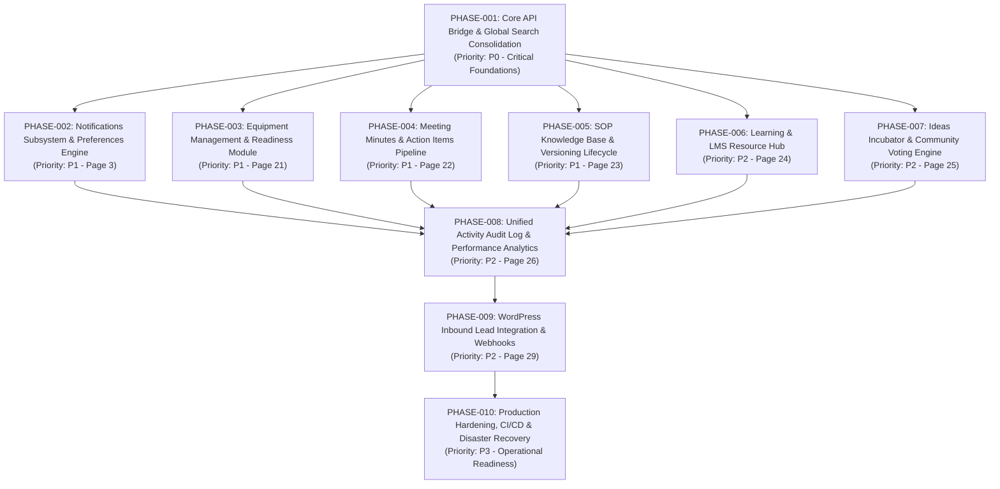

# 10 — Master Completion Roadmap (100% Product & Production Readiness)
## Gapji Digital Marketing Platform Deep Audit

---

## 1. Roadmap Architecture & Dependency Graph

This roadmap establishes the exact, dependency-driven sequence of engineering phases required to bridge all identified gaps, implement all remaining product pages from the 29-page specification (`marketing-platform-phase1-frontend-pages-1.pdf`), and achieve complete enterprise production readiness.

---

## 2. Phase Breakdown Specifications

### PHASE-001: Core API Bridge & Global Search Consolidation
- **1. Phase Title:** Core API Bridge, Route Standardization & Global Search Consolidation
- **2. Objective:** Eliminate client-side mock fallbacks, standardize route aliases between PDF and App Router, build unified backend global search, and implement permissions matrix persistence.
- **3. Business Purpose:** Ensure foundational user operations (header search, route navigation, custom permissions) work against live database state rather than transient client memory.
- **4. Current State:** Global search is visual-only (`Header.tsx`); `/campaigns` path differs from PDF `/performance/campaigns`; permissions matrix in `/settings/users` cannot save mutations; `platforms.api.ts` has silent fallback mocks.
- **5. Scope of Work:** Build `/api/search/global`; add Next.js rewrites for `/performance/campaigns`; add `PATCH /api/users/permissions/matrix`; replace frontend silent mock fallbacks with error state.
- **6. Related Requirement IDs:** `REQ-002`, `REQ-059`, `REQ-060`, `REQ-090`, `REQ-096`.
- **7. Related Modules:** `Header`, `Campaigns`, `Users`, `Shared`, `Navigation`.
- **8. Expected File & Component Impact:** `apps/api/src/modules/search/*`, `apps/api/src/modules/users/*`, `apps/web/next.config.js`, `apps/web/src/components/layout/header.tsx`, `apps/web/src/features/platforms/platforms.api.ts`.
- **9. Database Changes:** None required. Leverages existing indexed fields in `Lead`, `Campaign`, and `OrganizationMembership`.
- **10. API Changes:** New `GET /api/search/global?q=...`; new `PATCH /api/users/permissions/matrix`.
- **11. Architectural Changes:** Introduces dedicated search controller and removes mock fallbacks across frontend service layers.
- **12. Dependencies:** None. This is the foundational prerequisite for all subsequent phases.
- **13. Ordered Implementation Tasks:**
  1. Create `SearchModule` in `apps/api/src/modules/search/` with query filtering on leads and campaigns.
  2. Implement `GET /api/search/global` with permission scoping (sales agents only search owned leads).
  3. Wire search input in `apps/web/src/components/layout/header.tsx` with debounce and dropdown search results.
  4. Configure Next.js rewrites in `next.config.js` to alias `/performance/campaigns` to `/campaigns`.
  5. Add `PATCH /api/users/permissions/matrix` in `UsersController` to persist custom role overrides.
  6. Refactor `platforms.api.ts` and `task.api.ts` to remove silent fallback mocks.
- **14. Technical Risks:** High query latency on broad global search queries. *Mitigation:* Limit search results to top 5 leads and top 5 campaigns with minimum 3-character query threshold.
- **15. Regression Risks:** Modifying `next.config.js` rewrites could affect static assets if wildcards are misconfigured.
- **16. Required Tests:** Unit tests for search service; integration test verifying sales agent search isolation; contract test for permissions matrix save.
- **17. Acceptance Criteria:** Searching `0912` returns matching leads; searching campaign name returns matching campaign; permissions matrix save updates DB.
- **18. Deliverables:** `SearchModule`, updated `Header.tsx`, updated `UsersService`, test scripts.
- **19. Definition of Done:** All new endpoints covered by passing tests; zero fallback mocks remaining in active feature APIs.
- **20. Conditions that Block Completion:** PostgreSQL database must be reachable.

---

### PHASE-002: Notifications Subsystem & Preferences Engine (Page 3)
- **1. Phase Title:** Real-Time Notifications Hub & Notification Preferences Subsystem
- **2. Objective:** Implement complete notification infrastructure covering Page 3 of the product specification.
- **3. Business Purpose:** Deliver actionable, real-time in-app alerts to users when campaigns encounter issues, leads are assigned, or task deadlines approach.
- **4. Current State:** Header has mock counter and 3 static items. Backend models `Notification` and `NotificationPreference` exist in Prisma, but no API module or frontend `/notifications` page exists.
- **5. Scope of Work:** Build `NotificationModule` in NestJS; implement SSE/polling endpoints; build Header notification drawer (10 recent items); build `/notifications` page with list and Settings tab (Event Type × Channel matrix).
- **6. Related Requirement IDs:** `REQ-003`, `REQ-052`.
- **7. Related Modules:** `Notifications`, `Header`, `Settings`, `Shared`.
- **8. Expected File & Component Impact:** `apps/api/src/modules/notifications/*`, `apps/web/src/app/(app)/notifications/page.tsx`, `apps/web/src/features/notifications/*`, `apps/web/src/components/layout/header.tsx`.
- **9. Database Changes:** None. Uses existing `Notification` and `NotificationPreference` models in `schema.prisma`.
- **10. API Changes:** `GET /api/notifications` (list & unread count); `PATCH /api/notifications/mark-read`; `GET/PATCH /api/notifications/preferences`.
- **11. Architectural Changes:** Adds in-app notification event dispatcher service to broadcast alerts across modules.
- **12. Dependencies:** `PHASE-001`.
- **13. Ordered Implementation Tasks:**
  1. Scaffold `NotificationModule` in `apps/api/src/modules/notifications/`.
  2. Implement notification queries with unread counter (capped at `+99` in response).
  3. Implement preferences matrix CRUD (Event Type × In-App/Email).
  4. Build `notifications.api.ts` and React Query hooks in `apps/web/src/features/notifications/`.
  5. Replace static mock notifications in `Header.tsx` with live drawer fetching top 10 items.
  6. Create page `apps/web/src/app/(app)/notifications/page.tsx` with tabs: "لیست اعلان‌ها" and "تنظیمات دریافت".
- **14. Technical Risks:** Notification spam or excessive polling overhead. *Mitigation:* 30s refetch interval with conditional query invalidation.
- **15. Regression Risks:** Header layout shifts on notification drawer opening.
- **16. Required Tests:** Unit tests for unread count calculation; integration tests for mark-as-read; UI tests for unread badge display.
- **17. Acceptance Criteria:** Clicking "Mark all as read" zeroes badge; unread counter displays `+99` when unread > 99; preference toggles persist.
- **18. Deliverables:** Backend `NotificationModule`, Frontend `/notifications` page, active Header drawer.
- **19. Definition of Done:** 100% compliance with PDF page 7 specification verified by automated test script.
- **20. Conditions that Block Completion:** Completion of `PHASE-001`.

---

### PHASE-003: Equipment Management & Readiness Module (Page 21)
- **1. Phase Title:** Equipment Management, Readiness Tracking & Shortages Module
- **2. Objective:** Implement complete equipment tracking covering Page 21 of the product specification.
- **3. Business Purpose:** Prevent event execution failures (webinars, filming, campaigns) by identifying missing equipment items well in advance.
- **4. Current State:** Navigation has `comingSoon: true`. Prisma models `EquipmentItem`, `EquipmentTemplate`, `EquipmentTemplateItem`, `EventEquipment` exist. No API module or web views exist.
- **5. Scope of Work:** Build `EquipmentModule` in NestJS; create `/work/equipment` page with "Shortages" (default) and "All Equipment" views; implement equipment templates; integrate with Campaign and Webinar schedule tabs.
- **6. Related Requirement IDs:** `REQ-046`, `REQ-084`.
- **7. Related Modules:** `Equipment`, `Webinars`, `Campaigns`, `Calendar`, `Navigation`.
- **8. Expected File & Component Impact:** `apps/api/src/modules/equipment/*`, `apps/web/src/app/(app)/work/equipment/page.tsx`, `apps/web/src/features/equipment/*`, `apps/web/src/config/navigation.ts`.
- **9. Database Changes:** None. Relies on existing models in `schema.prisma`.
- **10. API Changes:** `GET /api/equipment/shortages`, `GET /api/equipment/items`, `POST /api/equipment/items`, `PATCH /api/equipment/items/:id/status`, `GET/POST /api/equipment/templates`, `POST /api/equipment/apply-template`.
- **11. Architectural Changes:** Bridges equipment readiness states to event dates in Calendar and Campaigns.
- **12. Dependencies:** `PHASE-001`.
- **13. Ordered Implementation Tasks:**
  1. Scaffold `EquipmentModule` in `apps/api/src/modules/equipment/`.
  2. Implement shortages query grouped by event execution date with `< 3 days` warning flag.
  3. Implement equipment templates CRUD and template application logic.
  4. Create `equipment.api.ts` and contracts in `apps/web/src/features/equipment/`.
  5. Build page `apps/web/src/app/(app)/work/equipment/page.tsx` with tabs: "کمبودها (پیش‌فرض)" and "همه تجهیزات".
  6. Enable navigation link in `apps/web/src/config/navigation.ts` (remove `comingSoon: true`).
  7. Wire equipment checklist tab in `Campaigns/[id]` and `Webinars/[id]`.
- **14. Technical Risks:** Incorrect date comparisons on shortages. *Mitigation:* Enforce ISO UTC comparisons with Jalali display format.
- **15. Regression Risks:** None; new standalone route.
- **16. Required Tests:** Shortages date calculation unit tests; template application integration tests; status badge tests.
- **17. Acceptance Criteria:** Equipment incomplete within < 3 days of event shows red warning; template applies all items to campaign/webinar.
- **18. Deliverables:** Backend `EquipmentModule`, Frontend `/work/equipment` page, connected event checklists.
- **19. Definition of Done:** Page 21 requirements fully implemented and verified via automated test script.
- **20. Conditions that Block Completion:** Completion of `PHASE-001`.

---

### PHASE-004: Meeting Minutes & Action Items Pipeline (Page 22)
- **1. Phase Title:** Meeting Minutes Subsystem & Action Items Task Pipeline
- **2. Objective:** Implement complete meeting minutes lifecycle covering Page 22 of the product specification.
- **3. Business Purpose:** Capture decisions, record participant attendance, and automatically convert meeting action items into executable system tasks.
- **4. Current State:** Navigation has `comingSoon: true`. Prisma models `Meeting`, `MeetingActionItem` exist. No API module or web views exist.
- **5. Scope of Work:** Build `MeetingsModule` in NestJS; create `/work/meetings` list and 800px reading view; build meeting creation/edit form; implement "Send to all" email preview; build "Convert action items to tasks" pipeline.
- **6. Related Requirement IDs:** `REQ-085`.
- **7. Related Modules:** `Meetings`, `Tasks`, `Users`, `Navigation`.
- **8. Expected File & Component Impact:** `apps/api/src/modules/meetings/*`, `apps/web/src/app/(app)/work/meetings/*`, `apps/web/src/features/meetings/*`, `apps/web/src/config/navigation.ts`.
- **9. Database Changes:** None. Relies on existing `Meeting` and `MeetingActionItem` models in `schema.prisma`.
- **10. API Changes:** `GET /api/meetings`, `POST /api/meetings`, `GET /api/meetings/:id`, `PATCH /api/meetings/:id`, `POST /api/meetings/:id/dispatch`, `POST /api/meetings/:id/convert-actions`.
- **11. Architectural Changes:** Integrates meetings module directly with `TasksService` to spawn tasks with linked entity relations.
- **12. Dependencies:** `PHASE-001`.
- **13. Ordered Implementation Tasks:**
  1. Scaffold `MeetingsModule` in `apps/api/src/modules/meetings/`.
  2. Implement meeting CRUD and action item relation management.
  3. Implement atomic "convert action items to tasks" mutation linking new `Task` records.
  4. Implement dispatch status tracking and email preview generator.
  5. Create `meetings.api.ts` in `apps/web/src/features/meetings/`.
  6. Build `apps/web/src/app/(app)/work/meetings/page.tsx` (list view) and `[id]/page.tsx` (800px max-width reading/edit view).
  7. Enable navigation item in `navigation.ts`.
- **14. Technical Risks:** Duplicate task creation on repeated conversions. *Mitigation:* Record `taskId` on `MeetingActionItem` and block duplicate task spawns.
- **15. Regression Risks:** None; new standalone domain.
- **16. Required Tests:** Meeting creation tests; action item task conversion unit tests; version history increment tests.
- **17. Acceptance Criteria:** Action items convert to tasks with assignee and deadline; editing dispatched meeting triggers "New version will be created" warning.
- **18. Deliverables:** Backend `MeetingsModule`, Frontend `/work/meetings` pages, task pipeline integration.
- **19. Definition of Done:** Page 22 requirements fully implemented and verified via automated test script.
- **20. Conditions that Block Completion:** Completion of `PHASE-001`.

---

### PHASE-005: SOP Knowledge Base & Versioning Lifecycle (Page 23)
- **1. Phase Title:** Standard Operating Procedures (SOP) Knowledge Engine & Versioning
- **2. Objective:** Implement complete SOP repository covering Page 23 of the product specification.
- **3. Business Purpose:** Standardize team operational procedures, manage approved processes, and allow 1-click generation of executable tasks from SOP templates.
- **4. Current State:** Navigation has `comingSoon: true`. Prisma models `Sop`, `SopVersion` exist. No API module or web views exist.
- **5. Scope of Work:** Build `SopsModule` in NestJS; create `/work/sops` card list and reading view (800px) with clean print styles; implement version history and approval lifecycle; implement "Create task from SOP" button.
- **6. Related Requirement IDs:** `REQ-086`.
- **7. Related Modules:** `SOPs`, `Tasks`, `Users`, `Navigation`.
- **8. Expected File & Component Impact:** `apps/api/src/modules/sops/*`, `apps/web/src/app/(app)/work/sops/*`, `apps/web/src/features/sops/*`, `apps/web/src/config/navigation.ts`.
- **9. Database Changes:** None. Relies on existing `Sop` and `SopVersion` models in `schema.prisma`.
- **10. API Changes:** `GET /api/sops`, `POST /api/sops`, `GET /api/sops/:id`, `PATCH /api/sops/:id`, `POST /api/sops/:id/publish-version`, `POST /api/sops/:id/spawn-task`.
- **11. Architectural Changes:** Permission guard strictly allows only `admin` and `marketing_manager` to edit or publish SOP versions; all users have read access.
- **12. Dependencies:** `PHASE-001`.
- **13. Ordered Implementation Tasks:**
  1. Scaffold `SopsModule` in `apps/api/src/modules/sops/` with role guards.
  2. Implement SOP versioning (draft vs published versions).
  3. Implement task generator copying checklist items to subtasks.
  4. Create `sops.api.ts` in `apps/web/src/features/sops/`.
  5. Build `apps/web/src/app/(app)/work/sops/page.tsx` (card list) and `[id]/page.tsx` (reading view + sidebar version history).
  6. Add clean print CSS stylesheet (`@media print`) hiding navigation and buttons.
  7. Enable navigation item in `navigation.ts`.
- **14. Technical Risks:** Version race conditions on concurrent edits. *Mitigation:* Optimistic locking with version increment.
- **15. Regression Risks:** None.
- **16. Required Tests:** RBAC tests verifying non-managers cannot edit; version increment tests; task spawn verification.
- **17. Acceptance Criteria:** Non-managers cannot edit SOPs; "Create task from SOP" spawns task with checklist; print stylesheet renders clean document.
- **18. Deliverables:** Backend `SopsModule`, Frontend `/work/sops` pages, print CSS, test suite.
- **19. Definition of Done:** Page 23 requirements fully implemented and verified via automated test script.
- **20. Conditions that Block Completion:** Completion of `PHASE-001`.

---

### PHASE-006: Learning & LMS Resource Hub (Page 24)
- **1. Phase Title:** Learning & Training Resource Hub (LMS)
- **2. Objective:** Implement complete learning portal covering Page 24 of the product specification.
- **3. Business Purpose:** Onboard marketing and sales staff, train team on software tools, and track course completion progress across the organization.
- **4. Current State:** Navigation has `comingSoon: true`. Prisma models `LearningResource`, `UserLearningProgress` exist. No API module or web views exist.
- **5. Scope of Work:** Build `LearningModule` in NestJS; create `/work/learning` and `/work/learning/me` pages; build video player with playback speed and resume timestamp; create manager "Team Progress" matrix.
- **6. Related Requirement IDs:** `REQ-087`.
- **7. Related Modules:** `Learning`, `Users`, `Navigation`.
- **8. Expected File & Component Impact:** `apps/api/src/modules/learning/*`, `apps/web/src/app/(app)/work/learning/*`, `apps/web/src/features/learning/*`, `apps/web/src/config/navigation.ts`.
- **9. Database Changes:** None. Relies on existing `LearningResource` and `UserLearningProgress` models in `schema.prisma`.
- **10. API Changes:** `GET /api/learning/resources`, `POST /api/learning/resources`, `GET /api/learning/my-progress`, `POST /api/learning/progress/:id`, `GET /api/learning/team-progress`, `POST /api/learning/assign`.
- **11. Architectural Changes:** Connects course progress tracking to user activity log.
- **12. Dependencies:** `PHASE-001`.
- **13. Ordered Implementation Tasks:**
  1. Scaffold `LearningModule` in `apps/api/src/modules/learning/`.
  2. Implement progress tracking service (last playback position, completion status).
  3. Implement manager team progress matrix aggregation query.
  4. Create `learning.api.ts` in `apps/web/src/features/learning/`.
  5. Build `apps/web/src/app/(app)/work/learning/page.tsx` with tabs: "کتابخانه", "آموزش‌های من", and manager-only "پیشرفت تیم".
  6. Implement video player component with playback speed controls (`0.75x`, `1x`, `1.25x`, `1.5x`, `2x`) and auto-save timestamp.
  7. Enable navigation item in `navigation.ts`.
- **14. Technical Risks:** Frequent network requests updating video timestamp. *Mitigation:* Debounce progress updates to once every 15 seconds.
- **15. Regression Risks:** None.
- **16. Required Tests:** Course assignment integration tests; completion calculation tests; progress matrix aggregation tests.
- **17. Acceptance Criteria:** Resuming video starts at saved timestamp; clicking "Completed" marks course 100% and updates Team Progress matrix.
- **18. Deliverables:** Backend `LearningModule`, Frontend `/work/learning` pages, custom video player.
- **19. Definition of Done:** Page 24 requirements fully implemented and verified via automated test script.
- **20. Conditions that Block Completion:** Completion of `PHASE-001`.

---

### PHASE-007: Ideas Incubator & Community Voting Engine (Page 25)
- **1. Phase Title:** Ideas Incubator, Voting Engine & Task Conversion
- **2. Objective:** Implement complete ideas pipeline covering Page 25 of the product specification.
- **3. Business Purpose:** Foster internal team innovation by crowdsourcing marketing ideas, prioritizing them via voting, and turning approved ideas into campaigns and tasks.
- **4. Current State:** Navigation has `comingSoon: true`. Prisma models `Idea`, `IdeaVote` exist. No API module or web views exist.
- **5. Scope of Work:** Build `IdeasModule` in NestJS; create `/work/ideas` page with quick submission input and card list; implement 1-click reversible upvotes; create manager status change controls; implement "Convert to task" button.
- **6. Related Requirement IDs:** `REQ-047`, `REQ-088`.
- **7. Related Modules:** `Ideas`, `Tasks`, `Campaigns`, `Navigation`.
- **8. Expected File & Component Impact:** `apps/api/src/modules/ideas/*`, `apps/web/src/app/(app)/work/ideas/page.tsx`, `apps/web/src/features/ideas/*`, `apps/web/src/config/navigation.ts`.
- **9. Database Changes:** None. Relies on existing `Idea` and `IdeaVote` models in `schema.prisma`.
- **10. API Changes:** `GET /api/ideas`, `POST /api/ideas`, `POST /api/ideas/:id/vote`, `PATCH /api/ideas/:id/status`, `POST /api/ideas/:id/convert-to-task`, `POST /api/ideas/:id/log-result`.
- **11. Architectural Changes:** Integrates ideas pipeline with `TasksService` and `CampaignsService`.
- **12. Dependencies:** `PHASE-001`.
- **13. Ordered Implementation Tasks:**
  1. Scaffold `IdeasModule` in `apps/api/src/modules/ideas/`.
  2. Implement voting logic with toggle behavior (second click removes vote).
  3. Implement status lifecycle guard (only managers can change status to Approved/Executed/Rejected).
  4. Implement task conversion linking `taskId` to `Idea`.
  5. Create `ideas.api.ts` in `apps/web/src/features/ideas/`.
  6. Build `apps/web/src/app/(app)/work/ideas/page.tsx` with quick add field, filter bar, cards, and details drawer.
  7. Enable navigation item in `navigation.ts`.
- **14. Technical Risks:** Race conditions on simultaneous upvotes. *Mitigation:* Atomic SQL increment on `votesCount` inside a database transaction.
- **15. Regression Risks:** None.
- **16. Required Tests:** Voting toggle unit tests; manager status guard tests; task conversion integration tests.
- **17. Acceptance Criteria:** Voting is 1-click and reversible; only managers can approve/reject; executed ideas highlight execution result.
- **18. Deliverables:** Backend `IdeasModule`, Frontend `/work/ideas` page, test suite.
- **19. Definition of Done:** Page 25 requirements fully implemented and verified via automated test script.
- **20. Conditions that Block Completion:** Completion of `PHASE-001`.

---

### PHASE-008: Unified Activity Audit Log & Performance Analytics (Page 26)
- **1. Phase Title:** Unified User Activity Audit Log & Performance Analytics
- **2. Objective:** Implement complete activity audit stream covering Page 26 of the product specification.
- **3. Business Purpose:** Provide organizational transparency, accountability, and operational productivity metrics across campaigns, leads, calls, costs, and tasks.
- **4. Current State:** Navigation has `comingSoon: true`. Prisma model `UserActivityLog` exists. No API module or web views exist.
- **5. Scope of Work:** Build `ActivityModule` in NestJS; create global activity logging interceptor; build `/work/activity` page with KPI summary cards, team comparison table, and live activity stream.
- **6. Related Requirement IDs:** `REQ-089`.
- **7. Related Modules:** `Activity`, `Users`, `Leads`, `Campaigns`, `Tasks`, `Costs`.
- **8. Expected File & Component Impact:** `apps/api/src/modules/activity/*`, `apps/api/src/common/interceptors/activity-logger.interceptor.ts`, `apps/web/src/app/(app)/work/activity/page.tsx`, `apps/web/src/features/activity/*`, `apps/web/src/config/navigation.ts`.
- **9. Database Changes:** None. Relies on existing `UserActivityLog` model in `schema.prisma`.
- **10. API Changes:** `GET /api/activity/feed`, `GET /api/activity/summary-stats`, `GET /api/activity/team-comparison`.
- **11. Architectural Changes:** Introduces global NestJS interceptor listening to mutation endpoints and writing audit logs asynchronously.
- **12. Dependencies:** `PHASE-001` through `PHASE-007`.
- **13. Ordered Implementation Tasks:**
  1. Scaffold `ActivityModule` in `apps/api/src/modules/activity/`.
  2. Implement `ActivityLoggerInterceptor` recording user ID, action, entity type, entity ID, metadata, and timestamp.
  3. Bind interceptor to Leads, Campaigns, Costs, and Tasks mutation controllers.
  4. Implement team comparison aggregation query (tasks completed, on-time %, calls logged, costs logged).
  5. Create `activity.api.ts` in `apps/web/src/features/activity/`.
  6. Build `apps/web/src/app/(app)/work/activity/page.tsx` with role scoping (managers see all, regular users see own).
  7. Enable navigation item in `navigation.ts`.
- **14. Technical Risks:** Heavy database write load on high-frequency mutations. *Mitigation:* Asynchronous, non-blocking fire-and-forget log insertion.
- **15. Regression Risks:** Interceptor errors must not fail the primary business transaction.
- **16. Required Tests:** Interceptor unit tests; role isolation tests (regular user cannot fetch team logs); aggregation accuracy tests.
- **17. Acceptance Criteria:** Lead status change appears in live feed with deep link; manager sees team comparison table; Excel export downloads valid file.
- **18. Deliverables:** Backend `ActivityModule`, Interceptor, Frontend `/work/activity` page, test suite.
- **19. Definition of Done:** Page 26 requirements fully implemented and verified via automated test script.
- **20. Conditions that Block Completion:** Completion of preceding business modules (`PHASE-001` to `007`).

---

### PHASE-009: WordPress Inbound Lead Integration & Webhooks (Page 29)
- **1. Phase Title:** WordPress Plugin Integration, API Key Management & Inbound Webhooks
- **2. Objective:** Implement complete WordPress connection covering Page 29 of the product specification.
- **3. Business Purpose:** Automatically ingest inbound leads captured on WordPress landing pages and forms directly into the platform's lead inbox.
- **4. Current State:** Navigation has `comingSoon: true`. Prisma models `WordpressIntegration`, `WordpressWebhookLog` exist. Partial status check in landing; no dedicated settings page or webhook ingestion pipeline.
- **5. Scope of Work:** Build `WordpressModule` in NestJS; implement secure API key generation & revocation; build inbound webhook ingestion endpoint with field mapping; create `/settings/wordpress` page with connection status, guide, mapper, and rejected logs table.
- **6. Related Requirement IDs:** `REQ-092`.
- **7. Related Modules:** `WordPress`, `Leads`, `Settings`, `Navigation`.
- **8. Expected File & Component Impact:** `apps/api/src/modules/wordpress/*`, `apps/web/src/app/(app)/settings/wordpress/page.tsx`, `apps/web/src/features/wordpress/*`, `apps/web/src/config/navigation.ts`.
- **9. Database Changes:** None. Relies on existing `WordpressIntegration` and `WordpressWebhookLog` models in `schema.prisma`.
- **10. API Changes:** `GET /api/wordpress/status`, `POST /api/wordpress/keys/generate`, `POST /api/wordpress/test-connection`, `GET/PATCH /api/wordpress/field-mapping`, `POST /api/wordpress/webhook` (public/authenticated by API key), `GET /api/wordpress/logs/rejected`.
- **11. Architectural Changes:** Inbound webhook pipeline validates API key, maps foreign form fields to canonical `Lead` fields, and records rejected attempts in `WordpressWebhookLog`.
- **12. Dependencies:** `PHASE-001`, `PHASE-008`.
- **13. Ordered Implementation Tasks:**
  1. Scaffold `WordpressModule` in `apps/api/src/modules/wordpress/`.
  2. Implement API key generator (cryptographic token, hashed in DB, shown once to admin).
  3. Implement webhook receiver validating API key header.
  4. Implement dynamic field mapping executor translating WordPress fields to `Lead` entity.
  5. Create `wordpress.api.ts` in `apps/web/src/features/wordpress/`.
  6. Build `apps/web/src/app/(app)/settings/wordpress/page.tsx` with connection status card, API key reveal modal, field mapping table, and rejected webhook log.
  7. Enable navigation item in `navigation.ts`.
- **14. Technical Risks:** Inbound webhook spam or malformed JSON payloads. *Mitigation:* Webhook rate limiting and strict payload schema validation.
- **15. Regression Risks:** Inbound leads must not bypass duplicate check or sales agent assignment rules.
- **16. Required Tests:** Webhook authentication tests; field mapping transformation tests; rejected log capture tests.
- **17. Acceptance Criteria:** Generating new key invalidates previous key with confirmation; test connection returns success; valid webhook creates Lead; invalid webhook logs reason in table.
- **18. Deliverables:** Backend `WordpressModule`, Webhook pipeline, Frontend `/settings/wordpress` page, test suite.
- **19. Definition of Done:** Page 29 requirements fully implemented and verified via automated test script.
- **20. Conditions that Block Completion:** Completion of `PHASE-001`.

---

### PHASE-010: Production Hardening, CI/CD & Disaster Recovery
- **1. Phase Title:** Enterprise Production Hardening, Observability, CI/CD & Disaster Recovery
- **2. Objective:** Complete all operational, security, and infrastructure requirements necessary to certify the platform for mission-critical production deployment.
- **3. Business Purpose:** Guarantee platform uptime, data durability, automated deployment reliability, and rapid disaster recovery.
- **4. Current State:** Score 68/100. Local Docker Compose for Postgres only. No production Dockerfile, no CI/CD, no health checks, no structured logging.
- **5. Scope of Work:** Author multi-stage Dockerfiles for API and Web; configure GitHub Actions CI/CD; implement `@nestjs/terminus` health checks; configure structured logging (Pino) and rate limiting (Throttler); add database composite indexes; draft backup script and disaster recovery runbook.
- **6. Related Requirement IDs:** `REQ-093` to `REQ-099`, Production Readiness Criteria.
- **7. Related Modules:** Infrastructure, DevOps, Root, Database, Observability.
- **8. Expected File & Component Impact:** `Dockerfile.api`, `Dockerfile.web`, `.github/workflows/ci.yml`, `apps/api/src/modules/health/*`, `apps/api/src/main.ts`, `apps/api/prisma/schema.prisma`.
- **9. Database Changes:** Add composite indexes on `Lead`, `Cost`, `Task` for high-volume queries. Run single non-destructive migration.
- **10. API Changes:** New `GET /health` (database ping, memory heap, disk storage checks); new `GET /metrics`.
- **11. Architectural Changes:** Integrates Helmet security headers, rate limiting, and structured logging middleware.
- **12. Dependencies:** `PHASE-001` through `PHASE-009`.
- **13. Ordered Implementation Tasks:**
  1. Author `Dockerfile.api` using multi-stage Node 20 alpine with non-root user.
  2. Author `Dockerfile.web` using Next.js standalone output mode.
  3. Create `.github/workflows/ci.yml` running lint, typecheck, tests, and Docker build.
  4. Implement `HealthModule` in NestJS with database connectivity check.
  5. Add `helmet()` and `@nestjs/throttler` to `apps/api/src/main.ts`.
  6. Add composite indexes to `apps/api/prisma/schema.prisma` and generate migration.
  7. Author automated daily backup script (`pg_dump` with S3 upload and retention policy).
  8. Execute full end-to-end regression verification test across all 29 product pages.
- **14. Technical Risks:** Next.js standalone build font or asset path misconfigurations. *Mitigation:* Explicitly copy `public` and `.next/static` in Dockerfile.
- **15. Regression Risks:** Helmet CSP headers blocking external fonts or images if improperly configured.
- **16. Required Tests:** Health check tests; rate limiting trigger tests; Docker container build verification; full regression suite.
- **17. Acceptance Criteria:** `GET /health` returns 200 OK; CI pipeline passes cleanly on pull request; production Docker images build under 250MB; 100% of product pages verified.
- **18. Deliverables:** Production Dockerfiles, GitHub Actions workflow, Health check module, Backup runbook.
- **19. Definition of Done:** Platform certified at **100% Product Completion** and **100% Production Readiness**.
- **20. Conditions that Block Completion:** Completion of all preceding roadmap phases (`PHASE-001` to `PHASE-009`).
