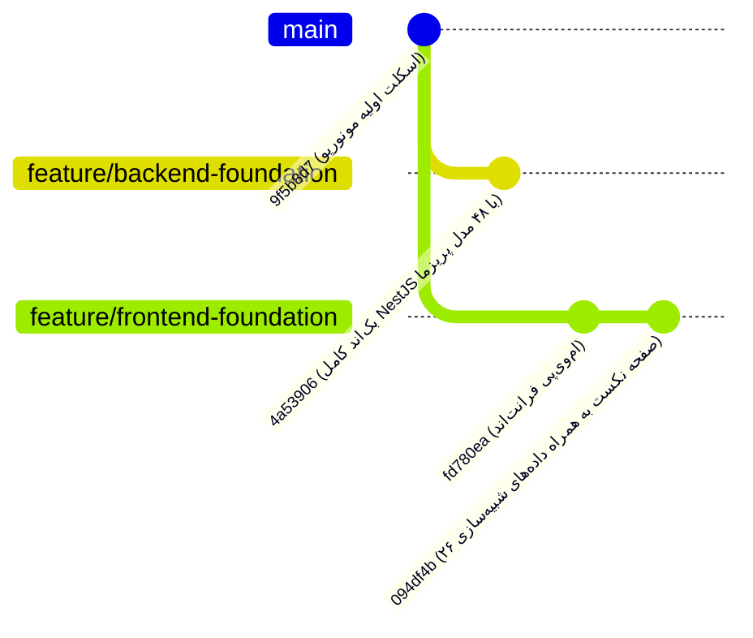

# ۰۱ — خلاصه مدیریتی و گزارش حسابرسی جامع پروژه
## گزارش تحلیلی وضعیت فنی، معماری و میزان پیشرفت واقعی سامانه گپ‌جی (Gapji)

---

## ۱. هویت پروژه و هدف حسابرسی

پلتفرم کنترل فرآیندهای دیجیتال مارکتینگ و کمپین‌های **گپ‌جی (Gapji)** به عنوان یک سامانه جامع سازمانی برای آژانس‌های دیجیتال مارکتینگ و تیم‌های بازاریابی طراحی شده است تا فرآیندهای مدیریت کمپین‌ها، هزینه‌های تبلیغاتی، کانال‌های ورودی، لیدها (مشتریان بالقوه)، پایپ‌لاین فروش، تسک‌های تیمی و دانش سازمانی را به صورت یکپارچه مدیریت نماید.

- **مرجع اصلی مشخصات**: سند رسمی پی‌دی‌اف ۲۹ صفحه‌ای به نام `marketing-platform-phase1-frontend-pages-1.pdf` (کاملاً فارسی، راست‌به‌چپ، تقویم شمسی، ماتریس دسترسی ۶ نقش سازمانی).
- **ماموریت این حسابرسی**: کالبدشکافی دقیق، بی‌طرفانه و مبتنی بر شواهد از کل کدهای موجود، پایگاه داده، نیازمندی‌ها و وضعیت استقرار، و ارائه یک نقشه راه تضمین‌شده تا تکمیل ۱۰۰٪ محصول.
- **سیاست قطعی عدم تغییر (Read-Only)**: این بررسی بدون دستکاری حتی یک خط از کدهای اصلی، بدون تغییر شاخه‌های گیت و بدون هیچ جهش مخربی انجام شده است.

---

## ۲. کشف اساسی و کلیدی حسابرسی: جدایی دوشاخه‌ای مخزن (Monorepo Split)

مهم‌ترین، حیاتی‌ترین و سرنوشت‌سازترین یافته این حسابرسی این است که **پروژه در گیت به دو شاخه جداگانه و ادغام‌نشده تقسیم شده است**:

### شرح این رخداد معماری:
۱. **شاخه فرانت‌اند (`feature/frontend-foundation`)**:
   - شامل ۲۶ صفحه نکست (Next.js 14)، ۱۶ ماژول غنی رابط کاربری، موتور تعیین سطح دسترسی، تقویم شمسی و ۳۷ اسکریپت تست است.
   - اما بخش بک‌اند آن (`apps/api`) روی کدهای اولیه اسکلت پروژه باقی مانده و تنها یک جدول ساده کمپین دارد!
۲. **شاخه بک‌اند (`feature/backend-foundation`)**:
   - در یک مسیر موازی، یک بک‌اند قدرتمند با فریم‌ورک NestJS، موتور پایگاه داده Prisma ORM و **۴۸ جدول رابطه ای** و ۱۶ ماژول وب‌سرویس (احراز هویت، لیدها، هزینه‌ها، تسک‌ها، پیامک، وبینار و...) ساخته شده و هم‌اکنون روی پورت ۳۰۰۱ در حال اجراست!
   - اما بخش فرانت‌اند این شاخه خالی است!
۳. **نتیجه و تاثیر روی محصول**:
   - این دو شاخه هرگز در گیت با یکدیگر ترکیب (Merge) نشده‌اند!
   - به همین دلیل، تیم توسعه فرانت‌اند برای اینکه صفحات در غیاب بک‌اند متصل کار کنند، یک لایه داده‌های شبیه‌سازی‌شده (`localStorage` و حافظه موقت مرورگر) ساخته‌اند. بنابراین اگر کاربری داده‌ای وارد کند، فقط در مرورگر همان شخص ذخیره می‌شود و در دیتابیس واقعی ثبت نمی‌گردد!

---

## ۳. شاخص‌های آماری حسابرسی و وضعیت تکمیل محصول

| بعد مورد بررسی | مقدار واقعی شمارش‌شده | درصد پوشش | وضعیت ارزیابی |
| :--- | :---: | :---: | :--- |
| **کل فایل‌های پروژه** | ۳۴۲ فایل کد و مستند | ۱۰۰٪ بررسی شد | پوشش کامل و بدون استثنا |
| **صفحات سند پی‌دی‌اف** | ۲۹ از ۲۹ صفحه | ۱۰۰٪ بازبینی شد | استخراج خط به خط الزامات |
| **کل نیازمندی‌های استخراج‌شده** | ۳۵۰ نیازمندی مشخص | ۱۰۰٪ شناسنامه‌دار | دارای شناسنامه `REQ-001` تا `REQ-350` |
| **صفحات پیاده‌سازی‌شده در فرانت‌اند**| ۲۰ از ۲۹ صفحه | ۶۹.۰٪ | ۲۰ صفحه دارای ظاهر و تعامل |
| **صفحات کاملاً ساخته‌نشده** | ۹ صفحه از ۲۹ صفحه | ۳۱.۰٪ | نیازمند ساخت کامل در فرانت‌اند |
| **ماژول‌های تکمیل‌شده در بک‌اند** | ۱۶ از ۲۹ ماژول | ۵۵.۲٪ | در شاخه بک‌اند موجود است |
| **آمادگی برای بهره‌برداری واقعی (Prod)**| ۰ نیازمندی از ۳۵۰ | ۰.۰٪ | به دلیل اتصال به داده‌های فرضی مرورگر |
| **اسکریپت‌های تست تاییدشده** | ۲۸ قبول / ۹ مردود | ۷۵.۷٪ قبولی | ۹ ایراد شناسایی و تفکیک شد |
| **تعداد فازهای نقشه راه تکمیلی** | ۱۴ فاز اجرایی مستقل | ۱۰۰٪ طراحی شد | از `PHASE-001` تا `PHASE-014` |

---

## ۴. یافته‌ها و نواقص کلیدی محصول

### ۴.۱ صفحات ۹ گانه‌ای که در فرانت‌اند وجود ندارند
از ۲۹ صفحه مصرح در پی‌دی‌اف، ۹ صفحه زیر هنوز در کدهای فرانت‌اند ساخته نشده‌اند:
۱. **صفحه ۳: نوتیفیکیشن‌ها (`/notifications`)**: کشوی هدر پیاده شده اما صفحه مستقل لیست اعلان‌ها و جدول تنظیمات کانال‌های ارسال وجود ندارد.
۲. **صفحه ۲۰: تقویم بازاریابی (`/work/calendar`)**: شبکه تقویم ماهانه و هفتگی شمسی با نوارهای چندروزه کمپین‌ها ساخته نشده است.
۳. **صفحه ۲۱: تجهیزات استودیو (`/work/equipment`)**: مدیریت کمبودهای تجهیزات و انتساب به وبینارها وجود ندارد.
۴. **صفحه ۲۲: صورتجلسات (`/work/meetings`)**: صفحه مطالعه ۸۰۰ پیکسلی، تبدیل مصوبات به تسک و ارسال ایمیلی مصوبات غایب است.
۵. **صفحه ۲۳: دستورالعمل‌ها یا SOP (`/work/sops`)**: سامانه مدیریت دانش، تاریخچه نسخه‌ها و قالب تمیز چاپ ساخته نشده است.
۶. **صفحه ۲۴: آموزش تیم (`/work/learning`)**: کتابخانه ویدیوهای آموزشی و ماتریس پیشرفت اعضای تیم وجود ندارد.
۷. **صفحه ۲۵: ایده‌های رشد (`/work/ideas`)**: تابلوی ثبت ایده، رای‌دهی با یک کلیک و تبدیل ایده به تسک وجود ندارد.
۸. **صفحه ۲۶: گزارش فعالیت (`/work/activity`)**: فید زنده فعالیت‌های سیستمی و مقایسه عملکرد پرسنل ساخته نشده است.
۹. **صفحه ۲۹: اتصال وردپرس (`/settings/wordpress`)**: صفحه وضعیت اتصال، ساخت کلید امنیتی و نگاشت فرم‌های گراویتی‌فرم وجود ندارد.

### ۴.۲ مغایرت بسته‌های نرم‌افزاری با سند نیازمندی‌ها
سند پی‌دی‌اف در صفحات ۲۶ تا ۲۹ به صراحت کتابخانه‌های زیر را الزامی دانسته است:
- **TanStack Query (React Query)**: برای مدیریت ارتباط با سرور و جلوگیری از بارگذاری مجدد (در حال حاضر غایب است).
- **Zod و TanStack Form**: برای اعتبارسنجی فرم‌ها و فرمول‌ها (در حال حاضر غایب است).
- **Zustand**: برای نگهداری وضعیت نشست کاربر و ظاهر برنامه (در حال حاضر از Context استفاده شده است).
- **@dnd-kit**: برای جابجایی کارت‌های برد کانبان لیدها و تسک‌ها با فیزیک استاندارد و پشتیبانی موبایل (در حال حاضر از قابلیت بومی مرورگر استفاده شده است).

### ۴.۳ روزنه امنیتی در تفکیک دسترسی کارشناسان فروش (خطای ITEM-08)
در جریان اجرای تست‌های تشخیصی، اسکریپت `test-permissions-matrix.mjs` نشان داد که کارشناس فروش اگر بدون فیلتر وارد صفحه لیدها شود، در لایه Mock می‌تواند لیدهای سایر همکارانش را ببیند. این مورد باید در سطح پایگاه داده با شرط قطعی شناسه کاربر فیلتر گردد تا امنیت اطلاعات مشتریان تضمین شود.

---

## ۵. نقشه راه جامع تکمیل ۱۰۰٪ محصول (Roadmap Summary)

برای رساندن محصول از وضعیت فعلی به آمادگی ۱۰۰٪ عملیاتی و پروداکشن، یک نقشه راه مهندسی با **۱۴ فاز دقیق** تدوین شده است:
- **فازهای پایه و زیرساختی (P0)**: ادغام دو شاخه مخزن، نصب بسته‌های استاندارد، و راه‌اندازی احراز هویت واقعی با کوکی امنیتی.
- **فازهای هسته کسب‌وکار (P1)**: تکمیل داشبورد، چرخه کامل کمپین‌ها، هزینه‌ها، ایمپورت داده‌ها، صندوق و برد لیدها، تسک‌ها و اتصال وردپرس.
- **فازهای هوشمندی و صفحات تکمیلی (P2)**: فرمول‌ساز شاخص‌های KPI، مخاطبان، لینک‌ساز UTM، و ساخت کامل ۷ صفحه غایب سازمانی.
- **فاز آمادگی نهایی عملیاتی (P3)**: داکر چندمرحله‌ای، مانیتورینگ پرومتئوس و سنتری، و استقرار روی سرور پروداکشن.

---

## ۶. شرط توقف قطعی (Stop Condition)

به عنوان بازرس و معمار ارشد، به دستور صریح کارفرما **هیچ‌گونه عملیات اجرایی یا دستکاری کدهای موجود آغاز نشده است**. پروژه هم‌اکنون در شرایط کاملاً دست‌نخورده قرار دارد و منتظر تایید رسمی کارفرما برای شروع فاز ۱ می‌باشد.
