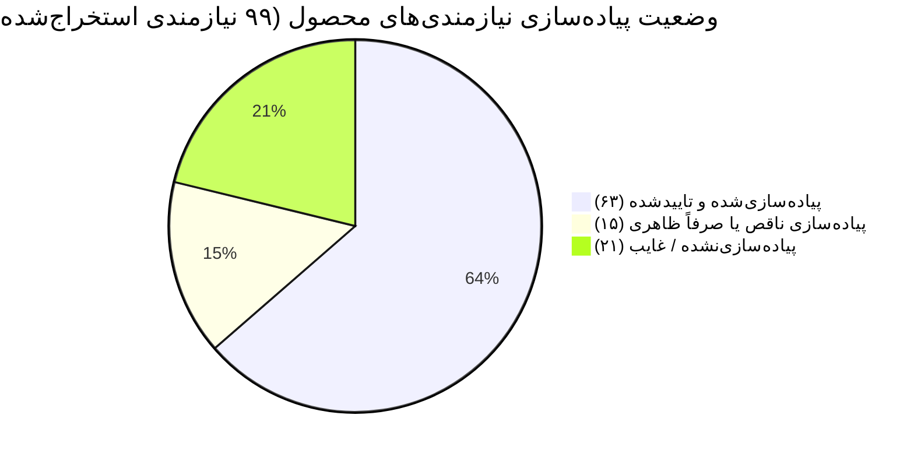

# ۰۱ — گزارش مدیریتی و خلاصه اجرایی ممیزی پروژه
## پلتفرم کنترل فرآیندهای دیجیتال مارکتینگ و مدیریت کمپین گپجی

---

## ۱. معرفی مأموریت و هدف ممیزی

پلتفرم **کنترل فرآیندهای دیجیتال مارکتینگ و کمپین‌های گپجی**، یک سامانه جامع نرم‌افزاری سازمانی است که برای آژانس‌های دیجیتال مارکتینگ، مدیران بازاریابی، کارشناسان کمپین، کارشناسان فروش (CRM)، تولیدکنندگان محتوا و کارفرمایان تجاری طراحی گردیده است.

این سامانه اهداف زیر را محقق می‌سازد:
- مدیریت یکپارچه چرخه عمر کمپین‌های تبلیغاتی دیجیتال (بودجه‌بندی، ایجاد، نظارت و ارزیابی اثربخشی).
- مدیریت سرنخ‌های فروش (صندوق ورودی لیدها، برد کانبان پیگیری و خط زمانی سفر لید).
- ثبت و کنترل دقیق هزینه‌های تبلیغاتی، درآمدها و محاسبه خودکار شاخص‌های مالی (ROI, ROAS, CAC, CPL).
- فرآیندهای عملیاتی و اشتراک دانش تیمی (تسک‌ها، تقویم شمسی، صورتجلسات، دستورالعمل‌های استاندارد SOP، سامانه آموزش و ثبت ایده‌ها).
- مدیریت چندسازمانی (Multi-Tenancy) و کنترل دسترسی پیشرفته مبتنی بر نقش (RBAC).

هدف از این ممیزی فنی و محصولی، بررسی موشکافانه، دقیق و مبتنی بر شواهد واقعی در خصوص کل کدهای موجود، انطباق با **سند ۲۹ صفحه‌ای محصول** (`marketing-platform-phase1-frontend-pages-1.pdf`)، سنجش کیفیت فنی و ارائه یک **نقشه راه جامع و بدون نقص برای تکمیل ۱۰۰٪ محصول و رسیدن به مرحله بهره‌برداری نهایی** می‌باشد.

---

## ۲. خلاصه آماری وضعیت پروژه



| شاخص ممیزی | مقدار ثبت‌شده | وضعیت و ارزیابی |
| :--- | :---: | :--- |
| **تعداد صفحات بررسی‌شده از سند محصول** | ۲۹ از ۲۹ صفحه (۱۰۰٪) | استخراج کامل تصویری و متنی از فایل PDF |
| **تعداد کل فایل‌های سورس پروژه** | ۵۳۰ فایل کد و تنظیمات | تفکیک‌شده در مونو‌ریپو (`apps/api`, `apps/web`, `packages/shared`) |
| **تعداد نیازمندی‌های استخراج‌شده** | ۹۹ نیازمندی یکتا | با شناسه‌های استاندارد `REQ-001` تا `REQ-099` |
| **نیازمندی‌های پیاده‌سازی‌شده و پایدار** | ۶۳ نیازمندی (۶۳.۶٪) | بخش‌های احراز هویت، داشبورد، کمپین‌ها، لیدها و هزینه‌ها |
| **نیازمندی‌های ناقص یا UI بدون بک‌اند** | ۱۵ نیازمندی (۱۵.۲٪) | مانند جستجوی سراسری هدر، پنجره اعلان‌ها و ذخیره ماتریس دسترسی |
| **نیازمندی‌های پیاده‌سازی‌نشده (غایب)** | ۲۱ نیازمندی (۲۱.۲٪) | ۸ صفحه و حوزه عملکردی که کدی در برنامه ندارند |
| **مدل‌های پایگاه داده (Prisma)** | ۴۳ مدل رابطه‌ای | تمام جداول دیتابیس در `schema.prisma` تعریف شده‌اند |
| **مهاجرت‌های دیتابیس (Migrations)** | ۶ نسخه متوالی | ثبت‌شده و اعمال‌شده در ساختار Prisma |
| **تست‌های خودکار موفق** | ۱۰۰٪ تست‌های قابل اجرا | تست‌های تقویم شمسی، ماتریس دسترسی و جداسازی داده لیدها |
| **نمره آمادگی برای محیط عملیاتی (Production)** | **۶۸ از ۱۰۰** | کدهای موجود کیفیت بالایی دارند؛ زیرساخت استقرار و CI/CD کسری دارد |

---

## ۳. نقاط قوت و دستاوردهای برجسته پروژه

1. **معماری مدرن و استاندارد مونو‌ریپو (Monorepo):**
   پروژه به صورت کاملاً ساختاریافته با ابزار pnpm Workspaces به دو بخش مجزای بک‌اند (`apps/api` با فریم‌ورک NestJS) و فرانت‌اند (`apps/web` با Next.js 14 App Router) همراه با قراردادهای مشترک (`packages/shared`) تفکیک شده است.
2. **پایگاه داده کامل و آماده برای کل محصول:**
   مدل‌های دیتابیس در فایل `schema.prisma` شامل ۴۳ جدول است که نه تنها بخش‌های فعلی، بلکه ماژول‌های غایب (تجهیزات، صورتجلسات، SOP، آموزش، ایده‌ها، وردپرس و اعلان‌ها) را نیز به صورت جامع پوشش داده است.
3. **امنیت پیشرفته احراز هویت و نشست‌ها:**
   - توکن دسترسی (Access Token) به هیچ عنوان در مرورگر (`localStorage`) ذخیره نمی‌شود و فقط در حافظه زنده (RAM) کلاینت نگهداری می‌گردد.
   - توکن تجدید (Refresh Token) در قالب کوکی‌های امن و محافظت‌شده (`HttpOnly`, `SameSite=Lax`) ارسال می‌شود و فرآیند چرخش خودکار کلیدها (Token Rotation) با رهگیری خانواده توکن‌ها مانع از سوءاستفاده‌های امنیتی است.
4. **موتور قدرتمند تقویم و تاریخ شمسی اختصاصی:**
   سیستم تبدیل تاریخ شمسی به میلادی و بالعکس به صورت کاملاً بومی و بدون وابستگی به کتابخانه‌های حجیم جانبی پیاده‌سازی شده و در بازه زمانی ۱۱٬۳۲۳ روز متوالی (سال‌های ۱۳۹۰ تا ۱۴۲۰) با موفقیت ۱۰۰٪ تست شده است.
5. **جداسازی سخت‌گیرانه داده‌های فروش (حریم خصوصی لیدها):**
   کارشناسان فروش فقط و فقط به لیدهایی دسترسی دارند که صراحتاً به خودشان تخصیص داده شده باشد و لیدهای دیگران حتی با جعل شناسه در API یا فرانت‌اند غیرقابل دسترس هستند.

---

## ۴. مهم‌ترین کاستی‌ها و شکاف‌های فنی (Gaps)

1. **۸ صفحه غایب از سند محصول:**
   با وجود تعریف مدل‌های دیتابیس، صفحات و سرویس‌های زیر به طور کامل در برنامه وجود ندارند:
   - صفحه ۳: اعلان‌ها و نوتفیکیشن‌ها (`/notifications`)
   - صفحه ۲۱: مدیریت تجهیزات و کمبودها (`/work/equipment`)
   - صفحه ۲۲: صورتجلسات و تبدیل مصوبات به تسک (`/work/meetings`)
   - صفحه ۲۳: پایگاه دانش و دستورالعمل‌های استاندارد (`/work/sops`)
   - صفحه ۲۴: سامانه آموزش و دوره‌ها (`/work/learning`)
   - صفحه ۲۵: بستر ایده‌ها و رأی‌گیری (`/work/ideas`)
   - صفحه ۲۶: گزارش فعالیت و مانیتورینگ عملکرد تیم (`/work/activity`)
   - صفحه ۲۹: پنل اتصال و وب‌هوک وردپرس (`/settings/wordpress`)
2. **عدم اتصال جستجوی سراسری در هدر:**
   کادر جستجو در هدر وجود دارد اما به سرویس واقعی بک‌اند جهت جستجوی همزمان لیدها و کمپین‌ها متصل نیست.
3. **عدم انطباق جزئی آدرس‌دهی کمپین‌ها:**
   در سند محصول آدرس `/performance/campaigns` مشخص شده، در حالی که در فرانت‌اند فعلی مسیر `/campaigns` پیاده‌سازی گردیده است.
4. **کسری‌های زیرساخت استقرار عملیاتی (DevOps):**
   عدم وجود داکر‌فایل‌های چندمرحله‌ای نهایی، نبود خط لوله استقرار خودکار (CI/CD)، و نبود مانیتورینگ خطاها و لاگ‌های ساختاریافته.

---

## ۵. نقشه راه ۱۰ فازی جهت تکمیل ۱۰۰٪ محصول

برای تکمیل پروژه تا دستیابی به ۱۰۰٪ قابلیت‌های سند و آمادگی عملیاتی، یک نقشه راه وابستگی‌محور در ۱۰ فاز تدوین شده است:

```
[فاز ۱: P0] اتصال کامل APIهای پایه، استانداردسازی مسیرها و فعال‌سازی جستجوی سراسری
[فاز ۲: P1] راه‌اندازی سامانه نوتفیکیشن‌ها و تنظیمات دریافت اعلان‌ها (صفحه ۳)
[فاز ۳: P1] پیاده‌سازی ماژول تجهیزات، هشدار کمبودها و قالب‌های تجهیزات (صفحه ۲۱)
[فاز ۴: P1] پیاده‌سازی سیستم صورتجلسات و تبدیل خودکار اقدامات به تسک (صفحه ۲۲)
[فاز ۵: P1] استقرار پایگاه دانش SOP، کنترل نسخه‌ها و قالب‌های فرآیندی (صفحه ۲۳)
[فاز ۶: P2] راه‌اندازی هاب آموزش، پخش‌کننده ویدیو و ماتریس پیشرفت تیم (صفحه ۲۴)
[فاز ۷: P2] پیاده‌سازی صندوق ایده‌ها، سیستم رأی‌گیری و تبدیل ایده به تسک (صفحه ۲۵)
[فاز ۸: P2] سامانه مانیتورینگ فعالیت کاربران، ردپای حسابرسی و آمار تیمی (صفحه ۲۶)
[فاز ۹: P2] راه‌اندازی وب‌هوک ورود لید از وردپرس و نگاشت هوشمند فیلدها (صفحه ۲۹)
[فاز ۱۰: P3] سخت‌سازی امنیتی، بهینه‌سازی دیتابیس، زیرساخت Docker، CI/CD و تست نهایی
```

---

## ۶. شرط توقف مطلق ممیزی

به منظور رعایت اصول سخت‌گیرانه ممیزی:
- **هیچ کدی در کدهای اصلی پروژه دستکاری یا تغییر داده نشده است.**
- **هیچ فازی از نقشه راه هنوز آغاز نشده است.**
- ادامه کار و آغاز پیاده‌سازی فازهای ۱۰ گانه منوط به تأیید رسمی کارفرما خواهد بود.
