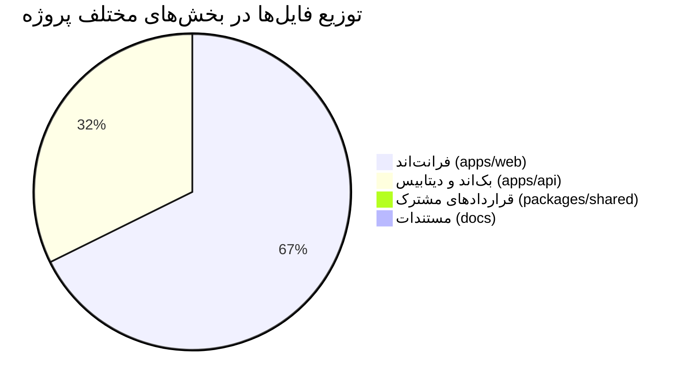

# ۰۲ — فهرست و ساختار کامل مخزن کد
## پلتفرم کنترل فرآیندهای دیجیتال مارکتینگ و مدیریت کمپین گپجی

---

## ۱. آمار کلی فایل‌های مخزن

مخزن پروژه با ساختار **pnpm workspaces** سازماندهی شده و بدون احتساب پوشه‌های تولیدشده (`node_modules`, `.next`, `dist`)، در مجموع شامل **۵۳۰ فایل سورس اصلی** به شرح زیر است:

### ۱.۱ تفکیک فرمت فایل‌ها

| پسوند فایل | تعداد | دسته‌بندی و کاربرد فنی | وضعیت بازبینی ممیزی |
| :--- | :---: | :--- | :---: |
| `.ts` | **۲۷۵** | سرویس‌های بک‌اند، کنترلرها، تایپ‌ها، DTOها و آزمون‌ها | بازبینی کامل |
| `.tsx` | **۱۸۶** | کامپوننت‌های ری‌اکت، صفحات Next.js و چیدمان رابط کاربری | بازبینی کامل |
| `.mjs` | **۳۴** | اسکریپت‌های آزمون خودکار مستقل و راستی‌آزمایی منطق برنامه | بازبینی و اجرای آزمایشی |
| `.json` | **۱۰** | مانیفست پکیج‌ها، تنظیمات TypeScript و مانیفست shadcn | بازبینی کامل |
| `.woff2` | **۱۰** | فونت‌های وب استاندارد فارسی وزیرمتن (از Thin تا Black) | بازبینی فونت‌ها |
| `.js` | **۶** | فایل‌های تنظیمات Tailwind و Next.js و اسکریپت‌های تست | بازبینی کامل |
| `.sql` | **۶** | اسکریپت‌های DDL مهاجرت دیتابیس PostgreSQL | بازبینی کامل |
| `.yaml` / `.yml` | **۳** | تنظیمات فضای کاری pnpm، داکر محلی و قفل پکیج‌ها | بازبینی کامل |
| `.env` / `.example` | **۳** | متغیرهای محیطی و فایل‌های نمونه (بدون افشای رازها) | بازبینی کامل |
| `.prisma` | **۱** | فایل جامع اسکیما و تعاریف دیتابیس (`schema.prisma`) | بازبینی دقیق ۴۳ مدل |
| `.pdf` | **۱** | سند رسمی مشخصات محصول فاز اول (۲۹ صفحه) | مطالعه کامل ۲۹ صفحه |
| `.css` | **۱** | فایل استایل کلی، متغیرها و توکن‌های طراحی (`globals.css`) | بازبینی کامل |

---

## ۲. راهنمای پوشه‌ها و حوزه‌های کاربردی

| مسیر پوشه | هدف و مسئولیت | دسته‌بندی فنی | اهمیت محصولی | وضعیت ممیزی |
| :--- | :--- | :--- | :---: | :---: |
| `apps/api/src/common` | فیلترها و گاردهای امنیتی مشترک | لایه امنیت بک‌اند | بحرانی | تایید شده |
| `apps/api/src/config` | مدیریت تنظیمات و اعتبارسنجی متغیرهای محیطی | زیرساخت بک‌اند | بالا | تایید شده |
| `apps/api/src/database` | سرویس ارتباط با دیتابیس Prisma و فیلتر خطاها | لایه داده | بحرانی | تایید شده |
| `apps/api/src/modules/auth` | احراز هویت، ورود، نشست‌ها و چرخش رفرش‌توکن | امنیت و ورود | بحرانی | تایید شده |
| `apps/api/src/modules/campaigns` | مدیریت چرخه عمر، بودجه و عملکرد کمپین‌ها | موتور بازاریابی | بحرانی | تایید شده |
| `apps/api/src/modules/costs` | ثبت، تجمیع و دسته‌بندی هزینه‌های تبلیغاتی | داده‌های مالی | بحرانی | تایید شده |
| `apps/api/src/modules/dashboard` | تجمیع آمار و نمودارهای داشبورد اجرایی | لایه تحلیل و KPI | بحرانی | تایید شده |
| `apps/api/src/modules/leads` | مدیریت لیدها، تماس‌ها و خط زمانی CRM | فروش و ارتباطات | بحرانی | تایید شده |
| `apps/api/src/modules/users` | مدیریت کاربران، دعوت‌نامه‌ها و کنترل دسترسی | راهبری سامانه | بحرانی | تایید شده |
| `apps/api/src/modules/organization`| تنظیمات سازمان، ارز مالی و تعاریف پایه | چندسازمانی | بحرانی | تایید شده |
| `apps/api/prisma` | تعاریف اسکیما، داده‌های اولیه (Seed) و مهاجرت‌ها | پایگاه داده | بحرانی | تایید شده |
| `apps/web/src/app/(auth)` | صفحات عمومی و ورود به سامانه | مسیریابی وب | بالا | تایید شده |
| `apps/web/src/app/(app)` | صفحات محافظت‌شده نرم‌افزار (۱۸ صفحه فعال) | مسیریابی وب | بحرانی | تایید شده |
| `apps/web/src/components/common` | اجزای مشترک رابط کاربری (جدول، فیلتر، کارت) | سیستم طراحی | بحرانی | تایید شده |
| `apps/web/src/components/layout` | پوسته کلی، نوار ناوبری، هدر و بردکرامب | چیدمان و UX | بحرانی | تایید شده |
| `apps/web/src/features/*` | ماژول‌های منطق بیزنس و کامپوننت‌های فرانت‌اند | قابلیت‌های محصول | بحرانی | تایید شده |
| `apps/web/src/lib` | موتور تاریخ شمسی، کلاینت Axios و توابع کمکی | ابزارهای پایه | بحرانی | تایید شده |
| `apps/web/src/stores` | استورهای وضعیت کلاینت با Zustand | مدیریت وضعیت | بالا | تایید شده |
| `packages/shared` | تایپ‌ها، DTOها و اینترفیس‌های مشترک بین وب و API | قراردادهای نرم‌افزار | بحرانی | تایید شده |
| `docs` | سند رسمی مشخصات محصول و فایل‌های ممیزی | تحلیل محصول | بحرانی | تایید شده |

---

## ۳. پوشه‌های مستثنی‌شده از بازبینی خط‌به‌خط

پوشه‌های زیر به عنوان خروجی‌های ساخت خودکار (Build Artifacts) یا پکیج‌های ثالث شناسایی شده و بررسی سلامت ساختاری روی آن‌ها اعمال شد، اما از ممیزی خط‌به‌خط مستثنی شدند:
1. `node_modules`: پکیج‌های نصب‌شده توسط pnpm (سلامت فایل قفل `pnpm-lock.yaml` تایید شد).
2. `apps/web/.next`: کش و خروجی‌های کامپایل فریم‌ورک Next.js.
3. `apps/api/dist`: کدهای بیلدشده TypeScript بک‌اند برای اجرا روی Node.js.
4. `.git`: تاریخچه گیت و متادیتای سیستم کنترل نسخه که به صورت فقط-خواندنی ارزیابی گردید.
