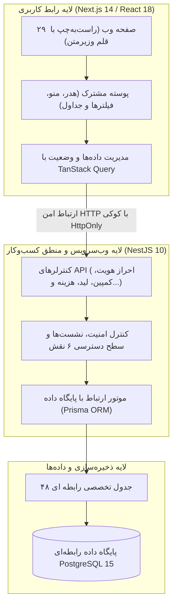

# ۰۳ — مستندات معماری، جریان داده‌ها و ساختار سامانه
## تحلیل معماری سیستم، تعاملات نرم‌افزاری و پایگاه داده برای کارفرما و مدیر محصول

---

## ۱. نمای کلی معماری سامانه گپ‌جی

سامانه گپ‌جی بر مبنای یک معماری سه‌لایه مدرن طراحی شده است که در یک مخزن واحد (مونورپو) سازماندهی می‌گردد:

---

## ۲. ریشه‌یابی فنی مشکل داده‌های مرورگر (Mock Data)

همانطور که در خلاصه مدیریتی ذکر شد، به علت عدم ادغام دو شاخه فرانت‌اند و بک‌اند در گذشته، تیم فرانت‌اند برای اینکه بتواند صفحات را به شما نمایش دهد، از یک ترفند موقت استفاده کرده است:
۱. در هر بخش برنامه، کدهایی نوشته شده که ابتدا تلاش می‌کند اطلاعات را از سرور بک‌اند بخواند.
۲. اگر سرور پاسخ ندهد یا آدرس آن در دسترس نباشد، برنامه به صورت خودکار خطا را مخفی کرده و داده‌های نمونه‌ای را از حافظه داخلی مرورگر (`localStorage`) می‌خواند.
۳. **پیامد برای کارفرما**: در حال حاضر برنامه به صورت نمایشی (دمو) به خوبی کار می‌کند، اما اگر شما یک کمپین یا لید جدید در مرورگر کامپیوتر خود ثبت کنید، همکار شما در کامپیوتر دیگر قادر به دیدن آن نخواهد بود، زیرا داده‌ها هنوز به پایگاه داده مرکزی متصل نشده‌اند.

---

## ۳. نقش‌های ۶ گانه کاربری و محدوده دسترسی‌ها (RBAC)

سامانه گپ‌جی فرآیندهای بازاریابی را میان ۶ نقش تفکیک کرده است:
۱. **مدیر ارشد / ادمین (admin)**: دسترسی کامل به تمام ۲۹ صفحه، تنظیمات سازمان، تعریف دسترسی‌ها و مدیریت کاربران.
۲. **مدیر مارکتینگ (marketing_manager)**: دسترسی مدیریتی به تمام کمپین‌ها، بودجه‌ها، هزینه‌ها، گزارش‌ها، مصوبات و تسک‌ها.
۳. **کمپین‌چی / مسئول کمپین (campaign_manager)**: ساخت و مدیریت کمپین‌های تحت مسئولیت خود، ثبت هزینه‌ها و مشاهده تسک‌های مرتبط.
۴. **کارشناس فروش (sales_agent)**: دسترسی اختصاصی به صندوق لیدها، برد پیگیری، ثبت نتایج تماس‌ها و پیشبرد لیدها تا مرحله خرید (بدون دسترسی به تنظیمات یا کمپین‌ها).
۵. **مسئول محتوا و وبینار (content_creator)**: برگزاری و مدیریت وبینارها، چک‌لیست تجهیزات استودیو و تقویم اجرایی.
۶. **کارفرما / مشتری (client)**: دسترسی فقط-خواندنی (Read-Only) به داشبورد عملکردی و شاخص‌های کلیدی بازگشت سرمایه (ROI).

---

## ۴. معماری پایگاه داده و ۴۸ جدول اطلاعاتی

در شاخه بک‌اند پروژه، یک ساختار پایگاه داده فوق‌العاده جامع و دقیق با ۴۸ مدل رابطه‌ای پیاده شده است:
- **سازمان و کاربران**: جداول کاربران، سازمان‌ها، نشست‌ها، توکن‌های رفرش و تنظیمات اعلان.
- **کمپین‌ها و کانال‌ها**: جداول کمپین‌ها، پلتفرم‌های تبلیغاتی، سهم بودجه هر پلتفرم، مخاطبان هدف، لندینگ‌ها و لینک‌های UTM.
- **هزینه‌ها و مالی**: دسته‌بندی هزینه‌ها، رکوردهای ثبت هزینه و انتساب به پلتفرم و کمپین.
- **لیدها و پایپ‌لاین فروش**: اطلاعات لید، لاگ فعالیت‌ها، لاگ تماس‌های تلفنی، نتایج تماس، وضعیت‌های پایپ‌لاین و دلایل رد شدن لید.
- **ارتباطات و رویدادها**: پیامک‌های ارسالی، وضعیت تحویل به هر شماره، وبینارها و لیست شرکت‌کنندگان.
- **تسک‌ها و تقویم**: تسک‌ها، زیرتسک‌ها، نظرات، رویدادهای تقویم، تجهیزات و قالب‌های تجهیزات استودیو.
- **دانش و مستندسازی**: صورتجلسات، اقدامات مصوب، مستندات SOP، تاریخچه ویرایش‌ها و منابع آموزشی.
- **هوشمندی و شاخص‌ها**: شاخص‌های KPI، تعاریف فرمول‌ها، قوانین هشدار هوشمند و تاریخچه پردازش ایمپورت.
- **یکپارچه‌سازی**: تنظیمات اتصال به سایت‌های وردپرسی و لاگ وب‌هوک‌های دریافتی از فرم‌های سایت.
