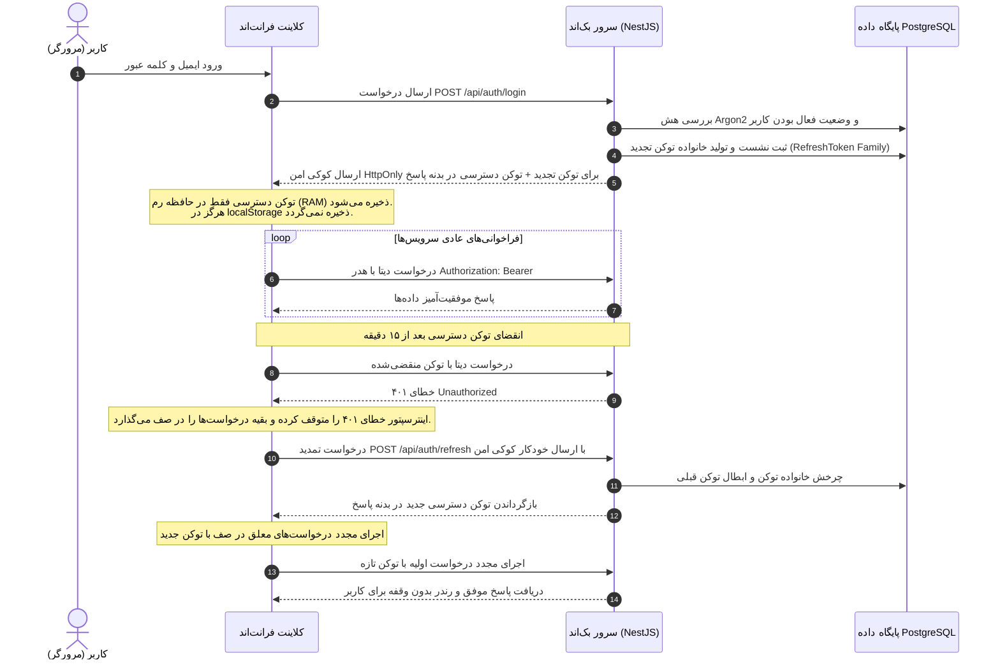

# ۰۳ — مستندات جامع معماری و لایه‌های فنی پلتفرم
## پلتفرم کنترل فرآیندهای دیجیتال مارکتینگ و مدیریت کمپین گپجی

---

## ۱. نمای کلی معماری سامانه (System Architecture)

معماری پلتفرم گپجی بر اساس الگوی **سیستم ماژولار فول‌استک** درون یک مخزن یکپارچه (Monorepo) بنا شده است. این سیستم ارتباط میان بک‌اند مبتنی بر فریم‌ورک سازمانی NestJS و فرانت‌اند مدرن Next.js 14 را از طریق یک وب‌سرویس RESTful امن با پروتکل JSON برقرار می‌نماید.

```mermaid
graph TB
    subgraph لایه_کلاینت["لایه کلاینت و فرانت‌اند (Next.js 14 App Router)"]
        UI["سیستم طراحی shadcn/ui و Tailwind CSS (کاملاً راست‌به‌چپ و تم روشن)"]
        Router["گروه‌های مسیریابی (auth) و (app)"]
        State["مدیریت وضعیت دوگانه: TanStack Query + Zustand"]
        Axios["کلاینت ارتباطی Axios با صف تمدید خودکار توکن"]
        Jalali["موتور محاسباتی تقویم شمسی (بدون کتابخانه جانبی با دقت ۱۱٬۳۲۳ روز)"]
    end

    subgraph لایه_ارتباط_و_امنیت["امنیت تبادل داده و شبکه"]
        CookiePolicy["کوکی‌های امن HttpOnly و سیاست SameSite=Lax"]
        AuthInterceptor["اینترسپتور رهگیری خطای ۴۰۱ و صف تمدید توکن"]
    end

    subgraph لایه_سرویس_بک‌اند["لایه پردازش و منطق کسب‌وکار (NestJS 10)"]
        Guards["گارد اعتبارسنجی JWT و کنترل دسترسی نقش‌ها (RBAC)"]
        Modules["۱۶ ماژول کاربردی فعال (کمپین‌ها، لیدها، هزینه‌ها، کاربران و...)"]
        Prisma["سرویس نگاشت رابطه‌ای Prisma ORM (با ۴۳ مدل داده)"]
    end

    subgraph لایه_پایگاه_داده["لایه ذخیره‌سازی داده‌ها"]
        PostgreSQL["پایگاه داده رابطه‌ای PostgreSQL"]
        Migrations["۶ مرحله مهاجرت ساختاریافته (Prisma Migrations)"]
    end

    UI --> Router
    Router --> State
    State --> Axios
    Axios --> CookiePolicy
    CookiePolicy --> AuthInterceptor
    AuthInterceptor --> Guards
    Guards --> Modules
    Modules --> Prisma
    Prisma --> PostgreSQL
    Migrations --> PostgreSQL
```

---

## ۲. قوانین جداسازی مونو‌ریپو و پکیج‌ها

فضای کاری با `pnpm-workspace.yaml` مدیریت شده و استقلال پکیج‌ها تضمین گردیده است:
1. **پکیج قراردادهای مشترک (`packages/shared`):**
   شامل تعاریف اینترفیس‌ها، تایپ‌ها، ثابت‌های مسیر API و اینام‌های ثابت بیزنس است. این پکیج توسط هر دو بخش فرانت‌اند و بک‌اند ایمپورت شده و تطابق کامل فیلدها را تضمین می‌کند.
2. **استقلال کامل بک‌اند (`apps/api`):**
   هیچ‌گونه وابستگی به رندرر فرانت‌اند، کدهای مرورگر یا Next.js در بک‌اند وجود ندارد. بک‌اند به عنوان یک API مستقل و مقیاس‌پذیر عمل می‌کند.
3. **فرانت‌اند مستقل (`apps/web`):**
   با کامپوننت‌های بهینه‌سازی‌شده سرور و کلاینت در Next.js 14 طراحی شده و از طریق فراخوانی متدهای کلاینت Axios با بک‌اند ارتباط می‌گیرد.

---

## ۳. معماری بک‌اند (NestJS 10 Core)

بک‌اند پلتفرم بر پایه اصول Domain-Driven Design (طراحی دامنه‌محور) توسعه یافته است:
- **ماژول تنظیمات و اعتبارسنجی:** بارگذاری متغیرهای محیطی توسط Joi در زمان استارت سرور چک می‌شود تا از صحت مقادیر امنیتی اطمینان حاصل گردد.
- **لایه پایگاه داده (Prisma):** اتصال امن به PostgreSQL با سرویس تزریق‌پذیر `PrismaService` برقرار است. فیلتر اختصاصی `PrismaClientExceptionFilter` خطاهای پایگاه داده (نظیر تلاش برای حذف رکورد وابسته با خطای `P2003`) را به خطاهای قابل فهم HTTP 400 تبدیل می‌کند.
- **ماژول‌های ۱۶ گانه فعال:** شامل ماژول‌های احراز هویت، کمپین‌ها، هزینه‌ها، داشبورد، لیدها، تسک‌ها، تقویم، وبینار، پیامک، مخاطبان، لندینگ، پلتفرم‌ها، ایمپورت، کاربران، شاخص‌ها و سازمان.

---

## ۴. معماری فرانت‌اند (Next.js 14 App Router)

### ۴.۱ ساختار مسیرها و امنیت ناوبری
- **گروه مسیرهای عمومی `(auth)`:** صفحات ورود، بازیابی کلمه عبور و انتخاب سازمان را در بر می‌گیرد که بدون توکن در دسترس هستند.
- **گروه مسیرهای حفاظت‌شده `(app)`:** تمام صفحات داخلی نرم‌افزار را پوشش داده و توسط `middleware.ts` و گارد نقش کنترل می‌شود. صفحات فاقد دسترسی پیام مناسب نمایش می‌دهند.

### ۴.۲ استراتژی تفکیک مدیریت وضعیت (State Management)
- **وضعیت سرور (Server State):** توسط `TanStack Query v5` با کلیدهای کوئری مشخص مدیریت می‌شود. اعمال تغییرات (مانند ثبت هزینه یا تغییر وضعیت لید) به صورت خودکار باعث ابطال و به‌روزرسانی اطلاعات داشبورد و جداول می‌گردد. برای بردهای کانبان از به‌روزرسانی خوش‌بینانه (Optimistic Update) با قابلیت برگشت در صورت بروز خطا استفاده شده است.
- **وضعیت کلاینت (Client State):** توسط `Zustand` مدیریت می‌شود و صرفاً شامل متغیرهای محیط کاربری نظیر باز/بسته بودن منوی کناری، حالت فشرده جدول و اطلاعات کاربر واردشده است. هیچ داده‌ای از سرور در Zustand کپی نمی‌شود تا تداخل رخ ندهد.

---

## ۵. امنیت ورود، نشست‌ها و چرخش توکن (Token Rotation)



---

## ۶. تفکیک سازمان‌ها (Multi-Tenancy) و کنترل دسترسی بر پایه نقش (RBAC)

پلتفرم از **۶ نقش سازمانی مصوب** پشتیبانی می‌کند:
1. `admin` (مدیر ارشد سازمان): دسترسی کامل مدیریتی، دعوت کاربران و تنظیمات پایه.
2. `marketing_manager` (مدیر مارکتینگ): راهبری کامل کمپین‌ها، هزینه‌ها، شاخص‌ها و تیم.
3. `campaign_manager` (کمپین‌چی): ساخت، اجرا و نظارت بر کمپین‌ها و بودجه‌ها.
4. `sales_agent` (کارشناس فروش): دریافت لیدهای تخصیص‌یافته، پیگیری و ثبت تماس‌ها.
5. `content_creator` (تولید محتوا و وبینار): برگزاری رویدادها، مدیریت محتوا و تسک‌ها.
6. `client` (کارفرما): دسترسی فقط-خواندنی به داشبورد و گزارش‌های سطح بالا.

### سیاست‌های ریاضی غیرقابل دور زدن (System Policies)
- **جداسازی لیدهای کارشناس فروش:** کارشناس فروش به هیچ عنوان نمی‌تواند لیدهای سایر همکاران را ببیند یا ویرایش کند (`assignedToId = user.id`).
- **ممنوعیت تغییرات مالی توسط کارفرما:** کاربر کارفرما نمی‌تواند رکوردی در کمپین‌ها، هزینه‌ها یا لیدها ثبت یا ویرایش کند.
- **قانون حداقل یک مدیر فعال:** حذف یا خلع نقش آخرین مدیر ارشد سازمان غیرممکن است و حتماً باید پیش از عزل، مدیر ارشد جدیدی تعیین گردد.

---

## ۷. بومی‌سازی فارسی، تایپوگرافی و تقویم شمسی

- **راست‌به‌چپ بومی (RTL):** فایل پایه با تگ `<html lang="fa" dir="rtl">` پیکربندی شده و از کلاس‌های منطقی CSS نظیر `ms-*`, `me-*` استفاده می‌کند.
- **فونت فارسی یکپارچه:** فونت وزیرمتن با ۱۰ وزن مختلف در پوشه فایل‌های عمومی کلاینت قرار گرفته و بدون نیاز به اینترنت لود می‌شود.
- **موتور تقویم شمسی اختصاصی (`persian-date.ts`):** بدون وابستگی به پکیج‌های خارجی، تبدیل دقیق تاریخ‌ها را در بازه سال‌های ۱۳۹۰ تا ۱۴۲۰ به صورت ۱۰۰٪ تست‌شده انجام می‌دهد.
- **نمایش مبالغ و اعداد:** کلیه اعداد بزرگ به صورت ۳ رقم ۳ رقم با ارقام فارسی جدا شده و پسوند «تومان» یا «ریال» در کنار آنها نمایش داده می‌شود.
