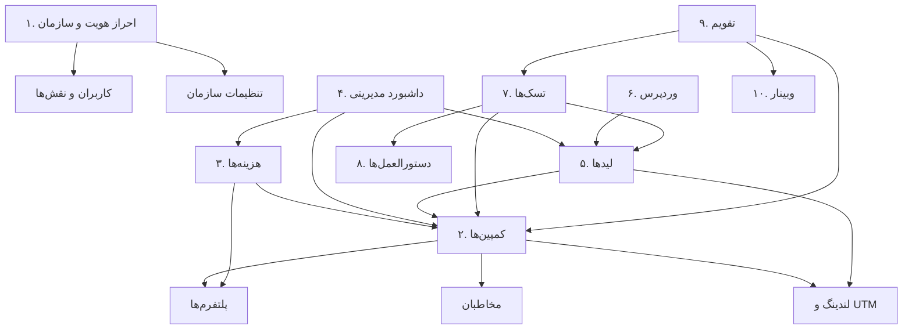

# ۰۶ — نقشه وابستگی‌های فنی، داده‌ای و ماژول‌های سامانه
## دیاگرام جریان وابستگی ماژول‌ها و شعاع اثر تغییرات برای کارفرما

---

## ۱. نمای کلان ارتباط ماژول‌ها

سامانه گپ‌جی یک سیستم متصل و ارگانیک است که تغییر در هر بخش آن می‌تواند روی بخش‌های دیگر تاثیر بگذارد:

---

## ۲. گلوگاه‌های حساس سامانه و شعاع اثر (Blast Radius)

| بخش یا ماژول | بخش‌های وابسته به آن | شعاع اثر در صورت تغییر یا خرابی | استراتژی محافظت |
| :--- | :--- | :---: | :--- |
| **احراز هویت و سازمان** | تمام ۲۹ صفحه محصول، هدر و منو | **۱۰۰٪ (بحرانی)** | استفاده از توکن امنیتی در حافظه و کوکی HttpOnly برای حفظ امنیت نشست کاربر. |
| **ماتریس دسترسی نقش‌ها**| ناوبری، ماسک تلفن، دکمه‌های عملیات | **۹۰٪ (خیلی زیاد)** | تست مداوم با اسکریپت ماتریس دسترسی برای تضمین عدم نشت اطلاعات. |
| **تقویم و تاریخ شمسی** | فیلترها، داشبورد، کمپین، لید، تسک | **۸۵٪ (زیاد)** | اعتبارسنجی دقیق تبدیل تاریخ به میلادی استاندارد هنگام ذخیره در سرور. |
| **کمپین‌ها** | داشبورد، هزینه‌ها، لیدها، تسک‌ها | **۷۵٪ (زیاد)** | نگهداری ساختار پایدار شناسه کمپین در تمام رکوردهای مرتبط. |
| **لیدها و وضعیت‌ها** | صندوق لید، برد کانبان، داشبورد | **۷۰٪ (زیاد)** | استفاده از وضعیت‌های استاندارد سند (جدید، تماس‌گرفته، واجدشرایط و...). |
