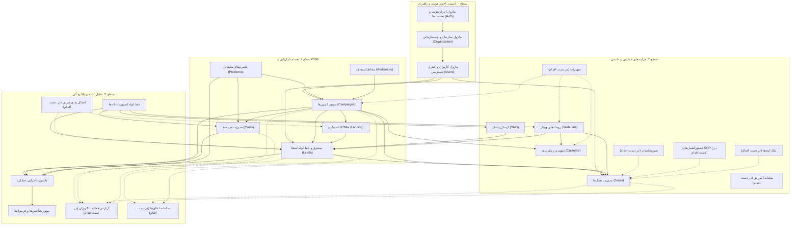

# ۰۶ — نقشه وابستگی‌های فنی و ساختار ارتباطی ماژول‌ها
## پلتفرم کنترل فرآیندهای دیجیتال مارکتینگ و مدیریت کمپین گپجی

---

## ۱. لایه‌بندی وابستگی ماژول‌های سامانه

پلتفرم گپجی بر اساس یک سلسله‌مراتب منطقی و ۴ سطحی بنا شده است که در آن، لایه‌های پایه‌ای وظیفه تأمین امنیت و داده‌های عمومی را برعهده دارند و سایر ماژول‌ها بر بستر آنها فعالیت می‌کنند:

---

## ۲. روابط کلیدی موجودیت‌ها در پایگاه داده (Prisma 43 Models)

طرح پایگاه داده ۴۳ مدلی در `schema.prisma` با کلیدهای خارجی و محدودیت‌های یکپارچگی ارجاعی به صورت زیر متصل است:

```mermaid
erDiagram
    Organization ||--o{ OrganizationMembership : "عضویت کاربران"
    Organization ||--o{ Campaign : "مالکیت کمپین‌ها"
    Organization ||--o{ Lead : "مالکیت لیدها"
    Organization ||--o{ Cost : "مالکیت هزینه‌ها"
    Organization ||--o{ Task : "مالکیت تسک‌ها"
    Organization ||--o{ Platform : "تنظیم پلتفرم‌ها"
    Organization ||--o{ TargetAudience : "تعریف مخاطبان"
    Organization ||--o{ LandingPage : "میزبانی لندینگ‌ها"
    Organization ||--o{ CalendarEvent : "برنامه‌ریزی تقویم"
    Organization ||--o{ EquipmentItem : "انبار تجهیزات"
    Organization ||--o{ Meeting : "ثبت جلسات"
    Organization ||--o{ Sop : "پایگاه دانش"
    Organization ||--o{ LearningResource : "منابع آموزشی"
    Organization ||--o{ Idea : "صندوق ایده‌ها"
    Organization ||--o{ Notification : "ارسال اعلان‌ها"

    User ||--o{ OrganizationMembership : "عضویت در سازمان"
    User ||--o{ Session : "نشست‌های ورود"
    User ||--o{ RefreshToken : "توکن‌های تجدید"
    User ||--o{ Task : "تسک‌های محوله"
    User ||--o{ Lead : "لیدهای مسئول"
    User ||--o{ UserActivityLog : "ردپای فعالیت"

    Campaign ||--o{ CampaignPlatformAllocation : "تخصیص بودجه پلتفرم"
    Campaign ||--o{ CampaignAudience : "مخاطبان هدف"
    Campaign ||--o{ UtmLink : "لینک‌های ردیابی"
    Campaign ||--o{ Cost : "هزینه‌های واقع‌شده"
    Campaign ||--o{ Lead : "لیدهای جذب‌شده"
    Campaign ||--o{ Task : "تسک‌های اجرایی"
    Campaign ||--o{ SmsCampaign : "ارسال پیامک"
    Campaign ||--o{ Webinar : "برگزاری وبینار"

    Lead ||--o{ LeadActivity : "ثبت وقایع لید"
    Lead ||--o{ LeadCall : "تماس‌های ثبت‌شده"
    Lead ||--o{ Task : "تسک‌های پیگیری"

    Task ||--o{ TaskSubtask : "زیرتسک‌ها"
    Task ||--o{ TaskComment : "یادداشت‌ها و نظرات"

    Meeting ||--o{ MeetingActionItem : "اقدامات مصوب"
    MeetingActionItem }o--|| Task : "تبدیل به تسک"

    Sop ||--o{ SopVersion : "نسخه‌های دستورالعمل"
    Idea ||--o{ IdeaVote : "آرای تیمی"
    Webinar ||--o{ WebinarAttendee : "شرکت‌کنندگان"
```

---

## ۳. گلوگاه‌ها و هشدارهای وابستگی فنی

1. **وابستگی سنگین داشبورد اجرایی به تجمیع چندجدولی:**
   اندپوینت `/api/dashboard/overview` به صورت همزمان جداول کمپین‌ها، هزینه‌ها، پلتفرم‌ها و لیدها را تجمیع می‌کند. با افزایش حجم لیدها به ده‌ها هزار رکورد، استفاده از ایندکس‌های ترکیبی و کشینگ کوتاه‌مدت ضروری است.
2. **قانون ممانعت از حذف کمپین‌های دارای هزینه (`P2003`):**
   پایگاه داده در صورت وجود هزینه یا لید وابسته، حذف فیزیکی کمپین را مسدود می‌کند (`RESTRICT`). این وابستگی باید با پیام هشدار شفاف به کاربر اطلاع‌رسانی شود تا کاربر بداند ابتدا باید کمپین را بایگانی کند.
3. **تغییر تخصیص دسته‌ای لیدها:**
   در تخصیص مجدد گروهی لیدها به کارشناس جدید، باید لاگ تغییرات و تسک‌های پیگیری آتی در قالب یک تراکنش اتمیک پایگاه داده بروز شوند تا عدم تطابق داده رخ ندهد.
