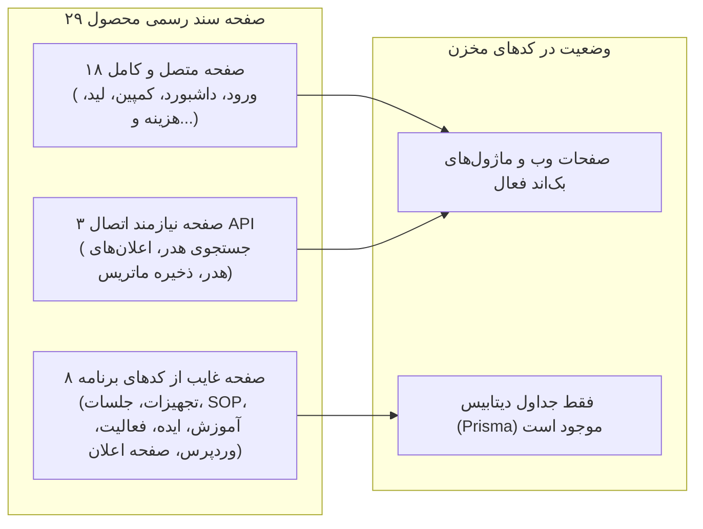

# ۰۷ — تحلیل بدهی‌های فنی، شکاف‌ها و بخش‌های ناتمام
## پلتفرم کنترل فرآیندهای دیجیتال مارکتینگ و مدیریت کمپین گپجی

---

## ۱. دفتر ثبت بدهی‌های فنی (Technical Debt Register)

| شناسه بدهی | دسته‌بندی | اولویت | حوزه / ماژول | شرح بدهی و علت ریشه‌ای | پیامد و ریسک | راهکار پیشنهادی در نقشه راه |
| :--- | :--- | :---: | :--- | :--- | :--- | :--- |
| **DEBT-01** | ماژول‌های غایب | `P0 / بحرانی` | بک‌اند و وب | ۸ ماژول مشخص‌شده در سند با وجود داشتن جدول در دیتابیس، کنترلر و صفحه وب ندارند. | ۲۷٪ از امکانات سند محصول غیرقابل استفاده است. | پیاده‌سازی گام‌به‌گام ماژول‌ها در `PHASE-002` تا `009`. |
| **DEBT-02** | جستجوی هدر | `P1 / بالا` | پوسته برنامه | فیلد جستجوی سراسری در هدر وجود دارد اما به هیچ اندپوئینت سرچ در بک‌اند متصل نیست. | کاربران نمی‌توانند لید یا کمپین را از هدر جستجو کنند. | ساخت اندپوینت `/api/search/global` در `PHASE-001`. |
| **DEBT-03** | مغایرت آدرس کمپین | `P1 / بالا` | ساختار مسیرها | در سند آدرس `/performance/campaigns` ذکر شده اما فرانت‌اند روی `/campaigns` ساخته شده است. | احتمال شکست لینک‌ها یا تضاد با مستندات کاربر نهایی. | تعریف ریرایت (Rewrite) در Next.js در `PHASE-001`. |
| **DEBT-04** | اعلان‌های ماک هدر | `P1 / بالا` | نوتفیکیشن‌ها | هدر دارای آرایه ۳ اعلان ثابت و ماک‌شده در کدهای ری‌اکت است. | اعلان‌های واقعی سیستم به اطلاع کاربران نمی‌رسد. | ساخت ماژول نوتیفیکیشن با SSE/Polling در `PHASE-002`. |
| **DEBT-05** | ماتریس دسترسی | `P1 / بالا` | تنظیمات کاربران | چک‌باکس‌های ماتریس دسترسی نقش‌ها در صفحه کاربر ذخیره نمی‌شوند و اندپوینت ندارد. | عدم امکان تغییر و ذخیره سطوح دسترسی سفارشی. | افزودن اندپوینت `PATCH /api/users/permissions/matrix` در `PHASE-001`. |
| **DEBT-06** | داده ماک در سرویس | `P2 / متوسط` | سرویس‌های کلاینت | برخی سرویس‌ها (`platforms.api.ts`) در زمان خطای سرور داده ماک برمی‌گردانند. | قطع بودن سرور یا خطای شبکه پشت داده فرضی پنهان می‌ماند. | حذف داده‌های ماک فال‌بک و نمایش استاندارد حالت خطا در `PHASE-001`. |
| **DEBT-07** | فیلتر کلاینتی کمپین | `P2 / متوسط` | کمپین‌ها | متد `campaignApi.getAll` همه رکوردها را گرفته و در رم مرورگر فیلتر می‌کند. | با افزایش تعداد کمپین‌ها به هزاران رکورد سرعت کند می‌شود. | انتقال فیلتر و جستجو به کوئری‌های SQL پریزما در `PHASE-001`. |
| **DEBT-08** | خروجی PDF داشبورد | `P2 / متوسط` | داشبورد اجرایی | دکمه دانلود اکسل کار می‌کند اما خروجی PDF وجود ندارد یا وابسته به پرینت است. | مدیران ارشد نمی‌توانند فایل پی‌دی‌اف گزارش را دریافت کنند. | افزودن خط لوله سروری تولید PDF در `PHASE-001`. |
| **DEBT-09** | داکر محیط پروداکشن | `P3 / متوسط` | زیرساخت داکر | فقط فایل `docker-compose.yml` برای دیتابیس محلی وجود دارد و ایمیج برنامه وجود ندارد. | عدم امکان استقرار روی کوبرنتیز یا سرورهای پروداکشن. | ساخت Dockerfile چندمرحله‌ای برای وب و API در `PHASE-010`. |
| **DEBT-10** | نبود خط لوله CI/CD | `P3 / متوسط` | تست و دواپس | هیچ پایپ‌لاین گیت‌هاب اکشن برای بیلد و تست خودکار در مخزن وجود ندارد. | ریسک شکست پروژه حین کامیت‌های جدید وجود دارد. | ایجاد فایل گردش کار تست خودکار CI در `PHASE-010`. |

---

## ۲. تحلیل شکاف ۸ دامنه غایب محصول

### بررسی اجمالی ۸ حوزه غایب:
1. **صفحه ۳: اعلان‌ها (`/notifications`):** غایب در فرانت‌اند و بک‌اند. نیازمند ماژول ارسال پیام و جدول تنظیمات دریافت رویدادها (`PHASE-002`).
2. **صفحه ۲۱: مدیریت تجهیزات (`/work/equipment`):** غایب در فرانت‌اند و بک‌اند. نیازمند سیستم هشدار کمبود قبل از اجرای رویداد (`PHASE-003`).
3. **صفحه ۲۲: صورتجلسات (`/work/meetings`):** غایب در فرانت‌اند و بک‌اند. نیازمند فرم ثبت تصمیمات و موتور تبدیل مصوبه به تسک (`PHASE-004`).
4. **صفحه ۲۳: دستورالعمل‌های استاندارد (`/work/sops`):** غایب در فرانت‌اند و بک‌اند. نیازمند کنترل نسخه و دکمه ساخت تسک از SOP (`PHASE-005`).
5. **صفحه ۲۴: سامانه آموزش (`/work/learning`):** غایب در فرانت‌اند و بک‌اند. نیازمند پلیر ویدیو با ذخیره ثانیه توقف و ماتریس پیشرفت تیم (`PHASE-006`).
6. **صفحه ۲۵: صندوق ایده‌ها (`/work/ideas`):** غایب در فرانت‌اند و بک‌اند. نیازمند ثبت ایده، رأی‌گیری برگشت‌پذیر و تبدیل ایده به تسک (`PHASE-007`).
7. **صفحه ۲۶: گزارش فعالیت پرسنل (`/work/activity`):** غایب در فرانت‌اند و بک‌اند. نیازمند اینترسپتور ثبت لاگ تغییرات و جدول مقایسه عملکرد (`PHASE-008`).
8. **صفحه ۲۹: اتصال وردپرس (`/settings/wordpress`):** غایب در فرانت‌اند و بک‌اند. نیازمند وب‌هوک دریافت لید و نگاشت فیلدهای فرم وردپرس (`PHASE-009`).
