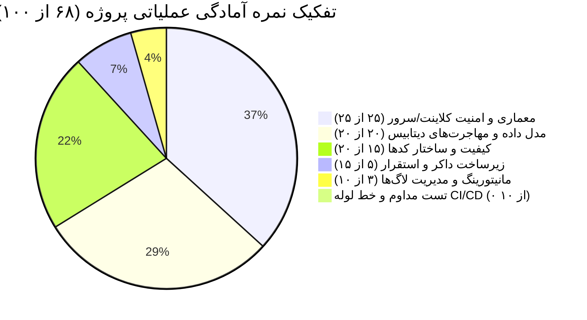

# ۰۹ — ارزیابی میزان آمادگی برای استقرار در محیط عملیاتی (Production Readiness)
## پلتفرم کنترل فرآیندهای دیجیتال مارکتینگ و مدیریت کمپین گپجی

---

## ۱. نمره کل آمادگی عملیاتی: ۶۸ از ۱۰۰



در حالی که هسته منطق نرم‌افزار، امنیت نشست‌ها، پایگاه داده و سیستم طراحی فرانت‌اند از **کیفیت سازمانی بسیار بالایی** برخوردار هستند، سامانه در حوزه‌های **DevOps، کانتینرسازی، مانیتورینگ خودکار و خط لوله استقرار مستمر (CI/CD)** دارای کسری‌هایی است که باید پیش از استقرار در سرورهای عملیاتی مرتفع شوند.

---

## ۲. ماتریس ارزیابی شاخص‌های استقرار عملیاتی

| شاخص عملیاتی | وضعیت کنونی پروژه | نیاز محیط پروداکشن | سطح کمبود | اقدام در نقشه راه |
| :--- | :--- | :--- | :---: | :--- |
| **کانتینرسازی (Docker)** | فقط `docker-compose.yml` برای دیتابیس محلی موجود است. | ساخت Dockerfile چندمرحله‌ای برای بک‌اند و فرانت‌اند با کاربر non-root. | `بالا` | ایجاد فایل‌های داکر پروداکشن در `PHASE-010`. |
| **مهاجرت‌های دیتابیس** | ۶ مرحله مهاجرت آماده در ساختار Prisma وجود دارد. | اجرای خودکار دستور `prisma migrate deploy` در پایپ‌لاین استقرار. | `پایین` | اتصال به فرآیند Deploy در `PHASE-010`. |
| **استخر اتصالات دیتابیس** | اتصال مستقیم کلاینت Prisma به PostgreSQL. | استفاده از PgBouncer برای مدیریت اتصالات همزمان و جلوگیری از اشباع رم. | `متوسط` | تنظیم آدرس پورت PgBouncer در `PHASE-010`. |
| **ایندکس‌های پایگاه داده** | ایندکس‌های کلید اصلی و فیلدهای یکتا موجود است. | افزودن ایندکس‌های ترکیبی روی `[organizationId, createdAt]` برای لیدها و هزینه‌ها. | `متوسط` | اضافه کردن ایندکس‌ها در اسکیما در `PHASE-010`. |
| **پشتیبان‌گیری و بازیابی** | روش دستی و سنتی بکاپ Postgres. | اسکریپت پشتیبان‌گیری خودکار روزانه با بارگذاری روی فضای ابری S3 و سناریوی ریکاوری. | `بالا` | نگارش اسکریپت بکاپ و راهنمای بازیابی در `PHASE-010`. |
| **لاگ‌های ساختاریافته** | لاگ‌های متنی کنسول با لاگر پیش‌فرض NestJS. | استفاده از Pino یا Winston با فرمت JSON و شناسه پیگیری درخواست (Correlation ID). | `متوسط` | پیاده‌سازی لاگر سازمانی در `PHASE-010`. |
| **سنجش سلامت (Health Check)**| استارت پیش‌فرض سرور بدون اندپوینت وضعیت. | افزودن پکیج `@nestjs/terminus` روی مسیر `/health` با چک زنده بودن دیتابیس و حافظه. | `متوسط` | راه‌اندازی ماژول سلامت در `PHASE-010`. |
| **مدیریت رازها (Secrets)** | فایل‌های متنی `.env` محلی. | انتقال کلیدهای حساس به Secret Manager یا Sealed Secrets در کوبرنتیز. | `بالا` | تدوین دستورالعمل پیکربندی امن در `PHASE-010`. |
| **خط لوله خودکار (CI/CD)** | عدم وجود گیت‌هاب اکشن یا پایپ‌لاین اتوماتیک. | ایجاد پایپ‌لاین تست خودکار، اعتبارسنجی تایپ‌ها، بیلد و پابلیش ایمیج داکر در هر کامیت. | `بالا` | راه‌اندازی `.github/workflows/ci.yml` در `PHASE-010`. |
| **سخت‌سازی امنیتی سرور** | سرور بدون هدرهای امنیتی اضافه. | افزودن پکیج Helmet و Throttler روی پورت ۳۰۰۱ برای کنترل نرخ درخواست‌ها. | `متوسط` | فعال‌سازی میدلورهای امنیتی در `PHASE-010`. |

---

## ۳. طرح بهینه‌سازی ایندکس‌های پایگاه داده

برای پاسخگویی سریع سامانه در مقیاس‌های بزرگ سازمانی (صدها هزار لید و ثبت هزینه)، ایندکس‌های ترکیبی زیر در پریزما پیشنهاد گردیده است:

```prisma
// ایندکس‌های ترکیبی پیشنهادی جهت اضافه شدن به schema.prisma در فاز ۱۰:

model Lead {
  // فیلدهای موجود...
  @@index([organizationId, status])
  @@index([organizationId, assignedToId])
  @@index([organizationId, createdAt(sort: Desc)])
}

model Cost {
  // فیلدهای موجود...
  @@index([organizationId, campaignId])
  @@index([organizationId, platformId])
  @@index([organizationId, date(sort: Desc)])
}

model Task {
  // فیلدهای موجود...
  @@index([organizationId, assigneeId, status])
  @@index([organizationId, dueDate(sort: Asc)])
}
```

---

## ۴. ساختار معماری پیشنهادی سرورهای پروداکشن

```mermaid
graph TB
    subgraph لایه_لبه_و_امنیت["فایروال، CDN و توازن بار"]
        WAF["کلودفلر / ابرآروان (WAF + CDN + SSL)"]
        Nginx["وب‌سرور Nginx معکوس (Reverse Proxy)"]
    end

    subgraph کلاستر_اپلیکیشن["کانتینرهای نرم‌افزار (Docker / Kubernetes)"]
        NextPods["پادهای فرانت‌اند Next.js (پورت ۳۰۰۰)"]
        NestPods["پادهای بک‌اند NestJS (پورت ۳۰۰۱)"]
    end

    subgraph لایه_ذخیره‌سازی_مدیریت‌شده["زیرساخت پایگاه داده و فایل‌ها"]
        PgBouncer["استخر اتصالات PgBouncer"]
        PostgresPrimary["سرور اصلی دیتابیس PostgreSQL 16"]
        PostgresReplica["سرور کپی فقط-خواندنی PostgreSQL"]
        Redis["کش سریع Redis و مدیریت صف‌ها"]
        S3["فضای ابری S3 برای ذخیره فایل‌های ایمپورت و اکسپورت"]
    end

    WAF --> Nginx
    Nginx --> NextPods
    Nginx --> NestPods
    NextPods --> NestPods
    NestPods --> PgBouncer
    PgBouncer --> PostgresPrimary
    PostgresPrimary -.-> PostgresReplica
    NestPods --> Redis
    NestPods --> S3
```
