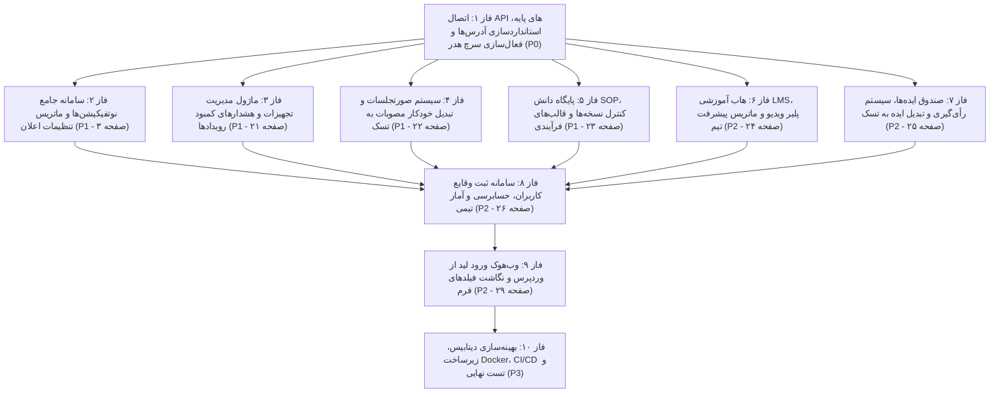

# ۱۰ — نقشه راه جامع تکمیل ۱۰۰٪ محصول و استقرار عملیاتی (Master Roadmap)
## پلتفرم کنترل فرآیندهای دیجیتال مارکتینگ و مدیریت کمپین گپجی

---

## ۱. ساختار توالی و نمودار وابستگی فازها

این نقشه راه، مسیر دقیق فنی از وضعیت فعلی تا دستیابی به **پوشش ۱۰۰٪ کلیه نیازمندی‌های سند ۲۹ صفحه‌ای محصول** و رسیدن به **آمادگی کامل جهت استقرار عملیاتی** را بر مبنای اولویت و وابستگی‌های واقعی مهندسی تعیین می‌نماید:

---

## ۲. مشخصات کامل فازهای ۱۰ گانه نقشه راه

### فاز ۱ (PHASE-001): اتصال APIهای پایه، استانداردسازی آدرس‌ها و فعال‌سازی سرچ هدر
- **۱. عنوان فاز:** تثبیت اتصالات APIهای پایه، همسان‌سازی مسیرهای ناوبری و فعال‌سازی جستجوی سراسری
- **۲. هدف اجرایی:** حذف فال‌بک‌های ماک کلاینت، استانداردسازی مسیر کمپین‌ها با تعریف Rewrite، اتصال سرچ سراسری هدر به دیتابیس و امکان ذخیره ماتریس دسترسی نقش‌ها.
- **۳. هدف کسب‌وکار:** اطمینان از عملکرد صددرصدی ابزارهای ناوبری، جستجوی بلادرنگ لید و کمپین، و فعال‌سازی ذخیره اختیارات نقش‌ها توسط مدیر ارشد.
- **۴. وضعیت فعلی:** سرچ هدر صرفاً ظاهر گرافیکی دارد؛ آدرس `/campaigns` با سند (`/performance/campaigns`) تفاوت دارد؛ ماتریس دسترسی در صفحه کاربران ذخیره نمی‌شود؛ برخی سرویس‌ها در خطا دیتای ماک می‌دهند.
- **۵. محدوده کار:** ساخت ماژول سرچ در بک‌اند؛ اضافه کردن Rewrite در `next.config.js`؛ افزودن متد ذخیره ماتریس در `UsersController`؛ پاکسازی داده‌های ماک فال‌بک در فرانت‌اند.
- **۶. شناسه‌های نیازمندی مرتبط:** `REQ-002`, `REQ-059`, `REQ-060`, `REQ-090`, `REQ-096`.
- **۷. ماژول‌های مرتبط:** هدر، کمپین‌ها، کاربران، تنظیمات، ناوبری.
- **۸. فایل‌ها و کامپوننت‌های تحت تأثیر:** `apps/api/src/modules/search/*`, `apps/api/src/modules/users/*`, `apps/web/next.config.js`, `apps/web/src/components/layout/header.tsx`.
- **۹. تغییرات پایگاه داده:** نیازی به تغییر اسکیما ندارد؛ از ایندکس‌های موجود استفاده می‌شود.
- **۱۰. تغییرات وب‌سرویس‌ها (API):** افزودن `GET /api/search/global?q=...`؛ افزودن `PATCH /api/users/permissions/matrix`.
- **۱۱. تغییرات معماری:** استقرار ماژول جستجوی متمرکز و لغو کامل فال‌بک‌های پنهان‌کننده خطا در فرانت‌اند.
- **۱۲. پیش‌نیازها:** ندارد؛ این فاز پیش‌نیاز سایر فازهاست.
- **۱۳. وظایف اجرایی به ترتیب اولویت:**
  1. ساخت `SearchModule` در بک‌اند با پشتیبانی از سرچ متنی لیدها و کمپین‌ها با فیلتر سازمان فعال.
  2. اعمال گارد نقش روی سرچ (کارشناس فروش فقط لیدهای خودش را پیدا کند).
  3. اتصال اینپوت هدر در `Header.tsx` با قابلیت Debounce و دراپ‌داون نتایج.
  4. افزودن قوانین ریرایت در `next.config.js` جهت پشتیبانی از مسیرهای `/performance/campaigns`.
  5. پیاده‌سازی متد ذخیره ماتریس دسترسی در بک‌اند و اتصال آن در فرانت‌اند.
  6. اصلاح `platforms.api.ts` جهت بازگرداندن خطای واقعی به جای دیتای ماک.
- **۱۴. ریسک‌های فنی:** کندی سرچ سراسری با افزایش داده‌ها. *راهکار:* اعمال لیمیت ۵ لید و ۵ کمپین و حداقل ۳ حرف برای کوئری.
- **۱۵. ریسک پسرفت (Regression):** پیکربندی اشتباه ریرایت در Next.js.
- **۱۶. آزمون‌های الزامی:** تست یکپارچگی سرچ؛ آزمون تفکیک داده کارشناس فروش در سرچ؛ تست ذخیره ماتریس دسترسی.
- **۱۷. معیارهای پذیرش:** سرچ شماره موبایل لید مربوطه را باز می‌کند؛ آدرس سند محصول باز می‌شود؛ تغییرات ماتریس ذخیره می‌گردد.
- **۱۸. اقلام تحویلی:** ماژول سرچ بک‌اند، هدر اصلاح‌شده، سرویس‌های بدون ماک، اسکریپت آزمون.
- **۱۹. تعریف انجام کار (DoD):** قبولی ۱۰۰٪ تست‌های جدید و عدم وجود دیتای ماک در سرویس‌های متصل.
- **۲۰. شرایط مسدودکننده:** دردسترس نبودن پایگاه داده محلی.

---

### فاز ۲ (PHASE-002): سامانه جامع نوتفیکیشن‌ها و ماتریس تنظیمات اعلان (صفحه ۳)
- **۱. عنوان فاز:** پیاده‌سازی مرکز اعلان‌ها، کشوی هدر و صفحه تنظیمات دریافت اعلان‌ها
- **۲. هدف اجرایی:** ساخت کامل ماژول بک‌اند اعلان‌ها و پیاده‌سازی صفحه ۳ سند محصول (`/notifications`).
- **۳. هدف کسب‌وکار:** اطلاع‌رسانی بلادرنگ تغییر وضعیت لیدها، هشدارهای کمپین و سررسید تسک‌ها به پرسنل و کارفرما.
- **۴. وضعیت فعلی:** در هدر ۳ اعلان فرضی وجود دارد؛ مدل‌های `Notification` و `NotificationPreference` در دیتابیس موجود است اما کنترلر، سرویس و صفحه وب ندارد.
- **۵. محدوده کار:** ساخت ماژول `notifications` در NestJS؛ ساخت کشوی ۱۰ اعلان آخر در هدر؛ ساخت صفحه `/notifications` با دو تب «لیست اعلان‌ها» و «تنظیمات دریافت رویدادها».
- **۶. شناسه‌های نیازمندی مرتبط:** `REQ-003`, `REQ-052`.
- **۷. ماژول‌های مرتبط:** نوتفیکیشن، هدر، تنظیمات، تسک‌ها، کمپین‌ها.
- **۸. فایل‌ها و کامپوننت‌های تحت تأثیر:** `apps/api/src/modules/notifications/*`, `apps/web/src/app/(app)/notifications/page.tsx`, `apps/web/src/features/notifications/*`.
- **۹. تغییرات پایگاه داده:** بدون تغییر اسکیما (استفاده از مدل‌های موجود).
- **۱۰. تغییرات وب‌سرویس‌ها (API):** `GET /api/notifications`، `PATCH /api/notifications/read-all`، `GET/PATCH /api/notifications/preferences`.
- **۱۱. تغییرات معماری:** ایجاد مکانیزم ارسال رویدادهای درون‌برنامه‌ای در سطح ماژول‌ها.
- **۱۲. پیش‌نیازها:** تکمیل فاز ۱ (`PHASE-001`).
- **۱۳. وظایف اجرایی به ترتیب اولویت:**
  1. ساخت کنترلر و سرویس `NotificationModule` در بک‌اند.
  2. پیاده‌سازی متد شمارش اعلان‌های نخوانده با سقف ۹۹+ (`unreadCount > 99 ? '+99' : unreadCount`).
  3. پیاده‌سازی جدول ماتریس تنظیمات (نوع رویداد × کانال درون‌برنامه‌ای/ایمیل).
  4. توسعه سرویس فرانت‌اند و هوک‌های TanStack Query در `features/notifications`.
  5. جایگزینی کشوی ماک هدر با کامپوننت متصل به سرور.
  6. ایجاد صفحه `apps/web/src/app/(app)/notifications/page.tsx` مطابق سند.
- **۱۴. ریسک‌های فنی:** بار سرور ناشی از پولینگ مکرر. *راهکار:* تنظیم بازه ۳۰ ثانیه‌ای برای رفرش.
- **۱۵. ریسک پسرفت:** تغییر چیدمان هدر حین باز شدن کشو.
- **۱۶. آزمون‌های الزامی:** آزمون واحد شمارنده اعلان؛ تست علامت‌گذاری همه به عنوان خوانده‌شده.
- **۱۷. معیارهای پذیرش:** زنگوله هدر شمارنده درست نشان می‌دهد؛ کلیک روی اعلان صفحه موجودیت را باز می‌کند؛ سوییچ‌های تنظیمات ذخیره می‌شوند.
- **۱۸. اقلام تحویلی:** ماژول اعلان‌ها در بک‌اند، صفحه اعلان‌ها در فرانت‌اند، کشوی هدر فعال.
- **۱۹. تعریف انجام کار (DoD):** انطباق ۱۰۰٪ با صفحه ۳ سند محصول با تایید تست خودکار.
- **۲۰. شرایط مسدودکننده:** تکمیل نشدن فاز ۱.

---

### فاز ۳ (PHASE-003): ماژول مدیریت تجهیزات و هشدارهای کمبود رویدادها (صفحه ۲۱)
- **۱. عنوان فاز:** پیاده‌سازی ماژول تجهیزات، ردیابی کمبودها و قالب‌های آماده رویداد
- **۲. هدف اجرایی:** پیاده‌سازی کامل صفحه ۲۱ سند محصول (`/work/equipment`) و اتصال به تقویم و کمپین‌ها.
- **۳. هدف کسب‌وکار:** جلوگیری از لغو یا اختلال در رویدادها و وبینارها با پایش کمبود تجهیزات و اعلام اخطار قبل از موعد.
- **۴. وضعیت فعلی:** منو برچسب «به‌زودی» دارد؛ جداول `EquipmentItem`, `EquipmentTemplate` در دیتابیس وجود دارند اما هیچ کدی در برنامه ندارد.
- **۵. محدوده کار:** ساخت ماژول بک‌اند تجهیزات؛ ساخت صفحه `/work/equipment` با دو نمای «کمبودها (پیش‌فرض)» و «همه تجهیزات»؛ اتصال اخطار ۳ روز مانده به رویداد.
- **۶. شناسه‌های نیازمندی مرتبط:** `REQ-046`, `REQ-084`.
- **۷. ماژول‌های مرتبط:** تجهیزات، تقویم، وبینار، کمپین‌ها، ناوبری.
- **۸. فایل‌ها و کامپوننت‌های تحت تأثیر:** `apps/api/src/modules/equipment/*`, `apps/web/src/app/(app)/work/equipment/page.tsx`, `apps/web/src/features/equipment/*`, `navigation.ts`.
- **۹. تغییرات پایگاه داده:** بدون تغییر اسکیما.
- **۱۰. تغییرات وب‌سرویس‌ها (API):** `GET /api/equipment/shortages`, `GET /api/equipment/items`, `POST /api/equipment/items`, `PATCH /api/equipment/items/:id/status`, `POST /api/equipment/apply-template`.
- **۱۱. تغییرات معماری:** پیوند زدن وضعیت تجهیزات به تاریخ‌های اجرای رویداد در تقویم.
- **۱۲. پیش‌نیازها:** تکمیل فاز ۱ (`PHASE-001`).
- **۱۳. وظایف اجرایی:**
  1. ساخت ماژول تجهیزات در بک‌اند.
  2. پیاده‌سازی کوئری کمبودها گروه‌بندی‌شده بر اساس تاریخ رویداد با نشانگر اخطار فاصله کمتر از ۳ روز.
  3. ساخت سرویس قالب‌های تجهیزات و اعمال دسته‌ای قالب به کمپین/وبینار.
  4. ساخت صفحه وب `/work/equipment` با دو تب مطابق سند.
  5. فعال‌سازی لینک منوی کناری (حذف `comingSoon`).
  6. اتصال تب تجهیزات در صفحه جزئیات وبینار و کمپین.
- **۱۴. ریسک‌های فنی:** اشتباه در مقایسه تاریخ‌ها. *راهکار:* استفاده از توابع موتور تقویم شمسی.
- **۱۵. ریسک پسرفت:** ندارد؛ صفحه جدید است.
- **۱۶. آزمون‌های الزامی:** تست محاسبه کمبود ۳ روزه؛ تست اعمال قالب تجهیزات.
- **۱۷. معیارهای پذیرش:** تجهیزات با وضعیت ناقص در رویدادهای ۳ روز آینده علامت هشدار قرمز می‌گیرند؛ قالب تجهیزات اعمال می‌شود.
- **۱۸. اقلام تحویلی:** ماژول بک‌اند، صفحه وب تجهیزات، چک‌لیست‌های متصل.
- **۱۹. تعریف انجام کار:** تایید انطباق کامل با صفحه ۲۱ سند.
- **۲۰. شرایط مسدودکننده:** تکمیل نشدن فاز ۱.

---

### فاز ۴ (PHASE-004): سیستم صورتجلسات و تبدیل خودکار مصوبات به تسک (صفحه ۲۲)
- **۱. عنوان فاز:** پیاده‌سازی سیستم مدیریت صورتجلسات و خط لوله تبدیل مصوبات به تسک
- **۲. هدف اجرایی:** ساخت کامل صفحه ۲۲ سند محصول (`/work/meetings`) و فرآیند تبدیل اقدام به تسک.
- **۳. هدف کسب‌وکار:** ثبت رسمی تصمیمات جلسات و تضمین اجرایی شدن مصوبات با تبدیل مستقیم به تسک‌های پرسنل.
- **۴. وضعیت فعلی:** منو برچسب «به‌زودی» دارد؛ جداول `Meeting`, `MeetingActionItem` موجود است اما کنترلی در برنامه ندارد.
- **۵. محدوده کار:** ساخت ماژول بک‌اند جلسات؛ ساخت صفحه لیست جلسات و صفحه مطالعه/ویرایش با عرض ۸۰۰ پیکسل؛ پیاده‌سازی فرم ثبت جلسه با جدول مصوبات؛ دکمه «تبدیل مصوبات به تسک»؛ دکمه «ارسال برای همه» با پیش‌نمایش ایمیل.
- **۶. شناسه‌های نیازمندی مرتبط:** `REQ-085`.
- **۷. ماژول‌های مرتبط:** جلسات، تسک‌ها، کاربران، ناوبری.
- **۸. فایل‌ها و کامپوننت‌های تحت تأثیر:** `apps/api/src/modules/meetings/*`, `apps/web/src/app/(app)/work/meetings/*`, `apps/web/src/features/meetings/*`, `navigation.ts`.
- **۹. تغییرات پایگاه داده:** بدون تغییر اسکیما.
- **۱۰. تغییرات وب‌سرویس‌ها (API):** `GET /api/meetings`, `POST /api/meetings`, `GET /api/meetings/:id`, `PATCH /api/meetings/:id`, `POST /api/meetings/:id/convert-actions`.
- **۱۱. تغییرات معماری:** برقراری ارتباط مستقیم سرویس جلسات با سرویس تسک‌ها.
- **۱۲. پیش‌نیازها:** تکمیل فاز ۱ (`PHASE-001`).
- **۱۳. وظایف اجرایی:**
  1. ساخت `MeetingsModule` در بک‌اند.
  2. پیاده‌سازی متد اتمیک تبدیل مصوبات به تسک و ثبت شناسه تسک روی ردیف اقدام جلسه.
  3. ساخت فرمت پیش‌نمایش ایمیل و ثبت لاگ زمان ارسال برای هر کاربر.
  4. ساخت صفحه وب لیست جلسات و صفحه جزئیات با عرض استاندارد ۸۰۰ پیکسل.
  5. فعال‌سازی لینک ناوبری در منوی کناری.
- **۱۴. ریسک‌های فنی:** تولید تسک‌های تکراری با کلیک‌های مجدد. *راهکار:* مسدودسازی تبدیل مجدد اقدامات تبدیل‌شده.
- **۱۵. ریسک پسرفت:** ندارد.
- **۱۶. آزمون‌های الزامی:** آزمون واحد تبدیل مصوبه به تسک؛ آزمون هشدار ویرایش پس از ارسال («نسخه جدید ساخته می‌شود»).
- **۱۷. معیارهای پذیرش:** کلیک روی تبدیل به تسک، تسک‌های مرتبط را در لیست تسک‌های فرد ایجاد می‌کند؛ نمایش عرض ۸۰۰ پیکسل تایید شود.
- **۱۸. اقلام تحویلی:** ماژول بک‌اند، صفحات فرانت‌اند، تست‌های خودکار.
- **۱۹. تعریف انجام کار:** انطباق ۱۰۰٪ با صفحه ۲۲ سند محصول.
- **۲۰. شرایط مسدودکننده:** تکمیل نشدن فاز ۱.

---

### فاز ۵ (PHASE-005): پایگاه دانش SOP، کنترل نسخه‌ها و قالب‌های فرآیندی (صفحه ۲۳)
- **۱. عنوان فاز:** استقرار پایگاه دانش دستورالعمل‌های استاندارد عملیاتی (SOP) و کنترل نسخه‌ها
- **۲. هدف اجرایی:** پیاده‌سازی کامل صفحه ۲۳ سند محصول (`/work/sops`) و ابزار تولید تسک از روی الگو.
- **۳. هدف کسب‌وکار:** مستندسازی یکپارچه فرآیندهای بازاریابی و امکان اجرای بدون خطای فرآیندها با دکمه ایجاد تسک از دستورالعمل.
- **۴. وضعیت فعلی:** منو برچسب «به‌زودی» دارد؛ جداول `Sop`, `SopVersion` موجودند؛ کدی در برنامه ندارد.
- **۵. محدوده کار:** ساخت ماژول بک‌اند SOP با گارد ویرایش مخصوص مدیران؛ ساخت صفحه لیست کارتی و صفحه مطالعه ۸۰۰ پیکسلی؛ نوار کناری تاریخچه نسخه‌ها؛ استایل چاپ تمیز؛ دکمه «ساخت تسک از روی SOP».
- **۶. شناسه‌های نیازمندی مرتبط:** `REQ-086`.
- **۷. ماژول‌های مرتبط:** پایگاه دانش SOP، تسک‌ها، کنترل دسترسی، ناوبری.
- **۸. فایل‌ها و کامپوننت‌های تحت تأثیر:** `apps/api/src/modules/sops/*`, `apps/web/src/app/(app)/work/sops/*`, `apps/web/src/features/sops/*`, `navigation.ts`.
- **۹. تغییرات پایگاه داده:** بدون تغییر اسکیما.
- **۱۰. تغییرات وب‌سرویس‌ها (API):** `GET /api/sops`, `POST /api/sops`, `GET /api/sops/:id`, `PATCH /api/sops/:id`, `POST /api/sops/:id/spawn-task`.
- **۱۱. تغییرات معماری:** اعمال سیاست دسترسی (همه کاربران می‌خوانند، فقط مدیر ویرایش و منتشر می‌کند).
- **۱۲. پیش‌نیازها:** تکمیل فاز ۱ (`PHASE-001`).
- **۱۳. وظایف اجرایی:**
  1. ساخت ماژول بک‌اند با گارد احراز نقش مدیر مارکتینگ و ادمین برای عملیات جهش.
  2. پیاده‌سازی ثبت نسخه‌های جدید (پیش‌نویس / منتشرشده).
  3. پیاده‌سازی تولید تسک با تبدیل چک‌لیست SOP به ساب‌تسک‌های تسک جدید.
  4. ساخت صفحات وب کارتی و مطالعه با عرض ۸۰۰ پیکسل و افزودن استایل CSS پرینت.
  5. فعال‌سازی لینک منو.
- **۱۴. ریسک‌های فنی:** تداخل ویرایش همزمان. *راهکار:* اعمال قفل خوش‌بینانه روی شماره نسخه.
- **۱۵. ریسک پسرفت:** ندارد.
- **۱۶. آزمون‌های الزامی:** تست مسدودسازی ویرایش توسط کاربر عادی؛ تست استخراج تسک از SOP.
- **۱۷. معیارهای پذیرش:** فقط مدیر بتواند ویرایش کند؛ چاپ خروجی تمیز بدون منو بدهد؛ تسک با ساب‌تسک‌ها ساخته شود.
- **۱۸. اقلام تحویلی:** ماژول بک‌اند، صفحات وب SOP، استایل پرینت، تست‌ها.
- **۱۹. تعریف انجام کار:** تایید انطباق کامل با صفحه ۲۳ سند محصول.
- **۲۰. شرایط مسدودکننده:** تکمیل نشدن فاز ۱.

---

### فاز ۶ (PHASE-006): هاب آموزشی LMS، پلیر ویدیو و ماتریس پیشرفت تیم (صفحه ۲۴)
- **۱. عنوان فاز:** راه‌اندازی سامانه آموزش و دوره‌ها و پایش پیشرفت تیم
- **۲. هدف اجرایی:** پیاده‌سازی کامل صفحه ۲۴ سند محصول (`/work/learning` و `/work/learning/me`).
- **۳. هدف کسب‌وکار:** آموزش کارکنان جدید، ارتقای مهارت‌های بازاریابی و پایش تکمیل دوره‌ها توسط مدیر تیم.
- **۴. وضعیت فعلی:** منو برچسب «به‌زودی» دارد؛ جداول `LearningResource`, `UserLearningProgress` در دیتابیس وجود دارد اما کدی ندارد.
- **۵. محدوده کار:** ساخت ماژول بک‌اند آموزش؛ ساخت پلیر ویدیو با کنترل سرعت و ذخیره ثانیه توقف؛ ساخت تب‌های کتابخانه، آموزش‌های من و ماتریس پیشرفت تیم برای مدیر.
- **۶. شناسه‌های نیازمندی مرتبط:** `REQ-087`.
- **۷. ماژول‌های مرتبط:** آموزش، کاربران، ناوبری.
- **۸. فایل‌ها و کامپوننت‌های تحت تأثیر:** `apps/api/src/modules/learning/*`, `apps/web/src/app/(app)/work/learning/*`, `apps/web/src/features/learning/*`, `navigation.ts`.
- **۹. تغییرات پایگاه داده:** بدون تغییر اسکیما.
- **۱۰. تغییرات وب‌سرویس‌ها (API):** `GET /api/learning/resources`, `POST /api/learning/resources`, `GET /api/learning/team-progress`, `POST /api/learning/progress/:id`.
- **۱۱. تغییرات معماری:** اتصال سامانه پیشرفت به لاگ فعالیت‌های کاربری.
- **۱۲. پیش‌نیازها:** تکمیل فاز ۱ (`PHASE-001`).
- **۱۳. وظایف اجرایی:**
  1. ساخت ماژول آموزش در بک‌اند.
  2. پیاده‌سازی کوئری ماتریس کاربر × دوره جهت نمایش وضعیت تکمیل دوره‌ها به مدیر.
  3. ساخت کامپوننت پخش ویدیو با ذخیره نقطه توقف و تغییر سرعت (۰٫۷۵ تا ۲ برابر).
  4. ساخت صفحه وب آموزش با ۳ تب مشخص‌شده در سند.
  5. فعال‌سازی لینک منو.
- **۱۴. ریسک‌های فنی:** بار بالای ذخیره ثانیه ویدیو در دیتابیس. *راهکار:* Debounce ذخیره زمان ویدیو به فواصل ۱۵ ثانیه.
- **۱۵. ریسک پسرفت:** ندارد.
- **۱۶. آزمون‌های الزامی:** تست ذخیره و بازیابی نقطه توقف ویدیو؛ تست دسترسی تب پیشرفت تیم فقط برای مدیر.
- **۱۷. معیارهای پذیرش:** پخش ویدیو با سرعت متغیر و ذخیره زمان کار کند؛ دکمه اتمام دوره ماتریس مدیر را آپدیت کند.
- **۱۸. اقلام تحویلی:** ماژول بک‌اند، صفحات فرانت‌اند، کامپوننت پلیر ویدیو.
- **۱۹. تعریف انجام کار:** تایید انطباق کامل با صفحه ۲۴ سند محصول.
- **۲۰. شرایط مسدودکننده:** تکمیل نشدن فاز ۱.

---

### فاز ۷ (PHASE-007): صندوق ایده‌ها، سیستم رأی‌گیری و تبدیل ایده به تسک (صفحه ۲۵)
- **۱. عنوان فاز:** پیاده‌سازی صندوق ایده‌ها، مکانیزم رأی‌گیری تیمی و تبدیل ایده به تسک
- **۲. هدف اجرایی:** پیاده‌سازی کامل صفحه ۲۵ سند محصول (`/work/ideas`).
- **۳. هدف کسب‌وکار:** نوآوری مستمر تیمی، دریافت پیشنهادهای بهبود کمپین و تبدیل مستقیم ایده‌های برتر به پروژه‌های عملیاتی.
- **۴. وضعیت فعلی:** منو برچسب «به‌زودی» دارد؛ جداول `Idea`, `IdeaVote` در دیتابیس موجودند اما کدی ندارد.
- **۵. محدوده کار:** ساخت ماژول بک‌اند ایده‌ها؛ ساخت صفحه کارتی با فیلد ثبت سریع ایده در بالا؛ رأی‌گیری یک‌کلیکی برگشت‌پذیر؛ کنترل تغییر وضعیت توسط مدیر؛ دکمه «تبدیل به تسک» و ثبت نتیجه اجرای ایده.
- **۶. شناسه‌های نیازمندی مرتبط:** `REQ-047`, `REQ-088`.
- **۷. ماژول‌های مرتبط:** ایده‌ها، تسک‌ها، کمپین‌ها، ناوبری.
- **۸. فایل‌ها و کامپوننت‌های تحت تأثیر:** `apps/api/src/modules/ideas/*`, `apps/web/src/app/(app)/work/ideas/page.tsx`, `apps/web/src/features/ideas/*`, `navigation.ts`.
- **۹. تغییرات پایگاه داده:** بدون تغییر اسکیما.
- **۱۰. تغییرات وب‌سرویس‌ها (API):** `GET /api/ideas`, `POST /api/ideas`, `POST /api/ideas/:id/vote`, `PATCH /api/ideas/:id/status`, `POST /api/ideas/:id/convert-to-task`.
- **۱۱. تغییرات معماری:** اتصال صندوق ایده‌ها به تسک‌ها با ذخیره `taskId` در ایده.
- **۱۲. پیش‌نیازها:** تکمیل فاز ۱ (`PHASE-001`).
- **۱۳. وظایف اجرایی:**
  1. ساخت ماژول ایده‌ها در بک‌اند با متد رأی‌گیری Toggle (کلیک مجدد رأی را پس می‌گیرد).
  2. اعمال قفل امنیتی تغییر وضعیت ایده (فقط مدیر می‌تواند تأیید یا رد کند).
  3. پیاده‌سازی متد تبدیل ایده به تسک اجرایی.
  4. ساخت صفحه وب ایده‌ها با فیلد ثبت سریع بالا، لیست کارتی و کشوی جزئیات.
  5. متمایز کردن کارت‌های «اجرا شده» با نمایش برجسته نتیجه ثبت‌شده.
  6. فعال‌سازی لینک منو.
- **۱۴. ریسک‌های فنی:** شمارش نادرست آرا در درخواست‌های همزمان. *راهکار:* شمارش اتمیک در سطح کوئری دیتابیس.
- **۱۵. ریسک پسرفت:** ندارد.
- **۱۶. آزمون‌های الزامی:** تست برگشت‌پذیری رأی؛ تست عدم امکان تغییر وضعیت توسط کاربر عادی.
- **۱۷. معیارهای پذیرش:** رأی‌گیری با یک کلیک انجام شود؛ ایده به تسک تبدیل شود؛ ایده‌های اجراشده شاخص باشند.
- **۱۸. اقلام تحویلی:** ماژول بک‌اند، صفحه وب ایده‌ها، تست‌های خودکار.
- **۱۹. تعریف انجام کار:** تایید انطباق ۱۰۰٪ با صفحه ۲۵ سند محصول.
- **۲۰. شرایط مسدودکننده:** تکمیل نشدن فاز ۱.

---

### فاز ۸ (PHASE-008): سامانه ثبت وقایع کاربران، حسابرسی و آمار تیمی (صفحه ۲۶)
- **۱. عنوان فاز:** پیاده‌سازی مرکز گزارش فعالیت کاربران و فید زنده رخدادها
- **۲. هدف اجرایی:** پیاده‌سازی کامل صفحه ۲۶ سند محصول (`/work/activity`).
- **۳. هدف کسب‌وکار:** شفافیت عملیاتی، نظارت بر بهره‌وری پرسنل و دسترسی سریع به وقایع مهم با لینک مستقیم به پرونده‌ها.
- **۴. وضعیت فعلی:** منو برچسب «به‌زودی» دارد؛ جدول `UserActivityLog` موجود است؛ کدی در برنامه ندارد.
- **۵. محدوده کار:** ساخت ماژول بک‌اند لاگ فعالیت‌ها؛ ایجاد اینترسپتور ثبت خودکار تغییرات در کمپین‌ها، لیدها، تماس‌ها و هزینه‌ها؛ ساخت صفحه وب گزارش فعالیت با جدول مقایسه پرسنل و فید زنده وقایع.
- **۶. شناسه‌های نیازمندی مرتبط:** `REQ-089`.
- **۷. ماژول‌های مرتبط:** فعالیت، کاربران، لیدها، کمپین‌ها، هزینه‌ها، تسک‌ها.
- **۸. فایل‌ها و کامپوننت‌های تحت تأثیر:** `apps/api/src/modules/activity/*`, `apps/api/src/common/interceptors/*`, `apps/web/src/app/(app)/work/activity/page.tsx`, `navigation.ts`.
- **۹. تغییرات پایگاه داده:** بدون تغییر اسکیما.
- **۱۰. تغییرات وب‌سرویس‌ها (API):** `GET /api/activity/feed`, `GET /api/activity/stats`, `GET /api/activity/team-summary`.
- **۱۱. تغییرات معماری:** ایجاد لاگر سراسری ناهمگام (Async Interceptor) در بک‌اند بدون اثر منفی بر سرعت عملیات اصلی.
- **۱۲. پیش‌نیازها:** تکمیل فازهای ۱ تا ۷ (`PHASE-001` تا `007`).
- **۱۳. وظایف اجرایی:**
  1. ساخت ماژول لاگ فعالیت‌ها در بک‌اند.
  2. ایجاد `ActivityLoggerInterceptor` و متصل کردن آن به اندپوینت‌های تغییر وضعیت لید، تماس، هزینه و تسک.
  3. پیاده‌سازی تفکیک دسترسی (مدیر کل سازمان را می‌بیند، کاربر فقط فعالیت‌های خودش را).
  4. ساخت صفحه وب گزارش فعالیت با کارت‌های شاخص، جدول مقایسه و فید زنده لینک‌دار.
  5. فعال‌سازی دکمه خروجی اکسل گزارش فعالیت.
  6. فعال‌سازی لینک منو.
- **۱۴. ریسک‌های فنی:** حجم بالای لاگ‌ها در دیتابیس. *راهکار:* ذخیره ساختاریافته و ایندکس‌گذاری روی تاریخ و شناسه کاربر.
- **۱۵. ریسک پسرفت:** خطای اینترسپتور نباید تراکنش اصلی بیزنس را متوقف کند (مدیریت با try/catch مستقل).
- **۱۶. آزمون‌های الزامی:** تست عدم دسترسی کاربر عادی به لاگ دیگران؛ تست ثبت دقیق تغییر وضعیت لید در فید.
- **۱۷. معیارهای پذیرش:** فید زنده نام کاربر و تغییر وضعیت را با لینک نمایش دهد؛ خروجی اکسل فایل معتبر دانلود کند.
- **۱۸. اقلام تحویلی:** ماژول بک‌اند، اینترسپتور، صفحه وب گزارش فعالیت، تست‌ها.
- **۱۹. تعریف انجام کار:** تایید انطباق کامل با صفحه ۲۶ سند محصول.
- **۲۰. شرایط مسدودکننده:** تکمیل نشدن فازهای قبلی.

---

### فاز ۹ (PHASE-009): وب‌هوک ورود لید از وردپرس و نگاشت فیلدهای فرم (صفحه ۲۹)
- **۱. عنوان فاز:** پیاده‌سازی اتصال وردپرس، مدیریت کلید API و خط لوله وب‌هوک دریافت لید
- **۲. هدف اجرایی:** پیاده‌سازی کامل صفحه ۲۹ سند محصول (`/settings/wordpress`) و وب‌هوک جذب سرنخ.
- **۳. هدف کسب‌وکار:** اتصال لندینگ‌پیج‌های وردپرسی و فرم‌های سایت به سامانه و ثبت بدون وقفه لیدهای جدید در CRM.
- **۴. وضعیت فعلی:** منو برچسب «به‌زودی» دارد؛ جداول `WordpressIntegration`, `WordpressWebhookLog` موجودند؛ صفحه و وب‌هوک وجود ندارد.
- **۵. محدوده کار:** ساخت ماژول بک‌اند وردپرس؛ ساخت اندپوینت امن دریافت وب‌هوک با اعتبارسنجی کلید API؛ ساخت جدول نگاشت فیلدهای فرم وردپرس به فیلدهای لید؛ ساخت صفحه وب تنظیمات وردپرس با راهنمای راه‌اندازی و جدول لاگ درخواست‌های ناموفق.
- **۶. شناسه‌های نیازمندی مرتبط:** `REQ-092`.
- **۷. ماژول‌های مرتبط:** وردپرس، لیدها، تنظیمات، ناوبری.
- **۸. فایل‌ها و کامپوننت‌های تحت تأثیر:** `apps/api/src/modules/wordpress/*`, `apps/web/src/app/(app)/settings/wordpress/page.tsx`, `apps/web/src/features/wordpress/*`, `navigation.ts`.
- **۹. تغییرات پایگاه داده:** بدون تغییر اسکیما.
- **۱۰. تغییرات وب‌سرویس‌ها (API):** `GET /api/wordpress/status`, `POST /api/wordpress/keys/generate`, `POST /api/wordpress/test-connection`, `GET/PATCH /api/wordpress/mapping`, `POST /api/wordpress/webhook`, `GET /api/wordpress/logs/rejected`.
- **۱۱. تغییرات معماری:** ایجاد کانال ورود لید بیرونی با رعایت چک تکراری نبودن شماره موبایل.
- **۱۲. پیش‌نیازها:** تکمیل فاز ۱ (`PHASE-001`) و فاز ۸ (`PHASE-008`).
- **۱۳. وظایف اجرایی:**
  1. ساخت ماژول وردپرس در بک‌اند با هش کردن امن کلید API در دیتابیس.
  2. پیاده‌سازی تولید کلید جدید و باطل‌سازی کلید قبلی با دریافت تأیید از مدیر.
  3. ساخت کنترلر وب‌هوک و موتور تبدیل فیلدهای ارسالی فرم به ساختار مدل `Lead`.
  4. ذخیره لاگ خطاها و رد شدن درخواست‌ها در جدول `WordpressWebhookLog`.
  5. ساخت صفحه وب `/settings/wordpress` با کارت وضعیت، مودال کلید، جدول نگاشت و لاگ ردشده‌ها.
  6. فعال‌سازی لینک منو.
- **۱۴. ریسک‌های فنی:** حملات ارسال هرزنامه به وب‌هوک. *راهکار:* اعمال گارد Rate Limiting روی مسیر وب‌هوک.
- **۱۵. ریسک پسرفت:** عدم تداخل با لیدهای ورودی دستی یا اکسل.
- **۱۶. آزمون‌های الزامی:** آزمون رد وب‌هوک با کلید نامعتبر؛ آزمون نگاشت صحیح فیلد نام و موبایل؛ آزمون ابطال کلید قبلی.
- **۱۷. معیارهای پذیرش:** کلید قبلی با ساخت کلید جدید باطل شود؛ وب‌هوک معتبر لید جدید در صندوق ایجاد کند؛ خطای وب‌هوک در جدول ثبت شود.
- **۱۸. اقلام تحویلی:** ماژول بک‌اند، پایپ‌لاین وب‌هوک، صفحه تنظیمات وردپرس، تست‌ها.
- **۱۹. تعریف انجام کار:** تایید انطباق کامل با صفحه ۲۹ سند محصول.
- **۲۰. شرایط مسدودکننده:** تکمیل نشدن فازهای قبلی.

---

### فاز ۱۰ (PHASE-010): بهینه‌سازی دیتابیس، زیرساخت Docker، CI/CD و تست نهایی
- **۱. عنوان فاز:** سخت‌سازی امنیتی، بهینه‌سازی دیتابیس، زیرساخت داکر پروداکشن، CI/CD و تست کامل
- **۲. هدف اجرایی:** رساندن نمره آمادگی عملیاتی به ۱۰۰ از ۱۰۰ و آماده‌سازی سامانه برای استقرار روی سرورهای عملیاتی.
- **۳. هدف کسب‌وکار:** تضمین پایداری ۹۹٫۹٪ سامانه، امنیت داده‌ها، بکاپ‌گیری خودکار، مانیتورینگ خطاها و استقرار مطمئن.
- **۴. وضعیت فعلی:** نمره آمادگی ۶۸ از ۱۰۰؛ نبود پایپ‌لاین CI/CD؛ نبود داکرفایل پروداکشن؛ نبود ایندکس‌های ترکیبی.
- **۵. محدوده کار:** ساخت داکرفایل‌های چندمرحله‌ای بهینه‌سازی‌شده برای API و Web؛ ایجاد پایپ‌لاین تست خودکار GitHub Actions؛ فعال‌سازی Helmet و محدودکننده نرخ درخواست؛ افزودن ایندکس‌های ترکیبی در پریزما؛ تهیه اسکریپت بکاپ‌گیری و راهنمای بازیابی بحران؛ اجرای تست رگرسیون کامل روی کل ۲۹ صفحه.
- **۶. شناسه‌های نیازمندی مرتبط:** `REQ-093` تا `REQ-099`، استانداردهای آمادگی عملیاتی.
- **۷. ماژول‌های مرتبط:** زیرساخت، دواپس، پایگاه داده، مانیتورینگ.
- **۸. فایل‌ها و کامپوننت‌های تحت تأثیر:** `Dockerfile.api`, `Dockerfile.web`, `.github/workflows/ci.yml`, `schema.prisma`, `main.ts`, `app.module.ts`.
- **۹. تغییرات پایگاه داده:** اضافه کردن ایندکس‌های ترکیبی روی جداول Lead, Cost, Task با مهاجرت نهایی پریزما.
- **۱۰. تغییرات وب‌سرویس‌ها (API):** افزودن مسیر ارزیابی سلامت `/health` و شاخص‌های پرومتئوس `/metrics`.
- **۱۱. تغییرات معماری:** فعال‌سازی هدرهای امنیتی و مانیتورینگ خطاها.
- **۱۲. پیش‌نیازها:** تکمیل کلیه فازهای ۱ تا ۹ (`PHASE-001` تا `009`).
- **۱۳. وظایف اجرایی:**
  1. تدوین `Dockerfile.api` چندمرحله‌ای سبک Node.js 20 Alpine با کانتینر بدون روت.
  2. تدوین `Dockerfile.web` با حالت Standalone فریم‌ورک Next.js.
  3. ساخت پایپ‌لاین `.github/workflows/ci.yml` جهت بررسی سلامت کدها قبل از ادغام.
  4. پیاده‌سازی ماژول بررسی سلامت `@nestjs/terminus` با پینگ اتصال دیتابیس و رم.
  5. فعال‌سازی `helmet()` و `@nestjs/throttler` در فایل اصلی سرور.
  6. اعمال ایندکس‌های ترکیبی در `schema.prisma` و اجرای مهاجرت پایگاه داده.
  7. تدوین اسکریپت پشتیبان‌گیری خودکار روزانه از دیتابیس با بارگذاری روی فضای ذخیره‌سازی امن.
  8. اجرای تست رگرسیون نهایی روی کلیه ۲۹ صفحه محصول.
- **۱۴. ریسک‌های فنی:** بلاک شدن فایل‌های استاتیک توسط CSP در صورت عدم تنظیم درست Helmet. *راهکار:* پیکربندی دقیق منابع مجاز.
- **۱۵. ریسک پسرفت:** تست جامع رگرسیون جهت جلوگیری از افت قابلیت‌های موجود.
- **۱۶. آزمون‌های الزامی:** تست عملکرد مسیر `/health`؛ تست محدودسازی تلاش‌های پیاپی در ورود؛ تست بیلد کامل کانتینرها.
- **۱۷. معیارهای پذیرش:** اندپوینت `/health` وضعیت سبز برگرداند؛ بیلد داکر زیر ۲۵۰ مگابایت تولید شود؛ پایپ‌لاین CI سبز باشد؛ هر ۲۹ صفحه بدون خطا اجرا شوند.
- **۱۸. اقلام تحویلی:** داکرفایل‌های پروداکشن، پایپ‌لاین CI/CD، راهنمای پشتیبان‌گیری و بازیابی، گزارش نهایی تاییدیه محصول.
- **۱۹. تعریف انجام کار:** اعلام آمادگی ۱۰۰٪ محصول برای تحویل نهایی و بهره‌برداری عملیاتی.
- **۲۰. شرایط مسدودکننده:** تکمیل نشدن هر یک از فازهای ۱ تا ۹.
