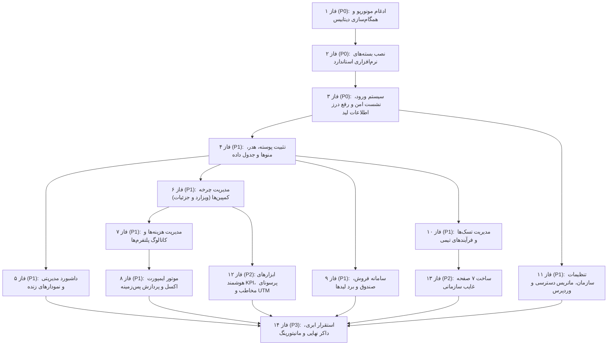

# ۱۰ — نقشه راه جامع تکمیل ۱۰۰٪ محصول (Master Completion Roadmap)
## برنامه اجرایی گام‌به‌گام و وابسته به پیش‌نیازها تا تحویل قطعی و عملیاتی سامانه گپ‌جی

---

## ۱. منطق توالی و اولویت‌بندی فازها

این نقشه راه مهندسی با هدف به صفر رساندن ریسک‌ها و ایجاد کمترین بار کاری مضاعف، بر اساس **وابستگی‌های فنی واقعی (Dependency-Driven)** سازماندهی شده است:
۱. **فازهای اضطراری زیرساخت (P0)**: ابتدا مونورپو و پایگاه داده ادغام شده، پشته فناوری استاندارد تکمیل و امنیت اتصال کاربران برقرار می‌شود.
۲. **فازهای هسته کسب‌وکار (P1)**: داشبورد اجرایی، کمپین‌ها، هزینه‌ها، ایمپورت، لیدها، تسک‌ها و تنظیمات به دیتابیس واقعی متصل می‌گردند.
۳. **فازهای تکمیلی و ابزارهای هوشمند (P2)**: قوانین KPI، مخاطبان، لندینگ‌ها و ۷ صفحه باقی‌مانده سازمانی به طور کامل ساخته می‌شوند.
۴. **فاز سخت‌سازی و استقرار نهایی (P3)**: تست‌های پرفورمنس، استقرار کانتینری داکر و راه‌اندازی خط استقرار خودکار CI/CD.

---

## ۲. مشخصات کامل فازهای ۱۴ گانه نقشه راه

---

### فاز ۱ (P0) — ادغام شاخه‌های مونورپو و همگام‌سازی پایگاه داده
- **شناسه**: `PHASE-001` | **اولویت**: `P0` (بسیار حیاتی / مسدودکننده) | **مدت زمان تخمینی**: ۳ روز کاری
- **هدف اجرایی**: ادغام شاخه بک‌اند (`feature/backend-foundation`) درون شاخه اصلی، استانداردسازی پایگاه داده روی Prisma ORM با ۴۸ جدول رابطه‌ای و اشتراک‌گذاری تایپ‌های TypeScript در پکیج `@gapji/shared`.
- **ارزش تجاری برای کارفرما**: اتصال دو نیمه جدا افتاده پروژه به یکدیگر و از بین بردن خطر توسعه کدهای ناهماهنگ.
- **وضعیت فعلی**: فرانت‌اند در یک شاخه و بک‌اند واقعی در شاخه‌ای دیگر قرار دارد و به هم متصل نیستند.
- **خروجی نهایی**: یک مخزن واحد با قابلیت بیلد همزمان فرانت‌اند و بک‌اند بدون خطا.

---

### فاز ۲ (P0) — تطبیق بسته فناوری فرانت‌اند با سند محصول
- **شناسه**: `PHASE-002` | **اولویت**: `P0` | **مدت زمان تخمینی**: ۴ روز کاری
- **هدف اجرایی**: نصب و پیکربندی کتابخانه‌های الزامی مصرح در سند (TanStack Query، Zod، TanStack Form، Zustand، @dnd-kit و Framer Motion).
- **ارزش تجاری برای کارفرما**: تضمین سرعت بالای بارگذاری صفحات، حذف بارگذاری‌های تکراری، اعتبارسنجی دقیق فرم‌ها و فیزیک استاندارد جابجایی کارت‌ها.
- **وضعیت فعلی**: برنامه‌نویسی فعلی با استیت‌های ساده ری‌اکت و درگ‌وان‌دراپ پیش‌فرض مرورگر انجام شده است.
- **خروجی نهایی**: پیکربندی لایه کشینگ و استورهای نشست و تم در پروژه.

---

### فاز ۳ (P0) — ارتقای سامانه احراز هویت، کوکی امنیتی و رفع باگ لیدها
- **شناسه**: `PHASE-003` | **اولویت**: `P0` | **مدت زمان تخمینی**: ۴ روز کاری
- **هدف اجرایی**: اتصال فرم ورود و انتخاب سازمان به کنترلر واقعی لاگین NestJS، استفاده از کوکی غیرقابل نفوذ HttpOnly، فعال‌سازی میدل‌ور محافظت از صفحات و رفع باگ دسترسی کارشناسان فروش (حل قطعی خطای ITEM-08).
- **ارزش تجاری برای کارفرما**: امنیت کامل سامانه، جلوگیری از هک توکن‌ها، و اطمینان از اینکه کارشناسان فروش فقط و فقط لیدهای اختصاص‌یافته به خود را می‌بینند.
- **وضعیت فعلی**: ورود فعلی با داده‌های فرضی مرورگر کار می‌کند و کارشناس فروش در لایه Mock می‌تواند لیدهای دیگران را ببیند.
- **خروجی نهایی**: قبولی ۱۰۰٪ اسکریپت‌های `test-auth-p0-1.mjs` و `test-permissions-matrix.mjs`.

---

### فاز ۴ (P1) — تثبیت پوسته، هدر سراسری، منوها و جدول داده
- **شناسه**: `PHASE-004` | **اولویت**: `P1` (هسته محصول) | **مدت زمان تخمینی**: ۵ روز کاری
- **هدف اجرایی**: داینامیک‌سازی نام سازمان و منوی تغییر سازمان در هدر، اتصال فیلد جستجوی سراسری، اتصال صفحه‌بندی سمت سرور جدول داده (DataTable) و استانداردسازی تقویم شمسی.
- **ارزش تجاری برای کارفرما**: تجربه کاربری روان، امکان جابجایی آسان میان سازمان‌ها بدون رفرش صفحه، و نمایش سریع جداول با هزاران ردیف اطلاعات.
- **خروجی نهایی**: رفع خطای SCEN-18 در هدر و کارکرد بی‌نقص ابزارهای مشترک.

---

### فاز ۵ (P1) — اتصال کامل داشبورد اجرایی و نمودارهای تحلیلی
- **شناسه**: `PHASE-005` | **اولویت**: `P1` | **مدت زمان تخمینی**: ۴ روز کاری
- **هدف اجرایی**: اتصال صفحه داشبورد (`/performance/dashboard`) به دیتابیس واقعی، رسم نمودارهای روند هزینه و لید با Recharts، پیاده‌سازی قیف ۵ مرحله‌ای و فیلترهای زمانی مقایسه‌ای.
- **ارزش تجاری برای کارفرما**: مشاهده لحظه‌ای وضعیت دخل و خرج مارکتینگ، تعداد لیدهای جذب‌شده، هزینه به ازای هر لید (CPL)، بازگشت سرمایه تبلیغات (ROAS) و استخراج گزارش اکسل و PDF.
- **خروجی نهایی**: قبولی کامل اسکریپت `verify-dashboard.js` بدون حتی یک داده ساختگی.

---

### فاز ۶ (P1) — مدیریت چرخه حیات کمپین‌ها (لیست، ویزارد ۶ مرحله‌ای و جزئیات ۸ تبی)
- **شناسه**: `PHASE-006` | **اولویت**: `P1` | **مدت زمان تخمینی**: ۶ روز کاری
- **هدف اجرایی**: اصلاح اعتبارسنجی ثبت کمپین در بک‌اند، اتصال ویزارد ۶ مرحله‌ای با سهم پلتفرم‌ها و اهداف، محاسبه سلامت کمپین، و اتصال هر ۸ تب صفحه جزئیات به دیتابیس.
- **ارزش تجاری برای کارفرما**: امکان تعریف، برنامه‌ریزی، کنترل هزینه و نظارت بر سلامت کمپین‌های تبلیغاتی با قابلیت ذخیره خودکار هر ۳۰ ثانیه.
- **خروجی نهایی**: قبولی کامل اسکریپت `verify-campaign-creation.js` (۲۲ قبولی از ۲۲ تست).

---

### فاز ۷ (P1) — مدیریت هزینه‌های مارکتینگ و کاتالوگ پلتفرم‌ها
- **شناسه**: `PHASE-007` | **اولویت**: `P1` | **مدت زمان تخمینی**: ۴ روز کاری
- **هدف اجرایی**: اتصال صفحه هزینه‌ها (`/performance/costs`) و پلتفرم‌ها به سرور، پشتیبانی از ثبت سریع هزینه، و امکان کپی/پیست مستقیم ردیف‌های هزینه از اکسل.
- **ارزش تجاری برای کارفرما**: ثبت بدون دردسر هزینه‌های روزانه گوگل‌ادز، اینستاگرام، تپسل و یکتانت با کنترل لحظه‌ای مغایرت بودجه.
- **خروجی نهایی**: به‌روزرسانی آنی مصرف بودجه کمپین بلافاصله پس از ثبت ردیف هزینه.

---

### فاز ۸ (P1) — موتور جامع ایمپورت داده‌ها با صف پردازش پس‌زمینه
- **شناسه**: `PHASE-008` | **اولویت**: `P1` | **مدت زمان تخمینی**: ۵ روز کاری
- **هدف اجرایی**: راه‌اندازی ویزارد ۴ مرحله‌ای ایمپورت فایل‌های اکسل و CSV برای هزینه‌ها، لیدها، پیامک و وبینار به همراه نگاشت ستون‌ها و مدیریت ردیف‌های تکراری با پردازش غیرهمزمان در پس‌زمینه (BullMQ).
- **ارزش تجاری برای کارفرما**: امکان بارگذاری فایل‌های ده‌ها هزار ردیفی لید بدون قفل شدن مرورگر و با دریافت گزارش اکسل از ردیف‌های دارای خطا.
- **خروجی نهایی**: پردازش خودکار فایل‌های حجیم در سرور و اطلاع‌رسانی پایان کار به کاربر.

---

### فاز ۹ (P1) — سامانه جامع فروش و لیدها (صندوق، برد کانبان، خط زمانی، پیامک و وبینار)
- **شناسه**: `PHASE-009` | **اولویت**: `P1` | **مدت زمان تخمینی**: ۶ روز کاری
- **هدف اجرایی**: اتصال کامل صندوق لیدها، ارتقای برد کانبان با `@dnd-kit`، اجباری‌سازی ثبت دلیل رد لید و مبلغ معامله، فرم سریع ثبت مکالمات، تاریخچه زمانی وقایع لید، لاگ پیامک و قیف تبدیل وبینار.
- **ارزش تجاری برای کارفرما**: افزایش نرخ تبدیل لید به مشتری، عدم فراموشی تماس‌های پیگیری، و نظارت کامل بر عملکرد کارشناسان فروش.
- **خروجی نهایی**: چرخه کامل مدیریت مشتری بالقوه از ورود تا خرید نهایی با قبولی تست‌های کانبان.

---

### فاز ۱۰ (P1) — مدیریت وظایف، تسک‌های تیمی و هماهنگی اجرا
- **شناسه**: `PHASE-010` | **اولویت**: `P1` | **مدت زمان تخمینی**: ۴ روز کاری
- **هدف اجرایی**: اتصال صفحه تسک‌ها به دیتابیس با قابلیت فیلتر تسک‌های من/تیم، ورودی تک‌خطی ایجاد سریع تسک، چک‌لیست زیرتسک‌ها، منشن کردن همکاران با @ و برچسب قرمز تاخیر.
- **ارزش تجاری برای کارفرما**: نظم عملیاتی تیم مارکتینگ، پیگیری تعهدات کمپین‌ها و عدم جا افتادن کارهای معوقه.
- **خروجی نهایی**: سیستم مدیریت وظایف چابک متصل به تمام بخش‌های پروژه.

---

### فاز ۱۱ (P1) — تنظیمات سازمان، ماتریس دسترسی‌ها و یکپارچه‌سازی با وردپرس
- **شناسه**: `PHASE-011` | **اولویت**: `P1` | **مدت زمان تخمینی**: ۵ روز کاری
- **هدف اجرایی**: مدیریت کاربران و نقش‌ها، کنترل لیست‌های پایه سازمان، ساخت صفحه اتصال وردپرس (`/settings/wordpress`) و ایجاد درگاه دریافت وب‌هوک از فرم‌های سایت وردپرسی.
- **ارزش تجاری برای کارفرما**: ورود خودکار مشتریانی که در سایت فرم پر می‌کنند به صندوق لیدهای سامانه در همان لحظه.
- **خروجی نهایی**: هدایت خودکار لیدهای سایت وردپرس به پایپ‌لاین فروش بدون نیاز به اکسل دستی.

---

### فاز ۱۲ (P2) — ابزارهای هوشمندی بازاریابی (قوانین KPI، مخاطبان هدف و UTM)
- **شناسه**: `PHASE-012` | **اولویت**: `P2` (پیشرفته) | **مدت زمان تخمینی**: ۵ روز کاری
- **هدف اجرایی**: اتصال پایگاه داده پرسونای مخاطبان، لینک‌ساز زنده UTM با پیش‌نمایش و راهنما، و فرمول‌ساز جمله‌ای هشدارهای هوشمند مارکتینگ.
- **ارزش تجاری برای کارفرما**: هشدار خودکار سیستم به مدیر در صورت افزایش ناگهانی هزینه هر لید یا افت بازدهی تبلیغات.
- **خروجی نهایی**: تولید لینک‌های استاندارد تبلیغاتی و سیستم هوشمند هشدار زودهنگام.

---

### فاز ۱۳ (P2) — ساخت و راه‌اندازی ۷ صفحه غایب سازمانی
- **شناسه**: `PHASE-013` | **اولویت**: `P2` | **مدت زمان تخمینی**: ۸ روز کاری
- **هدف اجرایی**: طراحی و پیاده‌سازی کامل ۷ صفحه باقیمانده شامل تقویم مارکتینگ (`/calendar`)، لجستیک تجهیزات استودیو (`/equipment`)، صورتجلسات با ارسال ایمیل (`/meetings`)، رویه‌های کاری با حالت پرینت (`/sops`)، آموزش تیم با پلیر ویدیو (`/learning`)، تابلوی ایده‌ها با رای‌دهی (`/ideas`) و گزارش شفاف فعالیت‌های پرسنل (`/activity`).
- **ارزش تجاری برای کارفرما**: تحقق ۱۰۰٪ تعهدات سند پی‌دی‌اف و در اختیار داشتن یک سیستم عامل جامع برای مدیریت کل آژانس دیجیتال مارکتینگ.
- **خروجی نهایی**: رسیدن تعداد صفحات فعال به ۲۹ از ۲۹ صفحه (پوشش ۱۰۰٪ سند محصول).

---

### فاز ۱۴ (P3) — بهینه‌سازی، استقرار ابری داکر و راه‌اندازی مانیتورینگ پروداکشن
- **شناسه**: `PHASE-014` | **اولویت**: `P3` (استقرار نهایی) | **مدت زمان تخمینی**: ۵ روز کاری
- **هدف اجرایی**: نگارش Dockerfileهای چندمرحله‌ای بهینه‌شده، پیکربندی Nginx و کش ردیس، راه‌اندازی لاگ ساختاریافته Pino، ثبت خطاهای کلاینت در Sentry و پایپ‌لاین خودکار GitHub Actions.
- **ارزش تجاری برای کارفرما**: اجرای پرسرعت، پایداری ۲۴ ساعته در برابر قطعی، پشتیبان‌گیری خودکار روزانه و استقرار سامانه با یک دستور روی سرور نهایی.
- **خروجی نهایی**: تحویل نهایی سامانه عملیاتی در محیط Production با تایید چک‌لیست نهایی.
