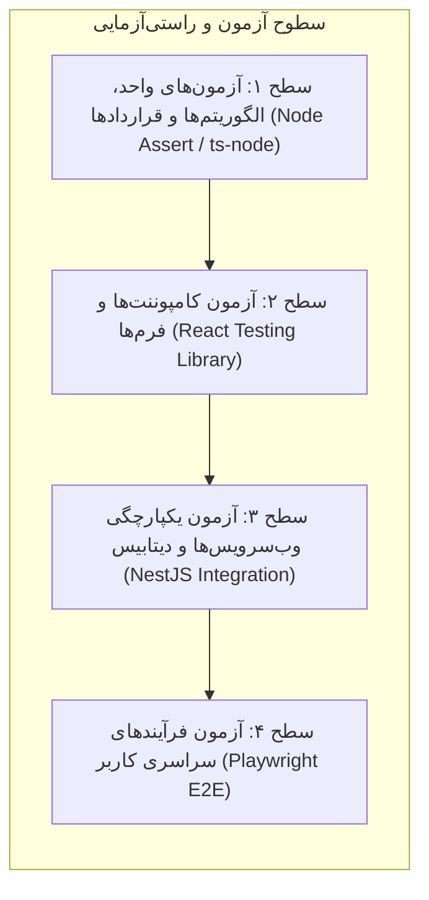
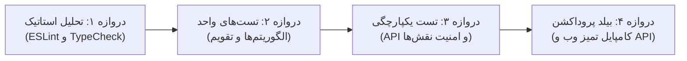

# ۱۱ — استراتژی آزمون و معیارهای پذیرش کیفی
## پلتفرم کنترل فرآیندهای دیجیتال مارکتینگ و مدیریت کمپین گپجی

---

## ۱. سطوح آزمون و استراتژی هرم آزمون (Testing Pyramid)

استراتژی ارزیابی کیفی پلتفرم گپجی بر اساس الگوی استاندارد هرم آزمون تدوین شده است تا با تکیه بر تست‌های سریع و ایزوله در لایه‌های پایین، پایداری برنامه در برابر تغییرات تضمین گردد:



---

## ۲. جدول سطوح آزمون و ابزارهای مرتبط

| سطح آزمون | ابزار اصلی | محدوده ارزیابی | محیط اجرا | شرایط قبولی در گیت |
| :--- | :--- | :--- | :--- | :--- |
| **سطح ۱: آزمون واحد** | `ts-node`, `node:assert`, Jest | الگوریتم تقویم شمسی، اعتبارسنجی ارقام، DTOها، توابع فرمول | رم کلاینت (بدون نیاز به دیتابیس) | **الزامی در هر کامیت** (قبولی ۱۰۰٪) |
| **سطح ۲: آزمون کامپوننت** | React Testing Library | اجزای مشترک جدول، نوار فیلتر، کارت شاخص، ویزارد | محیط شبیه‌ساز DOM | **الزامی در پول‌ریکوئست** |
| **سطح ۳: آزمون وب‌سرویس** | NestJS Testing, Supertest | صحت روتینگ کنترلرها، فیلتر خطاها، تراکنش‌های پریزما | دیتابیس تستی ایزوله | **الزامی در پول‌ریکوئست** |
| **سطح ۴: آزمون امنیت** | اسکریپت‌های راستی‌آزمایی | جداسازی داده لیدها، عدم امکان جهش توسط کارفرما | پایگاه داده قرنطینه | **الزامی پیش از ریلیز فاز** |
| **سطح ۵: آزمون سراسری** | Playwright | جریان ورود تا ثبت کمپین و تغییر وضعیت لید در کانبان | مرورگر کرومیوم هدلس | **الزامی پیش از تحویل نهایی** |

---

## ۳. دستورالعمل اجرای تست‌های خودکار بدون ریسک

اسکریپت‌های زیر بدون نیاز به تغییر در دیتابیس یا ریپازیتوری، در حافظه اجرا شده و صحت سیستم را می‌سنجند:

```bash
# ۱. آزمون جامع موتور تقویم و سال‌های کبیسه شمسی (۱۱٬۳۲۳ روز)
node apps/web/scripts/test-persian-date.mjs

# ۲. آزمون ماتریس نقش‌ها و ۱۸ تصمیم کلیدی محصول
node apps/web/scripts/test-permissions-matrix.mjs

# ۳. آزمون جداسازی حریم خصوصی لیدهای کارشناس فروش
node apps/web/scripts/test-permissions-hardening-gap01-gap03.mjs

# ۴. آزمون ناوبری، تم لایت و سیستم طراحی کامپوننت‌ها
node apps/web/scripts/test-sidebar-darkmode-shadcn-iransans.mjs

# ۵. آزمون پایداری فیلترها و هماهنگی با پارامترهای آدرس مرورگر
node apps/web/scripts/test-filter-service.mjs

# ۶. آزمون مرتب‌سازی، صفحه‌بندی سرور و حالت‌های جدول داده
node apps/web/scripts/test-data-table.mjs

# ۷. آزمون‌های واحد بک‌اند سرویس کمپین‌ها
pnpm --filter @gapji/api test
```

---

## ۴. ایزوله‌سازی پایگاه داده در آزمون‌های یکپارچگی

به منظور اجرای ایمن ۲۱ فایل تست اینتگریشن بک‌اند (`*.integration.spec.ts`) بدون آسیب به داده‌های اصلی:
1. آزمون‌ها صرفاً باید به دیتابیس اختصاصی تست (`gapji_marketing_test`) متصل شوند.
2. قبل از شروع آزمون، پایگاه داده با دستور `prisma migrate reset --force` خالی و سپس بذر داده‌ها (`seed.ts`) کاشته می‌شود.
3. در پایان هر آزمون، کلیه تراکنش‌ها با دستور `ROLLBACK` بازگردانده می‌شوند.

---

## ۵. دروازه‌های کیفی پایپ‌لاین CI/CD



ورود هرگونه کد جدید به شاخه اصلی منوط به عبور خودکار و بدون هشدار از هر ۴ دروازه کیفی فوق خواهد بود.
