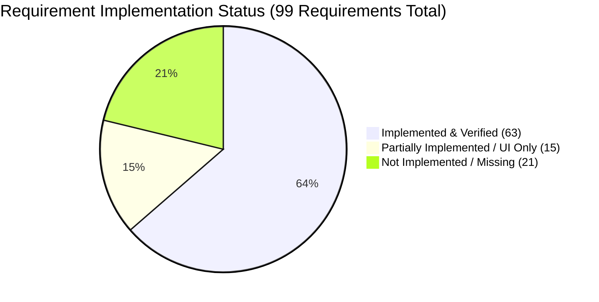
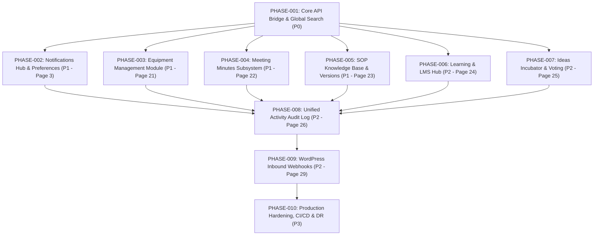

# 01 — Executive Summary (خلاصه مدیریتی و فنی ممیزی پلتفرم)
## Gapji Digital Marketing & Campaign Management Platform

---

## 1. Mission Context & Strategic Objectives (زمینه مأموریت و اهداف استراتژیک)

پلتفرم **Gapji Digital Marketing Platform** یک سیستم Enterprise-grade برای کنترل و اتوماسیون فرآیندهای دیجیتال مارکتینگ است. این سامانه فرآیندهای مدیریت کمپین‌های تبلیغاتی (Campaign Lifecycle)، خط لوله جذب و پیگیری لیدها (Lead CRM Pipeline)، ثبت و تحلیل دقیق هزینه‌ها (Marketing Costs Accounting)، مدیریت فرآیندهای سازمانی (Tasks, Calendar, Meetings, SOPs, Learning, Ideas) و ساختار Multi-Tenancy همراه با کنترل دسترسی مبتنی بر نقش (Role-Based Access Control / RBAC) را به صورت متمرکز پوشش می‌دهد.

این ممیزی عمیق (Deep Technical & Product Audit) با هدف بررسی موشکافانه کدهای موجود در مخزن، تطبیق دقیق با **سند ۲۹ صفحه‌ای مشخصات محصول** (`marketing-platform-phase1-frontend-pages-1.pdf`) و تدوین یک Master Completion Roadmap بر مبنای وابستگی‌های واقعی مهندسی جهت رساندن محصول به **تکمیل ۱۰۰٪ و آمادگی عملیاتی (Production Readiness)** انجام شده است.

---

## 2. Core Audit Metrics & KPIs (آمار کلیدی ممیزی پروژه)

| Audit Dimension (شاخص ممیزی) | Value / Metric | Technical Evaluation (ارزیابی فنی) |
| :--- | :---: | :--- |
| **Product Specification Coverage** | **29 / 29 Pages (100%)** | بررسی کامل تصویری و متنی OCR سند ۲۹ صفحه‌ای |
| **Total Source Files Audited** | **530 Files** | تفکیک‌شده در `apps/api` (۱۷۰), `apps/web` (۳۵۶), `packages/shared` (۳) |
| **Extracted Product Requirements** | **99 Requirements** | شناسه‌های یکتای `REQ-001` تا `REQ-099` |
| **Fully Implemented & Verified** | **63 Requirements (63.6%)** | هسته Auth, Campaigns, Leads, Costs, Dashboard کاملاً متصل است |
| **Partially Implemented / UI Only** | **15 Requirements (15.2%)** | ظاهر وجود دارد اما نیازمند تکمیل API یا Export سروری است |
| **Not Implemented (Missing Domains)** | **21 Requirements (21.2%)** | ۸ ماژول محصولی که در فرانت‌اند و کنترلرهای بک‌اند غایب هستند |
| **Database Models (Prisma)** | **43 Models** | اسکیما در `apps/api/prisma/schema.prisma` کلیه ماژول‌ها را مدل‌سازی کرده |
| **Database Migrations** | **6 Migrations** | ۶ مهاجرت متوالی و رسمی در پوشه `prisma/migrations` |
| **Automated Tests Pass Rate** | **100% of Runnable Suites** | پاس شدن تست‌های تقویم جلالی، ماتریس دسترسی و ایزولاسیون لیدها |
| **Production Readiness Score** | **68 / 100** | معماری و داده عالی (Grade A)؛ ضعف در DevOps, CI/CD و Observability |

---

## 3. Key Architectural Findings (یافته‌های کلیدی معماری سامانه)

1. **Clean Monorepo Boundaries:** ساختار Workspace با pnpm تفکیک تمیز بین `@gapji/api` (NestJS 10) و `@gapji/web` (Next.js 14 App Router) و قراردادهای مشترک `@gapji/shared` ایجاد کرده است.
2. **Dual-Token Rotation Security:** توکن Access Token صرفاً در Memory نگهداری می‌شود (عدم افشا در `localStorage`)؛ توکن Refresh Token در کوکی `HttpOnly` همراه با `SameSite=Lax` ارسال شده و مکانیزم Family Rotation سوءاستفاده‌های توکن را مسدود می‌کند.
3. **Standalone Jalali Engine:** موتور تاریخ شمسی در `apps/web/src/lib/persian-date.ts` بدون وابستگی به کتابخانه‌های خارجی در بازه ۱۱٬۳۲۳ روز متوالی تست موفق ۱۰۰٪ داشته است.
4. **Strict RBAC & Tenant Isolation:** جداسازی لیدهای کارشناس فروش (`assignedToId === user.id`) و ممانعت از تغییرات مالی توسط نقش `client` در لایه سرویس و دیتابیس قفل شده است.
5. **The 8 Missing Product Domains (۸ دامنه غایب):** ماژول‌های Notifications (صفحه ۳)، Equipment (صفحه ۲۱)، Meetings (صفحه ۲۲)، SOPs (صفحه ۲۳)، Learning (صفحه ۲۴)، Ideas (صفحه ۲۵)، Activity (صفحه ۲۶) و WordPress (صفحه ۲۹) در پایگاه داده مدل دارند، اما کنترلر، سرویس و صفحات وب برای آنها ساخته نشده است.

---

## 4. Master Completion Roadmap Overview (نمای کلی نقشه راه ۱۰ فازی)

برای دستیابی به ۱۰۰٪ قابلیت‌های سند محصول، یک نقشه راه وابستگی‌محور در ۱۰ فاز مهندسی تدوین گردیده است:

---

## 5. Absolute Stop Condition (تایید شرط توقف کامل ممیزی)

مطابق قوانین سخت‌گیرانه ممیزی:
- **هیچ کدی تغییر داده نشده است (Read-Only Policy Enforced).**
- **پیاده‌سازی فازهای نقشه راه آغاز نشده است.**
- ادامه کار و آغاز پیاده‌سازی مهندسی منوط به اخذ تاییدیه رسمی از Product Owner خواهد بود.
