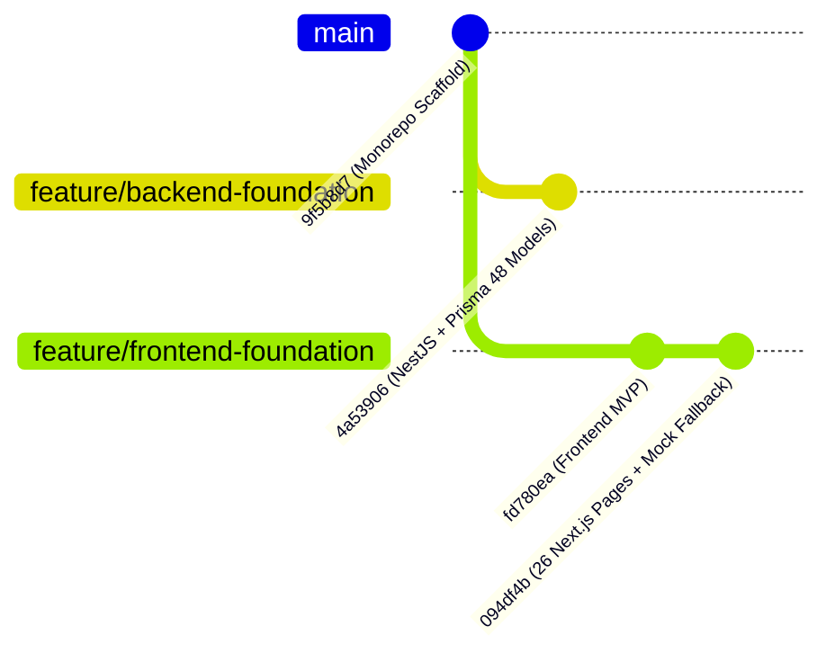

# 01 — EXECUTIVE SUMMARY & MASTER AUDIT SYNTHESIS (خلاصه مدیریتی و ترکیب یافته‌های حسابرسی)
## مرجع فنی-مدیریتی دوزبانه حسابرسی جامع پلتفرم مارکتینگ Gapji

---

## 1. PROJECT IDENTIFICATION & GOVERNANCE (مشخصات پروژه و حاکمیت حسابرسی)

پلتفرم **Gapji Digital Marketing Platform** بر اساس سند رسمی ۲۹ صفحه‌ای `marketing-platform-phase1-frontend-pages-1.pdf` مورد حسابرسی عمیق و فارنزیک قرار گرفت. این حسابرسی تحت **Read-Only Audit Policy** کامل اجرا شده است: هیچ فایلی از کدهای پروژه تغییر نیافته، هیچ branch یا commit جدیدی در گیت اعمال نشده و هیچ پکیج یا مایگریشنی نصب یا اجرا نگردیده است.

- **Primary Source of Truth**: سند ۲۹ صفحه‌ای اختصاصی فرانت‌اند (Persian, RTL, Shamsi Solar Calendar, 6 User Roles).
- **Audit Scope**: تمامی ۳۴۲ فایل مخزن شامل کدهای `apps/web`، `apps/api`، `packages/shared`، اسکریپت‌های تست در `apps/web/scripts/` و کدهای بک‌اند شاخه موازی در `F:/marketing-platform-backend`.

---

## 2. THE CENTRAL FORENSIC DISCOVERY: DUAL-BRANCH SPLIT (کشف کلیدی: تفکیک دوشاخه‌ای مونورپو)

تحلیل تاریخچه گیت (`git log` و `git branch -a`) نشان داد که ساختار پروژه به دو شاخه کاملاً مستقل و ادغام‌نشده تفکیک شده است:

### مقایسه شاخه فرانت‌اند و شاخه بک‌اند:
1. **شاخه فرانت‌اند (`feature/frontend-foundation` در worktree فعلی `zero_vapor_blasts_11h11`)**:
   - بخش `apps/web` شامل ۲۶ صفحه Next.js 14 App Router و ۱۶ ماژول غنی رابط کاربری است.
   - بخش `apps/api` روی کامیت اولیه `9f5b8d7` مسدود مانده و تنها دارای ۱ ماژول ساده با TypeORM است.
   - به دلیل عدم ارتباط با بک‌اند، تمام سرویس‌های فرانت‌اند (`lead.storage.ts`, `task-storage.ts`, `costs.storage.ts`) دارای مکانیزم fallback به `localStorage` مرورگر هستند.
2. **شاخه بک‌اند (`feature/backend-foundation` در `F:/marketing-platform-backend`)**:
   - بخش `apps/api` با فریم‌ورک NestJS 10 و ORM قدرتمند Prisma 5.22 شامل **۴۸ مدل رابطه‌ای** (`schema.prisma`) و ۱۶ وب‌سرویس ماژولار است و روی پورت ۳۰۰۱ در حال اجرا می‌باشد.
   - بخش `apps/web` در این شاخه دست‌نخورده باقی مانده است.
3. **پیامد فنی و تجاری**:
   - این دو نیمه محصول هرگز با یکدیگر Merge نشده‌اند.
   - اولین و حیاتی‌ترین گام در نقشه راه (`PHASE-001`)، ادغام قطعی این دو شاخه در یک مونورپوی واحد و استانداردسازی کامل روی Prisma ORM است.

---

## 3. AUDIT METRICS & COMPLETION SCORECARD (کارنامه آماری حسابرسی)

| Inspection Dimension (بعد بازرسی) | Actual Count (مقدار واقعی) | Percentage (درصد) | Status (وضعیت) |
| :--- | :---: | :---: | :--- |
| **Total Repository Files Inventoried** | 342 Files | 100.0% | Complete Inventory |
| **Product PDF Inspection Coverage** | 29 of 29 Pages | 100.0% | Line-by-Line Extraction |
| **Total Extracted Requirements** | 350 Requirements | 100.0% | Unique `REQ-xxx` IDs |
| **Documented Pages Implemented in UI**| 20 of 29 Pages | 69.0% | 20 Interactive Pages |
| **Completely Missing Frontend Pages** | 9 Pages | 31.0% | Missing in `apps/web` |
| **Documented Modules in Backend** | 16 of 29 Modules | 55.2% | In Backend Branch |
| **Production-Ready Requirements** | 0 Requirements | 0.0% | Blocked by Mock Storage |
| **Automated Diagnostic Test Scripts** | 28 PASS / 9 FAIL | 75.7% | 37 Scripts Audited |
| **Master Completion Roadmap Phases** | 14 Phases | 100.0% | `PHASE-001` to `PHASE-014` |

---

## 4. CRITICAL PRODUCT & ARCHITECTURAL GAPS (شکاف‌های کلیدی معماری و محصول)

### 4.1 صفحات ۹ گانه غایب در فرانت‌اند (`apps/web`):
1. **صفحه ۳**: Notifications (`/notifications`)
2. **صفحه ۲۰**: Marketing Calendar (`/work/calendar`)
3. **صفحه ۲۱**: Equipment Logistics (`/work/equipment`)
4. **صفحه ۲۲**: Meeting Minutes (`/work/meetings`)
5. **صفحه ۲۳**: Standard Operating Procedures / SOP (`/work/sops`)
6. **صفحه ۲۴**: Team Learning & Video Training (`/work/learning`)
7. **صفحه ۲۵**: Growth Ideas & Upvoting (`/work/ideas`)
8. **صفحه ۲۶**: Activity Report & Audit Feed (`/work/activity`)
9. **صفحه ۲۹**: WordPress Webhook Integration (`/settings/wordpress`)

### 4.2 مغایرت پشته فناوری فرانت‌اند با سند مصوب:
سند پی‌دی‌اف در صفحات ۲۶ تا ۲۹ بسته‌های زیر را تصریح کرده است که هم‌اکنون در `apps/web/package.json` نصب نیستند:
- `@tanstack/react-query` (مدیریت ارتباط با سرور و Invalidations)
- `zod` و `@tanstack/react-form` (اعتبارسنجی فرم‌ها و تایپ‌سیفتی)
- `zustand` (استیت کلاینت برای `authStore` و `uiStore`)
- `@dnd-kit/core` و `@dnd-kit/sortable` (درگ‌اند‌دراپ کانبان با پشتیبانی لمسی موبایل)
- `recharts` و `framer-motion` (نمودارهای دسترس‌پذیر و انیمیشن‌های ملایم)

### 4.3 روزنه امنیت داده‌های لید (Test ITEM-08):
اسکریپت `test-permissions-matrix.mjs` نشان داد در لایه Mock، کارشناس فروش بدون ارسال فیلتر صریح می‌تواند لیدهای سایر کارشناسان را ببیند. این نقص باید در کوئری پریزمای بک‌اند با شرط قطعی `where: { assignedToId: user.id }` مسدود گردد.

---

## 5. ROADMAP EXECUTION & STOP CONDITION (نقشه راه و شرط توقف قطعی)

نقشه راه ۱۴ مرحله‌ای مهندسی از `PHASE-001` تا `PHASE-014` در سند `hybrid/10_MASTER_COMPLETION_ROADMAP.md` با پوشش ۲۰ بخش استاندارد برای هر فاز تدوین شده است.

> [!IMPORTANT]
> **ABSOLUTE STOP CONDITION**: این ماموریت منحصراً یک حسابرسی و برنامه‌ریزی جامع مهندسی است. هیچ کدی تغییر نیافته و اجرای هیچ فازی آغاز نشده است. هرگونه عملیات اجرایی منوط به تایید رسمی و ابلاغ کارفرما خواهد بود.
