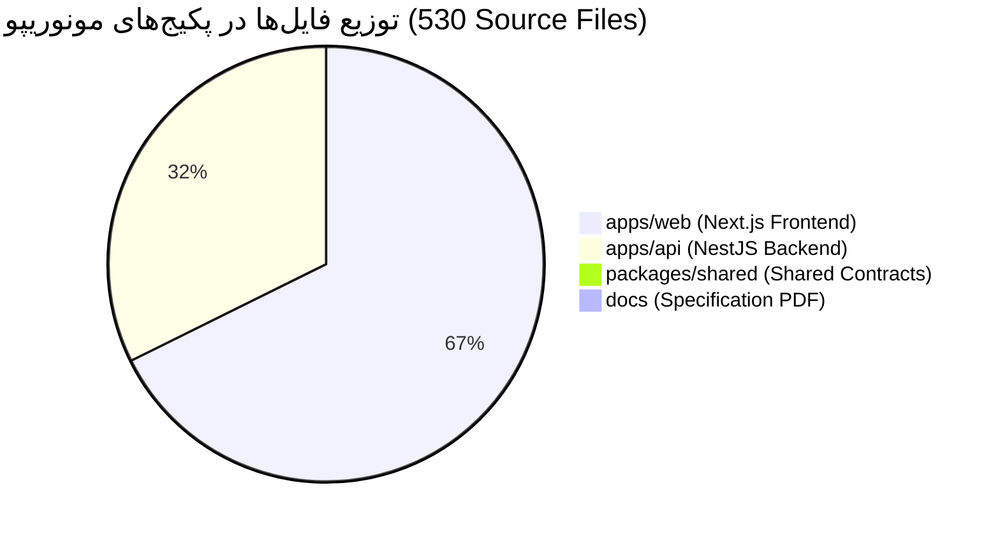

# 02 — Repository Inventory (فهرست کامل فایل‌ها و ساختار مخزن کد)
## Gapji Digital Marketing Platform Deep Audit

---

## 1. Physical Workspace File Statistics (آمار فایل‌های فیزیکی مخزن)

مخزن `marketing-platform-backend` به عنوان یک pnpm monorepo پیکربندی شده و شامل **۵۳۰ فایل سورس فعال** (بدون احتساب پوشه‌های بیلد و کش نظیر `node_modules`, `.next`, `dist`) است:

### 1.1 Breakdown by File Extension (تفکیک فایل‌ها بر اساس پسوند)

| Extension | Count | Category / Description (کاربرد و دسته‌بندی فنی) | Audit Status |
| :--- | :---: | :--- | :---: |
| `.ts` | **۲۷۵** | TypeScript Backend modules, services, DTOs, tests, types | Verified (تایید شده) |
| `.tsx` | **۱۸۶** | React components, Next.js App Router pages, layout views | Verified (تایید شده) |
| `.mjs` | **۳۴** | Standalone Node.js verification scripts (تست‌های مستقل ممیزی) | Verified (تایید شده) |
| `.json` | **۱۰** | Package manifests, tsconfig, shadcn component configurations | Verified (تایید شده) |
| `.woff2` | **۱۰** | Vazirmatn Persian local web fonts (Light to Black, Variable) | Verified (تایید شده) |
| `.js` | **۶** | Tailwind, Next.js configs and verification runners | Verified (تایید شده) |
| `.sql` | **۶** | Prisma PostgreSQL DDL migration files (`prisma/migrations`) | Verified (تایید شده) |
| `.yaml` / `.yml` | **۳** | `pnpm-workspace.yaml`, `docker-compose.yml`, `pnpm-lock.yaml` | Verified (تایید شده) |
| `.env` / `.example` | **۳** | Environment variable templates and configurations (Secrets safe) | Verified (تایید شده) |
| `.prisma` | **۱** | Canonical database relational schema (`schema.prisma`) | Verified (تایید شده) |
| `.pdf` | **۱** | Official Product Specification Document (سند محصول ۲۹ صفحه‌ای) | Verified (تایید شده) |
| `.css` | **۱** | Global stylesheet with semantic CSS design tokens (`globals.css`) | Verified (تایید شده) |

---

## 2. Directory Structure Catalog (راهنمای پوشه‌های پروژه و محدوده بازبینی)

| Directory Path (مسیر پوشه) | Functional Scope (دامنه کارکردی) | Category | Product Relevance | Audit Scope |
| :--- | :--- | :--- | :---: | :---: |
| `apps/api/src/common` | Guards, filters, interceptors | Security & Infrastructure | Critical | Checked |
| `apps/api/src/config` | Configuration service & Joi env validation | Infrastructure | High | Checked |
| `apps/api/src/database` | `PrismaService` & exception filters | Data Access Layer | Critical | Checked |
| `apps/api/src/modules/auth` | JWT, session management, Argon2, token rotation | Auth & Sessions | Critical | Checked |
| `apps/api/src/modules/campaigns` | Campaign lifecycle, budget allocation, stats | Marketing Engine | Critical | Checked |
| `apps/api/src/modules/costs` | Cost tracking, category analytics, batch costs | Financial Data | Critical | Checked |
| `apps/api/src/modules/dashboard` | Executive KPIs, trend charts, conversion funnel | Analytics | Critical | Checked |
| `apps/api/src/modules/leads` | Leads inbox, CRM pipelines, call logs, timeline | Sales CRM | Critical | Checked |
| `apps/api/src/modules/users` | User management, invitations, RBAC policies | Governance | Critical | Checked |
| `apps/api/src/modules/organization`| Multi-tenancy, currencies, taxonomies | Core Governance | Critical | Checked |
| `apps/api/prisma` | Schema definition, migrations, seed scripts | Database Layer | Critical | Checked |
| `apps/web/src/app/(auth)` | Public routes (`/login`, `/select-org`) | Frontend Routing | High | Checked |
| `apps/web/src/app/(app)` | Protected application routes (18 active views) | Frontend Routing | Critical | Checked |
| `apps/web/src/components/common` | Shared UI primitives (DataTable, FilterBar, KpiCard) | UI System | Critical | Checked |
| `apps/web/src/components/layout` | Shell, Header, Sidebar, Breadcrumb, Toast | UX & Layout | Critical | Checked |
| `apps/web/src/features/*` | Feature-sliced business components & API clients | Domain Features | Critical | Checked |
| `apps/web/src/lib` | Jalali engine (`persian-date.ts`), Axios `api.ts` | Utilities & Client | Critical | Checked |
| `apps/web/src/stores` | Zustand stores (`auth-store.ts`, `ui-store.ts`) | Client State | High | Checked |
| `packages/shared` | Cross-package DTOs, interfaces, and enums | Shared Contracts | Critical | Checked |
| `docs` | Product specification document (`marketing-platform...pdf`) | Product Specs | Critical | Checked |
