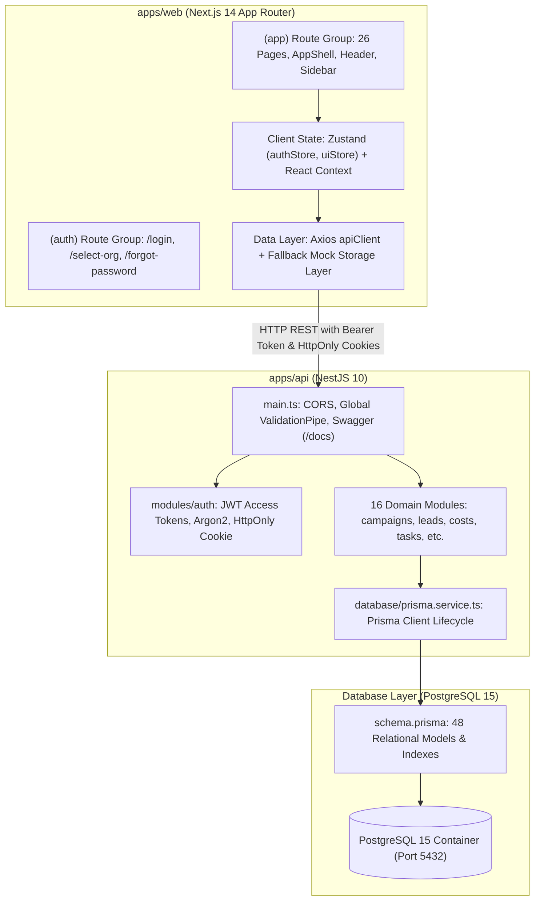
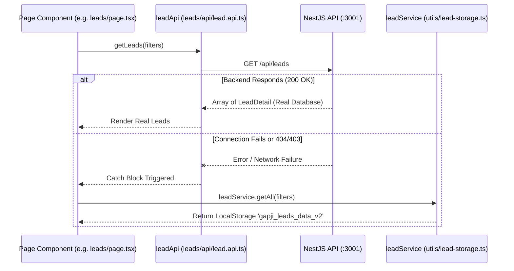

# 03 — SYSTEM ARCHITECTURE & DATA FLOW (معماری سامانه و جریان داده‌ها)
## مستندات جامع معماری، توپولوژی روتینگ، پایگاه داده و تعاملات کلاینت-سرور

---

## 1. HIGH-LEVEL TOPOLOGY & MONOREPO ARCHITECTURE (معماری کلان مونورپو)

معماری سامانه Gapji بر مبنای ساختار **pnpm Monorepo** طراحی شده است:

---

## 2. THE DUAL-LAYER STORAGE FALLBACK MECHANISM (مکانیزم دولایه‌ای ذخیره‌سازی داده)

به دلیل تفکیک دو شاخه در گیت، در حال حاضر فایل‌های `api.ts` در فرانت‌اند الگوی زیر را اجرا می‌کنند:

> [!WARNING]
> الگوی فوق صرفاً برای فاز توسعه رابط کاربری (Demo/Development) مناسب بوده و برای محیط پروداکشن به طور کامل منسوخ خواهد شد. در فاز ۲ و فازهای بعدی، تمامی فراخوانی‌ها از طریق `useQuery` و `useMutation` مستقیماً به سرور PostgreSQL متصل خواهند شد.

---

## 3. RBAC SECURITY & ROLE CAPABILITY MATRIX (ماتریس سطوح دسترسی ۶ نقش)

مدیریت دسترسی‌ها بر اساس `apps/web/src/lib/permissions.ts` و نقش‌های سازمانی پیاده‌سازی شده است:

| User Role (نقش کاربری) | Persian Title (عنوان فارسی) | Accessible Routes (مسیرهای مجاز) | Key Restrictions (محدودیت‌های کلیدی) |
| :--- | :--- | :--- | :--- |
| `admin` | مدیر ارشد سازمانی | تمامی ۲۹ صفحه و تنظیمات | الزام به حفظ حداقل ۱ ادمین فعال |
| `marketing_manager` | مدیر مارکتینگ | تمام بخش‌ها به جز تغییر ساختار ادمین | دسترسی کامل به بودجه و تایید مصوبات |
| `campaign_manager` | کمپین‌چی | کمپین‌ها، هزینه‌ها، ایمپورت، تسک‌ها | عدم دسترسی به تنظیمات کاربران و سازمان |
| `sales_agent` | کارشناس فروش | صندوق لیدها، برد کانبان، جزئیات لید | دسترسی **فقط به لیدهای اختصاص‌یافته به خود** |
| `content_creator` | مسئول محتوا و وبینار | وبینارها، تجهیزات، تسک‌ها، تقویم | عدم دسترسی به بخش‌های مالی و فروش |
| `client` | کارفرما / مشتری | صفحه خانه، داشبورد، خلاصه کمپین‌ها | دسترسی **فقط-خواندنی (Read-Only)** |

---

## 4. DATABASE ARCHITECTURE: 48 PRISMA RELATIONAL MODELS (مدل‌های ۴۸ گانه پایگاه داده)

فایل `apps/api/prisma/schema.prisma` در شاخه بک‌اند شامل ۴۸ مدل پایگاه داده است:
1. **سازمان و امنیت**: `User`, `Organization`, `OrganizationMembership`, `Session`, `RefreshToken`, `OrganizationTaxonomy`, `NotificationPreference`.
2. **کمپین و کانال‌ها**: `Campaign`, `Platform`, `CampaignPlatformAllocation`, `TargetAudience`, `CampaignAudience`, `LandingPage`, `UtmLink`.
3. **هزینه‌ها**: `CostCategory`, `Cost`.
4. **لید و پایپ‌لاین**: `LeadStatusConfig`, `Lead`, `LeadActivity`, `LeadCall`.
5. **رویداد و پیامک**: `SmsCampaign`, `SmsRecipient`, `Webinar`, `WebinarAttendee`.
6. **وظایف و هماهنگی**: `Task`, `TaskSubtask`, `TaskComment`, `CalendarEvent`, `EquipmentItem`, `EquipmentTemplate`, `EquipmentTemplateItem`, `EventEquipment`.
7. **دانش و آموزش**: `Meeting`, `MeetingActionItem`, `Sop`, `SopVersion`, `LearningResource`, `UserLearningProgress`, `Idea`, `IdeaVote`.
8. **هوشمندی و مانیتورینگ**: `KpiMetric`, `CustomMetric`, `KpiAlertRule`, `ImportJob`, `Notification`, `UserActivityLog`.
9. **یکپارچه‌سازی**: `WordpressIntegration`, `WordpressWebhookLog`.
