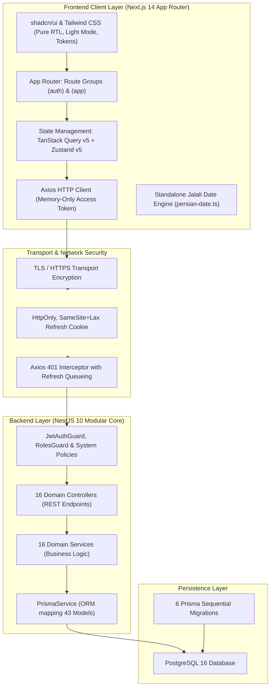
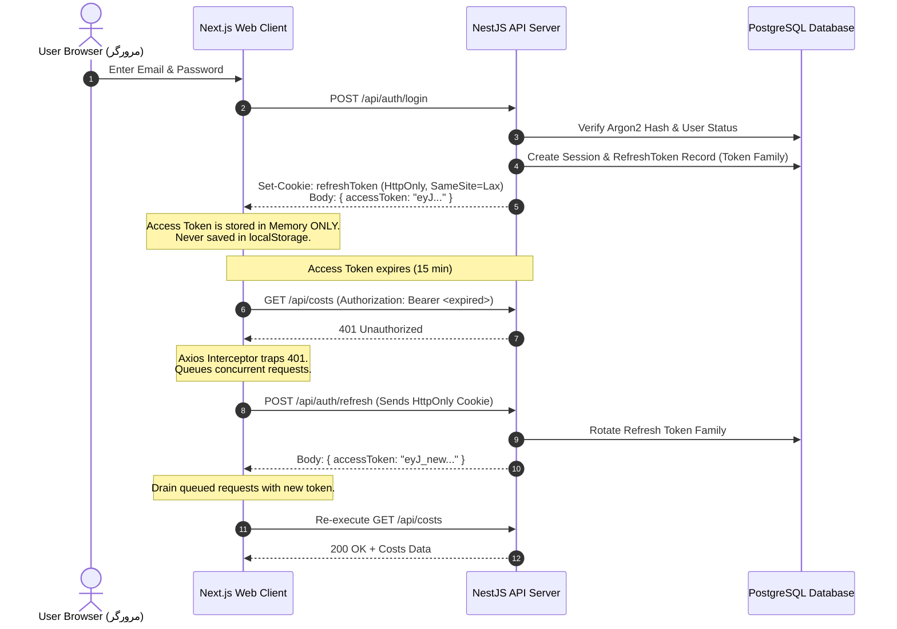

# 03 — Architecture Documentation (مستندات معماری و لایه‌های فنی پلتفرم)
## Gapji Digital Marketing Platform Deep Audit

---

## 1. High-Level Architecture (معماری کلان سیستم)

سامانه Gapji Digital Marketing Platform به صورت یک **Full-Stack Monorepo** بر پایه تفکیک لایه‌های ارائه (Presentation)، پردازش بیزنس (Business Logic) و ذخیره‌سازی داده‌ها (Data Layer) توسعه یافته است:

---

## 2. Monorepo Package Boundaries (مرزهای بسته‌ها و استقلال لایه‌ها)

1. **`packages/shared`:** مخزن قراردادهای مشترک (Shared Contracts). تعاریف DTO، اینام‌ها (`UserRole`, `LeadStatus`, `CampaignStatus`) و اینترفیس‌ها را بین کلاینت و سرور همگام نگه می‌دارد.
2. **`apps/api`:** بک‌اند کاملاً مستقل با فریم‌ورک NestJS. بدون کوچک‌ترین وابستگی به کدهای مرورگر یا Next.js.
3. **`apps/web`:** فرانت‌اند ترکیبی SSR/Client با فریم‌ورک Next.js 14 App Router که صرفاً از طریق فراخوانی متدهای Axios کلاینت با API ارتباط می‌گیرد.

---

## 3. Backend Architecture (معماری بک‌اند NestJS)

- **Configuration:** با استفاده از `@nestjs/config` متغیرهای محیطی لود شده و صحت مقادیر توسط Joi schema (`apps/api/src/config/env.validation.ts`) بررسی می‌شود.
- **Data Access & Prisma:** پایگاه داده PostgreSQL توسط `PrismaService` مدیریت می‌شود. خطاهای پایگاه داده از طریق `PrismaClientExceptionFilter` هندل شده و کدهای خطای دیتابیس (نظیر خطای `P2003` برای حذف رکوردهای وابسته) به پیام‌های خطای استاندارد HTTP تبدیل می‌شوند.
- **Domain Modules:** ۱۶ ماژول کاربردی فعال: `auth`, `campaigns`, `costs`, `dashboard`, `leads`, `tasks`, `calendar`, `webinars`, `sms`, `audiences`, `landing`, `platforms`, `imports`, `kpis`, `users`, `organization`.

---

## 4. Frontend Architecture (معماری فرانت‌اند Next.js)

### 4.1 Routing & Layout (ساختار مسیرها و چیدمان)
- **`(auth)` Route Group:** مسیرهای عمومی لاگین (`/login`)، فراموشی رمز (`/forgot-password`) و انتخاب سازمان (`/select-org`).
- **`(app)` Route Group:** کلیه مسیرهای حفاظت‌شده نرم‌افزار. توسط `middleware.ts` بررسی نشست و نقش انجام می‌شود.
- **Universal 3 States:** تمام صفحات ملزم به پیاده‌سازی ۳ وضعیت هستند: Skeleton Loading، Empty State همراه با Action Button، و Error State همراه با Retry Button.

### 4.2 State Management Strategy (استراتژی مدیریت وضعیت)
- **Server State:** مدیریت کوئری‌ها، کش و همگام‌سازی داده‌های سرور توسط `TanStack Query v5` با کلیدهای کوئری یکتا (`['campaigns', 'list', filters]`).
- **Client State:** وضعیت‌های صرفاً کلاینتی (منوی باز/بسته، حالت فشرده جدول، تب انتخابی) توسط `Zustand` ذخیره شده و با localStorage هماهنگ است.

---

## 5. Security & Session Management (امنیت نشست‌ها و احراز هویت)

---

## 6. Granular RBAC & System Policies (کنترل دسترسی و سیاست‌های سیستم)

پلتفرم ۶ نقش مصوب را در سطح سازمان اعمال می‌کند:
1. `admin`: مدیر ارشد سازمان با اختیارات کامل راهبری.
2. `marketing_manager`: مدیر مارکتینگ با دسترسی کامل به کمپین‌ها، هزینه‌ها و تیم.
3. `campaign_manager`: کارشناس کمپین برای ساخت و اجرای کمپین‌ها.
4. `sales_agent`: کارشناس فروش با دسترسی منحصراً به لیدهای محوله (`assignedToId === user.id`).
5. `content_creator`: کارشناس محتوا و برگزارکننده رویدادهای وبینار.
6. `client`: کارفرما با دسترسی صرفاً خواندنی به داشبورد و گزارش‌ها.

### Mathematical System Baseline Policies:
- **Lead Privacy:** دسترسی `sales_agent` به لیدهای سایر کاربران حتی در صورت جعل شناسه لید در API غیرممکن است (خطای ۴۰۳ یا آرایه خالی).
- **Client Mutation Lock:** نقش `client` به هیچ‌یک از متدهای POST/PATCH/DELETE روی کمپین‌ها، هزینه‌ها یا لیدها دسترسی ندارد.
- **Single Admin Rule:** سازمان همواره باید حداقل یک ادمین فعال داشته باشد و عزل آخرین ادمین بدون معرفی ادمین جدید توسط دیتابیس مسدود است.

---

## 7. Localization, RTL & Shamsi Calendar Engine

- **Pure RTL & Vazirmatn:** تگ `<html lang="fa" dir="rtl">` همراه با لود فونت‌های محلی وزیرمتن (بدون نیاز به اینترنت).
- **Jalali Engine (`persian-date.ts`):** الگوریتم محاسباتی مستقل تاریخ شمسی بدون وابستگی خارجی با موفقیت ۱۰۰٪ در آزمون ۱۱٬۳۲۳ روز متوالی (۱۳۹۰ تا ۱۴۲۰).
- **Currency Standard:** نمایش مبالغ با ارقام فارسی، جداکننده ۳ رقم و پسوند تومان یا ریال مصوب سازمان (`۱۲٬۵۰۰٬۰۰۰ تومان`).
