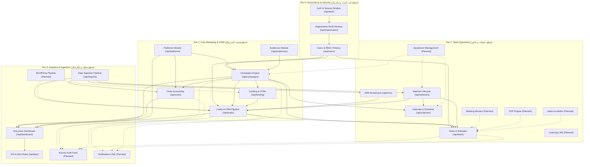

# 06 — Dependency Map (نقشه وابستگی‌های فنی ماژول‌ها و پایگاه داده)
## Gapji Digital Marketing Platform Deep Audit

---

## 1. System Module Dependency Graph (نمودار وابستگی ماژول‌های سامانه)

ساختار معماری سامانه دارای ۴ سطح وابستگی مهندسی است که تغییر در هر لایه بر لایه‌های بالاتر اثر مستقیم می‌گذارد:

---

## 2. Database Entity Relationships (مدل رابطه‌ای ۴۳ جدول پریزما)

مدل‌های دیتابیس در `schema.prisma` با کلیدهای خارجی و محدودیت‌های ارجاعی به صورت زیر متصل هستند:

```mermaid
erDiagram
    Organization ||--o{ OrganizationMembership : "عضویت کاربران"
    Organization ||--o{ Campaign : "مالکیت کمپین‌ها"
    Organization ||--o{ Lead : "مالکیت لیدها"
    Organization ||--o{ Cost : "مالکیت هزینه‌ها"
    Organization ||--o{ Task : "مالکیت تسک‌ها"
    Organization ||--o{ Platform : "تنظیم پلتفرم‌ها"
    Organization ||--o{ TargetAudience : "تعریف مخاطبان"
    Organization ||--o{ LandingPage : "میزبانی لندینگ‌ها"
    Organization ||--o{ CalendarEvent : "برنامه‌ریزی تقویم"
    Organization ||--o{ EquipmentItem : "انبار تجهیزات"
    Organization ||--o{ Meeting : "ثبت جلسات"
    Organization ||--o{ Sop : "پایگاه دانش"
    Organization ||--o{ LearningResource : "منابع آموزشی"
    Organization ||--o{ Idea : "صندوق ایده‌ها"
    Organization ||--o{ Notification : "ارسال اعلان‌ها"

    User ||--o{ OrganizationMembership : "عضویت در سازمان"
    User ||--o{ Session : "نشست‌های ورود"
    User ||--o{ RefreshToken : "توکن‌های تجدید"
    User ||--o{ Task : "تسک‌های محوله"
    User ||--o{ Lead : "لیدهای مسئول"
    User ||--o{ UserActivityLog : "ردپای فعالیت"

    Campaign ||--o{ CampaignPlatformAllocation : "تخصیص بودجه پلتفرم"
    Campaign ||--o{ CampaignAudience : "مخاطبان هدف"
    Campaign ||--o{ UtmLink : "لینک‌های ردیابی"
    Campaign ||--o{ Cost : "هزینه‌های واقع‌شده"
    Campaign ||--o{ Lead : "لیدهای جذب‌شده"
    Campaign ||--o{ Task : "تسک‌های اجرایی"
    Campaign ||--o{ SmsCampaign : "ارسال پیامک"
    Campaign ||--o{ Webinar : "برگزاری وبینار"

    Lead ||--o{ LeadActivity : "ثبت وقایع لید"
    Lead ||--o{ LeadCall : "تماس‌های ثبت‌شده"
    Lead ||--o{ Task : "تسک‌های پیگیری"

    Task ||--o{ TaskSubtask : "زیرتسک‌ها"
    Task ||--o{ TaskComment : "یادداشت‌ها و نظرات"

    Meeting ||--o{ MeetingActionItem : "اقدامات مصوب"
    MeetingActionItem }o--|| Task : "تبدیل به تسک"

    Sop ||--o{ SopVersion : "نسخه‌های دستورالعمل"
    Idea ||--o{ IdeaVote : "آرای تیمی"
    Webinar ||--o{ WebinarAttendee : "شرکت‌کنندگان"
```

---

## 3. API Endpoints Registry & Integration Points (ثبت وب‌سرویس‌ها و نقاط اتصال)

| Module Name | Base Route | Key Endpoints | Downstream Consumers (مصرف‌کنندگان کلاینت) |
| :--- | :--- | :--- | :--- |
| **Auth** | `/api/auth` | `POST /login`, `POST /refresh`, `POST /logout`, `GET /me` | Web `useAuthStore`, `middleware.ts` |
| **Users** | `/api/users` | `GET /`, `POST /invite`, `PATCH /:id/role`, `GET /matrix` | User Management, Assignee Selectors |
| **Organization** | `/api/organization` | `GET /general`, `PATCH /general`, `GET/POST /taxonomies/:type` | Org Settings, Lead Statuses, Categories |
| **Campaigns** | `/api/campaigns` | `GET /`, `POST /`, `GET /:id`, `PATCH /:id`, `GET /stats` | Campaigns List, Wizard, Details, Home |
| **Costs** | `/api/costs` | `GET /`, `POST /`, `GET /:id`, `PATCH /:id`, `GET /stats` | Costs Tracking Table, Dashboard Trends |
| **Dashboard** | `/api/dashboard` | `GET /overview`, `GET /compare` | Executive Dashboard, Role-Based Home Views |
| **Leads** | `/api/leads` | `GET /`, `POST /`, `GET /:id`, `PATCH /:id/status`, `POST /bulk-assign` | Lead Inbox, Kanban Board, Lead Details |
| **Platforms** | `/api/platforms` | `GET /`, `POST /`, `GET /templates`, `GET /:id` | Campaign Wizard, Platform Settings, Costs |
| **Audiences** | `/api/audiences` | `GET /`, `POST /`, `GET /:id`, `PATCH /:id` | Audiences Page, Campaign Wizard Step 2 |
| **Landing** | `/api/landing` | `GET /pages`, `POST /pages`, `GET/POST /utm`, `POST /utm/preview` | Landing Table, UTM Builder, GA4 Guide |
| **SMS** | `/api/sms` | `GET /`, `POST /`, `GET /:id`, `POST /import-results` | SMS Broadcasts List, Recipients Table |
| **Webinars** | `/api/webinars` | `GET /`, `POST /`, `GET /:id`, `POST /:id/attendees/convert` | Webinars List, Attendees Table, Leads |
| **Tasks** | `/api/tasks` | `GET /`, `POST /`, `GET /:id`, `POST /:id/comments`, `POST /:id/subtasks` | Tasks List, Kanban Board, Task Drawer |
| **Calendar** | `/api/calendar` | `GET /events`, `POST /events`, `PATCH /events/:id` | Shamsi Calendar View, Campaign Schedule |
| **Imports** | `/api/imports` | `GET /fields`, `POST /inspect`, `POST /validate`, `POST /execute` | Data Import History, 4-Step Wizard |
| **KPIs** | `/api/kpis` | `GET /`, `POST /`, `POST /metrics`, `POST /validate-formula`, `POST /rules` | KPI Table, Formula Builder, Alert Rules |
