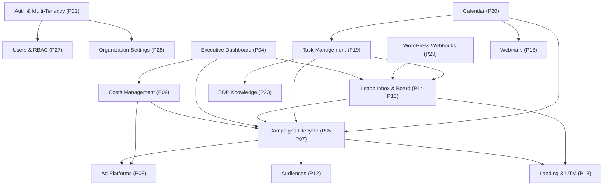

# 06 — DEPENDENCY MAP & INTERACTION TOPOLOGY (نقشه وابستگی‌ها و تعاملات)
## گراف وابستگی‌های ماژول‌ها، شعاع اثر تغییرات و نقاط بحرانی اتصال

---

## 1. CROSS-MODULE TOPOLOGY & DATA LINEAGE (گراف جریان اطلاعات و وابستگی‌ها)

---

## 2. CRITICAL BOTTLENECK ANALYSIS (تحلیل نقاط حساس و شعاع اثر)

1. **`auth-context.tsx` & `useAuth()`**: هرگونه تغییر ناسازگار در این کانتکست باعث از کار افتادن کل صفحات برنامه و نوار ناوبری می‌شود (Blast Radius: 100%).
2. **`permissions.ts` (`can`, `canAccessRoute`)**: کنترل‌کننده اصلی ماسک کردن شماره تلفن‌ها، نمایش دکمه‌ها و فیلتر منوها (Blast Radius: 90%).
3. **`persian-date.ts`**: هسته محاسبات فیلترهای زمانی، سال کبیسه شمسی و تبدیل به میلادی (Blast Radius: 85%).
4. **`Campaign` Entity**: ارتباط دهنده هزینه‌ها، لیدها، وبینارها، تسک‌ها و رویدادهای تقویم (Blast Radius: 75%).
