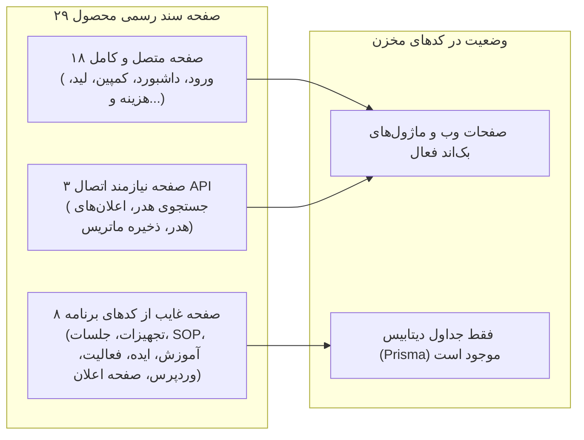

# 07 — Technical Debt and Gap Analysis (تحلیل بدهی‌های فنی و شکاف‌های محصول)
## Gapji Digital Marketing Platform Deep Audit

---

## 1. Technical Debt Register (دفتر ثبت بدهی‌های فنی و معماری)

| Debt ID | Classification | Priority | Area / Module | Technical Description (شرح فنی بدهی) | Business Impact (پیامد بیزنس) | Target Phase |
| :--- | :--- | :---: | :--- | :--- | :--- | :---: |
| **DEBT-01** | Missing Modules | `P0 / Critical` | Backend & Web | ۸ ماژول مشخص‌شده در سند ۲۹ صفحه‌ای با وجود داشتن مدل در Prisma، فاقد کنترلر و صفحه وب هستند. | ۲۷٪ قابلیت‌های مستندشده غیرقابل استفاده است. | `PHASE-002` to `009` |
| **DEBT-02** | Header Search Gap | `P1 / High` | Application Shell | فیلد جستجوی هدر در `Header.tsx` به اندپوئینت سرچ بک‌اند متصل نیست. | کاربران نمی‌توانند لید یا کمپین را از بالای صفحه جستجو کنند. | `PHASE-001` |
| **DEBT-03** | Route Alias Inconsistency | `P1 / High` | Routing Structure | آدرس سند `/performance/campaigns` است اما فرانت‌اند مسیر `/campaigns` را رندر می‌کند. | احتمال شکست بوک‌مارک‌ها یا تضاد با مستندات کاربر. | `PHASE-001` |
| **DEBT-04** | Mock Notification Fallback | `P1 / High` | Notifications | هدر دارای آرایه ۳ تایی استاتیک در React state است و به سرویس زنده متصل نیست. | اعلان‌های واقعی سیستم به اطلاع کاربران نمی‌رسد. | `PHASE-002` |
| **DEBT-05** | Permissions Matrix Save | `P1 / High` | Settings / Users | جدول ماتریس دسترسی نقش‌ها در صفحه `/settings/users` اندپوینت ذخیره سازی در بک‌اند ندارد. | عدم امکان شخصی‌سازی و ماندگاری دسترسی نقش‌ها. | `PHASE-001` |
| **DEBT-06** | Mock Fallback in APIs | `P2 / Medium` | Frontend Services | برخی سرویس‌ها نظیر `platforms.api.ts` در زمان خطای شبکه دیتای ماک برمی‌گردانند. | قطع بودن سرور یا خطای API پشت داده فرضی پنهان می‌ماند. | `PHASE-001` |
| **DEBT-07** | Client-Side Campaign Filters | `P2 / Medium` | Campaigns API | متد `campaignApi.getAll` همه رکوردها را به کلاینت منتقل کرده و در رم فیلتر می‌کند. | با افزایش تعداد کمپین‌ها به هزاران رکورد سرعت کند خواهد شد. | `PHASE-001` |
| **DEBT-08** | Incomplete PDF Export | `P2 / Medium` | Dashboard Export | خروجی اکسل پیاده شده اما خروجی PDF به صورت ساختاریافته در سرور تولید نمی‌شود. | مدیران ارشد نمی‌توانند گزارش چاپی استاندارد دریافت کنند. | `PHASE-001` |
| **DEBT-09** | Missing Production Docker | `P3 / Medium` | DevOps Infra | فقط `docker-compose.yml` برای دیتابیس محلی موجود است؛ داکرفایل چندمرحله‌ای پروداکشن غایب است. | عدم امکان استقرار استاندارد روی سرورهای کانتینری. | `PHASE-010` |
| **DEBT-10** | Missing CI/CD Pipelines | `P3 / Medium` | Quality Assurance | هیچ اکشن گیت‌هاب برای بیلد و تست خودکار در مخزن تنظیم نشده است. | ریسک شکست پروژه در پول‌ریکوئست‌های بعدی. | `PHASE-010` |

---

## 2. The 8 Missing Product Domains (تحلیل ۸ حوزه غایب از سند محصول)

### 1. Notifications Hub (صفحه ۳ - `/notifications`)
- **Documented:** کشوی ۱۰ اعلان آخر هدر، صفحه کامل با لیست و تب تنظیمات دریافت اعلان‌ها.
- **Current State:** هدر دارای ۳ اعلان ماک است؛ مدل‌های Prisma موجود است اما کنترلر ندارد.
- **Remediation:** ساخت `NotificationModule` در NestJS و صفحه وب در `PHASE-002`.

### 2. Equipment Management (صفحه ۲۱ - `/work/equipment`)
- **Documented:** دو نمای «کمبودها» با هشدار کمتر از ۳ روز تا رویداد و «همه تجهیزات»؛ قالب‌های آماده.
- **Current State:** تگ `comingSoon: true` در منو؛ مدل‌های پریزما موجود است اما صفحه و سرویس ندارد.
- **Remediation:** ساخت `EquipmentModule` و صفحه وب در `PHASE-003`.

### 3. Meeting Minutes (صفحه ۲۲ - `/work/meetings`)
- **Documented:** صفحه مطالعه ۸۰۰ پیکسلی، فرم جلسه با جدول مصوبات، تبدیل مصوبات به تسک، ارسال با ایمیل.
- **Current State:** تگ `comingSoon: true` در منو؛ مدل‌های پریزما موجود است اما صفحه و سرویس ندارد.
- **Remediation:** ساخت `MeetingsModule` و صفحه وب در `PHASE-004`.

### 4. SOP Knowledge Base (صفحه ۲۳ - `/work/sops`)
- **Documented:** لیست کارتی، صفحه مطالعه ۸۰۰ پیکسلی، مراحل و چک‌لیست، دکمه ساخت تسک از روی SOP، استایل چاپ.
- **Current State:** تگ `comingSoon: true` در منو؛ مدل‌های پریزما موجود است اما صفحه و سرویس ندارد.
- **Remediation:** ساخت `SopsModule` و صفحه وب در `PHASE-005`.

### 5. Learning LMS Hub (صفحه ۲۴ - `/work/learning`)
- **Documented:** تب‌های کتابخانه، آموزش‌های من، پیشرفت تیم، پلیر ویدیو با کنترل سرعت و ذخیره زمان توقف.
- **Current State:** تگ `comingSoon: true` در منو؛ مدل‌های پریزما موجود است اما صفحه و سرویس ندارد.
- **Remediation:** ساخت `LearningModule` و صفحه وب در `PHASE-006`.

### 6. Ideas Incubator (صفحه ۲۵ - `/work/ideas`)
- **Documented:** ثبت سریع، رأی‌گیری یک‌کلیکی برگشت‌پذیر، تایید مدیر، تبدیل به تسک، ثبت نتیجه اجرا.
- **Current State:** تگ `comingSoon: true` در منو؛ مدل‌های پریزما موجود است اما صفحه و سرویس ندارد.
- **Remediation:** ساخت `IdeasModule` و صفحه وب در `PHASE-007`.

### 7. Activity Report Feed (صفحه ۲۶ - `/work/activity`)
- **Documented:** فیلتر نقش (مدیر همه، پرسنل فقط خود)، کارت شاخص، جدول مقایسه پرسنل، فید زنده رخدادها با لینک.
- **Current State:** تگ `comingSoon: true` در منو؛ مدل `UserActivityLog` موجود است اما ماژول ندارد.
- **Remediation:** ساخت `ActivityModule` و اینترسپتور ثبت وقایع در `PHASE-008`.

### 8. WordPress Integration (صفحه ۲۹ - `/settings/wordpress`)
- **Documented:** کارت وضعیت اتصال، تولید کلید API یک‌بارنمایش، نگاشت فیلدهای فرم وردپرس به لید، لاگ خطای وب‌هوک.
- **Current State:** تگ `comingSoon: true` در منو؛ مدل‌های پریزما موجود است اما صفحه و کنترلر وب‌هوک ندارد.
- **Remediation:** ساخت `WordpressModule` و پایپ‌لاین وب‌هوک در `PHASE-009`.
