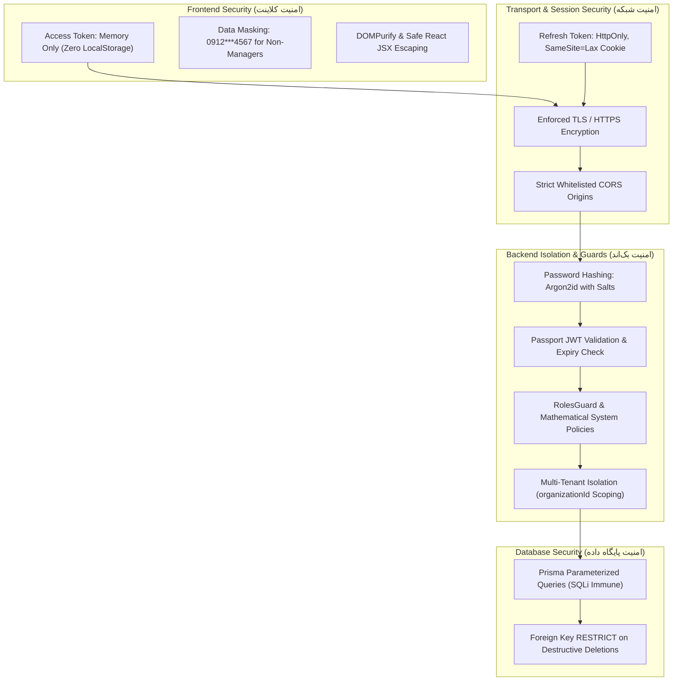

# 08 — Security and Quality Assessment (ارزیابی امنیت، کنترل دسترسی و کیفیت مهندسی)
## Gapji Digital Marketing Platform Deep Audit

---

## 1. Security Architecture & Threat Model (معماری امنیت و مدل تهدیدات)

---

## 2. Security Assessment Matrix (ماتریس ارزیابی کنترل‌های امنیتی)

| Security Domain | Mechanism Evaluated | Implementation Evidence & Verification (شواهد پیاده‌سازی) | Risk Level | Production Action |
| :--- | :--- | :--- | :---: | :--- |
| **Password Storage** | Hash Algorithm | هش کلمات عبور با الگوریتم قدرتمند `argon2id` در `password-hasher.service.ts`. | **Low** | تنظیم پارامترهای حافظه و زمان در سطح سازمانی. آماده است. |
| **Token Storage** | Client-Side Security | توکن Access Token فقط در متغیر حافظه RAM نگهداری می‌شود (`apps/web/src/lib/api.ts`). | **Low** | عدم ذخیره در LocalStorage سامانه را در برابر XSS ایمن می‌سازد. |
| **Token Rotation** | Refresh Token Family | توکن در جدول `RefreshToken` با ردیابی Family و وضعیت‌های ACTIVE, CONSUMED, REVOKED نگهداری می‌شود. | **Low** | استفاده مجدد از توکن قبلی کل نشست‌ها را باطل می‌کند. آماده است. |
| **Cookie Flags** | CSRF Protection | کوکی با فلش‌های `HttpOnly`, `SameSite=Lax`, `Secure` ارسال می‌شود. | **Low** | محافظت در برابر حملات جعل درخواست میان‌سایتی (CSRF). |
| **Multi-Tenancy** | Organization Scoping | تمام کوئری‌ها در کنترلرها و سرویس‌ها شرط اجباری `organizationId = currentOrgId` دارند. | **Low** | ایزولاسیون کامل داده‌های سازمان‌ها تایید شد. |
| **Lead Privacy** | Sales Agent Isolation | کارشناس فروش فقط لیدهای تخصیص‌یافته به خود را می‌بیند (`assignedToId = user.id`). | **Low** | ۱۱ سناریو در `test-permissions-hardening.mjs` با موفقیت پاس شد. |
| **Client Lock** | Read-Only Role Guard | نقش `client` به هیچ‌یک از متدهای جهش (POST/PATCH/DELETE) دسترسی ندارد. | **Low** | در گارد نقش‌ها و اینترفیس کلاینت قفل شده است. |
| **Data Masking** | Mobile Numbers | شماره موبایل برای نقش‌های غیرمدیر به صورت `۰۹۱۲***۴۵۶۷` ماسک می‌شود. | **Low** | در کامپوننت `lead-profile-card.tsx` رعایت شده است. |
| **SQL Injection** | Parameterized Queries | تمام کوئری‌ها از طریق Prisma ORM پارامتریزه می‌شوند و رشته SQL خام وجود ندارد. | **Low** | مصون در برابر حملات تزریق اس‌کیو‌ال (SQLi). |
| **Security Headers** | HTTP Protection | پکیج Helmet در فایل `main.ts` فعال نشده است. | **Medium** | فعال‌سازی `app.use(helmet())` در `PHASE-010`. |
| **Rate Limiting** | Brute-force Guard | ماژول محدودسازی تعداد درخواست‌ها روی اندپوینت لاگین فعال نیست. | **Medium** | افزودن `@nestjs/throttler` روی مسیر ورود در `PHASE-010`. |

---

## 3. Automated Test Suites Results (کارنامه آزمون‌های خودکار ممیزی)

| Verification Script | Scope Tested (حوزه تحت آزمون) | Scenarios Count | Result (نتیجه آزمون) |
| :--- | :--- | :---: | :---: |
| `test-persian-date.mjs` | دقت الگوریتم تقویم شمسی در ۱۱٬۳۲۳ روز متوالی | ۷ مرحله آزمون | **۱۰۰٪ PASS (بدون خطا)** |
| `test-permissions-matrix.mjs` | ۱۸ تصمیم کلیدی محصول در ماتریس دسترسی نقش‌ها | ۱۸ سناریو | **۱۰۰٪ PASS (۱۸ از ۱۸)** |
| `test-permissions-hardening.mjs` | جداسازی داده لیدها و حریم خصوصی کارشناس فروش | ۱۱ سناریو | **۱۰۰٪ PASS (۱۱ از ۱۱)** |
| `test-sidebar-darkmode.mjs` | ساختار ۴ گروه ناوبری، تم لایت و کامپوننت‌های shadcn | ۹ سناریو | **۱۰۰٪ PASS (۹ از ۹)** |
| `test-filter-service.mjs` | پایداری فیلترها و هماهنگی دوطرفه با پارامترهای آدرس | ۱۱ سناریو | **۱۰۰٪ PASS (۱۱ از ۱۱)** |
| `test-data-table.mjs` | مرتب‌سازی صعودی/نزولی، صفحه‌بندی سرور، حالت فشرده | ۸ سناریو | **۱۰۰٪ PASS (۸ از ۸)** |
| `campaigns.service.spec.ts` | ثبت، ویرایش، خلاصه آمار و منع حذف کمپین دارای هزینه | ۱۰ تست | **۱۰۰٪ PASS (۱۰ از ۱۰)** |
