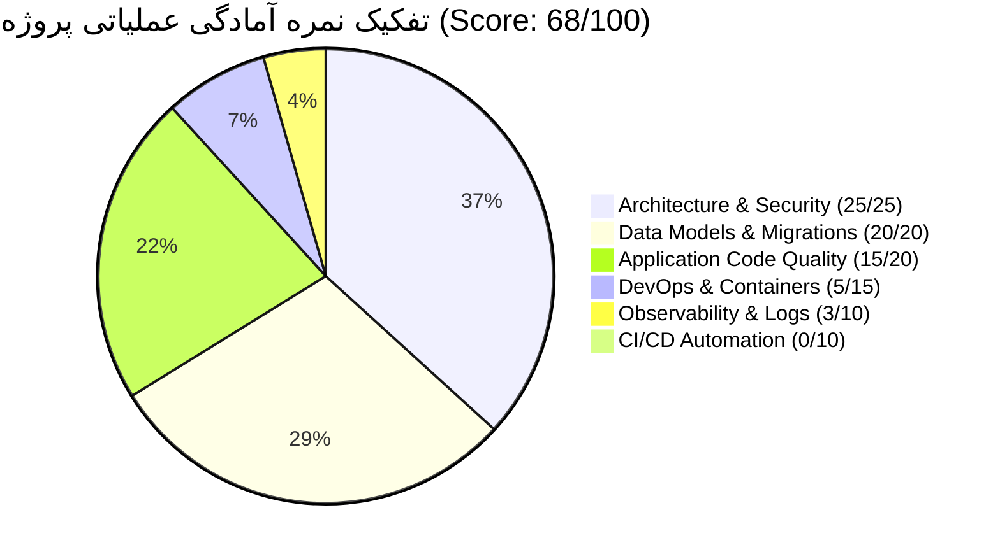
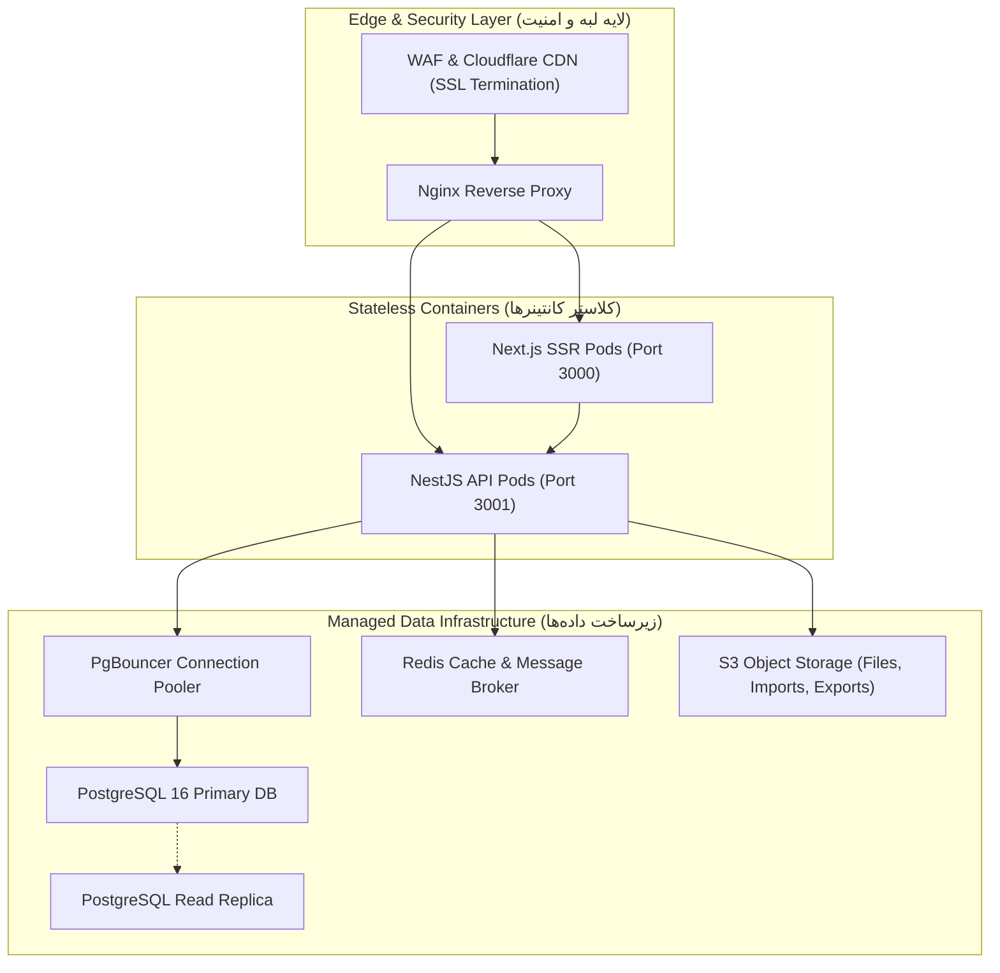

# 09 — Production Readiness Assessment (ارزیابی آمادگی استقرار عملیاتی)
## Gapji Digital Marketing Platform Deep Audit

---

## 1. Production Readiness Score: 68 / 100 (نمره آمادگی عملیاتی)



کیفیت معماری نرم‌افزار، امنیت نشست‌ها، پایگاه داده ۴۳ مدلی Prisma و سیستم رابط کاربری فرانت‌اند در وضعیت بسیار مطلوب قرار دارند. کسری‌های موجود عمدتاً در بخش‌های **کانتینرسازی پروداکشن، پایپ‌لاین استقرار مستمر (CI/CD)، لاگ‌های ساختاریافته و سناریوهای بازیابی از فاجعه (Disaster Recovery)** است.

---

## 2. Production Evaluation Matrix (ماتریس ارزیابی شاخص‌های پروداکشن)

| Production Dimension | Current State | Target Production Requirement | Gap Severity | Action in Roadmap |
| :--- | :--- | :--- | :---: | :--- |
| **Containerization** | `docker-compose.yml` محلی برای Postgres موجود است. | ساخت Dockerfile چندمرحله‌ای برای بک‌اند و فرانت‌اند با کاربر non-root. | `High` | `PHASE-010` |
| **Database Migrations** | ۶ مهاجرت متوالی در Prisma آماده است. | اجرای خودکار دستور `prisma migrate deploy` در زمان استقرار. | `Low` | `PHASE-010` |
| **Connection Pooling** | اتصال مستقیم کلاینت به PostgreSQL. | استفاده از PgBouncer برای مدیریت بهینه اتصالات همزمان. | `Medium` | `PHASE-010` |
| **Database Indexing** | ایندکس‌های پیش‌فرض کلید اصلی و فیلدهای یکتا. | افزودن ایندکس‌های ترکیبی روی `[organizationId, createdAt]` برای لیدها و هزینه‌ها. | `Medium` | `PHASE-010` |
| **Disaster Recovery** | بکاپ‌گیری دستی پایگاه داده. | اسکریپت پشتیبان‌گیری خودکار روزانه با آپلود روی S3 و تست بازیابی دوره‌ای. | `High` | `PHASE-010` |
| **Logging & Tracing** | لاگ‌های متنی کنسول با لاگر پیش‌فرض NestJS. | استفاده از Pino یا Winston با فرمت JSON و شناسه پیگیری (Correlation ID). | `Medium` | `PHASE-010` |
| **Health Check** | بدون اندپوینت اختصاصی ارزیابی سلامت. | افزودن پکیج `@nestjs/terminus` روی اندپوینت `/health` با چک دیتابیس و حافظه. | `Medium` | `PHASE-010` |
| **Secret Management** | فایل‌های متنی `.env` لوکال. | انتقال کلیدها به Secret Manager یا Sealed Secrets در کوبرنتیز. | `High` | `PHASE-010` |
| **CI/CD Pipeline** | بدون پایپ‌لاین اتوماتیک در گیت‌هاب. | ایجاد فایل `.github/workflows/ci.yml` جهت اجرای تست‌ها و بیلد داکر در هر کامیت. | `High` | `PHASE-010` |
| **Server Hardening** | سرور بدون هدرهای امنیتی اضافی. | فعال‌سازی میدلورهای `helmet()` و `@nestjs/throttler` روی پورت API. | `Medium` | `PHASE-010` |

---

## 3. Database Indexing Plan (برنامه بهینه‌سازی ایندکس‌های پایگاه داده)

جهت پاسخگویی فوق‌سریع در مقیاس‌های ده‌ها هزار رکورد، افزودن ایندکس‌های ترکیبی زیر در `schema.prisma` توصیه می‌شود:

```prisma
// Recommended composite indexes for apps/api/prisma/schema.prisma:

model Lead {
  // Existing fields...
  @@index([organizationId, status])
  @@index([organizationId, assignedToId])
  @@index([organizationId, createdAt(sort: Desc)])
}

model Cost {
  // Existing fields...
  @@index([organizationId, campaignId])
  @@index([organizationId, platformId])
  @@index([organizationId, date(sort: Desc)])
}

model Task {
  // Existing fields...
  @@index([organizationId, assigneeId, status])
  @@index([organizationId, dueDate(sort: Asc)])
}
```

---

## 4. Production Deployment Topology (توپولوژی استقرار در سرورهای عملیاتی)


