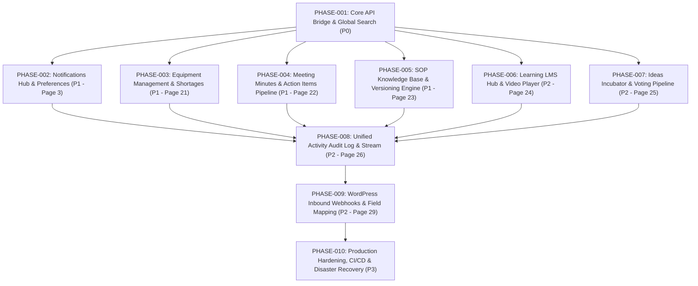

# 10 — Master Completion Roadmap (نقشه راه جامع تکمیل ۱۰۰٪ محصول و پروداکشن)
## Gapji Digital Marketing Platform Deep Audit

---

## 1. Roadmap Architecture & Dependency Sequencing (توالی مهندسی فازها)

این نقشه راه، مسیر گام‌به‌گام از وضعیت کنونی پروژه تا رسیدن به **پوشش ۱۰۰٪ تمام نیازمندی‌های مستندشده در سند ۲۹ صفحه‌ای** و **آمادگی کامل پروداکشن** را بر پایه وابستگی‌های واقعی معماری تنظیم کرده است:

---

## 2. Comprehensive 10-Phase Specifications (مشخصات ۲۰ گانه فازهای ده‌گانه)

### PHASE-001: Core API Bridge & Global Search Consolidation
- **1. Phase Title:** تثبیت اتصالات APIهای پایه، همسان‌سازی مسیرها و فعال‌سازی سرچ سراسری
- **2. Objective:** حذف دیتای ماک فال‌بک در کلاینت، ایجاد بازنویسی مسیرهای کمپین در Next.js، ساخت اندپوینت جستجوی سراسری هدر، و ذخیره ماتریس دسترسی کاربران.
- **3. Business Purpose:** حصول اطمینان از عملکرد صددرصدی ابزارهای ناوبری، جستجوی بلادرنگ لید و کمپین، و امکان ذخیره اختیارات نقش‌ها توسط مدیر ارشد.
- **4. Current State:** سرچ هدر دیتای زنده ندارد؛ مسیر `/campaigns` با سند (`/performance/campaigns`) تفاوت دارد؛ ماتریس دسترسی در صفحه کاربران ذخیره نمی‌شود؛ برخی سرویس‌ها در خطا دیتای ماک می‌دهند.
- **5. Scope of Work:** ساخت ماژول `search` در بک‌اند؛ اضافه کردن Rewrite در `next.config.js`؛ افزودن متد ذخیره ماتریس در `UsersController`؛ پاکسازی داده‌های ماک فال‌بک در فرانت‌اند.
- **6. Related Requirement IDs:** `REQ-002`, `REQ-059`, `REQ-060`, `REQ-090`, `REQ-096`.
- **7. Related Modules:** `Header`, `Campaigns`, `Users`, `Shared`, `Navigation`.
- **8. Expected File & Component Impact:** `apps/api/src/modules/search/*`, `apps/api/src/modules/users/*`, `apps/web/next.config.js`, `apps/web/src/components/layout/header.tsx`, `platforms.api.ts`.
- **9. Database Changes:** بدون تغییر اسکیما (استفاده از مدل‌های موجود).
- **10. API Changes:** `GET /api/search/global?q=...`؛ `PATCH /api/users/permissions/matrix`.
- **11. Architectural Changes:** استقرار ماژول جستجوی متمرکز و لغو کامل فال‌بک‌های پنهان‌کننده خطا در فرانت‌اند.
- **12. Dependencies:** ندارد؛ این فاز پیش‌نیاز سایر فازهاست.
- **13. Ordered Implementation Tasks:**
  1. ساخت `SearchModule` در بک‌اند با پشتیبانی از سرچ متنی لیدها و کمپین‌ها با فیلتر سازمان فعال.
  2. اعمال گارد نقش روی سرچ (کارشناس فروش فقط لیدهای خودش را پیدا کند).
  3. اتصال اینپوت هدر در `Header.tsx` با قابلیت Debounce و دراپ‌داون نتایج.
  4. افزودن قوانین ریرایت در `next.config.js` جهت پشتیبانی از مسیرهای `/performance/campaigns`.
  5. پیاده‌سازی متد ذخیره ماتریس دسترسی در بک‌اند و اتصال آن در فرانت‌اند.
  6. اصلاح `platforms.api.ts` جهت بازگرداندن خطای واقعی به جای دیتای ماک.
- **14. Technical Risks:** کندی سرچ سراسری با افزایش داده‌ها. *Mitigation:* اعمال لیمیت ۵ لید و ۵ کمپین و حداقل ۳ حرف برای کوئری.
- **15. Regression Risks:** پیکربندی اشتباه ریرایت در Next.js.
- **16. Required Tests:** تست یکپارچگی سرچ؛ آزمون تفکیک داده کارشناس فروش در سرچ؛ تست ذخیره ماتریس دسترسی.
- **17. Acceptance Criteria:** سرچ شماره موبایل لید مربوطه را باز می‌کند؛ آدرس سند محصول باز می‌شود؛ تغییرات ماتریس ذخیره می‌گردد.
- **18. Deliverables:** ماژول سرچ بک‌اند، هدر اصلاح‌شده، سرویس‌های بدون ماک، اسکریپت آزمون.
- **19. Definition of Done:** قبولی ۱۰۰٪ تست‌های جدید و عدم وجود دیتای ماک در سرویس‌های متصل.
- **20. Conditions that Block Completion:** دردسترس نبودن پایگاه داده محلی.

---

### PHASE-002: Notifications Subsystem & Preferences Engine (Page 3)
- **1. Phase Title:** پیاده‌سازی مرکز اعلان‌ها، کشوی هدر و صفحه تنظیمات دریافت اعلان‌ها
- **2. Objective:** ساخت کامل ماژول بک‌اند اعلان‌ها و پیاده‌سازی صفحه ۳ سند محصول (`/notifications`).
- **3. Business Purpose:** اطلاع‌رسانی بلادرنگ تغییر وضعیت لیدها، هشدارهای کمپین و سررسید تسک‌ها به پرسنل و کارفرما.
- **4. Current State:** در هدر ۳ اعلان فرضی وجود دارد؛ مدل‌های `Notification` و `NotificationPreference` در دیتابیس موجود است اما کنترلر، سرویس و صفحه وب ندارد.
- **5. Scope of Work:** ساخت ماژول `notifications` در NestJS؛ ساخت کشوی ۱۰ اعلان آخر در هدر؛ ساخت صفحه `/notifications` با دو تب «لیست اعلان‌ها» و «تنظیمات دریافت رویدادها».
- **6. Related Requirement IDs:** `REQ-003`, `REQ-052`.
- **7. Related Modules:** `Notifications`, `Header`, `Settings`, `Shared`.
- **8. Expected File & Component Impact:** `apps/api/src/modules/notifications/*`, `apps/web/src/app/(app)/notifications/page.tsx`, `apps/web/src/features/notifications/*`.
- **9. Database Changes:** بدون تغییر اسکیما (استفاده از مدل‌های موجود).
- **10. API Changes:** `GET /api/notifications`، `PATCH /api/notifications/read-all`، `GET/PATCH /api/notifications/preferences`.
- **11. Architectural Changes:** ایجاد مکانیزم ارسال رویدادهای درون‌برنامه‌ای در سطح ماژول‌ها.
- **12. Dependencies:** تکمیل فاز ۱ (`PHASE-001`).
- **13. Ordered Implementation Tasks:**
  1. ساخت کنترلر و سرویس `NotificationModule` در بک‌اند.
  2. پیاده‌سازی متد شمارش اعلان‌های نخوانده با سقف ۹۹+ (`unreadCount > 99 ? '+99' : unreadCount`).
  3. پیاده‌سازی جدول ماتریس تنظیمات (نوع رویداد × کانال درون‌برنامه‌ای/ایمیل).
  4. توسعه سرویس فرانت‌اند و هوک‌های TanStack Query در `features/notifications`.
  5. جایگزینی کشوی ماک هدر با کامپوننت متصل به سرور.
  6. ایجاد صفحه `apps/web/src/app/(app)/notifications/page.tsx` مطابق سند.
- **14. Technical Risks:** بار سرور ناشی از پولینگ مکرر. *Mitigation:* تنظیم بازه ۳۰ ثانیه‌ای برای رفرش.
- **15. Regression Risks:** تغییر چیدمان هدر حین باز شدن کشو.
- **16. Required Tests:** آزمون واحد شمارنده اعلان؛ تست علامت‌گذاری همه به عنوان خوانده‌شده.
- **17. Acceptance Criteria:** زنگوله هدر شمارنده درست نشان می‌دهد؛ کلیک روی اعلان صفحه موجودیت را باز می‌کند؛ سوییچ‌های تنظیمات ذخیره می‌شوند.
- **18. Deliverables:** ماژول اعلان‌ها در بک‌اند، صفحه اعلان‌ها در فرانت‌اند، کشوی هدر فعال.
- **19. Definition of Done:** انطباق ۱۰۰٪ با صفحه ۳ سند محصول با تایید تست خودکار.
- **20. Conditions that Block Completion:** تکمیل نشدن فاز ۱.

---

### PHASE-003: Equipment Management & Readiness Module (Page 21)
- **1. Phase Title:** پیاده‌سازی ماژول تجهیزات، ردیابی کمبودها و قالب‌های آماده رویداد
- **2. Objective:** پیاده‌سازی کامل صفحه ۲۱ سند محصول (`/work/equipment`) و اتصال به تقویم و کمپین‌ها.
- **3. Business Purpose:** جلوگیری از لغو یا اختلال در رویدادها و وبینارها با پایش کمبود تجهیزات و اعلام اخطار قبل از موعد.
- **4. Current State:** منو برچسب «به‌زودی» دارد؛ جداول `EquipmentItem`, `EquipmentTemplate` در دیتابیس وجود دارند اما هیچ کدی در برنامه ندارد.
- **5. Scope of Work:** ساخت ماژول بک‌اند تجهیزات؛ ساخت صفحه `/work/equipment` با دو نمای «کمبودها (پیش‌فرض)» و «همه تجهیزات»؛ اتصال اخطار ۳ روز مانده به رویداد.
- **6. Related Requirement IDs:** `REQ-046`, `REQ-084`.
- **7. Related Modules:** `Equipment`, `Webinars`, `Campaigns`, `Calendar`, `Navigation`.
- **8. Expected File & Component Impact:** `apps/api/src/modules/equipment/*`, `apps/web/src/app/(app)/work/equipment/page.tsx`, `apps/web/src/features/equipment/*`, `navigation.ts`.
- **9. Database Changes:** بدون تغییر اسکیما.
- **10. API Changes:** `GET /api/equipment/shortages`, `GET /api/equipment/items`, `POST /api/equipment/items`, `PATCH /api/equipment/items/:id/status`, `POST /api/equipment/apply-template`.
- **11. Architectural Changes:** پیوند زدن وضعیت تجهیزات به تاریخ‌های اجرای رویداد در تقویم.
- **12. Dependencies:** تکمیل فاز ۱ (`PHASE-001`).
- **13. Ordered Implementation Tasks:**
  1. ساخت ماژول تجهیزات در بک‌اند.
  2. پیاده‌سازی کوئری کمبودها گروه‌بندی‌شده بر اساس تاریخ رویداد با نشانگر اخطار فاصله کمتر از ۳ روز.
  3. ساخت سرویس قالب‌های تجهیزات و اعمال دسته‌ای قالب به کمپین/وبینار.
  4. ساخت صفحه وب `/work/equipment` با دو تب مطابق سند.
  5. فعال‌سازی لینک منوی کناری (حذف `comingSoon`).
  6. اتصال تب تجهیزات در صفحه جزئیات وبینار و کمپین.
- **14. Technical Risks:** اشتباه در مقایسه تاریخ‌ها. *Mitigation:* استفاده از توابع موتور تقویم شمسی.
- **15. Regression Risks:** ندارد؛ صفحه جدید است.
- **16. Required Tests:** تست محاسبه کمبود ۳ روزه؛ تست اعمال قالب تجهیزات.
- **17. Acceptance Criteria:** تجهیزات با وضعیت ناقص در رویدادهای ۳ روز آینده علامت هشدار قرمز می‌گیرند؛ قالب تجهیزات اعمال می‌شود.
- **18. Deliverables:** ماژول بک‌اند، صفحه وب تجهیزات، چک‌لیست‌های متصل.
- **19. Definition of Done:** تایید انطباق کامل با صفحه ۲۱ سند.
- **20. Conditions that Block Completion:** تکمیل نشدن فاز ۱.

---

### PHASE-004: Meeting Minutes & Action Items Pipeline (Page 22)
- **1. Phase Title:** پیاده‌سازی سیستم مدیریت صورتجلسات و خط لوله تبدیل مصوبات به تسک
- **2. Objective:** ساخت کامل صفحه ۲۲ سند محصول (`/work/meetings`) و فرآیند تبدیل اقدام به تسک.
- **3. Business Purpose:** ثبت رسمی تصمیمات جلسات و تضمین اجرایی شدن مصوبات با تبدیل مستقیم به تسک‌های پرسنل.
- **4. Current State:** منو برچسب «به‌زودی» دارد؛ جداول `Meeting`, `MeetingActionItem` موجود است اما کنترلی در برنامه ندارد.
- **5. Scope of Work:** ساخت ماژول بک‌اند جلسات؛ ساخت صفحه لیست جلسات و صفحه مطالعه/ویرایش با عرض ۸۰۰ پیکسل؛ پیاده‌سازی فرم ثبت جلسه با جدول مصوبات؛ دکمه «تبدیل مصوبات به تسک»؛ دکمه «ارسال برای همه» با پیش‌نمایش ایمیل.
- **6. Related Requirement IDs:** `REQ-085`.
- **7. Related Modules:** `Meetings`, `Tasks`, `Users`, `Navigation`.
- **8. Expected File & Component Impact:** `apps/api/src/modules/meetings/*`, `apps/web/src/app/(app)/work/meetings/*`, `apps/web/src/features/meetings/*`, `navigation.ts`.
- **9. Database Changes:** بدون تغییر اسکیما.
- **10. API Changes:** `GET /api/meetings`, `POST /api/meetings`, `GET /api/meetings/:id`, `PATCH /api/meetings/:id`, `POST /api/meetings/:id/convert-actions`.
- **11. Architectural Changes:** برقراری ارتباط مستقیم سرویس جلسات با سرویس تسک‌ها.
- **12. Dependencies:** تکمیل فاز ۱ (`PHASE-001`).
- **13. Ordered Implementation Tasks:**
  1. ساخت `MeetingsModule` در بک‌اند.
  2. پیاده‌سازی متد اتمیک تبدیل مصوبات به تسک و ثبت شناسه تسک روی ردیف اقدام جلسه.
  3. ساخت فرمت پیش‌نمایش ایمیل و ثبت لاگ زمان ارسال برای هر کاربر.
  4. ساخت صفحه وب لیست جلسات و صفحه جزئیات با عرض استاندارد ۸۰۰ پیکسل.
  5. فعال‌سازی لینک ناوبری در منوی کناری.
- **14. Technical Risks:** تولید تسک‌های تکراری با کلیک‌های مجدد. *Mitigation:* مسدودسازی تبدیل مجدد اقدامات تبدیل‌شده.
- **15. Regression Risks:** ندارد.
- **16. Required Tests:** آزمون واحد تبدیل مصوبه به تسک؛ آزمون هشدار ویرایش پس از ارسال («نسخه جدید ساخته می‌شود»).
- **17. Acceptance Criteria:** کلیک روی تبدیل به تسک، تسک‌های مرتبط را در لیست تسک‌های فرد ایجاد می‌کند؛ نمایش عرض ۸۰۰ پیکسل تایید شود.
- **18. Deliverables:** ماژول بک‌اند، صفحات فرانت‌اند، تست‌های خودکار.
- **19. Definition of Done:** انطباق ۱۰۰٪ با صفحه ۲۲ سند محصول.
- **20. Conditions that Block Completion:** تکمیل نشدن فاز ۱.

---

### PHASE-005: SOP Knowledge Base & Versioning Lifecycle (Page 23)
- **1. Phase Title:** استقرار پایگاه دانش دستورالعمل‌های استاندارد عملیاتی (SOP) و کنترل نسخه‌ها
- **2. Objective:** پیاده‌سازی کامل صفحه ۲۳ سند محصول (`/work/sops`) و ابزار تولید تسک از روی الگو.
- **3. Business Purpose:** مستندسازی یکپارچه فرآیندهای بازاریابی و امکان اجرای بدون خطای فرآیندها با دکمه ایجاد تسک از دستورالعمل.
- **4. Current State:** منو برچسب «به‌زودی» دارد؛ جداول `Sop`, `SopVersion` موجودند؛ کدی در برنامه ندارد.
- **5. Scope of Work:** ساخت ماژول بک‌اند SOP با گارد ویرایش مخصوص مدیران؛ ساخت صفحه لیست کارتی و صفحه مطالعه ۸۰۰ پیکسلی؛ نوار کناری تاریخچه نسخه‌ها؛ استایل چاپ تمیز؛ دکمه «ساخت تسک از روی SOP».
- **6. Related Requirement IDs:** `REQ-086`.
- **7. Related Modules:** `SOPs`, `Tasks`, `Users`, `Navigation`.
- **8. Expected File & Component Impact:** `apps/api/src/modules/sops/*`, `apps/web/src/app/(app)/work/sops/*`, `apps/web/src/features/sops/*`, `navigation.ts`.
- **9. Database Changes:** بدون تغییر اسکیما.
- **10. API Changes:** `GET /api/sops`, `POST /api/sops`, `GET /api/sops/:id`, `PATCH /api/sops/:id`, `POST /api/sops/:id/spawn-task`.
- **11. Architectural Changes:** اعمال سیاست دسترسی (همه کاربران می‌خوانند، فقط مدیر ویرایش و منتشر می‌کند).
- **12. Dependencies:** تکمیل فاز ۱ (`PHASE-001`).
- **13. Ordered Implementation Tasks:**
  1. ساخت ماژول بک‌اند با گارد احراز نقش مدیر مارکتینگ و ادمین برای عملیات جهش.
  2. پیاده‌سازی ثبت نسخه‌های جدید (پیش‌نویس / منتشرشده).
  3. پیاده‌سازی تولید تسک با تبدیل چک‌لیست SOP به ساب‌تسک‌های تسک جدید.
  4. ساخت صفحات وب کارتی و مطالعه با عرض ۸۰۰ پیکسل و افزودن استایل CSS پرینت.
  5. فعال‌سازی لینک منو.
- **14. Technical Risks:** تداخل ویرایش همزمان. *Mitigation:* اعمال قفل خوش‌بینانه روی شماره نسخه.
- **15. Regression Risks:** ندارد.
- **16. Required Tests:** تست مسدودسازی ویرایش توسط کاربر عادی؛ تست استخراج تسک از SOP.
- **17. Acceptance Criteria:** فقط مدیر بتواند ویرایش کند؛ چاپ خروجی تمیز بدون منو بدهد؛ تسک با ساب‌تسک‌ها ساخته شود.
- **18. Deliverables:** ماژول بک‌اند، صفحات وب SOP، استایل پرینت، تست‌ها.
- **19. Definition of Done:** تایید انطباق کامل با صفحه ۲۳ سند محصول.
- **20. Conditions that Block Completion:** تکمیل نشدن فاز ۱.

---

### PHASE-006: Learning & LMS Resource Hub (Page 24)
- **1. Phase Title:** راه‌اندازی سامانه آموزش و دوره‌ها و پایش پیشرفت تیم
- **2. Objective:** پیاده‌سازی کامل صفحه ۲۴ سند محصول (`/work/learning` و `/work/learning/me`).
- **3. Business Purpose:** آموزش کارکنان جدید، ارتقای مهارت‌های بازاریابی و پایش تکمیل دوره‌ها توسط مدیر تیم.
- **4. Current State:** منو برچسب «به‌زودی» دارد؛ جداول `LearningResource`, `UserLearningProgress` در دیتابیس وجود دارد اما کدی ندارد.
- **5. Scope of Work:** ساخت ماژول بک‌اند آموزش؛ ساخت پلیر ویدیو با کنترل سرعت و ذخیره ثانیه توقف؛ ساخت تب‌های کتابخانه، آموزش‌های من و ماتریس پیشرفت تیم برای مدیر.
- **6. Related Requirement IDs:** `REQ-087`.
- **7. Related Modules:** `Learning`, `Users`, `Navigation`.
- **8. Expected File & Component Impact:** `apps/api/src/modules/learning/*`, `apps/web/src/app/(app)/work/learning/*`, `apps/web/src/features/learning/*`, `navigation.ts`.
- **9. Database Changes:** بدون تغییر اسکیما.
- **10. API Changes:** `GET /api/learning/resources`, `POST /api/learning/resources`, `GET /api/learning/team-progress`, `POST /api/learning/progress/:id`.
- **11. Architectural Changes:** اتصال سامانه پیشرفت به لاگ فعالیت‌های کاربری.
- **12. Dependencies:** تکمیل فاز ۱ (`PHASE-001`).
- **13. Ordered Implementation Tasks:**
  1. ساخت ماژول آموزش در بک‌اند.
  2. پیاده‌سازی کوئری ماتریس کاربر × دوره جهت نمایش وضعیت تکمیل دوره‌ها به مدیر.
  3. ساخت کامپوننت پخش ویدیو با ذخیره نقطه توقف و تغییر سرعت (۰٫۷۵ تا ۲ برابر).
  4. ساخت صفحه وب آموزش با ۳ تب مشخص‌شده در سند.
  5. فعال‌سازی لینک منو.
- **14. Technical Risks:** بار بالای ذخیره ثانیه ویدیو در دیتابیس. *Mitigation:* Debounce ذخیره زمان ویدیو به فواصل ۱۵ ثانیه.
- **15. Regression Risks:** ندارد.
- **16. Required Tests:** تست ذخیره و بازیابی نقطه توقف ویدیو؛ تست دسترسی تب پیشرفت تیم فقط برای مدیر.
- **17. Acceptance Criteria:** پخش ویدیو با سرعت متغیر و ذخیره زمان کار کند؛ دکمه اتمام دوره ماتریس مدیر را آپدیت کند.
- **18. Deliverables:** ماژول بک‌اند، صفحات فرانت‌اند، کامپوننت پلیر ویدیو.
- **19. Definition of Done:** تایید انطباق کامل با صفحه ۲۴ سند محصول.
- **20. Conditions that Block Completion:** تکمیل نشدن فاز ۱.

---

### PHASE-007: Ideas Incubator & Community Voting Engine (Page 25)
- **1. Phase Title:** پیاده‌سازی صندوق ایده‌ها، مکانیزم رأی‌گیری تیمی و تبدیل ایده به تسک
- **2. Objective:** پیاده‌سازی کامل صفحه ۲۵ سند محصول (`/work/ideas`).
- **3. Business Purpose:** نوآوری مستمر تیمی، دریافت پیشنهادهای بهبود کمپین و تبدیل مستقیم ایده‌های برتر به پروژه‌های عملیاتی.
- **4. Current State:** منو برچسب «به‌زودی» دارد؛ جداول `Idea`, `IdeaVote` در دیتابیس موجودند اما کدی ندارد.
- **5. Scope of Work:** ساخت ماژول بک‌اند ایده‌ها؛ ساخت صفحه کارتی با فیلد ثبت سریع ایده در بالا؛ رأی‌گیری یک‌کلیکی برگشت‌پذیر؛ کنترل تغییر وضعیت توسط مدیر؛ دکمه «تبدیل به تسک» و ثبت نتیجه اجرای ایده.
- **6. Related Requirement IDs:** `REQ-047`, `REQ-088`.
- **7. Related Modules:** `Ideas`, `Tasks`, `Campaigns`, `Navigation`.
- **8. Expected File & Component Impact:** `apps/api/src/modules/ideas/*`, `apps/web/src/app/(app)/work/ideas/page.tsx`, `apps/web/src/features/ideas/*`, `navigation.ts`.
- **9. Database Changes:** بدون تغییر اسکیما.
- **10. API Changes:** `GET /api/ideas`, `POST /api/ideas`, `POST /api/ideas/:id/vote`, `PATCH /api/ideas/:id/status`, `POST /api/ideas/:id/convert-to-task`.
- **11. Architectural Changes:** اتصال صندوق ایده‌ها به تسک‌ها با ذخیره `taskId` در ایده.
- **12. Dependencies:** تکمیل فاز ۱ (`PHASE-001`).
- **13. Ordered Implementation Tasks:**
  1. ساخت ماژول ایده‌ها در بک‌اند با متد رأی‌گیری Toggle (کلیک مجدد رأی را پس می‌گیرد).
  2. اعمال قفل امنیتی تغییر وضعیت ایده (فقط مدیر می‌تواند تأیید یا رد کند).
  3. پیاده‌سازی متد تبدیل ایده به تسک اجرایی.
  4. ساخت صفحه وب ایده‌ها با فیلد ثبت سریع بالا، لیست کارتی و کشوی جزئیات.
  5. متمایز کردن کارت‌های «اجرا شده» با نمایش برجسته نتیجه ثبت‌شده.
  6. فعال‌سازی لینک منو.
- **14. Technical Risks:** شمارش نادرست آرا در درخواست‌های همزمان. *Mitigation:* شمارش اتمیک در سطح کوئری دیتابیس.
- **15. Regression Risks:** ندارد.
- **16. Required Tests:** تست برگشت‌پذیری رأی؛ تست عدم امکان تغییر وضعیت توسط کاربر عادی.
- **17. Acceptance Criteria:** رأی‌گیری با یک کلیک انجام شود؛ ایده به تسک تبدیل شود؛ ایده‌های اجراشده شاخص باشند.
- **18. Deliverables:** ماژول بک‌اند، صفحه وب ایده‌ها، تست‌های خودکار.
- **19. Definition of Done:** تایید انطباق ۱۰۰٪ با صفحه ۲۵ سند محصول.
- **20. Conditions that Block Completion:** تکمیل نشدن فاز ۱.

---

### PHASE-008: Unified Activity Audit Log & Performance Analytics (Page 26)
- **1. Phase Title:** پیاده‌سازی مرکز گزارش فعالیت کاربران و فید زنده رخدادها
- **2. Objective:** پیاده‌سازی کامل صفحه ۲۶ سند محصول (`/work/activity`).
- **3. Business Purpose:** شفافیت عملیاتی، نظارت بر بهره‌وری پرسنل و دسترسی سریع به وقایع مهم با لینک مستقیم به پرونده‌ها.
- **4. Current State:** منو برچسب «به‌زودی» دارد؛ جدول `UserActivityLog` موجود است؛ کدی در برنامه ندارد.
- **5. Scope of Work:** ساخت ماژول بک‌اند لاگ فعالیت‌ها؛ ایجاد اینترسپتور ثبت خودکار تغییرات در کمپین‌ها، لیدها، تماس‌ها و هزینه‌ها؛ ساخت صفحه وب گزارش فعالیت با جدول مقایسه پرسنل و فید زنده وقایع.
- **6. Related Requirement IDs:** `REQ-089`.
- **7. Related Modules:** `Activity`, `Users`, `Leads`, `Campaigns`, `Costs`, `Tasks`.
- **8. Expected File & Component Impact:** `apps/api/src/modules/activity/*`, `apps/api/src/common/interceptors/*`, `apps/web/src/app/(app)/work/activity/page.tsx`, `navigation.ts`.
- **9. Database Changes:** بدون تغییر اسکیما.
- **10. API Changes:** `GET /api/activity/feed`, `GET /api/activity/stats`, `GET /api/activity/team-summary`.
- **11. Architectural Changes:** ایجاد لاگر سراسری ناهمگام (Async Interceptor) در بک‌اند بدون اثر منفی بر سرعت عملیات اصلی.
- **12. Dependencies:** تکمیل فازهای ۱ تا ۷ (`PHASE-001` تا `007`).
- **13. Ordered Implementation Tasks:**
  1. ساخت ماژول لاگ فعالیت‌ها در بک‌اند.
  2. ایجاد `ActivityLoggerInterceptor` و متصل کردن آن به اندپوینت‌های تغییر وضعیت لید، تماس، هزینه و تسک.
  3. پیاده‌سازی تفکیک دسترسی (مدیر کل سازمان را می‌بیند، کاربر فقط فعالیت‌های خودش را).
  4. ساخت صفحه وب گزارش فعالیت با کارت‌های شاخص، جدول مقایسه و فید زنده لینک‌دار.
  5. فعال‌سازی دکمه خروجی اکسل گزارش فعالیت.
  6. فعال‌سازی لینک منو.
- **14. Technical Risks:** حجم بالای لاگ‌ها در دیتابیس. *Mitigation:* ذخیره ساختاریافته و ایندکس‌گذاری روی تاریخ و شناسه کاربر.
- **15. Regression Risks:** خطای اینترسپتور نباید تراکنش اصلی بیزنس را متوقف کند (مدیریت با try/catch مستقل).
- **16. Required Tests:** تست عدم دسترسی کاربر عادی به لاگ دیگران؛ تست ثبت دقیق تغییر وضعیت لید در فید.
- **17. Acceptance Criteria:** فید زنده نام کاربر و تغییر وضعیت را با لینک نمایش دهد؛ خروجی اکسل فایل معتبر دانلود کند.
- **18. Deliverables:** ماژول بک‌اند، اینترسپتور، صفحه وب گزارش فعالیت، تست‌ها.
- **19. Definition of Done:** تایید انطباق کامل با صفحه ۲۶ سند محصول.
- **20. Conditions that Block Completion:** تکمیل نشدن فازهای قبلی.

---

### PHASE-009: WordPress Inbound Lead Integration & Webhooks (Page 29)
- **1. Phase Title:** پیاده‌سازی اتصال وردپرس، مدیریت کلید API و خط لوله وب‌هوک دریافت لید
- **2. Objective:** پیاده‌سازی کامل صفحه ۲۹ سند محصول (`/settings/wordpress`) و وب‌هوک جذب سرنخ.
- **3. Business Purpose:** اتصال لندینگ‌پیج‌های وردپرسی و فرم‌های سایت به سامانه و ثبت بدون وقفه لیدهای جدید در CRM.
- **4. Current State:** منو برچسب «به‌زودی» دارد؛ جداول `WordpressIntegration`, `WordpressWebhookLog` موجودند؛ صفحه و وب‌هوک وجود ندارد.
- **5. Scope of Work:** ساخت ماژول بک‌اند وردپرس؛ ساخت اندپوینت امن دریافت وب‌هوک با اعتبارسنجی کلید API؛ ساخت جدول نگاشت فیلدهای فرم وردپرس به فیلدهای لید؛ ساخت صفحه وب تنظیمات وردپرس با راهنمای راه‌اندازی و جدول لاگ درخواست‌های ناموفق.
- **6. Related Requirement IDs:** `REQ-092`.
- **7. Related Modules:** `WordPress`, `Leads`, `Settings`, `Navigation`.
- **8. Expected File & Component Impact:** `apps/api/src/modules/wordpress/*`, `apps/web/src/app/(app)/settings/wordpress/page.tsx`, `apps/web/src/features/wordpress/*`, `navigation.ts`.
- **9. Database Changes:** بدون تغییر اسکیما.
- **10. API Changes:** `GET /api/wordpress/status`, `POST /api/wordpress/keys/generate`, `POST /api/wordpress/test-connection`, `GET/PATCH /api/wordpress/mapping`, `POST /api/wordpress/webhook`, `GET /api/wordpress/logs/rejected`.
- **11. Architectural Changes:** ایجاد کانال ورود لید بیرونی با رعایت چک تکراری نبودن شماره موبایل.
- **12. Dependencies:** تکمیل فاز ۱ (`PHASE-001`) و فاز ۸ (`PHASE-008`).
- **13. Ordered Implementation Tasks:**
  1. ساخت ماژول وردپرس در بک‌اند با هش کردن امن کلید API در دیتابیس.
  2. پیاده‌سازی تولید کلید جدید و باطل‌سازی کلید قبلی با دریافت تأیید از مدیر.
  3. ساخت کنترلر وب‌هوک و موتور تبدیل فیلدهای ارسالی فرم به ساختار مدل `Lead`.
  4. ذخیره لاگ خطاها و رد شدن درخواست‌ها در جدول `WordpressWebhookLog`.
  5. ساخت صفحه وب `/settings/wordpress` با کارت وضعیت، مودال کلید، جدول نگاشت و لاگ ردشده‌ها.
  6. فعال‌سازی لینک منو.
- **14. Technical Risks:** حملات ارسال هرزنامه به وب‌هوک. *Mitigation:* اعمال گارد Rate Limiting روی مسیر وب‌هوک.
- **15. Regression Risks:** عدم تداخل با لیدهای ورودی دستی یا اکسل.
- **16. Required Tests:** آزمون رد وب‌هوک با کلید نامعتبر؛ آزمون نگاشت صحیح فیلد نام و موبایل؛ آزمون ابطال کلید قبلی.
- **17. Acceptance Criteria:** کلید قبلی با ساخت کلید جدید باطل شود؛ وب‌هوک معتبر لید جدید در صندوق ایجاد کند؛ خطای وب‌هوک در جدول ثبت شود.
- **18. Deliverables:** ماژول بک‌اند، پایپ‌لاین وب‌هوک، صفحه تنظیمات وردپرس، تست‌ها.
- **19. Definition of Done:** تایید انطباق کامل با صفحه ۲۹ سند محصول.
- **20. Conditions that Block Completion:** تکمیل نشدن فازهای قبلی.

---

### PHASE-010: Production Hardening, CI/CD & Disaster Recovery
- **1. Phase Title:** سخت‌سازی امنیتی، بهینه‌سازی دیتابیس، زیرساخت داکر پروداکشن، CI/CD و تست کامل
- **2. Objective:** رساندن نمره آمادگی عملیاتی به ۱۰۰ از ۱۰۰ و آماده‌سازی سامانه برای استقرار روی سرورهای عملیاتی.
- **3. Business Purpose:** تضمین پایداری ۹۹٫۹٪ سامانه، امنیت داده‌ها، بکاپ‌گیری خودکار، مانیتورینگ خطاها و استقرار مطمئن.
- **4. Current State:** نمره آمادگی ۶۸ از ۱۰۰؛ نبود پایپ‌لاین CI/CD؛ نبود داکرفایل پروداکشن؛ نبود ایندکس‌های ترکیبی.
- **5. Scope of Work:** ساخت داکرفایل‌های چندمرحله‌ای بهینه‌سازی‌شده برای API و Web؛ ایجاد پایپ‌لاین تست خودکار GitHub Actions؛ فعال‌سازی Helmet و محدودکننده نرخ درخواست؛ افزودن ایندکس‌های ترکیبی در پریزما؛ تهیه اسکریپت بکاپ‌گیری و راهنمای بازیابی بحران؛ اجرای تست رگرسیون کامل روی کل ۲۹ صفحه.
- **6. Related Requirement IDs:** `REQ-093` تا `REQ-099`، استانداردهای آمادگی عملیاتی.
- **7. Related Modules:** زیرساخت، دواپس، پایگاه داده، مانیتورینگ.
- **8. Expected File & Component Impact:** `Dockerfile.api`, `Dockerfile.web`, `.github/workflows/ci.yml`, `schema.prisma`, `main.ts`, `app.module.ts`.
- **9. Database Changes:** اضافه کردن ایندکس‌های ترکیبی روی جداول Lead, Cost, Task با مهاجرت نهایی پریزما.
- **10. API Changes:** افزودن مسیر ارزیابی سلامت `/health` و شاخص‌های پرومتئوس `/metrics`.
- **11. Architectural Changes:** فعال‌سازی هدرهای امنیتی و مانیتورینگ خطاها.
- **12. Dependencies:** تکمیل کلیه فازهای ۱ تا ۹ (`PHASE-001` تا `009`).
- **13. Ordered Implementation Tasks:**
  1. تدوین `Dockerfile.api` چندمرحله‌ای سبک Node.js 20 Alpine با کانتینر بدون روت.
  2. تدوین `Dockerfile.web` با حالت Standalone فریم‌ورک Next.js.
  3. ساخت پایپ‌لاین `.github/workflows/ci.yml` جهت بررسی سلامت کدها قبل از ادغام.
  4. پیاده‌سازی ماژول بررسی سلامت `@nestjs/terminus` با پینگ اتصال دیتابیس و رم.
  5. فعال‌سازی `helmet()` و `@nestjs/throttler` در فایل اصلی سرور.
  6. اعمال ایندکس‌های ترکیبی در `schema.prisma` و اجرای مهاجرت پایگاه داده.
  7. تدوین اسکریپت پشتیبان‌گیری خودکار روزانه از دیتابیس با بارگذاری روی فضای ذخیره‌سازی امن.
  8. اجرای تست رگرسیون نهایی روی کلیه ۲۹ صفحه محصول.
- **14. Technical Risks:** بلاک شدن فایل‌های استاتیک توسط CSP در صورت عدم تنظیم درست Helmet. *Mitigation:* پیکربندی دقیق منابع مجاز.
- **15. Regression Risks:** تست جامع رگرسیون جهت جلوگیری از افت قابلیت‌های موجود.
- **16. Required Tests:** تست عملکرد مسیر `/health`؛ تست محدودسازی تلاش‌های پیاپی در ورود؛ تست بیلد کامل کانتینرها.
- **17. Acceptance Criteria:** اندپوینت `/health` وضعیت سبز برگرداند؛ بیلد داکر زیر ۲۵۰ مگابایت تولید شود؛ پایپ‌لاین CI سبز باشد؛ هر ۲۹ صفحه بدون خطا اجرا شوند.
- **18. Deliverables:** داکرفایل‌های پروداکشن، پایپ‌لاین CI/CD، راهنمای پشتیبان‌گیری و بازیابی، گزارش نهایی تاییدیه محصول.
- **19. Definition of Done:** اعلام آمادگی ۱۰۰٪ محصول برای تحویل نهایی و بهره‌برداری عملیاتی.
- **20. Conditions that Block Completion:** تکمیل نشدن هر یک از فازهای ۱ تا ۹.
