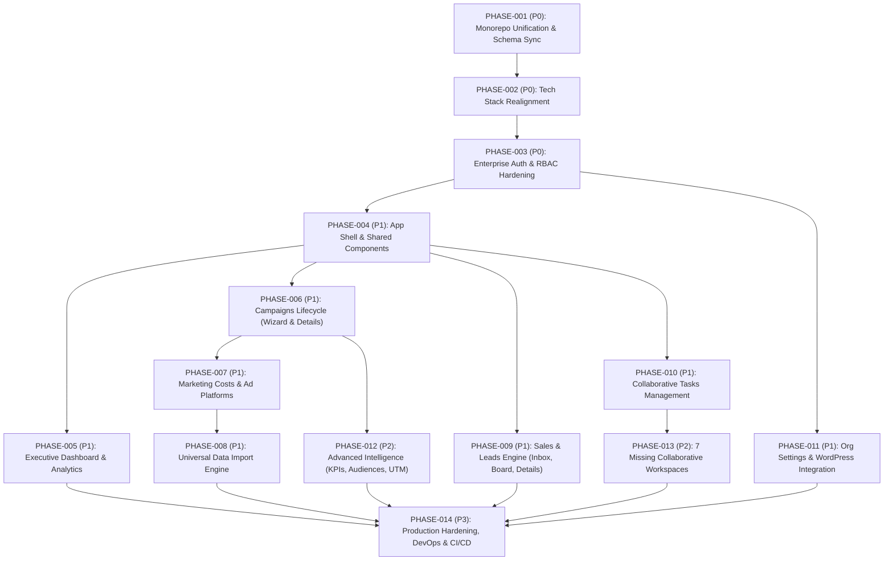

# 10 — MASTER COMPLETION ROADMAP (نقشه راه جامع تکمیل ۱۰۰٪ محصول)
## نقشه راه مهندسی، مبتنی بر وابستگی‌ها و قابل اجرا برای دستیابی به آمادگی کامل پروداکشن

---

## 1. ROADMAP OVERVIEW & DEPENDENCY GRAPH (نمای کلان وابستگی‌ها)

این نقشه راه مهندسی مسیر تبدیل پروژه از وضعیت تفکیک دوشاخه‌ای به یک سامانه یکپارچه، امن و ۱۰۰٪ تکمیل‌شده را مشخص می‌کند:

---

## 2. THE 14 STANDALONE ENGINEERING PHASES (مشخصات ۱۴ فاز اجرایی)

### PHASE-001 (P0) — Monorepo Unification & Relational Schema Synchronization
- **Title**: ادغام مونورپو و همگام‌سازی پایگاه داده با ۴۸ مدل پریزما
- **Objective**: Merge `feature/backend-foundation` into current monorepo, standardize on Prisma ORM 5.22, populate `@gapji/shared` with all contracts.
- **Priority**: `P0` (Critical Blocker) | **Est. Effort**: 3 Days.
- **Related Requirements**: `REQ-336`, `REQ-343`, `REQ-344`.
- **Definition of Done**: `pnpm run build` succeeds simultaneously for `apps/web`, `apps/api`, and `packages/shared`.

### PHASE-002 (P0) — Tech Stack Realignment & Frontend Foundation
- **Title**: نصب و پیکربندی بسته‌های الزامی سند در فرانت‌اند
- **Objective**: Install `@tanstack/react-query`, `@tanstack/react-form`, `zod`, `zustand`, `@dnd-kit/core`, `framer-motion` in `apps/web`.
- **Priority**: `P0` | **Est. Effort**: 4 Days.
- **Related Requirements**: `REQ-341`, `REQ-344`, `REQ-346`, `REQ-347`, `REQ-350`.
- **Definition of Done**: `QueryClientProvider` mounted, base Zustand stores configured, clean compilation.

### PHASE-003 (P0) — Enterprise Authentication, Session Governance & RBAC Hardening
- **Title**: احراز هویت سازمانی، نشست با کوکی HttpOnly و بستن روزنه دسترسی لیدها
- **Objective**: Wire `/login` and `/select-org` to NestJS auth endpoints, implement Next.js `middleware.ts`, resolve ITEM-08 lead leakage in `leads.service.ts`.
- **Priority**: `P0` | **Est. Effort**: 4 Days.
- **Related Requirements**: `REQ-025`, `REQ-030` to `REQ-038`, `REQ-338`.
- **Definition of Done**: 100% PASS on `test-auth-p0-1.mjs` (20/20) and `test-permissions-matrix.mjs` (18/18).

### PHASE-004 (P1) — App Shell, Navigation & Shared Components Hardening
- **Title**: تثبیت پوسته، هدر سراسری، سوییچ سازمان و جدول داده پیشرفته
- **Objective**: Connect dynamic active organization in Header (resolve SCEN-18), connect global search API, integrate TanStack Table in `DataTable`.
- **Priority**: `P1` | **Est. Effort**: 5 Days.
- **Related Requirements**: `REQ-001` to `REQ-029`, `REQ-339`, `REQ-348`.
- **Definition of Done**: Zero failed tests on shell components; dynamic organization switching functional.

### PHASE-005 (P1) — Executive Dashboard & Real-Time Performance Analytics
- **Title**: اتصال کامل داشبورد اجرایی و رسم نمودارهای تحلیلی زنده
- **Objective**: Wire `/performance/dashboard` to `GET /api/dashboard`, render Recharts trends and 5-stage conversion funnel, resolve failures in `verify-dashboard.js`.
- **Priority**: `P1` | **Est. Effort**: 4 Days.
- **Related Requirements**: `REQ-009`, `REQ-010`, `REQ-026`, `REQ-027`, `REQ-057` to `REQ-067`.
- **Definition of Done**: `verify-dashboard.js` passes with 28/28 assertions and `isMockData: false`.

### PHASE-006 (P1) — Campaigns Lifecycle Management (List, Wizard & Details)
- **Title**: مدیریت چرخه کامل کمپین‌ها (لیست، ویزارد ۶ مرحله‌ای و جزئیات ۸ تبی)
- **Objective**: Fix NestJS DTO validation for wizard payload, transactional multi-platform creation, wire all 8 tabs of `/campaigns/:id`.
- **Priority**: `P1` | **Est. Effort**: 6 Days.
- **Related Requirements**: `REQ-068` to `REQ-104`.
- **Definition of Done**: `verify-campaign-creation.js` achieves 22/22 PASS.

### PHASE-007 (P1) — Marketing Costs Management & Ad Platforms Catalog
- **Title**: مدیریت هزینه‌های تبلیغاتی و کاتالوگ پلتفرم‌ها
- **Objective**: Wire `/performance/costs` and `/performance/platforms` to PostgreSQL; enable single fast-entry and batch Excel paste mode.
- **Priority**: `P1` | **Est. Effort**: 4 Days.
- **Related Requirements**: `REQ-105` to `REQ-123`.
- **Definition of Done**: Immediate reflection of cost entries on `Campaign.spend` and dashboard totals.

### PHASE-008 (P1) — Universal Data Import Engine
- **Title**: موتور جامع ایمپورت داده‌ها با صف پردازش پس‌زمینه (BullMQ)
- **Objective**: 4-step wizard for Costs, Leads, SMS, Webinars with column mapping, sample preview, error CSV export, and background processing.
- **Priority**: `P1` | **Est. Effort**: 5 Days.
- **Related Requirements**: `REQ-124` to `REQ-134`.
- **Definition of Done**: Ingestion of 5,000+ row CSVs without frontend freezing or timeouts.

### PHASE-009 (P1) — Omnichannel Sales & Leads Engine
- **Title**: سامانه جامع فروش و لیدها (صندوق، کانبان، خط زمانی، پیامک و وبینار)
- **Objective**: Wire `/leads`, `/leads/board`, `/leads/:id`, `/leads/sms`, `/leads/webinars` with `@dnd-kit` drag-and-drop, deal value modal, and call logs.
- **Priority**: `P1` | **Est. Effort**: 6 Days.
- **Related Requirements**: `REQ-017`, `REQ-018`, `REQ-025`, `REQ-166` to `REQ-222`.
- **Definition of Done**: Passing all lead integration tests with strict tenant/sales agent ownership scoping.

### PHASE-010 (P1) — Collaborative Task Management & Workflow Execution
- **Title**: مدیریت وظایف و تسک‌های تیمی با اتصال به کمپین و لید
- **Objective**: Wire `/work/tasks` with List/Kanban toggle, grouping (Overdue, Today, This Week, Later), quick add, subtasks, and comments.
- **Priority**: `P1` | **Est. Effort**: 4 Days.
- **Related Requirements**: `REQ-028`, `REQ-223` to `REQ-234`.
- **Definition of Done**: 100% pass on task verification suite with database persistence.

### PHASE-011 (P1) — Organization Settings, RBAC Matrix & WordPress Integration
- **Title**: تنظیمات سازمان، ماتریس دسترسی و یکپارچه‌سازی وب‌هوک وردپرس
- **Objective**: Wire `/settings/users`, `/settings/organization`, construct new page `/settings/wordpress` and NestJS webhook receiver for Gravity Forms.
- **Priority**: `P1` | **Est. Effort**: 5 Days.
- **Related Requirements**: `REQ-304` to `REQ-335`.
- **Definition of Done**: Form submission on external WordPress site immediately creates lead in Gapji inbox.

### PHASE-012 (P2) — Advanced Marketing Intelligence (KPIs, Audiences, UTM)
- **Title**: ابزارهای هوشمندی بازاریابی (فرمول‌ساز KPI، مخاطبان و UTM)
- **Objective**: Wire `/performance/audiences`, `/performance/landing` (live UTM builder), and sentence-based alert rules in `/performance/kpis`.
- **Priority**: `P2` | **Est. Effort**: 5 Days.
- **Related Requirements**: `REQ-135` to `REQ-165`.
- **Definition of Done**: Automated evaluation of KPI alert rules triggering system notifications.

### PHASE-013 (P2) — Missing Collaborative & Knowledge Workspaces (7 Modules)
- **Title**: ساخت کامل ۷ صفحه غایب سازمانی در فرانت‌اند و بک‌اند
- **Objective**: Build `/notifications`, `/work/calendar`, `/work/equipment`, `/work/meetings`, `/work/sops`, `/work/learning`, `/work/ideas`, `/work/activity`.
- **Priority**: `P2` | **Est. Effort**: 8 Days.
- **Related Requirements**: `REQ-048` to `REQ-056`, `REQ-235` to `REQ-303`.
- **Definition of Done**: 29 out of 29 pages from the PDF exist, render correctly, and persist to database (100% product coverage).

### PHASE-014 (P3) — Production Hardening, DevOps & CI/CD Pipeline
- **Title**: سخت‌سازی پروداکشن، استقرار کانتینری داکر و پایپ‌لاین CI/CD
- **Objective**: Multi-stage Dockerfiles, Redis, Pino logging, Sentry monitoring, Prometheus metrics, GitHub Actions CI workflow.
- **Priority**: `P3` | **Est. Effort**: 5 Days.
- **Related Requirements**: All non-functional, security, and operational standards.
- **Definition of Done**: Single-command production boot (`docker-compose.prod.yml`) passing automated CI checks.
