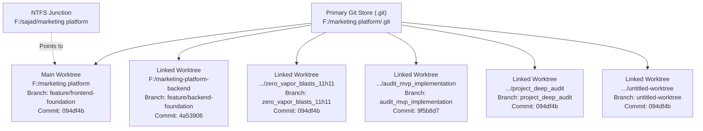
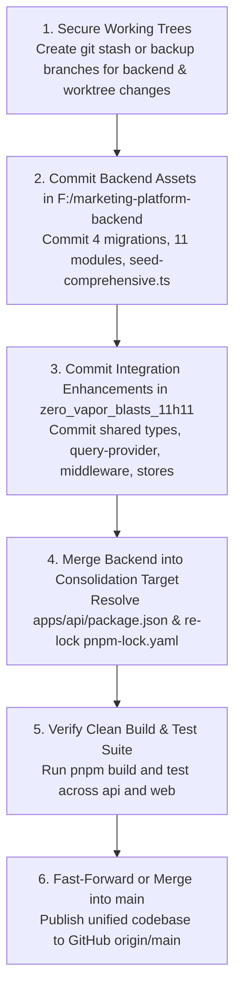

# Master Git Repository Discovery & Remote Audit

**Execution Mode:** STRICT READ-ONLY FORENSIC AUDIT  
**Audit Date:** 2026-11-18  
**Auditor:** Antigravity Pair Programming Agent  
**Repository Identity:** `gapji-digital-marketing-dashboard`  

---

## Executive Summary

A comprehensive, non-destructive, read-only inspection was conducted across all suspected local Git worktrees and remote references on GitHub. 

### Key Findings
1. **Single Git Database (True Root Confirmed):** All inspected directories (`F:\marketing platform`, `F:\marketing-platform-backend`, and the four worktrees under `C:\Users\DRGAPJI\.gemini\antigravity\worktrees\marketing platform\`) belong to the exact same Git repository object store: `F:\marketing platform\.git`.
2. **Directory Junction:** `F:\sajad\marketing platform` is an NTFS junction pointing directly to `F:\marketing platform`.
3. **GitHub Remote Up-To-Date:** The GitHub remote (`origin`) contains three branches: `main`, `feature/backend-foundation`, and `feature/frontend-foundation`. Remote tracking references match the live remote heads commit-for-commit. There are **zero remote-only commits** or unseen GitHub references.
4. **Architectural Split & Divergence:** The codebase was developed in two divergent tracks off initial commit `9f5b8d7`:
   - `feature/frontend-foundation` (`094df4b`) holds the full Next.js App Router UI (`apps/web`), Persian date pickers, Vazirmatn fonts, and feature pages.
   - `feature/backend-foundation` (`4a53906`) holds the NestJS backend foundation (`apps/api`), Prisma schema, migrations, seed, auth, and architecture documents (`docs/`).
   - Neither branch was ever merged into `main`, nor into each other on Git.
5. **High-Risk Uncommitted / Untracked Local Work:** 
   - In `F:\marketing-platform-backend`: 4 new Prisma migrations, 11 new NestJS backend modules (`audiences`, `calendar`, `imports`, `kpis`, `landing`, `organization`, `platforms`, `sms`, `tasks`, `users`, `webinars`), and comprehensive seeds exist solely as uncommitted/untracked files.
   - In worktree `zero_vapor_blasts_11h11`: A consolidation effort was initiated, adding extended domain types to `packages/shared/src/index.ts`, Next.js React Query & Zustand infrastructure, JWT middleware, calendar API integration specs, and header navigation. These modifications are uncommitted and must be protected.

---

## 1. Confirmed Git Repository & Worktree Inventory

### 1.1 Inspected Locations Summary

| Property | Location 1 (`F:\marketing platform`) | Location 2 (`F:\marketing-platform-backend`) | Location 3 (`zero_vapor_blasts_11h11`) |
| :--- | :--- | :--- | :--- |
| **Current Path** | `F:\marketing platform` (also `F:\sajad\marketing platform`) | `F:\marketing-platform-backend` | `C:\Users\DRGAPJI\.gemini\antigravity\worktrees\marketing platform\zero_vapor_blasts_11h11` |
| **Git Top-Level Root** | `F:/marketing platform` | `F:/marketing-platform-backend` | `C:/Users/DRGAPJI/.../zero_vapor_blasts_11h11` |
| **Git Common Directory** | `F:/marketing platform/.git` | `F:/marketing platform/.git` | `F:/marketing platform/.git` |
| **Git Directory (`--git-dir`)**| `F:/marketing platform/.git` | `F:/marketing platform/.git/worktrees/marketing-platform-backend` | `F:/marketing platform/.git/worktrees/zero_vapor_blasts_11h11` |
| **Worktree Classification** | **Primary Repository Root (Main Worktree)** | **Linked Worktree** | **Linked Worktree** |
| **Current Branch** | `feature/frontend-foundation` | `feature/backend-foundation` | `zero_vapor_blasts_11h11` |
| **Current Commit Hash** | `094df4bc3fad3bd1df48e0ba3ce380ed851e1259` | `4a5390658cd5ddfe8c00cb150ca93e56a4c38b4d` | `094df4bc3fad3bd1df48e0ba3ce380ed851e1259` |
| **Upstream Branch** | `origin/feature/frontend-foundation` | `origin/feature/backend-foundation` | *None (local feature branch)* |
| **Commit vs Upstream** | In sync with remote commit | In sync with remote commit | Local only (unpushed) |
| **Working Tree Status** | Dirty (2 modified, 2 untracked dirs, 2 deleted) | Dirty (7 modified, 16 untracked modules/migrations) | Dirty (25 modified, 30 untracked dirs/files) |

### 1.2 Full Git Worktree Relationship Map



---

## 2. GitHub Remote Configuration & Verification

### 2.1 Remote URLs and Reachability
- **Remote Name:** `origin`
- **Fetch URL:** `https://github.com/saleharashh/gapji-digital-marketing-dashboard.git`
- **Push URL:** `https://github.com/saleharashh/gapji-digital-marketing-dashboard.git`
- **Default Branch on GitHub:** `main`
- **Authentication:** Operational via HTTPS. Queries executed without credential prompts or failures. No tokens or secrets are exposed in configuration.

### 2.2 Live Remote References (`git ls-remote`)
Verified via read-only `git ls-remote origin`:

| Reference | Target Commit Hash | Corresponding Local Tracking Ref | Commit Status |
| :--- | :--- | :--- | :--- |
| `refs/heads/main` | `9f5b8d7e5a121c2700a208d901556fcd3eca138e` | `remotes/origin/main` | **100% Identical** |
| `refs/heads/feature/backend-foundation` | `4a5390658cd5ddfe8c00cb150ca93e56a4c38b4d` | `remotes/origin/feature/backend-foundation` | **100% Identical** |
| `refs/heads/feature/frontend-foundation` | `094df4bc3fad3bd1df48e0ba3ce380ed851e1259` | `remotes/origin/feature/frontend-foundation` | **100% Identical** |
| `refs/tags/*` | *None* | *None* | No remote tags exist |

> [!NOTE]
> All commits present on GitHub are already cloned and fully present in the local `.git` object database. No commits exist exclusively on GitHub.

---

## 3. Git Commit History & Branch Divergence

### 3.1 Commit Graph

```
* 094df4b (feature/frontend-foundation, origin/feature/frontend-foundation, zero_vapor_blasts_11h11, project_deep_audit, untitled-worktree) chore: publish complete project to GitHub
* fd780ea feat(frontend): implement marketing platform MVP modules
| * 4a53906 (feature/backend-foundation, origin/feature/backend-foundation) feat(backend): implement marketing platform MVP APIs
|/  
* 9f5b8d7 (main, origin/main, origin/HEAD, audit_mvp_implementation) chore: initial monorepo scaffold
```

### 3.2 Commit Log Details

| Hash | Author | Date | Subject | Scope |
| :--- | :--- | :--- | :--- | :--- |
| `9f5b8d7` | `saleharashh <saleharashh@gmail.com>` | 2026-10-31 08:35:12 +0330 | `chore: initial monorepo scaffold` | Base monorepo: pnpm workspace, NestJS and Next.js stubs, docker-compose |
| `fd780ea` | `saleharashh <saleharashh@gmail.com>` | 2026-11-10 14:03:55 +0330 | `feat(frontend): implement marketing platform MVP modules` | Next.js frontend pages, dashboard, campaigns, leads, forms, components |
| `4a53906` | `saleharashh <saleharashh@gmail.com>` | 2026-11-10 14:04:02 +0330 | `feat(backend): implement marketing platform MVP APIs` | NestJS APIs, Prisma schema, auth module, campaigns, costs, leads, docs |
| `094df4b` | `saleharashh <saleharashh@gmail.com>` | 2026-11-16 12:16:13 +0330 | `chore: publish complete project to GitHub` | Frontend Vazirmatn fonts, UI components, audit reports |

### 3.3 Ahead / Behind Matrix

| Reference | vs `origin/main` | vs `feature/frontend-foundation` | vs `feature/backend-foundation` |
| :--- | :---: | :---: | :---: |
| `main` | 0 / 0 | 0 / 2 | 0 / 1 |
| `feature/frontend-foundation` | **2 ahead / 0 behind** | 0 / 0 | **2 ahead / 1 behind** (DIVERGED) |
| `feature/backend-foundation` | **1 ahead / 0 behind** | **1 ahead / 2 behind** (DIVERGED) | 0 / 0 |
| `zero_vapor_blasts_11h11` | **2 ahead / 0 behind** | 0 / 0 | **2 ahead / 1 behind** (DIVERGED) |
| `audit_mvp_implementation` | 0 / 0 | 0 / 2 | 0 / 1 |

> [!IMPORTANT]
> `feature/frontend-foundation` and `feature/backend-foundation` branched simultaneously from `9f5b8d7` on 2026-11-10 and never integrated. GitHub's `main` branch still sits at the Oct 31 initial scaffold.

---

## 4. Branch Content Comparison

### 4.1 Root Directory Comparison

| File / Folder | `origin/main` (`9f5b8d7`) | `origin/feature/backend-foundation` (`4a53906`) | `origin/feature/frontend-foundation` (`094df4b`) |
| :--- | :---: | :---: | :---: |
| `.env.example` | Yes | Yes (Identical) | Yes (Identical) |
| `.gitignore` | Base | Base | Adds `scratch/` |
| `README.md` | Yes | Yes (Identical) | Yes (Identical) |
| `docker-compose.yml` | Base | Base (Identical) | Base (Identical) |
| `package.json` | Base | Base | Adds audit script / scripts |
| `packages/shared/` | Base | Base (Identical) | Base (Identical) |
| `pnpm-workspace.yaml` | Base | Base (Identical) | Base (Identical) |
| `tsconfig.json` | Base | Base (Identical) | Modifies include/exclude & DOM lib |
| `pnpm-lock.yaml` | Base | Updated for backend deps | Updated for frontend deps |
| `docs/` | **No** | **Yes (15 domain & design specs)** | **No** |
| `audit-reports/` | **No** | **No** | **Yes (HTML & PDF audit reports)** |
| `marketing-platform-phase1-frontend-pages-1.pdf` | **No** | **No** | **Yes** |

### 4.2 Application Implementations (`apps/api` vs `apps/web`)

1. **`apps/api` (Backend):**
   - In `origin/feature/backend-foundation`: Contains full Prisma schema (`1530 lines`), 2 initial migrations (`20261101000000_init`, `20261103000000_drop_campaign_status_trigger`), Prisma seed, database module, auth module (JWT, Argon2, specs), campaigns, costs, dashboard, leads modules with full integration tests.
   - In `origin/feature/frontend-foundation`: Contains only the initial stub `apps/api` from `9f5b8d7` plus minor package.json entries. **No Prisma, no auth, no costs, no leads.**

2. **`apps/web` (Frontend):**
   - In `origin/feature/frontend-foundation`: Contains comprehensive Next.js 14 App Router dashboard:
     - 17 route pages (`campaigns`, `leads`, `sms`, `webinars`, `audiences`, `costs`, `dashboard`, `imports`, `kpis`, `landing`, `platforms`, `organization`, `users`, `tasks`, auth routes).
     - Full component suite: DataTable, PersianDatePicker, KPI cards, FilterBar, Modals, Drawers.
     - Persian typography (Vazirmatn web fonts).
   - In `origin/feature/backend-foundation`: Contains only the skeleton Next.js starter from `9f5b8d7`.

---

## 5. Potential Data Loss & Uncommitted Work Inventory

### 5.1 Local-Only Work (CRITICAL ASSETS)

#### Asset Track A: `F:\marketing-platform-backend` (Uncommitted / Untracked)
The following work exists ONLY in this worktree and is NOT in Git history:
- **4 New Prisma Migrations:**
  - `apps/api/prisma/migrations/20261112090000_add_invitation_tokens_to_memberships/`
  - `apps/api/prisma/migrations/20261112133000_lead_status_config_restrict_delete/`
  - `apps/api/prisma/migrations/20261114143000_add_channel_to_target_audiences/`
  - `apps/api/prisma/migrations/20261118101500_add_assignee_and_equipment_to_calendar_events/`
- **11 Untracked NestJS Modules:**
  - `apps/api/src/modules/audiences/`
  - `apps/api/src/modules/calendar/`
  - `apps/api/src/modules/imports/`
  - `apps/api/src/modules/kpis/`
  - `apps/api/src/modules/landing/`
  - `apps/api/src/modules/organization/`
  - `apps/api/src/modules/platforms/`
  - `apps/api/src/modules/sms/`
  - `apps/api/src/modules/tasks/`
  - `apps/api/src/modules/users/`
  - `apps/api/src/modules/webinars/`
- **Seeds & Utilities:**
  - `apps/api/prisma/seed-comprehensive.ts`
  - `apps/api/prisma/check-counts.ts`
- **Modified Core Backend Files:**
  - `apps/api/prisma/schema.prisma` (updated with relations for calendar, organization tokens, lead status)
  - `apps/api/src/app.module.ts`
  - `apps/api/src/modules/campaigns/campaigns.service.ts`
  - `apps/api/src/modules/dashboard/dashboard.service.ts`
  - `apps/api/src/modules/leads/leads.service.ts` (dynamic status config resolution)
  - `apps/api/src/modules/leads/dto/update-lead-status.dto.ts`
  - `apps/api/src/modules/leads/leads.integration.spec.ts`

#### Asset Track B: `zero_vapor_blasts_11h11` (Uncommitted / Untracked)
The following enhancements exist in this worktree:
- **Enhanced Calendar Integration:**
  - `apps/api/src/modules/calendar/calendar.integration.spec.ts`
  - Compatibility aliases (`relatedEntityType`, `relatedEntityId`) in `calendar.service.ts` and `create-calendar-event.dto.ts`.
- **Shared Package Extensions (`packages/shared/src/index.ts`):**
  - Full domain type definitions (`UserProfile`, `Organization`, `OrganizationMembership`, `Lead`, `Cost`, `Task`).
  - `API_ENDPOINTS` centralized catalog.
- **Frontend State & Integration Architecture (`apps/web`):**
  - `apps/web/src/middleware.ts` (Next.js route protection & auth redirection)
  - `apps/web/src/components/providers/query-provider.tsx` & `apps/web/src/lib/query-client.ts` (@tanstack/react-query)
  - `apps/web/src/stores/auth-store.ts` & `apps/web/src/stores/ui-store.ts` (Zustand)
  - Header organization switcher and user profile logout controls (`header.tsx`)
  - Integration test scripts (`test-calendar-integration-phase2.mjs`)

#### Asset Track C: `F:\marketing platform` (Uncommitted / Untracked)
- Untracked calendar UI: `apps/web/src/app/(app)/work/calendar/`, `apps/web/src/features/calendar/`
- Modified navigation & permissions: `apps/web/src/config/navigation.ts`, `apps/web/src/lib/permissions.ts`
- Local deletion of audit reports: `audit-reports/GAPJI_FULL_PROJECT_AUDIT_B2.5.0.*` (safe in Git commit `094df4b`).

---

## 6. Conflict & Merge Simulation

An in-memory simulation (`git merge-tree`) was executed between `origin/feature/backend-foundation` (`4a53906`) and `origin/feature/frontend-foundation` (`094df4b`):

### 6.1 Clean Merge Components (0 Conflicts)
- `apps/web/**` (merges completely cleanly without any conflict)
- `docs/**` (merges cleanly)
- `apps/api/prisma/**` (merges cleanly)
- `apps/api/src/database/**` (merges cleanly)
- `apps/api/src/modules/auth/**`, `costs/**`, `dashboard/**`, `leads/**` (merges cleanly)
- `.gitignore` (merges cleanly)
- `tsconfig.json` (merges cleanly)

### 6.2 Conflict Points
- **`apps/api/package.json`:** Backend added `@prisma/client`, `argon2`, `@nestjs/mapped-types`, `joi`; frontend retained legacy TypeORM / pg references from scaffolding. Resolution: Accept backend dependencies.
- **`pnpm-lock.yaml`:** Disparate package resolution trees. Resolution: Re-generate cleanly via `pnpm install` after manifest reconciliation.

---

## 7. Recommended Consolidation Strategy (After Audit Approval)



---

## 8. Verified Facts vs Assumptions

### Verified Facts
1. There is only one Git object store located at `F:\marketing platform\.git`.
2. `F:\sajad\marketing platform` is an NTFS junction to `F:\marketing platform`.
3. `origin` points to `https://github.com/saleharashh/gapji-digital-marketing-dashboard.git`.
4. Remote `origin/main` has only the initial commit `9f5b8d7`.
5. Frontend was pushed to `origin/feature/frontend-foundation` (`094df4b`).
6. Backend was pushed to `origin/feature/backend-foundation` (`4a53906`).
7. There are zero remote tags and zero remote-only commits.
8. The two feature branches share base `9f5b8d7` and have diverged.
9. All 11 new backend modules and 4 migrations exist only as untracked files on local disk.

### Assumptions (None relied upon)
- No assumptions were made regarding authoritative branch status or code completeness; all findings are backed by Git object tree comparisons and cryptographic SHA hashes.
