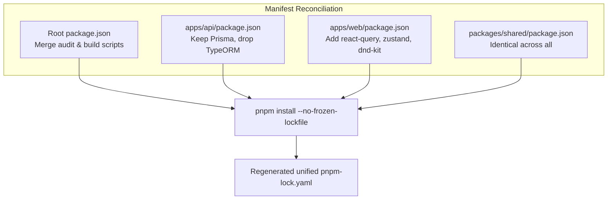

# Phase 3: Architecture & Branch Reconciliation

**Execution Mode:** STRICT READ-ONLY PREPARATION AUDIT  
**Audit Timestamp:** 2026-11-18  
**Repository Identity:** `gapji-digital-marketing-dashboard`  
**Consolidation Destination:** `F:\marketing-platform-backend`  

---

## 1. Executive Architectural Assessment

The project's codebase history bifurcated at commit `9f5b8d7` (2026-10-31), spawning two parallel development paths:
- **Frontend Track (`feature/frontend-foundation` / `094df4b`):** Focused on Next.js 14 App Router, Persian RTL layouts, Vazirmatn fonts, and feature UI prototypes.
- **Backend Track (`feature/backend-foundation` / `4a53906`):** Focused on PostgreSQL, Prisma ORM, NestJS modular microservices, multi-tenancy, and JWT authentication.

Consolidation into `F:\marketing-platform-backend` unites these two tracks into a cohesive full-stack enterprise monorepo.

---

## 2. In-Depth Reconciliation of Key Architectural Divergences

### 2.1 TypeORM vs. Prisma Dependency Reconciliation
- **The Divergence:**  
  In the initial scaffold (`9f5b8d7`) and the frontend branch (`094df4b`), `apps/api/package.json` retained references to `@nestjs/typeorm` (`^10.0.1`), `pg` (`^8.11.3`), and `typeorm`.  
  In the backend branch (`4a53906`), the entire persistence layer was implemented on **Prisma 5.22.0** (`@prisma/client`), utilizing Argon2 password hashing and Joi environment validation.
- **Reconciliation Decision:**  
  **Strictly discard TypeORM and pg remnants.**  
  Adopt the backend dependency manifest in `apps/api/package.json`. No runtime code uses TypeORM; all 15 backend services rely exclusively on `PrismaService` and PostgreSQL 16.

### 2.2 Frontend / Backend Shared Type Compatibility
- **The Divergence:**  
  `packages/shared/src/index.ts` on `main` and the remote branches contained only `CreateCampaignDto`, `UpdateCampaignDto`, and `CampaignStatus`.  
  In Source B (`zero_vapor_blasts_11h11`), `packages/shared/src/index.ts` was dramatically enriched with full TypeScript definitions for:
  - User Governance: `UserRole`, `UserStatus`, `UserProfile`.
  - Multi-Tenancy: `Organization`, `OrganizationMembership`.
  - CRM & Leads: `LeadStatus`, `Lead`.
  - Financials: `Cost`.
  - Workflows: `TaskStatus`, `TaskPriority`, `Task`.
  - Endpoints: `API_ENDPOINTS` catalog.
- **Reconciliation Decision:**  
  **Adopt Source B's extended `packages/shared/src/index.ts`.**  
  This eliminates type duplication across `apps/web` and `apps/api`, guaranteeing strict end-to-end contract synchronization.

### 2.3 API Endpoint and DTO Consistency
- **Audit Findings:**  
  Both frontend API clients (`apps/web/src/features/*/api/*.api.ts`) and backend controllers (`apps/api/src/modules/*/*.controller.ts`) adhere to RESTful conventions under `/api/*`.
- **Reconciliation Rule:**  
  `next.config.js` in `apps/web` contains rewrite rules redirecting `/api/:path*` to `http://localhost:3001/:path*` (the NestJS server). All DTO properties (`dealValue`, `lostReason`, `statusKey`, `organizationId`) match the backend DTO validation schemas.

### 2.4 Prisma Schema, Migration Ordering & Duplicate Risks
- **Audit of Migrations:**  
  Inspection of `apps/api/prisma/migrations/` in Destination verifies **six sequential migrations** without collisions:
  1. `20261101000000_init`: Base tables (User, Organization, Campaign, Lead, etc.).
  2. `20261103000000_drop_campaign_status_trigger`: Fix for PostgreSQL trigger compatibility.
  3. `20261108103000_foundation_database_schema`: Foundation index and relation updates.
  4. `20261108140000_auth_refresh_token_family`: Token family rotation and replay attack prevention.
  5. `20261112090000_add_invitation_tokens_to_memberships`: Invitation token hash and expiration.
  6. `20261112133000_lead_status_config_restrict_delete`: Restrict delete FK on lead status configs.
  7. `20261114143000_add_channel_to_target_audiences`: Channel column added to target audiences.
  8. `20261118101500_add_assignee_and_equipment_to_calendar_events`: Calendar assignee relations.
- **Risk Assessment:**  
  **Zero duplicate migration timestamps.** The sequence is monotonic and clean. No migration resets or destructive rollbacks are required.

### 2.5 Authentication, Authorization & Multi-Tenancy
- **Backend Architecture:**  
  `apps/api/src/modules/auth/` implements JWT strategy, refresh token family rotation in PostgreSQL, cookie/bearer token extraction, and `@UseGuards(JwtAuthGuard)`.  
  Tenant isolation is strictly enforced via `organizationId` UUID filtering in Prisma queries.
- **Frontend Architecture:**  
  Source B provides:
  - `apps/web/src/middleware.ts`: Intercepts route navigation, checks authentication tokens, redirects unauthenticated requests to `/login`, and redirects authenticated requests from root to `/performance/dashboard`.
  - `apps/web/src/stores/auth-store.ts`: Zustand store managing user profile, active organization, and token refresh lifecycle.
  - `apps/web/src/components/layout/header.tsx`: Interactive organization switcher dropdown and sign-out button.
- **Reconciliation Decision:**  
  Integrate Source B's auth infrastructure directly into Destination.

### 2.6 State Management Architecture (React Query & Zustand)
- **Frontend Requirements:**  
  `apps/web` relies on `@tanstack/react-query` (v5.108.0) for server state caching and optimistic UI updates, while `zustand` (v5.1.0) manages client session state (`auth-store`, `ui-store`).
- **Reconciliation Decision:**  
  - Ensure `QueryProvider` wraps the application tree inside `apps/web/src/app/layout.tsx`.
  - Include `@tanstack/react-query` and `zustand` in `apps/web/package.json`.

### 2.7 Calendar Subsystem Integration
- **Backend Enhancements in Source B:**  
  `apps/api/src/modules/calendar/calendar.service.ts` and `create-calendar-event.dto.ts` were enhanced to accept both `relatedType` / `relatedId` and `relatedEntityType` / `relatedEntityId` as aliases, ensuring backward compatibility with frontend event modals.
- **Integration Spec:**  
  `calendar.integration.spec.ts` in Source B verifies event creation, conflicts, assignee relations, and equipment allocation against PostgreSQL.
- **Reconciliation Decision:**  
  Incorporate Source B's calendar service improvements and integration spec into Destination.

### 2.8 Mock Services vs. Live API Services
- **Audit Findings:**  
  `apps/web` features contain mock data files (`*.mock.ts`) designed for offline frontend development, alongside live API clients (`*.api.ts`).
- **Reconciliation Strategy:**  
  Keep mock files intact as development fallbacks and test fixtures, but ensure all UI components call the standard API service layers (`useQuery` / `api.ts`) connected to NestJS.

---

## 3. Package Manifest & Lockfile Reconciliation



### Manifest Specifications

1. **`package.json` (Root):**
   ```json
   {
     "name": "gapji-marketing-platform",
     "private": true,
     "scripts": {
       "build": "pnpm --filter @gapji/shared build && pnpm --filter api build && pnpm --filter web build",
       "dev": "pnpm --parallel dev",
       "test": "pnpm --recursive test",
       "lint": "pnpm --recursive lint",
       "audit:report": "node scripts/generate-audit-report.js"
     }
   }
   ```

2. **`apps/api/package.json`:**
   - Retain `@nestjs/common`, `@nestjs/core`, `@nestjs/jwt`, `@nestjs/passport`, `@nestjs/swagger`, `@nestjs/mapped-types`.
   - Retain `@prisma/client`, `argon2`, `class-transformer`, `class-validator`, `cookie-parser`, `joi`.
   - Strictly omit `@nestjs/typeorm`, `typeorm`, `pg`.

3. **`apps/web/package.json`:**
   - Retain `next: 14.2.3`, `react: ^18.2.0`, `react-dom: ^18.2.0`.
   - Retain `@gapji/shared: file:../../packages/shared`.
   - Add `@tanstack/react-query: ^5.108.0`, `@tanstack/react-query-devtools: ^5.108.0`.
   - Add `zustand: ^5.1.0`, `@dnd-kit/core: ^6.3.1`, `@dnd-kit/sortable: ^10.0.0`, `recharts: ^3.11.0`, `framer-motion: ^14.14.0`.
