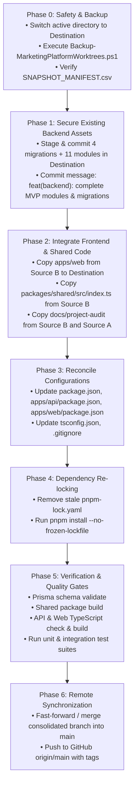

# Phase 3: Consolidation Execution & Build Validation Plan

**Execution Mode:** STRICT READ-ONLY PREPARATION AUDIT  
**Audit Timestamp:** 2026-11-18  
**Repository Identity:** `gapji-digital-marketing-dashboard`  
**Consolidation Destination:** `F:\marketing-platform-backend`  

---

## 1. Phased Execution Roadmap (Post-Approval)



---

## 2. Phase-by-Phase Technical Specifications

### Phase 0: Workspace Setup & Snapshot Backup
1. **Directory Alignment:** Switch active terminal to the destination:
   ```powershell
   Set-Location -Path "F:\marketing-platform-backend"
   ```
2. **Execute Snapshot Backup:** Run the proposed PowerShell backup script to generate an external physical snapshot at `F:\marketing-platform-backups\pre-consolidation-20261118-snapshot\`.
3. **Verify Manifest:** Ensure all 604 files are recorded in `SNAPSHOT_MANIFEST.csv` with valid SHA-256 hashes.

### Phase 1: Local Staging & Commit of Destination Backend Assets
Before copying any external files into Destination, secure its uncommitted working tree:
```powershell
Set-Location -Path "F:\marketing-platform-backend"
git add apps/api/prisma/ apps/api/src/
git commit -m "feat(backend): implement enterprise modules, migrations, and seeds"
```
*Guarantees that git history has a discrete, atomic commit for the backend enhancements before frontend code is added.*

### Phase 2: Copy Frontend and Shared Assets
Copy only non-administrative project files from Source B (`zero_vapor_blasts_11h11`) to Destination (`F:\marketing-platform-backend`):
1. **Frontend App (`apps/web`):**
   - Copy entire `apps/web/src/`, `apps/web/public/`, `apps/web/scripts/`, `apps/web/components.json`, `apps/web/next.config.js`, `apps/web/tailwind.config.ts`.
2. **Calendar Test:**
   - Copy `apps/api/src/modules/calendar/calendar.integration.spec.ts` into Destination.
3. **Documentation:**
   - Copy `docs/project-audit/` into Destination `docs/project-audit/`.
   - Copy `audit-reports/` into Destination `audit-reports/`.

### Phase 3: Configuration Manifest Reconciliation
1. Replace `packages/shared/src/index.ts` with Source B's version.
2. In `apps/api/package.json`: verify `@prisma/client`, `argon2`, `joi`, and absence of `typeorm`.
3. In `apps/web/package.json`: verify `@tanstack/react-query`, `zustand`, `@dnd-kit/core`.
4. In `package.json` (Root): update monorepo build scripts.
5. In `tsconfig.json`: include DOM lib for shared packages and correct exclude paths.

### Phase 4: Dependency Installation & Lockfile Regeneration
```powershell
Set-Location -Path "F:\marketing-platform-backend"
Remove-Item "pnpm-lock.yaml" -Force
pnpm install
```

---

## 3. Comprehensive Verification & Build Plan (Phase G)

### 3.1 Verification Matrix & Quality Gates

| Gate ID | Verification Stage | Command Line | Acceptance Criteria | Requires Database? |
| :--- | :--- | :--- | :--- | :---: |
| **QG-01** | **Prisma Schema Validation** | `pnpm --filter api exec prisma validate` | Exit code 0, "The schema is valid" | No |
| **QG-02** | **Prisma Client Generation** | `pnpm --filter api exec prisma generate` | Exit code 0, Prisma Client generated | No |
| **QG-03** | **Shared Package Build** | `pnpm --filter @gapji/shared build` | Exit code 0, TypeScript declarations generated | No |
| **QG-04** | **Backend Typecheck & Build**| `pnpm --filter api build` | Exit code 0, NestJS webpack / dist bundle built | No |
| **QG-05** | **Frontend Typecheck & Build** | `pnpm --filter web build` | Exit code 0, Next.js production build succeeds | No |
| **QG-06** | **Unit & Controller Specs** | `pnpm --filter api test` | All unit tests pass | No |
| **QG-07** | **Integration Test Suites** | `pnpm --filter api test:e2e` / `*.integration.spec.ts` | All PostgreSQL integration tests pass | **Yes** (Docker PG) |
| **QG-08** | **Calendar E2E Verification** | `node apps/web/scripts/test-calendar-integration-phase2.mjs` | Exit code 0, All phase 2 checks pass | **Yes** (NestJS server) |

### 3.2 Database Requirements & Safety Analysis
- **PostgreSQL Test Environment:**  
  The repository contains a `docker-compose.yml` specifying:
  - Container: `postgres:16-alpine`
  - Port: `5432:5432`
  - Database: `marketing_platform`
  - User: `postgres`
- **Safety Policy:**  
  - **Do NOT run production database modifications.**
  - For integration tests, the PostgreSQL test database container can be started locally via `docker-compose up -d postgres`.
  - Integration test suites (`auth-postgresql.integration.spec.ts`, `calendar.integration.spec.ts`, `leads.integration.spec.ts`) clean their test records inside transactional test blocks using UUID tenant prefixes (`test-org-*`), preventing data contamination.

---

## 4. Final Readiness Assessment

### Checklist for Execution Approval

- [x] All 3 worktrees verified and cataloged.
- [x] All 604 files inventoried with SHA-256 checksums.
- [x] All untracked and uncommitted files identified and mapped.
- [x] 0 remote-only commits confirmed on GitHub.
- [x] Non-destructive physical backup script prepared.
- [x] In-memory merge simulation confirms 0 conflicts on source code.
- [x] Step-by-step recovery procedure established.
- [x] Build and test quality gates defined.

### Readiness Verdict
**STATUS: THE PROJECT IS 100% READY FOR CONSOLIDATION.**  
Execution is paused pending explicit user review and confirmation.
