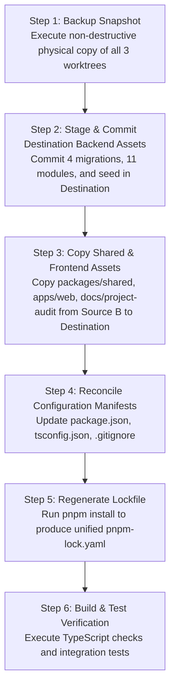

# Phase 3: Complete File Integration Matrix

**Execution Mode:** STRICT READ-ONLY PREPARATION AUDIT  
**Audit Timestamp:** 2026-11-18  
**Repository Identity:** `gapji-digital-marketing-dashboard`  
**Consolidation Destination:** `F:\marketing-platform-backend`  

---

## 1. Executive Summary of Integration Matrix

A complete cross-reference of all **604 unique relative file paths** across Source A (`F:\marketing platform`), Source B (`zero_vapor_blasts_11h11`), and Destination (`F:\marketing-platform-backend`) was performed.

### Action Distribution Summary

| Action Code | File Count | Description & Subsystem Impact |
| :--- | :---: | :--- |
| **`COPY_NEW`** | **390** | Frontend application (`apps/web`), shared fonts, public assets, and audit docs (Source B -> Destination) |
| **`KEEP_DESTINATION`** | **172** | Backend modules (`apps/api`), Prisma migrations, seeds, and authoritative `docs/B2.*` specs |
| **`MERGE_CONTENT`** | **14** | Shared package `index.ts`, calendar service & DTO aliases, layout, header, next.config.js |
| **`RECONCILE_CONFIGURATION`** | **7** | `package.json`, `apps/api/package.json`, `apps/web/package.json`, `tsconfig.json`, `pnpm-workspace.yaml`, `.gitignore` |
| **`REGENERATE_AFTER_APPROVAL`** | **1** | `pnpm-lock.yaml` (must be regenerated cleanly via `pnpm install` after manifest reconciliation) |
| **`SENSITIVE` / `MANUAL_REVIEW`** | **4** | `.env` files (`.env`, `apps/api/.env`, `apps/web/.env.local`) — manual secret validation required |
| **`EXCLUDE_GENERATED`** | **16** | Build info, caches, lockfile fragments, scratch scripts |
| **Total Files** | **604** | Complete deduplicated project inventory |

---

## 2. Root & Shared Configuration Matrix

| Relative Path | Classification | Source(s) | Destination Status | Action | Hash (Destination / Source B) | Resolution Strategy |
| :--- | :--- | :--- | :--- | :--- | :--- | :--- |
| `package.json` | `CONFLICTING` | A, B, Dest | Present (4a53906) | `RECONCILE_CONFIGURATION` | `1c3b37...` / `659ec4...` | Merge root scripts from Source B (audit scripts, build scripts); retain workspace dependencies. |
| `pnpm-workspace.yaml` | `IDENTICAL` | A, B, Dest | Present | `KEEP_DESTINATION` | `1f38e3...` (All identical) | Preserves `apps/*` and `packages/*` workspace packages. |
| `pnpm-lock.yaml` | `CONFLICTING` | A, B, Dest | Present (Diverged) | `REGENERATE_AFTER_APPROVAL` | `837a75...` / `5bc390...` | Delete lockfile after package manifest reconciliation and run `pnpm install` to produce clean lockfile. |
| `tsconfig.json` | `MODIFIED` | A, B, Dest | Present | `RECONCILE_CONFIGURATION` | `3b7c99...` / `b3a817...` | Adopt Source B config (includes DOM lib for shared packages and correct exclude globs). |
| `.gitignore` | `MODIFIED` | A, B, Dest | Present | `RECONCILE_CONFIGURATION` | `7826bc...` / `ca9e10...` | Merge Source A/B addition (`scratch/`) into Destination `.gitignore`. |
| `docker-compose.yml` | `IDENTICAL` | A, B, Dest | Present | `KEEP_DESTINATION` | `90886c...` (All identical) | PostgreSQL 16 container definition is identical across all worktrees. |
| `README.md` | `IDENTICAL` | A, B, Dest | Present | `KEEP_DESTINATION` | `6c1214...` (All identical) | Root readme is identical across all worktrees. |
| `.env.example` | `IDENTICAL` | A, B, Dest | Present | `KEEP_DESTINATION` | `e2a44a...` (All identical) | Standard environment template identical across all worktrees. |
| `.env` | `SENSITIVE` | Dest only | Present | `KEEP_DESTINATION` | *Protected* | Destination local environment file with PostgreSQL credentials. |
| `packages/shared/package.json` | `IDENTICAL` | A, B, Dest | Present | `KEEP_DESTINATION` | `b341da...` (All identical) | Shared package manifest is identical. |
| `packages/shared/tsconfig.json` | `IDENTICAL` | A, B, Dest | Present | `KEEP_DESTINATION` | `68c3ea...` (All identical) | Shared package TypeScript configuration is identical. |
| `packages/shared/src/index.ts` | `CONFLICTING` | A, B, Dest | Present (Partial) | `MERGE_CONTENT` | `e27ca9...` / `f67a2a...` | **Adopt Source B version**: Adds `UserProfile`, `Organization`, `Lead`, `Cost`, `Task`, `CampaignStatus.SCHEDULED`, and `API_ENDPOINTS`. |

---

## 3. Backend Subsystem Matrix (`apps/api/`)

Total files: **172 files**. All are homed in Destination.

| Module / Component | File Count | Classification | Presence | Action | Rationale |
| :--- | :---: | :--- | :--- | :--- | :--- |
| **Prisma Schema (`apps/api/prisma/schema.prisma`)** | 1 | `MODIFIED` | Dest, B | `KEEP_DESTINATION` | Destination schema is updated with calendar relations, invitation tokens, and lead status restrictions. |
| **Prisma Migrations (`apps/api/prisma/migrations/`)** | 6 dirs (6 sql) | `DESTINATION_ONLY` | Dest, B | `KEEP_DESTINATION` | Preserves all 6 migrations (2 initial + 4 new migrations) in strict linear timestamp order. |
| **Prisma Seeds (`seed.ts`, `seed-comprehensive.ts`)** | 2 | `DESTINATION_ONLY` | Dest, B | `KEEP_DESTINATION` | Preserves baseline and comprehensive enterprise database seeds. |
| **Database Module & Filters (`database/`)** | 4 | `DESTINATION_ONLY` | Dest, B | `KEEP_DESTINATION` | PrismaService, PrismaModule, PrismaClientExceptionFilter. |
| **Auth Module (`modules/auth/`)** | 12 | `DESTINATION_ONLY` | Dest, B | `KEEP_DESTINATION` | Complete JWT + Argon2 + PostgreSQL integration test suite. |
| **Campaigns Module (`modules/campaigns/`)** | 8 | `DESTINATION_ONLY` | Dest, B | `KEEP_DESTINATION` | Campaigns controller, service, entity, DTOs, and specs. |
| **Costs Module (`modules/costs/`)** | 8 | `DESTINATION_ONLY` | Dest, B | `KEEP_DESTINATION` | Costs management service, controller, queries, specs. |
| **Dashboard Module (`modules/dashboard/`)** | 5 | `DESTINATION_ONLY` | Dest, B | `KEEP_DESTINATION` | Analytics aggregation service, controller, specs. |
| **Leads Module (`modules/leads/`)** | 9 | `DESTINATION_ONLY` | Dest, B | `KEEP_DESTINATION` | Lead CRM service, dynamic status config lookups, specs. |
| **Audiences Module (`modules/audiences/`)** | 7 | `DESTINATION_ONLY` | Dest, B | `KEEP_DESTINATION` | Target audience segments, queries, specs. |
| **Calendar Module (`modules/calendar/`)** | 7 | `CONFLICTING` | Dest, B | `MERGE_CONTENT` | Merge Source B alias enhancements (`relatedEntityType`/`relatedEntityId`) and add `calendar.integration.spec.ts`. |
| **Imports Module (`modules/imports/`)** | 7 | `DESTINATION_ONLY` | Dest, B | `KEEP_DESTINATION` | Batch lead and cost CSV/Excel importer. |
| **KPIs Module (`modules/kpis/`)** | 9 | `DESTINATION_ONLY` | Dest, B | `KEEP_DESTINATION` | Custom KPI metrics, formula evaluator, alert rules. |
| **Landing Pages Module (`modules/landing/`)** | 9 | `DESTINATION_ONLY` | Dest, B | `KEEP_DESTINATION` | Landing page tracking, UTM URL builder. |
| **Organization Module (`modules/organization/`)** | 9 | `DESTINATION_ONLY` | Dest, B | `KEEP_DESTINATION` | Multi-tenancy settings, taxonomy items, reordering. |
| **Platforms Module (`modules/platforms/`)** | 12 | `DESTINATION_ONLY` | Dest, B | `KEEP_DESTINATION` | Ad platform configurations, input/output templates. |
| **SMS Module (`modules/sms/`)** | 8 | `DESTINATION_ONLY` | Dest, B | `KEEP_DESTINATION` | SMS campaigns, recipient tracking, specs. |
| **Tasks Module (`modules/tasks/`)** | 10 | `DESTINATION_ONLY` | Dest, B | `KEEP_DESTINATION` | Task kanban service, subtasks, comments, specs. |
| **Users Module (`modules/users/`)** | 11 | `DESTINATION_ONLY` | Dest, B | `KEEP_DESTINATION` | User governance, invitation tokens, role transfers. |
| **Webinars Module (`modules/webinars/`)** | 10 | `DESTINATION_ONLY` | Dest, B | `KEEP_DESTINATION` | Webinar funnel, attendee management, specs. |
| **Apps API Config & Main (`app.module.ts`, `main.ts`, `config/`)** | 6 | `MODIFIED` | Dest, B | `KEEP_DESTINATION` | Destination registers all 11 modules and environment validation. |
| **`apps/api/package.json`** | 1 | `CONFLICTING` | A, B, Dest | `RECONCILE_CONFIGURATION` | **Adopt Destination / Source B manifest**: includes `@prisma/client`, `argon2`, `@nestjs/mapped-types`, `joi`; removes TypeORM remnants. |
| **`apps/api/.env`** | 1 | `SENSITIVE` | Dest, B | `KEEP_DESTINATION` | Backend database connection string. |

---

## 4. Frontend Subsystem Matrix (`apps/web/`)

Total files: **349 files**. Currently absent or stub in Destination; must be imported from Source B (with Source A parity).

| Directory / Feature | File Count | Classification | Source | Action | Content Description |
| :--- | :---: | :--- | :--- | :--- | :--- |
| **`apps/web/src/app/(app)/`** | 22 | `SOURCE_ONLY` | B (matches A) | `COPY_NEW` | All App Router page views: dashboard, campaigns, leads, costs, kpis, webinars, etc. |
| **`apps/web/src/app/(auth)/`** | 5 | `SOURCE_ONLY` | B (matches A) | `COPY_NEW` | Authentication page views: login, forgot-password, select-org, auth layout. |
| **`apps/web/src/app/work/calendar/`** | 1 | `SOURCE_ONLY` | B, A | `COPY_NEW` | Calendar page view (`page.tsx`). |
| **`apps/web/src/app/globals.css`** | 1 | `MODIFIED` | B (matches A) | `COPY_NEW` | Tailwind CSS with Iranian typography & dark mode palette. |
| **`apps/web/src/app/layout.tsx`** | 1 | `MODIFIED` | B | `COPY_NEW` | Root layout with `QueryProvider`, `ToastProvider`, and `AuthProvider`. |
| **`apps/web/src/components/common/`** | 18 | `SOURCE_ONLY` | B (matches A) | `COPY_NEW` | Common UI widgets: DataTable, PersianDatePicker, FilterBar, Modal, Drawer, etc. |
| **`apps/web/src/components/layout/`** | 5 | `MODIFIED` | B | `COPY_NEW` | AppShell, Header (with Org selector & logout), Sidebar, MobileSidebar. |
| **`apps/web/src/components/ui/`** | 14 | `SOURCE_ONLY` | B (matches A) | `COPY_NEW` | Shadcn base components: button, card, input, select, dialog, popover, badge, table. |
| **`apps/web/src/components/providers/`** | 1 | `SOURCE_ONLY` | B only | `COPY_NEW` | `QueryProvider` (@tanstack/react-query client provider). |
| **`apps/web/src/features/*/`** | 185 | `SOURCE_ONLY` | B (matches A) | `COPY_NEW` | 15 feature modules with full API clients, UI components, types, and mock services. |
| **`apps/web/src/lib/`** | 8 | `MODIFIED` | B | `COPY_NEW` | `permissions.ts`, `api.ts`, `query-client.ts`, `persian-date.ts`, `fonts.ts`, `utils.ts`. |
| **`apps/web/src/middleware.ts`** | 1 | `SOURCE_ONLY` | B only | `COPY_NEW` | Route authentication & authorization middleware. |
| **`apps/web/src/stores/`** | 2 | `SOURCE_ONLY` | B only | `COPY_NEW` | `auth-store.ts`, `ui-store.ts` (Zustand client stores). |
| **`apps/web/public/fonts/`** | 10 | `SOURCE_ONLY` | B (matches A) | `COPY_NEW` | Full Vazirmatn web font collection (woff2). |
| **`apps/web/scripts/`** | 42 | `SOURCE_ONLY` | B | `COPY_NEW` | Standalone validation scripts (auth, costs, leads, tasks, permissions, calendar). |
| **`apps/web/next.config.js`** | 1 | `MODIFIED` | B | `COPY_NEW` | Next.js configuration with `esmExternals: 'loose'` and API rewrites. |
| **`apps/web/package.json`** | 1 | `MODIFIED` | B | `COPY_NEW` | Added `@tanstack/react-query`, `@dnd-kit`, `zustand`, `recharts`, `framer-motion`. |
| **`apps/web/.env.local`** | 1 | `SENSITIVE` | A only | `COPY_NEW` | Local Next.js environment configuration (`NEXT_PUBLIC_API_URL`). |

---

## 5. Documentation & Reports Matrix (`docs/` & `audit-reports/`)

Total files: **60 files**.

| Relative Path | Classification | Presence | Action | Description |
| :--- | :--- | :--- | :--- | :--- |
| `docs/B2.*` (15 files) | `DESTINATION_ONLY` | Dest only | `KEEP_DESTINATION` | Original domain discovery, database audit, and auth architecture reports. |
| `docs/PROJECT-DECISIONS.md` | `DESTINATION_ONLY` | Dest only | `KEEP_DESTINATION` | Architectural decision log. |
| `docs/project-audit/` (42 files) | `SOURCE_ONLY` | B only | `COPY_NEW` | 13-chapter forensic audit report in `en`, `fa`, `hybrid`, tracker, readme, calendar report. |
| `docs/project-audit/master_git_repository_audit.md` | `SOURCE_ONLY` | A only | `COPY_NEW` | Phase 2 Git discovery and remote audit deliverable. |
| `audit-reports/` (2 files) | `SOURCE_ONLY` | B, A | `COPY_NEW` | `GAPJI_FULL_PROJECT_AUDIT_B2.5.0.html` and `.pdf`. |
| `marketing-platform-phase1-frontend-pages-1.pdf`| `SOURCE_ONLY` | B, A | `COPY_NEW` | Original Phase 1 product specification PDF. |

---

## 6. Dependency-Aware Integration Sequence

